# wc3-mcp server specification

Version 1, draft for review. Written before the code it describes.

Describes wc3ctl 0.4.13 and wc3-mcp 0.5.16, with the surface measured on 8 November 2026.

Owner, the wc3ctl maintainer. Reviewers, the wc3-mcp maintainer and a client author integrating the server.

This document specifies the MCP server that ships as `wc3-mcp` and as `wc3ctl mcp serve`, the set of tools it offers an AI client, the safety rules every tool follows, the way a result comes back, the way it is registered with a client, and the way it is built, tested and released. It states the server as it stands today, measured, and the requirements the next version has to meet. Section 10 lists every place the build differs from those requirements, and that list is the work queue.

Nothing in this document is a plan with dates. A requirement is met when its acceptance check passes, and the order the work happens in follows the dependencies between requirements, not a calendar.

## 1. Definitions

This section defines the words this document uses and what each means here. A requirement ID in brackets names the requirement that uses the term.

### Protocol

| Term | What it means here |
|---|---|
| MCP | Model Context Protocol, the JSON-RPC protocol an AI client uses to discover and call tools on a server. This document follows the revision dated 2024-11-05, the one the bundled SDK negotiates today |
| Client | The AI application that starts the server, lists its tools and calls them, such as Claude Desktop, Claude Code, Cursor, VS Code, Codex, Windsurf, Gemini CLI, Cline, LM Studio or Zed |
| Server | The process this document specifies, `wc3-mcp.exe` or `wc3ctl.exe mcp serve`, speaking MCP over stdio |
| Tool | One named operation the server exposes, with a description, an input schema, four annotation hints and a JSON result (SUR-01) |
| Resource | A named document the client can read by URI, separate from a tool call. This server serves its reference documents and its tool catalog this way (RSC-01) |
| Prompt | A named instruction template the client can pull from the server, returning text rather than performing work (PRM-01) |
| Annotation hint | One of the four booleans a tool declares, `readOnlyHint`, `destructiveHint`, `idempotentHint` and `openWorldHint`. A client uses them to decide whether to ask the user before a call (SAF-01) |
| Input schema | The JSON Schema a tool publishes for its arguments, generated from the method signature and its `[Description]` attributes |
| Output schema | The JSON Schema a tool publishes for its result. No tool publishes one today, and RES-02 requires it |
| Structured content | The machine-readable half of a tool result, as distinct from the text content block. RES-02 requires both |
| Tool error | A failed call returned as a protocol-level error result with `isError`, not a crashed process and not a stack trace (ERR-01) |
| Protocol version | The MCP revision string exchanged during initialize. The server accepts what the client offers and answers with the revision it implements |
| Capability | A feature the server declares during initialize, such as tools, resources and prompts, and whether each can change at run time (TRN-05) |
| Resource template | A resource URI with a variable part, so a client can read one section of a document rather than the whole file (RSC-02) |
| Content block | One item in a tool result, either text, an image, or a resource link. Binary payloads above the inline limit travel as a path or a link, not as base64 (RES-05) |

### Products and source

| Term | What it means here |
|---|---|
| wc3ctl | The toolkit repository this server is written in. It holds the command line tool, the Avalonia desktop editor and the MCP server, all over one shared command layer |
| wc3-mcp | The public product repository, a filtered mirror of the server and the libraries it needs, published to npm, the MCP Registry and GitHub Releases. Its source is generated from wc3ctl and is never edited there (PKG-07) |
| Front end | A program that presents the shared command layer, either the CLI, the Studio or this MCP server. A front end renders and never parses (SUR-01) |
| Wc3.Commands | The shared command layer. Every tool that acts on a map or a game file is a thin wrapper over one handler here, and no map parsing lives in `Wc3.Mcp` (SUR-01) |
| Export | The copy of `src/` and the mirrored tests from a named wc3ctl commit into the wc3-mcp checkout, performed by `scripts/export-wc3-mcp.py` (PKG-07) |
| Surface | The whole set of tools, resources and prompts one server build offers. It is computed by reflection, so the catalog, the audit, the docs and a real client all read the same list (DSC-04) |
| Family | The group of tools that share a name prefix, such as `object_`, `terrain_` or `trigger_`, and the unit of the inventory in section 6.5 (SUR-06) |
| Profile | A named subset of the surface a caller can select at start, so a small client can carry a smaller tool list. The full surface is the default (SUR-07) |
| Catalog | The machine-readable list of every tool with its description and hints, served as `wc3://tools` and printed by `wc3ctl mcp tools` |

### Maps and files

| Term | What it means here |
|---|---|
| Map | A Warcraft III `.w3x` or `.w3m` file, or an unpacked map folder holding the same internal files (PAR-01) |
| Internal file | One file inside the map archive, named by its archive path, such as `war3map.j` or `war3mapImported\dummy.mdx` |
| Imported asset | An internal file that the map carries rather than the base game, listed in `war3map.imp` |
| Read | A tool that changes no byte anywhere. It may write a cache entry the server owns, but never a map, an asset or a client config (SAF-02) |
| Write | A tool that produces a new file. Every write tool names its output and never edits its input (SAF-08) |
| Destructive | A write that can discard map content, such as removing a placement, an object, a region or a parent category. A write that only adds or rebuilds is not destructive (SAF-03) |
| Idempotent | A tool whose second call with the same inputs and the same starting map produces the same result. A tool that allocates a new rawcode or creation number is not idempotent |
| Open world | A tool that can reach the network. Exactly one tool declares it today, `rag_install` (SEC-02) |
| Target build | The Warcraft III build a map is checked against, named by a schema folder or a build name. Resolution order is the tool argument, then `WC3_TARGET_BUILD`, then the saved setting, then the default (PAR-03) |
| Schemas directory | The folder holding one subfolder per game build, each with the object, trigger, script and enum sections the compatibility tools read |
| Game directory | The Warcraft III install used for base game data, resolved from the tool argument, then `WC3_GAME_DIR`, then auto-detection. An unset placeholder such as `${user_config.game_dir}` counts as unset (PAR-02) |
| out_path | The output file a write tool produces. It defaults to a sibling `.edited` copy for a map edit, and it is required where the output is a different artifact, such as a PNG, a CSV or a model |
| Edited copy | The default output of a map edit, named `<map>.edited.<ext>` beside the input, so a caller that omits `out_path` still cannot overwrite its input |
| Ported copy | The default output of a port, named `<target>.ported.<ext>` beside the target map |
| Write gate | The one code path every write passes through, which resolves the output path, refuses an output equal to the input, refuses an output inside a folder map, creates the parent directory and returns the digests (SAF-04) |
| Input digest | The SHA-256 of the input map bytes as they were read. A write reports it, and a caller can pass it back as `expect_input_sha256` so a file that changed after it was read is refused. It verifies the input revision and does not by itself choose the next file in a sequence (SAF-07) |
| Fidelity | The rule that an untouched internal file keeps its original bytes, and only the files an edit changed are re-serialized |

### Retrieval and measurement

| Term | What it means here |
|---|---|
| RAG index | The optional local vector index over the Warcraft III corpus, installed by `rag_install` or `wc3ctl rag install`, used by `docs_search` for semantic matches (RSC-06) |
| Lexical search | Matching query words on word boundaries and ranking passages by the terms they carry and by the section heading. It works with no download |
| Semantic search | Ranking passages by embedding similarity when the index and the model are installed |
| Corpus | The fixed dataset the RAG index is built from, never a folder named by the caller (SEC-03) |
| Measured | A number or behaviour this document states from an artifact read in this repository on the date given, such as a source file, the live protocol surface or a test run |
| Inferred | A statement that follows from the code but was not exercised in a run. It is labelled where it is used |
| Assumed | A statement taken on trust without an artifact. Section 8 holds the ones this specification depends on |

### Abbreviations

| Abbreviation | Expansion |
|---|---|
| CLI | Command line interface |
| GUI | Graphical user interface |
| JSON | JavaScript Object Notation |
| JSON-RPC | JSON Remote Procedure Call, the message format MCP uses |
| MDX | Warcraft III's binary model format, with MDL as its text twin |
| BLP | Warcraft III's texture format |
| MPQ | The archive format a map file is built on |
| SDK | Software development kit, here the official C# MCP SDK |
| SHA-256 | Secure Hash Algorithm, 256 bit, used for file and download identity |
| SSIM | Structural similarity, used by `model_compare` to score two renders |
| UTF-8 | Unicode Transformation Format, 8 bit, the encoding the text tools assume |
| WC3 | Warcraft III |
| CI | Continuous integration |

## 2. Purpose and scope

This document specifies the MCP server that exposes the wc3ctl map toolkit to an AI client. It is written for the maintainer who will change the server, for the reviewer who will judge the change, and for the client author who needs to know what the server promises. Every requirement has an ID, and section 7 gives the check that proves it.

The server is a thin front end over `Wc3.Commands`, the same layer the CLI and the Studio call. A client asks a question about a map, a model, an asset, a script or a replay, and the server loads the file, calls the shared handler and returns the handler's result object as JSON. A client that asks for a change gets a new file written beside the input, never the input rewritten. That one rule is what makes the server safe to hand to an agent that has never seen the map.

The server also carries reference knowledge. It serves two Warcraft III reference documents as resources, a lexical search over the same text, an optional semantic index, and five prompt templates for the common jobs. Those are part of the same contract because a client that can read the UI-Frame tutorial whole, or search the Ability Insight reference for one field, does not have to guess from memory.

### The model in one picture

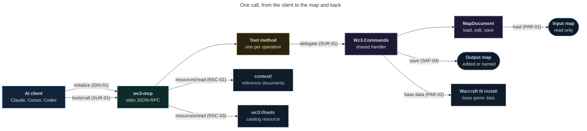

*Each arrow names the requirement behind it, here and in every diagram after it.*

### Who this is for

- The maintainer, who needs one place that says what every tool must do and what a change may not break.
- The reviewer, who needs a requirement to point at when a tool, a schema or a result is wrong.
- The client author, who needs to know which parameters are safe to send, what a write returns, and how to chain two edits without losing the first.
- The user, who needs to know what the server will and will not touch on their disk.

### Reading paths

Different readers need different sections. This table is the shortest route for each.

| Reader | Start with | Then |
|---|---|---|
| A client author | 1 and 2 | 5, 6, 7 |
| A maintainer | 3 | 4, 9 to 13, 16 |
| A reviewer | 3 | 4, 7, 10, 12 |
| A release manager | 15 | 17, Appendix A |
| A new contributor | 2 | 3, 11, 16 |

### What the server is not

It is not a map editor with its own state. Every call loads the file fresh, applies one change and saves one output. It is not a server with a database, a session, a user account or a background job. It is not a remote service. It is one local process per client, started on stdio, ending when the client closes the stream.

### In scope

- The tool surface, its names, parameters, descriptions and annotation hints.
- The result contract, including JSON shape, size limits and error codes.
- The resources, the prompts and the catalog.
- The setup commands that register the server with a client, and the client matrix.
- The environment variables, the target build and the game directory resolution.
- The packaging, the version identity and the release chain into npm, the MCP Registry and the `.mcpb` bundle.
- The test strategy and the CI guards that keep the surface honest.
- The known gaps between the build and this specification, in section 10.

### Out of scope

| Item | Why it is out |
|---|---|
| An HTTP, SSE or WebSocket transport | The server reads and writes the user's local files with the user's own permissions. A network transport would need authentication, authorization, tenancy and a hosting story that none of that has, and every current client can start a local process (TRN-06) |
| Authentication and user accounts | There is no remote boundary to authenticate across. The operating system account is the authorization boundary, and the threat model in SEC-05 states it |
| Editing a map in place | Every write produces a new file. This is the safety rule the whole surface is built on, not a limitation to be lifted (SAF-08) |
| Long-running sessions, jobs or queues | A call returns what it produced. A caller that needs a large batch calls the folder tools or the CLI |
| A second map engine | All parsing belongs to `Wc3.Commands` and the libraries under it. The server may not learn the map format (SUR-01) |
| The Studio's screens, the CLI's rendering and the npm launcher's internals | They are separate surfaces with their own documents. This one covers the protocol server and the packaging that carries it |
| Tool behaviour rules that belong to the shared layer | Fidelity, model parsing, script analysis and object merging are specified where they live. This document specifies how the server presents them |

### Relationship to wc3ctl and the public repository

The same source builds both products. In wc3ctl the exe reports the name `wc3ctl`, registers as `wc3ctl`, and is reached as `wc3ctl mcp serve`. In the public repository the same source builds `wc3-mcp.exe`, reports the name `wc3-mcp`, registers as `wc3`, and is reached by running the exe with no arguments. The identity comes from assembly metadata written by each repository's `Directory.Build.props`, never from a branch in the code (IDN-01).

The public repository owns its README, installer, workflows, bundle manifest, registry entry and licences. The source under `src/` and the mirrored tests are exported from a named wc3ctl commit and are never edited there (PKG-07). That is why a fix lands in wc3ctl first, and why the export is a separate, checked step.

### How to read a requirement

An ID is the group and a number, so `SAF-04` is the fourth requirement in the safety group. `SHALL` marks a requirement and `SHALL NOT` a prohibition. The Basis column names the evidence, the decision or the failure that the requirement rests on. Where a requirement is new in this revision, the basis says design decision and gives the reason.

This version holds 174 requirements in 20 groups, and 39 acceptance checks that cover them. A requirement that no check covers is a sentence, not a requirement, and the traceability check in Appendix B lists the pairing.

Numbers in this document are labelled. A number stated as measured came from a command or a file in this repository on 8 November 2026. A number stated as inferred came from reading the code and was not produced by a run. Nothing here is stated from memory.

The Basis column also separates three kinds of authority. A requirement whose basis names the protocol or a client behaviour cites the page in Appendix D. A requirement whose basis names a measurement can be re-run from the method in Appendix E. Everything else is a design decision, and this document says so rather than borrowing the grammar of a standard. The verification log in Appendix E records what happened when the measured claims were re-derived from the published exe, including the two counts that moved and the one claim that looked wrong until its definition was stated.

## 3. The build as it stands

This section is the measured state of the server on 8 November 2026. Nothing in it is a requirement. Section 4 states what the server must be, and section 10 lists where this state falls short.

### 3.1 The surface in numbers

The surface was captured by starting the Release build of `Wc3.Mcp` and sending `initialize`, `tools/list`, `resources/list` and `prompts/list` over stdio, then reading the reply. The counts are from that capture, not from the generated reference.

| Measure | Value |
|---|---|
| Tools | 271 |
| Read-only tools | 157 |
| Writing tools | 114 |
| Writing tools that declare `destructiveHint` true | 9 |
| Writing tools that leave `destructiveHint` unset | 6 |
| Tools that declare `openWorldHint` true | 1, which is `rag_install` |
| Tools that declare no annotations at all | 0 |
| Tools with no parameters | 5, which are `mcp_audit_annotations`, `leak_benchmark`, `rag_status`, `script_conversion_notes` and `version_info` |
| Resources | 3, which are `wc3://context/ui-frames`, `wc3://context/abilities` and `wc3://tools` |
| Prompts | 5 |
| Protocol revision answered | 2024-11-05 |
| SDK package | `ModelContextProtocol` 1.4.1 |
| Server name and version in initialize | `wc3ctl` 0.4.13 |
| Initialize instructions | `target  Beta-ROC-v1.00  (settings), game install 3.0.1.24371` |
| Capabilities declared | logging, prompts with `listChanged`, resources with `listChanged`, tools with `listChanged` |
| Tools publishing an output schema | 0 |
| Tools using progress notifications or a cancellation token | 0 |

The surface is computed by reflection over the `[McpServerTool]` methods on `Wc3Tools` and `Wc3Context`, so the client, the catalog resource, the annotation audit and the generated reference all read one list. That is the strongest structural property the build has today and SUR-01 keeps it.

### 3.2 How the 271 tools divide

The groups below are the ones the inventory in section 6.5 uses. They follow the name prefix, which is how a client finds a family.

| Group | Tools |
|---|---|
| Map and archive inspection | 22 |
| Objects and game data | 30 |
| Placed instances, regions, players | 37 |
| Terrain, pathing and time of day | 20 |
| Scripts | 32 |
| Triggers and hero wiring | 35 |
| Assets, models and textures | 33 |
| Porting and bundles | 7 |
| Repair, doctor and compatibility | 15 |
| Leaks and benchmarks | 27 |
| Product, catalog and context | 13 |
| Total | 271 |

Thirty-three of the 55 families carry fewer than five tools each, and several carry exactly one. The largest are `trigger` at 25, `script` at 25, `object` at 18 and `terrain` at 16.

### 3.3 What a client is told

Every tool carries a description and an input schema. The generated `docs/mcp-reference.md` reproduces the description and the four hints, and it is guarded against staleness by CI.

| Measure | Value |
|---|---|
| Total description text across the surface | 82,487 characters, about 20,000 tokens |
| Median description | 260 characters |
| Longest description | 1,126 characters, on `model_import` |
| Shortest description | 94 characters, on `camera_remove` |
| Descriptions under 150 characters | 33 |
| Descriptions from 150 to 299 characters | 136 |
| Descriptions from 300 to 599 characters | 84 |
| Descriptions from 600 to 999 characters | 16 |
| Descriptions of 1,000 characters or more | 2 |
| Tools with a `title` annotation | 0 |

The description text is the part every client loads before it knows what the user wants, so it is the context cost of the surface. At about 20,000 tokens it is a real cost for a small model and a real reason to describe a tool in one sentence and keep the long rationale in the reference document (SUR-05, SUR-07). These values were re-measured after the first slice and moved by exactly the amount one description edit explains. Section 3.13 records the delta and the arithmetic.

### 3.4 Common parameters

The surface repeats a small set of parameter names across most tools. That repetition is the interface, so it is worth stating once.

| Parameter | Tools that take it | Meaning |
|---|---|---|
| `map` | 200 | A map file, or for a few tools a folder. This ambiguity is a defect that PAR-01 removes |
| `out_path` | 108 | The output file. Required where the output is a different artifact, optional with a `.edited` default for a map edit |
| `game_dir` | 36 | The Warcraft III install, overriding `WC3_GAME_DIR` and auto-detection |
| `schemas_dir` | 26 | The schema dataset folder, overriding the saved setting |
| `kind` | 20 | An Object Editor kind, one of unit, item, ability, destructable, doodad, buff or upgrade |
| `target` | 14 | A target build name or schema path |
| `rawcode` | 12 | A four-character object code |
| `folder` | 8 | A folder of maps, used by the library, asset and batch tools |
| `out_dir` | 4 | An output directory rather than a single output file |

The parameter types are 625 strings of which 140 are optional, 96 integers of which 8 are optional, 38 numbers, 41 booleans of which 1 is optional, and 13 arrays of which 4 are optional. The largest tool has eight required parameters, `force_set_flags`. Eighteen tools require none at all, which is the five with no parameters plus thirteen whose every parameter has a default.

Three tools accept a map but do not require it, `asset_list`, `leak_ab` and `replay_summary`, each for a stated reason. No tool requires more than eight parameters, which matters because a large required set is where an agent starts guessing.

### 3.5 Resources and prompts

The two reference documents are served whole, one resource each, read from `context/<id>/<id>.md` beside the exe. The third resource is the catalog, serialized from the same reflection the tools use.

| Resource | Contents | Size at build |
|---|---|---|
| `wc3://context/ui-frames` | The Big UI-Frame Tutorial by Tasyen, in full | 331,895 bytes |
| `wc3://context/abilities` | The Warcraft III Editor Ability Insight reference, in full | 336,818 bytes |
| `wc3://tools` | Every tool with its description and four hints, as JSON | 116,570 bytes |

The five prompts are `inspect_map`, `port_hero`, `repair_reforged_map`, `optimize_map_size` and `audit_hero_spells`. Each returns guidance text and a numbered list of tools to call. None performs a call itself, so serving a prompt has no side effect (PRM-01).

### 3.6 Setup and registration

One setup code path serves both products. It knows ten clients, writes JSON for eight of them, TOML for Codex and shells out to the `claude` command for Claude Code. It backs up every file it edits to `NAME.<product>.bak`, which is `NAME.wc3ctl.bak` from the CLI and `NAME.wc3-mcp.bak` from the standalone server, refuses to rewrite a file that carries comments, and prints the snippet to paste instead. The write is already atomic, a temporary file in the same folder followed by a move, so a crash cannot leave a half-written config. On Windows it also adds the exe folder to the user PATH once, preserving every other entry exactly as written, including `%VARIABLES%` and the registry value kind.

| Client id | How its config is written | Where |
|---|---|---|
| `claude-code` | `claude mcp add --scope user` | The client's own command |
| `claude-desktop` | JSON under `mcpServers` | `%APPDATA%\Claude\claude_desktop_config.json`, plus the Store package folder when present |
| `cursor` | JSON under `mcpServers`, with `"type": "stdio"` | `%USERPROFILE%\.cursor\mcp.json` |
| `vscode` | JSON under `servers`, with `"type": "stdio"` | `%APPDATA%\Code\User\mcp.json` |
| `windsurf` | JSON under `mcpServers` | `%USERPROFILE%\.codeium\windsurf\mcp_config.json`, or `%APPDATA%\devin\mcp_config.json` |
| `gemini` | JSON under `mcpServers` | `%USERPROFILE%\.gemini\settings.json` |
| `codex` | TOML under `[mcp_servers.NAME]` | `%CODEX_HOME%\config.toml`, defaulting to `%USERPROFILE%\.codex` |
| `cline` | JSON under `mcpServers` | The Cline extension's `cline_mcp_settings.json` under VS Code global storage |
| `lmstudio` | JSON under `mcpServers` | `%USERPROFILE%\.lmstudio\mcp.json` |
| `zed` | JSON under `context_servers` | `%APPDATA%\Zed\settings.json` |

`WC3_MCP_NPX=1`, or the `--npx` option, makes the setup register `npx -y wc3-mcp@latest` instead of a fixed exe, so the client updates on each launch. The npm launcher sets that variable, which is how a one-line `npx` install becomes self-updating. The Studio's Connect AI Apps dialog calls the same `SetupCli.Run` with an entry override, so a client added from the Studio is registered exactly as one added from the command line, and the setup matrix has three callers over one implementation.

### 3.7 Six live artifacts carrying five values, and a stale copy

The version is not in one place today. Each value below was read from its file on 8 November 2026, and the last was read from the npm registry.

| Artifact | Version |
|---|---|
| wc3ctl `Directory.Build.props`, and the version the server reports in initialize | 0.4.13 |
| wc3-mcp `Directory.Build.props` | 0.5.16 |
| wc3-mcp `npm/package.json` | 0.5.8 |
| wc3-mcp `mcpb/manifest.json` | 0.3.0 |
| wc3-mcp `server.json` | 0.3.0 |
| The published `wc3-mcp` package on npm, `latest` | 0.5.19 |
| The stale `npm/wc3-mcp/package.json` inside this repository | 0.5.9, never published |

The registry value matters most. The mirror repository's tags stop at `v0.5.9`, its tree says 0.5.16 and 0.5.8, and the package a user installs today is 0.5.19. So the published artifact is newer than every tag and every committed file, and nothing in either repository explains where its version came from (IDN-02). The release workflow rewrites the npm version, the bundle manifest version and `server.json` from the tag and smoke-tests that the published exe prints the tag, so a release made by that path is consistent. The tree between releases is not, and a reader who compares two files cannot tell which value is authoritative.

### 3.8 What is verified today

The MCP and setup tests were run in Release on 8 November 2026. The command was `dotnet test tests/Wc3.Tests -c Release` with a filter over `McpServerTests`, `McpAnnotationAuditTests`, `CliMcpParityTests`, `SetupTests` and `McpToolSmokeTests`. The result was 50 passed, 0 failed, 0 skipped, in 3 seconds.

The tests cover the initialize handshake and identity, `tools/list` exposing every tool, the instructions line, one real `list_files` call through the protocol, the catalog resource, a missing map surfacing as a clean tool error, the prompts, the context resources and their search, the annotation audit over the real surface, the CLI to MCP parity map, and the setup writers over a temporary home directory.

Two further suites exist. `McpToolSweepTests` calls read-only tools against a real map and was not in that run, because it is gated on the corpus. The `McpToolSmokeTests` partials call tools against a synthetic map, and they ran inside the filter.

| Suite | What it proves | Gate |
|---|---|---|
| `McpServerTests` | Protocol wiring, identity, catalog resource, prompts, resources, clean error | Hermetic |
| `McpAnnotationAuditTests` | The audit rules, and that the live surface passes them | Hermetic |
| `CliMcpParityTests` | Every tool has a named CLI counterpart, and every CLI verb has a conscious decision | Hermetic |
| `SetupTests` | Every client writer, backup, comment refusal, PATH handling and idempotence | Hermetic, temp profile |
| `McpToolSmokeTests` | Named tools return the expected shape on synthetic maps | Hermetic |
| `McpToolSweepTests` | Every read-only tool returns something sensible on a real map | Corpus |

### 3.9 What a caller sees at startup

The initialize reply is the whole first impression. It is reproduced here as the protocol returned it, with the tool and resource collections omitted.

```json
{
  "protocolVersion": "2024-11-05",
  "capabilities": {
    "logging": {},
    "prompts": { "listChanged": true },
    "resources": { "listChanged": true },
    "tools": { "listChanged": true }
  },
  "serverInfo": { "name": "wc3ctl", "version": "0.4.13" },
  "instructions": "target  Beta-ROC-v1.00  (settings), game install 3.0.1.24371"
}
```

The instructions name the target build and the installed game build. They do not name the product, the rule that a write never overwrites its input, or the tool a caller should start with. On a surface of 270 tools that is the largest single usability gap the build has (DSC-01).

### 3.10 What a write returns

A write returns a JSON object, not prose. The shape varies by family, but every one names the file it wrote. Two examples, taken from the schemas the tools publish.

```json
{ "savedTo": "C:\\maps\\MyMap.edited.w3x", "message": "set Name = ..." }
```

```json
{ "savedTo": "C:\\maps\\MyMap.ported.w3x", "report": { "remaps": [], "objects": 12 } }
```

There is no digest, no count of files rewritten and no output schema. A caller cannot tell from the result whether the output is really the file it intended, nor whether the edit touched one internal file or forty (SAF-06, RES-02).

### 3.11 What is not there

The following are absent, and each becomes a requirement in section 4.

- No output schema on any tool.
- No progress notification and no cancellation on any tool, on a surface that includes map optimisation, folder audits and model import.
- No response size limit, apart from `brief` on `list_files` and a 1,600 character cut in `docs_search`.
- No write gate that every write passes through, and no digest on a write result.
- No input revision guard, so two edits from one base lose the first, which the parameter text itself warns about.
- No section level resources, so reading one heading of the UI-Frame tutorial means reading the whole document.
- No tool that extracts raw bytes, which matters because `file_get_text` decodes as UTF-8 and cannot round-trip a non-ASCII script.
- No behavioural test that calls every writing tool, and a sweep that selects read-only tools by name prefix.
- No profile or grouping, so a small client cannot carry a smaller surface.
- No watch loop and no single release-readiness command, and the changelog ignores requirement IDs.

### 3.12 Known limits

These are the limits a caller should know before it starts, each with where the evidence lives.

| Limit | What it means for a caller | Evidence |
|---|---|---|
| Windows x64 only | The server does not run on macOS, Linux or ARM, because `CascLib.dll` is a Windows x64 native library | 2, PKG-09 |
| Base game data needs an install | Tools that merge base data need `game_dir` or `WC3_GAME_DIR`, and without it they return less, not an error | PAR-02, PAR-04 |
| A non-ASCII script is not safe as text | `war3map.j` must be extracted as bytes and transformed as bytes. Reading it as UTF-8 and writing it back corrupts it | RES-04, 13 |
| A Wurst script is refused by `script_to_lua` | Its package runtime does not survive the conversion. `allow_wurst` overrides the refusal, and the documentation says not to | 12, 13 |
| The `war3map.wct` decoder is lossy | A custom-text body is written through a byte-level splice, never through the decoded model | 13 |
| A protected map may have no names | An unnamed archive entry has no path to report, and `list_files` can recover some names from the map's own data | 3.9, `harvest` |
| A player's colour is not a `w3i` field | `player_set_color` rewrites the script call that sets it | `player_set_color` |
| A replay does not carry team or race | `replay_players` omits both rather than guessing | 12 |
| The doctor is a separate binary | `doctor_*` needs the pinned third-party doctor and costs about five seconds a spawn, cached for the process | 0.4.7 |
| Semantic search needs a download | `docs_search` is lexical until `rag_install` fetches about 190 MB and builds the index | RSC-06 |
| No result size cap today | A large object dump or script function list is returned whole, so a caller must ask for less | RES-03, G-03 |
| A running exe is locked on Windows | An update renames the locked file to `.old`, and the npm cache keeps one folder per version | PKG-10, PKG-12 |
| Bookkeeping entries are excluded from a round trip | `(listfile)` and `(attributes)` are regenerated or dropped, and a fidelity comparison ignores them | `roundtrip` |
| A map must fit in memory | The loader holds the archive and its parsed sections, and a folder tool processes one map at a time | PRF-05 |

## 3.13 Re-measured after the first slice

The capture above was taken on 8 November 2026. One edit has landed since, the `object_set` description gained two parameters and a paragraph, and the same capture was run again to see whether the document tracks the change.

| Measure | Section 3 value | Re-measured | Delta | Cause |
|---|---|---|---|---|
| Tools | 269 | 269 | 0 | None |
| Total description characters | 81,615 | 81,772 | +157 | The `object_set` description grew from 293 to 450 characters, exactly 157 |
| Descriptions 150 to 299 characters | 137 | 136 | -1 | `object_set` crossed 300 |
| Descriptions 300 to 599 characters | 81 | 82 | +1 | The same move |
| Nullable string parameters | 136 | 137 | +1 | `expect_input_sha256` |
| Boolean parameters, nullable counted as boolean | 38 | 39 | +1 | `overwrite` |

Every other count held exactly, including the 55 families, the 33 families under five tools, the 5 tools with no parameters, the 18 tools that require none, the 9 destructive tools, the 6 with the hint unset, the 3 resources, the 5 prompts and the five committed version values.

Two later slices added `object_batch_set` and `audit_ability_orders`, so the current capture in section 3.1 is 271 tools and 82,487 description characters. This table stays as the record of the first slice, and the deltas below are what one description edit did.

The arithmetic is consistent with a capture, and it is not proof of one. What makes it a capture is that every number can be produced again from the exe, and Appendix E states the method so a reader can repeat it. Agreement between two documents is evidence that they match each other, not that they match the build.

## 4. Requirements

This section states what the server SHALL do. Each group is a subject, each ID is one testable statement, and the Basis column names the measured fact, the decision or the failure that put it there. An ID that a section 10 gap names is work that is not done yet.

| Prefix | Subject | The question it answers |
|---|---|---|
| IDN | Identity and version | Is this build the build I think it is? |
| TRN | Transport and lifecycle | How does the process start, speak and stop? |
| SUR | Tool surface and naming | What tools exist and what are they called? |
| SAF | Safety and annotations | What can a call write or destroy? |
| PAR | Parameters and environment | What does each argument mean? |
| RES | Results and the context budget | What comes back, and how big is it? |
| ERR | Errors | What does a failure look like? |
| RSC | Resources | What documents can be read? |
| PRM | Prompts | What ready-made plans can be pulled? |
| DSC | Discovery and guidance | How does a caller find the right tool? |
| ENV | Environment and configuration | What configuration exists? |
| SET | Setup and registration | How is the server registered with a client? |
| PKG | Packaging and release | How is it built and shipped? |
| DOC | Documentation | What documentation is generated? |
| SEC | Security and privacy | What is the trust boundary? |
| PRF | Performance and resources | How fast is it, and how much memory does it hold? |
| OBS | Observability | What is logged, and where? |
| CMP | Compatibility and deprecation | What can change, and how is it announced? |
| TST | Testing and CI | What proves it works? |
| AUT | Automation | What runs without a person? |

### Identity and version

| ID | Requirement | Basis | Status |
|---|---|---|---|
| IDN-01 | The server SHALL take its product id, its registered server name and its version from assembly metadata written at build time, and SHALL NOT hardcode them in source or branch on a repository name | Measured. The identity today comes from `McpProductId` and `McpServerName` in `Wc3.Mcp.csproj`, overridden by each repository's `Directory.Build.props`, so one source builds `wc3ctl` and `wc3-mcp` | unassessed |
| IDN-02 | One product version SHALL be the source of every version a caller can read, which is the exe, `version_info`, the npm package, the `.mcpb` manifest, `server.json` and the release tag. The release SHALL refuse a tag that differs from the exe. A committed check SHALL report every place the values disagree, even between releases | Measured. Five live artifacts carry values that disagree today, 0.4.13, 0.5.16, 0.5.8 and 0.3.0 in two files. The release aligns them, the tree does not | gap |
| IDN-03 | `version_info` SHALL return the product id, the server name, the version, the git short hash, the UTC build time, the MCP protocol revision and the SDK version | Design decision. A caller diagnosing a client problem needs the whole build identity in one call, not four | unassessed |
| IDN-04 | The registered server name SHALL be stable for a product, `wc3ctl` for the CLI and `wc3` for the public server, and SHALL be the name used to remove or reinstall it | Measured. Setup writes the name, then removes by the same name. A name that moved would leave a stale entry behind | unassessed |
| IDN-05 | A build without git SHALL report `nogit` and an unknown time rather than a git error message, and the fallback SHALL be tested | Measured. The build target validates the hash shape for exactly this reason | unassessed |
| IDN-06 | The protocol revision and SDK version SHALL be visible without reading the project file, through `version_info` and the diagnostics tool | Design decision. A client bug is often a protocol mismatch, and the build is the only place it can be seen | unassessed |

### Transport and lifecycle

| ID | Requirement | Basis | Status |
|---|---|---|---|
| TRN-01 | The server SHALL speak MCP over stdio as newline-delimited JSON-RPC on stdin and stdout, one process per client, started by the client | Measured. This is the only transport today and every supported client can start a process | unassessed |
| TRN-02 | stdout SHALL carry protocol messages only. Every log line, banner and warning SHALL go to stderr | Measured. `Program.cs` sends console logging to stderr. A stray stdout write corrupts the stream and the client cannot report why | unassessed |
| TRN-03 | The server SHALL exit 0 when stdin closes, and SHALL finish the in-flight call before exiting where the client allows it | Design decision. A client closes the pipe on shutdown, and a half-written output map is worse than a slow exit | unassessed |
| TRN-04 | Every call SHALL load its inputs, do its work and return, with no session state carried between calls other than caches documented in OBS and PRF | Design decision. A stateless call is what lets two clients share the server and what makes a retry safe | unassessed |
| TRN-05 | The server SHALL declare only the capabilities it has, and SHALL NOT advertise `listChanged` for a collection that cannot change during a session | Measured. All three collections advertise `listChanged` true while the surface is fixed at start | gap |
| TRN-06 | The server SHALL NOT add a network transport in version 1. If one is added later it SHALL require authentication, an explicit workspace root and a separate specification | Design decision. A local process uses the user's own file permissions. A socket needs a tenancy and authorization model that does not exist | unassessed |
| TRN-07 | A second server instance SHALL be safe. Two clients may start the server at once, and neither may hold a lock that blocks the other, except a short lock on the RAG index build | Design decision. A user may run Claude and Cursor together | unassessed |

### Tool surface and naming

| ID | Requirement | Basis | Status |
|---|---|---|---|
| SUR-01 | Every tool that acts on a map, a model, an asset, a script or a replay SHALL be a thin wrapper over one `Wc3.Commands` handler. The introspection tools and the reference search MAY live in the MCP layer, and no tool in that layer SHALL parse a map format, a model, a script or an archive, or reimplement logic the shared layer owns | Measured. This is the architecture today and the reason the CLI, the Studio and MCP cannot drift in behaviour. Two tools are introspection (`mcp_audit_annotations`, `version_info`) and one is the lexical reference search (`docs_search`), which lives in `Wc3Context` over the shared heading rule | unassessed |
| SUR-02 | A tool name SHALL follow `<domain>_<verb>[_<noun>]`, lower case, one canonical name per operation, and the verb SHALL be the operation rather than a synonym. `map_info` and `map_info_get` SHALL NOT both exist. `list_files` and `file_list` SHALL NOT both exist | Measured. Both pairs exist today, plus `triggers_read` beside 25 `trigger_*` tools, `placed_units_list` beside `placed_unit_*`, and `search` beside `docs_search` | gap |
| SUR-03 | A renamed tool SHALL keep an alias for at least one minor release, the alias SHALL say it is deprecated and name the replacement, and `wc3://tools` SHALL list the replacement. The alias may be removed in the first major release after the rename, never in a minor release | Design decision. An agent may have a cached prompt that names the old tool, and a hard removal turns that into a failed task | gap |
| SUR-04 | One operation SHALL have one tool. A tool that only reformats another tool's result SHALL be a parameter of that tool, unless it answers a different question | Measured. `leak_list` is a presentation over `script_leaks`, and `map_overview` is a composition of three reads. The second is justified, the first is a candidate to merge | unassessed |
| SUR-05 | Every description SHALL state what the tool does, whether it writes, what it refuses and the one trap a caller would otherwise hit, in at most 600 characters. The longer rationale SHALL live in the generated reference and in `tool_help` | Measured. Two descriptions exceed 1,000 characters and the surface totals about 20,000 tokens before the user asks anything | gap |
| SUR-06 | Every tool SHALL belong to exactly one family, and the family SHALL be visible in the catalog resource and the generated reference | Design decision. With 270 tools a caller needs a grouping that is not guesswork | gap |
| SUR-07 | The full surface SHALL stay under 300 tools and under 70,000 characters of description text. A profile named `core` SHALL offer the read, inspect, audit and single-map edit tools for a client with a small context, and the default SHALL remain the full surface | Measured. The surface is 270 tools and 82,116 characters today, so the budget is a guard against growth rather than a cut | gap |
| SUR-08 | No tool SHALL require more than eight parameters, and a requirement for more SHALL become a parameter object with its own schema | Measured. The maximum is eight today, `force_set_flags`. More than that is where a model starts inventing values | unassessed |
| SUR-09 | Every parameter SHALL have a type, a description and, when it is optional, a stated default. An enumerated value SHALL list its legal values in the description and SHALL NOT accept an unknown one silently | Measured. All parameters are typed and described today, and most enums are listed. PAR-05 makes the refusal uniform | unassessed |
| SUR-10 | Every tool SHALL carry a `title` annotation, a short human label, so a client can show a readable name without parsing the description | Design decision. No tool sets a title today, and a client that displays one falls back to the snake case name | gap |

### Safety and annotations

| ID | Requirement | Basis | Status |
|---|---|---|---|
| SAF-01 | Every tool SHALL set all four annotation hints explicitly. An unset hint SHALL fail the annotation audit | Measured. Six writing tools leave `destructiveHint` unset, which per the protocol means true, so a non-destructive tool can be read as destructive and the signal loses meaning | gap |
| SAF-02 | `readOnlyHint` true SHALL mean the call writes no byte anywhere in the user's workspace. A tool that writes a PNG, a CSV, a report or a temp map SHALL NOT claim to be read-only | Measured. `render_model`, `terrain_export_heightmap`, `pathing_export_png` and `library_report` write files, and `render_model` correctly declares not read-only. The rule is sound, the audit does not check the description | gap |
| SAF-03 | `destructiveHint` true SHALL mean the call can discard map content that cannot be recovered from its output, such as a removed placement, object, region, trigger, variable, sound or archive entry. A tool that only adds, rebuilds or copies SHALL declare false. A transformation that discards information in its output, such as lossy model compression or a texture re-encode, SHALL state what it discards and SHALL declare the hint for that loss. Replacing an existing destination is a separate fact and is governed by `overwrite` | Measured. Nine tools declare it true. Six leave it unset, `gamedata_export_schemas`, `pathing_export_png`, `terrain_export_heightmap`, `model_squish`, `target_set` and `rag_install`. All six are non-destructive by this definition, but an unset hint defaults to true, so the value a client reads is wrong in every one of them | unassessed |
| SAF-04 | Every write SHALL pass through one write gate in `Wc3.Mcp`, which resolves the output path, applies the refusal rules, creates the parent directory, writes and returns the digests | Design decision. Today the rule is implemented twice, in `ResolveOutPath` and again inside several commands, so a new tool can miss it | gap |
| SAF-05 | The write gate SHALL refuse an output equal to the input, an output inside an input folder map, and an existing output unless the caller passes `overwrite` true. It SHALL NOT refuse a new file in the input's folder | Measured. The first two refusals exist in `ResolveOutPath` and are not on every path. The third is new and stops a rerun from silently replacing a previous good build | unassessed |
| SAF-06 | A write result SHALL report `savedTo`, `inputSha256`, `outputSha256`, `filesRewritten` and `bytesWritten`, so a caller can verify what changed and chain the next edit on the right file. `filesRewritten` proves the declared change size, not the preservation of the other entries, which the round-trip comparison and the write sweep establish | Design decision. A count of rewritten internal files is available from the dirty set and is the cheapest fidelity signal a caller can get | gap |
| SAF-07 | Every write SHALL accept an optional `expect_input_sha256` and SHALL refuse the call when it differs from the digest of the bytes it parsed. This verifies the input revision. It SHALL NOT be described as proof that the caller chose the latest output of a sequence | Design decision. The parameter text already warns that two edits from one base lose the first. A digest turns a changed base into a refusal, and it cannot detect an unchanged base reused by mistake | gap |
| SAF-08 | No tool SHALL overwrite its input map, model, texture or replay. A map edit with no `out_path` SHALL default to `<map>.edited.<ext>`, a port to `<target>.ported.<ext>`, and every other output SHALL be required | Measured. The defaults exist and the parameter text states them. Two implementations, one gate | unassessed |
| SAF-09 | An extract tool SHALL refuse a relative path that escapes its output folder, a rooted path, a drive letter, a device name and a `..` segment after normalization, applying one shared rule | Measured. `mpq_extract_all` uses the same rule as the CLI `extract`. It is not applied to every folder-writing tool | unassessed |
| SAF-10 | A destructive tool SHALL require `confirm` true and SHALL refuse the call with an error naming what would be removed when it is absent. A non-destructive write SHALL NOT require it | Design decision. A client cannot show a confirmation dialog on the server's behalf, so the caller has to state intent in the call. The flag proves the caller included it, not that a person approved it, and the durable protections are the new-file default and the write gate | gap |
| SAF-11 | A map, model, texture or report write SHALL stage to a temporary file in the destination folder and rename it into place, so a crash or a full disk cannot leave a truncated artifact where a valid one was. The client config writer already does this | Design decision. `MapDocument.Save` calls `File.WriteAllBytes`, so a process crash or a full disk mid-write truncates the output, and a user may not have the previous copy | gap |
| SAF-12 | A tool SHALL NOT follow a symbolic link to write outside the folder the caller named, and a link in an extract destination SHALL be refused | Design decision. The server writes where the caller says, not where a link points | unassessed |

### Parameters and environment

| ID | Requirement | Basis | Status |
|---|---|---|---|
| PAR-01 | `map` SHALL name a map file, `.w3x` or `.w3m`, and `folder` SHALL name a directory. A tool SHALL NOT accept a directory where `map` is declared. The extension SHALL be checked before the archive is opened | Measured. `LoadMap` accepts a directory, so `map_info` on a folder loads a folder map while its description promises a file. `library_*`, `asset_*` and `uabi_profile` already use `folder` or `paths` | gap |
| PAR-02 | The game directory SHALL resolve from the tool argument, then `WC3_GAME_DIR`, then auto-detection. A value holding an unfilled placeholder SHALL count as unset | Measured. `ResolveGameDir` implements exactly this, including the `${...}` check that an MCPB host needs | unassessed |
| PAR-03 | The target build SHALL resolve from the tool argument, then `WC3_TARGET_BUILD`, then the saved setting, then the default, and `target_get` SHALL report which source won | Measured. `TargetBuildSettings` reports the source and the initialize line names it. The precedence is not in one place a caller can read | unassessed |
| PAR-04 | A tool that needs game data SHALL state in its description what it returns without it, and its result SHALL mark any degraded field rather than returning an empty value that reads as real | Design decision. 36 tools take `game_dir`, and a missing install currently turns base names into absences that look like data | unassessed |
| PAR-05 | A parameter value outside its legal set SHALL be refused with an error that lists the legal set. No parameter SHALL be accepted and ignored | Measured. Some tools parse enums with a clear error, others fall back. One rule, one message shape | unassessed |
| PAR-06 | `out_path` SHALL be required where the output is a different artifact type, such as a PNG, CSV, OBJ, atlas or report, and optional with a stated default where the output is an edited map | Measured. This is the current split and it is right. It is not stated in one place | unassessed |
| PAR-07 | A coordinate SHALL state its unit and frame in the parameter description, either world units, terrain cells, pathing cells or corners, and a rotation SHALL state radians or degrees | Measured. `placed_unit_set` states radians and names the map's own convention, and `pathing_paint` states four cells per tile. Both are the kind of fact a caller guesses wrong | unassessed |
| PAR-08 | An array parameter SHALL have a stated maximum, and a call above it SHALL be refused rather than truncated | Design decision. `mpq_remove_many`, `object_bulk_set`, `uabi_profile` and `model_lod` take arrays. A silent truncation looks like success | unassessed |
| PAR-09 | A path parameter SHALL accept forward slashes on Windows, and an internal archive path SHALL accept either slash and normalize it | Design decision. A model emits both, and a failed path looks like a missing file | unassessed |

### Results and the context budget

| ID | Requirement | Basis | Status |
|---|---|---|---|
| RES-01 | A successful tool call SHALL return a JSON object as its text content, and SHALL NOT return prose that a caller has to parse | Measured. Every result is a POCO serialized by the SDK. The exception is a result that is genuinely a list, which SHALL be wrapped as `{ items, count }` (RES-02) | unassessed |
| RES-02 | Every tool SHALL publish an `outputSchema`, and SHALL return the same object as `structuredContent`. The text content SHALL stay for a client that does not read structured content | Measured. No tool publishes an output schema, so a client cannot validate a result or discover its shape without calling the tool | gap |
| RES-03 | No single result SHALL exceed 256 KB of structured JSON, excluding binary content blocks, which RES-05 bounds separately at 1 MB. A list tool SHALL accept `limit` and `offset`, default to a bounded page, and state the total and the next offset. A capped result SHALL say it is capped | Design decision. A caller that fills its context with one result cannot finish the task, and a silent cap reads as the whole answer | gap |
| RES-04 | `file_get_text` SHALL decode with an explicit encoding, report that encoding and whether it was chosen or assumed, count the bytes the decoder had to replace, and report a `lossy` flag, SHALL refuse a lossy decode unless `allow_lossy` is true, and a separate `file_extract` tool SHALL write the raw bytes to disk. Text that is valid under the selected encoding, including non-ASCII text, SHALL NOT be reported as lossy | Measured. `FileEditCommand.ReadText` decodes UTF-8 without throwing on invalid bytes, so a Cyrillic script comes back with replacement characters. The project record shows the resulting corruption when such text is written back | gap |
| RES-05 | Binary content SHALL travel as a saved path, a resource link or an image content block under 1 MB. A larger payload SHALL be a path, never inline base64 | Measured. `render_model` inlines a PNG up to 1 MB and reports the path, which is the right shape | unassessed |
| RES-06 | A result field SHALL carry the same name and meaning as the CLI's `--json` output for the same operation | Measured. Both front ends serialize the same POCO, so this holds today and is easy to break | unassessed |
| RES-07 | An enum SHALL serialize as its name, not its number | Measured. `JsonOptions` adds `JsonStringEnumConverter`, and a placed unit's scale needed its own converter | unassessed |
| RES-08 | A result field SHALL be camel case, stable within a major version, and additive only. A field SHALL NOT be renamed or removed without a major version | Design decision. A caller writes code against these names | unassessed |
| RES-09 | A tool that allocates an identifier, such as a rawcode or a creation number, SHALL produce the same identifier for the same inputs and the same starting map, so a test can assert it | Design decision. A random allocator makes the write sweep flaky and makes a caller's retry produce a second object | unassessed |
| RES-10 | A paged result SHALL use `returnedCount` for the page size, `totalCount` for the total, `hasMore` for whether another page exists and `nextOffset` for the next page. It SHALL NOT use a bare `count`, which a caller reads as the total | Design decision. A caller reading `count` as the total is the common mistake with a paged result | gap |

### Errors

| ID | Requirement | Basis | Status |
|---|---|---|---|
| ERR-01 | An expected failure SHALL return a tool error with a one-line message, and SHALL NOT crash the process or return a stack trace | Measured. `Run` catches every exception and rethrows an `McpException` with its message, and a test pins the missing-map case | unassessed |
| ERR-02 | Every tool error SHALL carry a stable code, the message, and a next step where one exists, as structured content beside the text | Design decision. A code lets a caller branch, and a next step turns a dead end into one retry | gap |
| ERR-03 | The error code set SHALL be documented in one place and tested, and a new code SHALL fail the test until it is listed | Design decision. An undocumented code is a string a client cannot rely on | gap |
| ERR-04 | A missing Warcraft III install SHALL NOT fail a tool that does not need it, and a tool that needs it SHALL say so before it reads the map | Measured. `doctor` already reports that map tools still work without the game | unassessed |
| ERR-05 | A partial success SHALL be reported as partial, with the items that failed and the reason, and SHALL NOT be reported as success | Design decision. A batch conversion or a repair that skipped ten files is not a success | unassessed |
| ERR-06 | An error message SHALL name the path, the input and the rule that refused, and SHALL NOT include file contents, a configuration value or a token | Design decision. A map can hold a user's private text, and a tool error travels to a model provider | unassessed |
| ERR-07 | A call that names an unknown tool SHALL be answered by the protocol layer with the unknown-tool error, and the server SHALL NOT invent a tool or guess a near name | Measured. The SDK already does this. It is stated so a custom dispatcher cannot silently replace it | unassessed |

### Resources

| ID | Requirement | Basis | Status |
|---|---|---|---|
| RSC-01 | Each bundled reference document SHALL be served whole as a markdown resource, with a name, a description and its size | Measured. Two documents are served this way today | unassessed |
| RSC-02 | Each document SHALL also be served as section resources through a URI template, so a client can read one heading by title rather than the whole file | Design decision. Reading one ability's section should not cost the whole 300 KB document | gap |
| RSC-03 | `wc3://tools` SHALL be generated from the live surface by the same reflection the tools use, and SHALL include each tool's family, aliases, input schema and hints | Measured. The resource exists and is generated from the same reflection. It carries description and hints only | gap |
| RSC-04 | This specification SHALL be served as `wc3://spec`, so a client can quote the rule it is following | Design decision. A client that explains why it refused a call is more useful than one that silently refuses | gap |
| RSC-05 | Every resource SHALL report its MIME type, its byte size and a SHA-256 in its metadata, and a read SHALL return the same bytes as the file beside the exe | Design decision. A client deciding whether to read a document needs its size, and a hash proves the copy is the shipped one | unassessed |
| RSC-06 | The semantic index SHALL be opt-in. `docs_search` SHALL work lexically with no download, and `rag_status` SHALL report what is installed before anything is fetched | Measured. This is the behaviour today, and it is why the server has no mandatory network path | unassessed |

### Prompts

| ID | Requirement | Basis | Status |
|---|---|---|---|
| PRM-01 | A prompt SHALL return guidance text and SHALL NOT read or write a map, call a tool, or change any state | Measured. Every prompt today is read-only text | unassessed |
| PRM-02 | There SHALL be one prompt for each workflow `quickstart` returns, so a client that can read prompts gets the same plan the routing tool describes | Measured. Five prompts exist and `quickstart` names ten workflows | gap |
| PRM-03 | Every prompt SHALL name the tools to call, in order, and the guard rule that applies, such as writing to a new path and never overwriting the input | Measured. The five prompts already do this and it is the most useful property they have | unassessed |
| PRM-04 | A prompt argument SHALL be optional and its placeholder SHALL name what to substitute, so a prompt can be pulled before the user has chosen a map | Measured. Every argument is optional and the text substitutes `<map>` and similar | unassessed |
| PRM-05 | The prompt list SHALL be available in the catalog with its arguments, and a stale prompt that names a removed tool SHALL fail the parity test | Design decision. A prompt is a cached instruction and its tool names age | unassessed |

### Discovery and guidance

| ID | Requirement | Basis | Status |
|---|---|---|---|
| DSC-01 | The initialize instructions SHALL state the product and version, the target build and its source, whether game data is available, the three safety rules (read before write, never overwrite the input, chain edits on the output), and that `quickstart` routes a broad request. The whole field SHALL stay under 1,000 characters | Measured. Today it is one line that names the target and nothing else, on a surface of 270 tools | gap |
| DSC-02 | `quickstart` SHALL cover every family and SHALL return, for each workflow, the prompt name, the tools in order and the CLI equivalent | Measured. It names ten workflows. Several families, including replay, MPQ, library and game data, are not in any of them | gap |
| DSC-03 | A `tool_help` tool SHALL return the full description, every parameter with its default and legal values, the result shape, the error codes and an example call for one named tool | Design decision. With descriptions capped at 600 characters, the long form needs one place a caller can ask for | gap |
| DSC-04 | The catalog resource, `wc3ctl mcp tools`, `mcp_audit_annotations` and the live `tools/list` SHALL be computed from one reflection call, and a test SHALL compare all four | Measured. This holds today. It is the property that stops documentation drift | unassessed |
| DSC-05 | An error for a missing capability SHOULD name the tool that has it, for example a call to read a replay from `search` naming `replay_summary` | Design decision. The surface is too large to browse and an error is a free routing hint | unassessed |
| DSC-06 | `quickstart` with no arguments, and the initialize instructions, SHALL answer with a short orientation rather than a required-parameter error. A tool whose schema requires a map SHALL still require it | Design decision. A fresh client often calls the first tool it sees with nothing | unassessed |

### Environment and configuration

| ID | Requirement | Basis | Status |
|---|---|---|---|
| ENV-01 | Every environment variable the server reads SHALL be listed in one table with its effect, its default and its precedence | Design decision. `WC3_GAME_DIR`, `WC3_TARGET_BUILD`, `WC3_MCP_NPX`, `WC3_MCP_LOG` and `CODEX_HOME` are read in different files | unassessed |
| ENV-02 | The precedence of each variable against its tool argument and its saved setting SHALL be tested, including the placeholder case | Measured. `ResolveGameDir` handles the placeholder and no test names `WC3_TARGET_BUILD` | gap |
| ENV-03 | An undocumented environment variable SHALL NOT change behaviour, and a variable read for a test SHALL be namespaced and listed | Design decision. A hidden switch is a behaviour nobody can reproduce | unassessed |
| ENV-04 | On start the server SHALL write one line to stderr with the product, version, protocol revision, tool count, target, game directory and profile | Design decision. The first question in a client bug report is which build it was, and stderr is where a human looks | gap |
| ENV-05 | `WC3_MCP_LOG` SHALL set the log level, default to warn, and never accept a value that turns on per-call payload logging | Design decision. A debug log that writes map text to disk is a privacy incident | gap |
| ENV-06 | A configuration file SHALL NOT be needed. The server SHALL work with no file, no environment variable and no game install, for the tools that do not need them | Measured. This is the current behaviour and it is the property that makes a one-line install work | unassessed |

### Setup and registration

| ID | Requirement | Basis | Status |
|---|---|---|---|
| SET-01 | Both products SHALL offer `install`, `uninstall`, `config`, `clients`, `doctor`, `version`, `help` and `update`, and one implementation SHALL serve the CLI, the standalone exe and the Studio dialog | Measured. `SetupCli` and `SetupProduct` serve both products, and `AiSetup` in the Studio calls the same `SetupCli.Run` with an entry override | unassessed |
| SET-02 | Every supported client SHALL have a fixture test that starts from a temporary home, runs install, checks the written entry, runs uninstall and checks it is gone | Measured. `SetupTests` does this over a temp profile | unassessed |
| SET-03 | A client config SHALL be backed up before a write, written atomically, and refused when it carries comments, with the snippet printed instead | Measured. The backup suffix, the comment refusal and the printed snippet are implemented | unassessed |
| SET-04 | A PATH edit SHALL preserve every other entry exactly as written, including `%VARIABLES%` and the registry value kind | Measured. The raw read and write were added after an expanded write turned every `%VAR%` into a fixed path | unassessed |
| SET-05 | `--npx` and `WC3_MCP_NPX=1` SHALL register the auto-updating `npx -y wc3-mcp@latest` command, and a plain install SHALL register the absolute exe path | Measured. The npm launcher sets the variable and setup honours it | unassessed |
| SET-06 | `doctor` SHALL check the exe, `CascLib.dll`, the context folder, the game directory, each client entry, the version against the latest release when the network is available, and SHALL exit non-zero on a problem | Measured. It checks the exe, CascLib, the game and the clients, not the context folder or the version | gap |
| SET-07 | Install and uninstall SHALL be idempotent, and a second install SHALL leave exactly one entry | Measured. Claude Code removes before adding and the JSON writer upserts | unassessed |
| SET-08 | Setup SHALL NOT require administrator rights and SHALL NOT write outside the user profile, the user PATH and the exe folder | Measured. Everything is per user | unassessed |
| SET-09 | An unknown client or an unknown option SHALL exit 2, name the legal set and print the snippet, rather than exiting 0 | Measured. Setup returns 2 for both cases today | unassessed |
| SET-10 | Uninstall SHALL remove only this product's entry and its own PATH folder, and SHALL NOT remove another product's entry with the same name | Design decision. `wc3ctl` and `wc3` can both be registered, and a broad removal would delete the other | unassessed |
| SET-11 | A client whose config file cannot be parsed SHALL be reported, not overwritten. The other clients SHALL still be set up | Design decision. One malformed file must not stop the rest of an `--all` install | unassessed |

### Packaging and release

| ID | Requirement | Basis | Status |
|---|---|---|---|
| PKG-01 | The published server SHALL be self-contained for win-x64, with `CascLib.dll` and the `context/` folder beside the exe, and SHALL start without a .NET install | Measured. This is the current release shape and the reason a one-line install works | unassessed |
| PKG-02 | The npm launcher SHALL cache the binary per version under the user's local app data, verify the release archive against its published SHA-256, refuse a mismatch, and never fail an npm install when the network is down | Measured. This is implemented, including the postinstall that only warns | unassessed |
| PKG-03 | The npm launcher SHALL write nothing to stdout except its own version, because stdout is the protocol stream once the exe starts | Measured. Every launcher message goes to stderr | unassessed |
| PKG-04 | The `.mcpb` manifest version SHALL be set from the tag at release, validated with the official validator, and packed with the exe and its dependencies | Measured. The release workflow does exactly this | unassessed |
| PKG-05 | `server.json` SHALL be filled at release with the version, the bundle URL and the bundle SHA-256, and published only once per tag | Measured. The workflow fills it and publishes once | unassessed |
| PKG-06 | The release SHALL start the published exe, ask it its version and refuse the release when that differs from the tag | Measured. The workflow smoke-tests the exe | unassessed |
| PKG-07 | The export SHALL take files from a named commit, refuse a path with uncommitted changes, refuse a Windows profile path or a private identity, and leave the target repository's own files alone | Measured. `scripts/export-wc3-mcp.py` implements all four rules | unassessed |
| PKG-08 | A release SHALL publish into an empty folder and swap it in, never publish over a previous one | Measured. Publishing over an old folder kept a stale `System.Text.Json.dll` with a newer date and `mcp serve` crashed while every other command worked | unassessed |
| PKG-09 | On a non-Windows or non-x64 platform the server SHALL fail with one sentence that names the supported target, not a missing native library trace | Design decision. `CascLib` is a Windows x64 native library, and an unexplained load failure is the worst first impression | unassessed |
| PKG-10 | Old cached versions SHALL be pruned to two, and a failed prune because a client holds the exe SHALL NOT fail the launch | Measured. The launcher ignores `EBUSY` and `EPERM` for exactly this reason | unassessed |
| PKG-11 | The release assets SHALL include a `.sha256` for the zip and the bundle, and the installer SHALL verify it before unpacking | Measured. Both exist | unassessed |
| PKG-12 | An update SHALL replace a running install by renaming a locked exe or DLL to a `.old` sibling and copying the new file in, so a client holding the old binary open does not have to be closed first, and the `.old` copy SHALL be removable on the next run | Measured. The self-updater does this, and it is why an update from inside a running AI app works | unassessed |

### Documentation

| ID | Requirement | Basis | Status |
|---|---|---|---|
| DOC-01 | The generated MCP reference SHALL include each tool's family, description, every parameter with type and default, the result shape, the error codes and the hints, and CI SHALL fail when the committed file is stale | Measured. The file is generated and guarded, and it carries no parameters and no result shape | gap |
| DOC-02 | This specification SHALL be versioned, SHALL carry a change log, and SHALL name the build it describes | Design decision. A requirement without a version cannot be cited | unassessed |
| DOC-03 | The README SHALL state only facts that a command or a file in the repository proves, and a test or a script SHALL check the counts it quotes | Design decision. A README that says 269 tools after the surface grew is a documentation defect with a number | gap |
| DOC-04 | Every claim in a release note SHALL name the requirement it satisfies or the defect it closes | Design decision. A release note that lists files changed tells a reader nothing | unassessed |
| DOC-05 | A breaking change to a tool name, a parameter or a result field SHALL be stated in the release note, in the deprecated tool's description and in this specification | Design decision. The three places a client author actually reads | unassessed |
| DOC-06 | A requirement whose basis claims a protocol rule, a client behaviour or an external measurement SHALL cite the source in Appendix D, and a requirement with no such source SHALL be labelled a design decision | Design decision. A claim about the protocol that names no page cannot be checked by its reader | gap |

### Security and privacy

| ID | Requirement | Basis | Status |
|---|---|---|---|
| SEC-01 | The server SHALL NOT collect telemetry, analytics or usage data, and SHALL NOT contact any endpoint that is not named in SEC-02 | Design decision. It runs on a user's machine over their files | unassessed |
| SEC-02 | Every network access SHALL be listed here with its purpose, its trigger and its verification. Today there are four. `rag_install` fetches the model and the corpus. `update` fetches a GitHub release. The npm postinstall fetches the release archive. `install.ps1` fetches and unpacks a release | Measured. These are the only four paths in the source | unassessed |
| SEC-03 | Every download SHALL be verified against a pinned SHA-256 and, where a size is known, a size, and the RAG corpus SHALL be the fixed bundled dataset, never a folder named by the caller | Measured. The launcher checks the release digest, the RAG installer pins its digests, and `rag_install` takes no path argument | unassessed |
| SEC-04 | The server SHALL NOT read, write or log a secret, a token, a credential or a connection string. A client config write SHALL add one MCP entry and nothing else | Design decision. A setup tool editing a config file is exactly where a broad rewrite would leak or destroy | unassessed |
| SEC-05 | The threat model SHALL state that the boundary is the operating system account, that any client the user starts can call any tool, and that the server does not sandbox the client | Design decision. A tool server that pretends to be a security boundary is worse than one that states it is not | unassessed |
| SEC-06 | A parser bug on a hostile map SHALL NOT execute code, write outside the output path or crash the process without a tool error | Design decision. A map is untrusted input, and several tools parse thousands of bytes from one | unassessed |
| SEC-07 | A resource read SHALL return a file from the installed `context/` folder and SHALL NOT accept a path from the caller | Measured. Resources are built from a fixed folder at start | unassessed |

### Performance and resources

| ID | Requirement | Basis | Status |
|---|---|---|---|
| PRF-01 | A cold start to the first initialize reply SHALL be under 1 second on a warm disk, and the surface SHALL NOT be recomputed per session | Measured. The instruction string is already computed once with a lazy, after recomputing it per session made the test suite take minutes | unassessed |
| PRF-02 | `tools/list` SHALL answer in under 100 ms after start | Design decision. It is reflection over a fixed list, and a client calls it on every launch | unassessed |
| PRF-03 | A call SHALL load each input once. A tool SHALL NOT load the same map twice, and `LoadMap` SHALL be the only entry point | Measured. `port_unit` deliberately loads the source and the target once each and never feeds output back | unassessed |
| PRF-04 | A tool expected to exceed 2 seconds SHALL report progress and SHALL observe cancellation. The families are map optimisation, folder audits, model import and export, atlas and texture work, and the doctor repair | Measured. No tool reports progress or accepts a cancellation token today, and several of these run for minutes | gap |
| PRF-05 | Memory SHALL stay bounded by the largest single input plus its output, and a folder tool SHALL process one map at a time | Design decision. A library of 500 maps must not be loaded at once | unassessed |
| PRF-06 | The RAG index and the embedder SHALL load once per process and stay loaded, and a failed load SHALL fall back to lexical search rather than fail the call | Measured. Both are lazy and kept. The fallback is the current behaviour | unassessed |
| PRF-07 | A performance gate SHALL fail CI when a read-only call on the reference map regresses past a stated multiple of its baseline | Design decision. `bench_perf_gate` already exists and the MCP layer is not in it | unassessed |

### Observability

| ID | Requirement | Basis | Status |
|---|---|---|---|
| OBS-01 | Diagnostics SHALL go to stderr with a level, and SHALL NOT interleave with the protocol stream | Measured. Console logging is redirected to stderr | unassessed |
| OBS-02 | A call that exceeds 2 seconds SHALL log its tool name, its duration and its result size to stderr | Design decision. That one line answers most slow-client reports | unassessed |
| OBS-03 | A log line SHALL NOT contain map contents, script text, a string-table value or a file body. It MAY contain a path, a size, a digest and a duration | Design decision. The log is a file a user may paste into an issue | unassessed |
| OBS-04 | A tool error SHALL be logged once at warn with its code, and SHALL NOT be logged again by the generic handler as an unknown failure | Design decision. A double log makes one failure look like two | unassessed |

### Compatibility and deprecation

| ID | Requirement | Basis | Status |
|---|---|---|---|
| CMP-01 | The server SHALL answer a tested set of protocol revisions, currently 2024-11-05, and SHALL NOT claim a revision until a test exercises it. A new revision from an SDK upgrade is a compatibility decision, not an automatic grant | Measured. The SDK negotiates 2024-11-05 today and no test names any other revision | gap |
| CMP-02 | The SDK version SHALL be pinned, and an upgrade SHALL include a protocol test run and a note in the release | Measured. The package is pinned at 1.4.1 and the transitive host packages are isolated to this exe | unassessed |
| CMP-03 | A tool rename SHALL follow the alias window in SUR-03, and the removed name SHALL be listed in the release note that removes it | Design decision. A client's saved prompt is the reason | unassessed |
| CMP-04 | A result field SHALL change only additively within a major version, and a removed field SHALL be announced one minor release before | Design decision. A caller writes against names | unassessed |
| CMP-05 | A tool SHALL keep working when the target build or the game install is absent, where it does not need them, and the failure mode SHALL be stated | Measured. Map tools work without the game and base-data tools do not | unassessed |
| CMP-06 | The server SHALL record the minimum client capability it relies on, which is tools. Resources and prompts SHALL degrade gracefully when a client does not offer them, and the server SHALL NOT require sampling, elicitation, roots or a completion handler | Design decision. A client that offers only tools still gets a usable server | unassessed |

### Testing and CI

| ID | Requirement | Basis | Status |
|---|---|---|---|
| TST-01 | The protocol tests SHALL drive the real server wiring through an in-memory client, covering initialize, tools/list, one real call, one error, the catalog resource, a prompt and a context resource | Measured. `McpServerTests` does this today | unassessed |
| TST-02 | Every read-only tool SHALL be called against synthetic maps built in the test, with no real map and no game install required, and the result SHALL be JSON that parses and carries its documented fields | Measured. The current sweep is corpus-gated and selects by name prefix, so a write tool with a read-like name escapes it | gap |
| TST-03 | Every writing tool SHALL be called into a temporary folder with minimal valid arguments, the output SHALL load, the input digest SHALL be unchanged, and the tool SHALL refuse an output equal to its input | Design decision. This is the test that would have caught the class of defect the tool safety tests were written for | gap |
| TST-04 | The annotation audit SHALL fail on a tool with no hints, a read-only name that declares `destructiveHint` true, a writing name that declares `readOnlyHint` true, and a destructive tool that declares false | Measured. The audit checks the first two. It has no destructive rule | gap |
| TST-05 | Every tool SHALL have a CLI parity entry, and a new tool SHALL fail the parity test until one is added | Measured. `CliMcpParityTests` holds a full map and asserts both directions | unassessed |
| TST-06 | The generated references SHALL be regenerated in memory and compared byte for byte with the committed files | Measured. The CLI reference guard does this. The MCP reference is guarded the same way | unassessed |
| TST-07 | The setup writers SHALL be tested over a temporary home, a temporary app data and a temporary PATH for every client, including the comment refusal, the backup and the idempotence | Measured. `SetupTests` does this | unassessed |
| TST-08 | The npm launcher SHALL be tested for its version path with no download, its cache hit, a digest mismatch, a network failure and the stdout rule | Design decision. The launcher is the first thing a new user runs and it has no test today | gap |
| TST-09 | Each family SHALL have a result size test, asserting the documented page and the cap | Design decision. RES-03 is unenforceable without a test per family | unassessed |
| TST-10 | A hermetic test SHALL NOT depend on a map outside the repository and MAY build a synthetic map in a temporary folder. The Corpus category SHALL be excluded from the hermetic run | Measured. The categories already exist and the hermetic command excludes them | unassessed |
| TST-11 | Every error code SHALL have a test that produces it, and the code list test SHALL fail when a new code appears without a test | Design decision. An error code path that never ran is a guess | gap |
| TST-12 | A pull request that changes the surface SHALL fail CI when the count in the README, the generated reference or this specification disagrees with the live count | Design decision. DOC-03 and DOC-01 without a check are intentions | gap |
| TST-13 | The MCP and setup suites SHALL run on Windows in CI on every pull request, and a corpus run SHALL be available by hand | Measured. The hermetic suites ran in 3 seconds locally, so they are cheap enough to gate on | unassessed |

### Automation

| ID | Requirement | Basis | Status |
|---|---|---|---|
| AUT-01 | A changelog SHALL be generated from git over an explicit range, grouped by Conventional Commit type, and written to the changelog folder by one command | Measured. The command exists and writes the markdown. The entries under `changelog/` are not proven to come from it | unassessed |
| AUT-02 | The changelog SHALL carry the requirement IDs a commit names, SHALL put a breaking change in its own section, SHALL list a commit it could not parse, and SHALL fail when a commit does not follow the convention | Design decision. Today the subject is parsed and a non-conforming subject falls under `other`, while the `!` marker and any requirement reference are ignored (G-37) | gap |
| AUT-03 | The reference documents SHALL be regenerated by one command, and CI SHALL fail when either is stale | Measured. `docs cli` and `docs mcp` do it and the test guard compares byte for byte | unassessed |
| AUT-04 | One command SHALL build, publish and verify every front end into a fresh folder, swap it in, and print the timestamp of every published exe | Measured. `publish-all.ps1` publishes and prints the timestamps. It does not run the tests or regenerate the docs | gap |
| AUT-05 | A watch command SHALL rebuild, run the hermetic suite, regenerate the docs and publish when a source file changes, and SHALL refuse to publish when a gate fails | Design decision. No watch exists today (G-39) | gap |
| AUT-06 | A release-readiness command SHALL run the build, the hermetic suite, the docs guard, the surface audit, the parity check and the publish verification, and SHALL print one verdict with one exit code | Design decision. The parts exist and no command folds them (G-40) | gap |
| AUT-07 | Every automation command SHALL answer `--json` with a stable object, so an agent can drive the same loop a person drives | Design decision. `changelog` and `ci` answer JSON. `docs` and the publish script do not (G-43) | gap |
| AUT-08 | A published binary SHALL be verified by starting it and reading its version and, for the server, its tool count, and the check SHALL fail on a stale version or timestamp | Measured. The release smoke does this once. The local publish does not (G-42) | gap |
| AUT-09 | A release SHALL be one tag, one version, one changelog entry and one handoff to the mirror, and the changelog entry SHALL be committed before the tag | Measured. The tag and the handoff are automated. The changelog entry is not part of the gate (G-38) | gap |
| AUT-10 | The changelog SHALL be checked for staleness against the commits it covers, the way the reference documents are checked, so a release cannot ship notes that miss a commit | Design decision. Nothing checks the committed changelog (G-44) | gap |


### 4.1 Hardening requirements from the second review

The first slice makes one write safe to chain. A second review named what that slice does not reach, and these requirements state each one so it can be tested rather than remembered.

| ID | Requirement | Basis | Status |
|---|---|---|---|
| SAF-13 | A batch write SHALL apply every edit in one load and SHALL write nothing when any edit fails. A partial batch SHALL NOT produce an output | Design decision. A chain of writes is where the first edit is lost, and a partly applied batch is worse than a refused one | gap |
| SAF-14 | The write gate SHALL live in the shared layer and SHALL be reachable from the CLI, the Studio and MCP, so a guarantee does not depend on the front end | Design decision. SUR-01 promises one behaviour per command, and SAF-04 places the gate in the adapter | gap |
| SAF-15 | A tool that writes several files SHALL publish them as a unit, by a staged directory or a manifest written last, and SHALL NOT report success until every file is complete | Design decision. An OBJ, MTL and texture set can be half written while each file is individually atomic | gap |
| RES-11 | A result with more than one input or output SHALL report each with a role, a path and a digest, and SHALL keep `savedTo` as the primary output for the existing clients | Design decision. A port reads two maps and a model export writes three files | gap |
| PRF-08 | The server SHALL apply explicit limits to archive entry count, decompressed bytes per entry and per call, parser depth, array size, temporary disk and child-process time, and SHALL refuse with a code before allocation | Design decision. Managed code and an exception handler are not a resource bound | gap |
| PRF-09 | The server SHALL state a memory budget on a named reference machine for the largest supported map, and a call that would exceed it SHALL be refused rather than attempted | Design decision. PRF-05 counts the input and output and ignores parsed sections, assets, schemas and concurrent calls | gap |
| RSC-07 | A cached result SHALL be keyed by the content digest of its input, the options, the target build and the tool version, and a changed input SHALL invalidate it | Design decision. The doctor cache is keyed by path, so a file edited at the same path is served a stale verdict | gap |
| PKG-13 | Every published artifact SHALL name its source commit, its artifact digest and the tag it was built from, and a version number alone SHALL NOT be treated as provenance | Measured. npm `latest` is 0.5.19 while the tags stop at v0.5.9 | gap |
| TST-14 | Each write family SHALL have a semantic test that asserts the intended change and the preservation of unrelated data, not only that the output loads | Design decision. A model with missing UVs and a map with a wrong trigger subtree both load | gap |
| CMP-07 | The server SHALL publish a tested protocol revision matrix naming the revision, the SDK version, the fields emitted and the features an older client loses | Design decision. CMP-01 promises a tested set, and the set has one entry today | gap |
| SEC-08 | The parsers SHALL have a named fuzz corpus and a stated residual risk, and a malformed input SHALL return a tool error rather than terminate the process | Design decision. Managed code, no `eval` and native CascLib are not a proof | gap |
| AUT-11 | The release SHALL write a machine-readable record of the source commit, the artifact digests and the tag, and a published version SHALL resolve to that record | Design decision. The npm 0.5.19 artifact has no tag that explains it | gap |
| SAF-16 | A read-only audit SHALL report Channel-based abilities that share a Base Order ID, and SHALL distinguish levels that disagree and empty order ids | Measured. `audit orders` finds 105 shared ids in Anime Choice Arena V0.33A and 53 in Anime WoS2 v0.34h | met |
| DOC-07 | The PDF SHALL offer a light printing edition with larger table text, and the cover statistics SHALL be generated from the document rather than typed | Design decision. The tables are 7.2pt and the cover was wrong three times in one revision | gap |

## 5. Flows

Each flow below is one job a caller does, the calls in order, and the rule that governs each step. The diagrams are sequence diagrams because the value is the order and the boundary, and each arrow names the requirement behind it.

### 5.1 Cold start and registration

The client starts the process, they exchange initialize, the client asks for the tool list, and then it waits for the user.

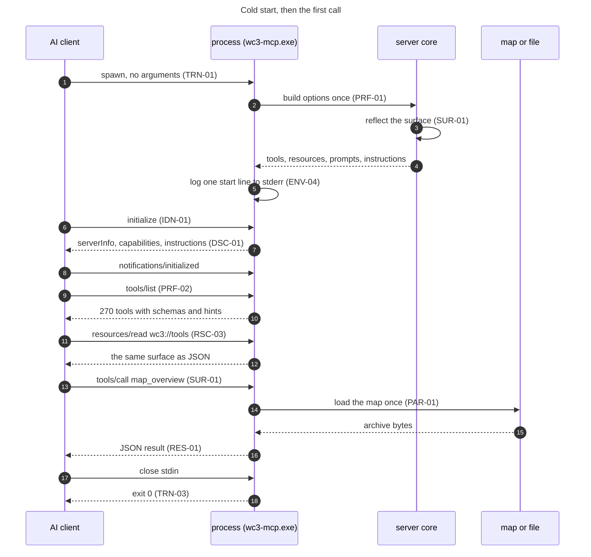

Two properties matter here. The surface is built once, so the tool list and the catalog cannot disagree. And nothing the server writes on this path touches a map, so a client that lists tools and stops has changed nothing on disk.

### 5.2 A read

A read is one load, one handler and one result. It may not write.

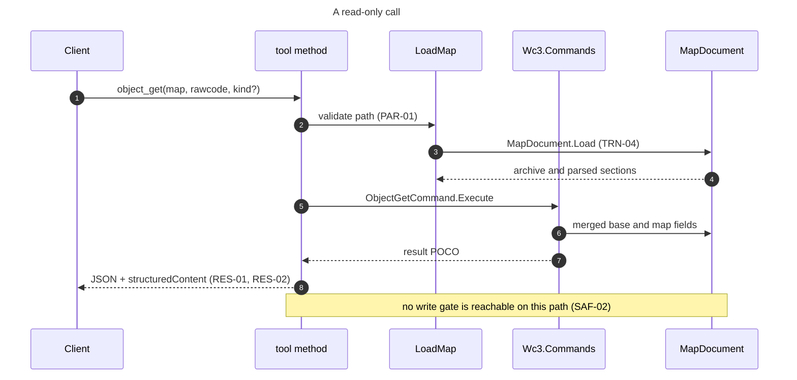

A read that needs base game data resolves the game directory from the argument, then `WC3_GAME_DIR`, then auto-detection, and when none is present it returns the fields it can read from the map with the missing ones marked (PAR-04).

### 5.3 A write and the chained edit

This is the flow that matters most, because the common agent mistake is to make two edits from one base and lose the first. The digest verifies that the file named as input is the revision the caller last read. It does not choose the revision, so the second call still has to name the first output.

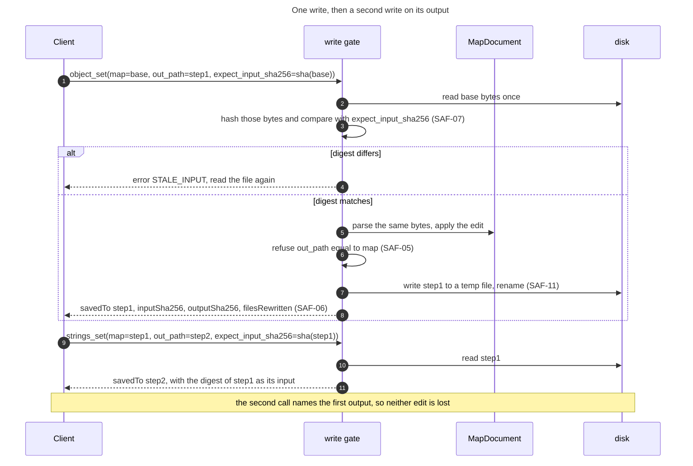

The digest is an input revision check, not a chain. It refuses a base that changed after it was read, and it cannot detect a caller that reused an unchanged base by mistake. The chaining rule lives in the tool descriptions and the instructions, and the digest makes only the first half of it enforceable. A batch call removes the mistake entirely for one family, and `object_batch_set` is it. The remaining families still chain, which is G-50.

### 5.4 A destructive call

A destructive call is rare and explicit. The caller states the intent, and the refusal names what would be lost.

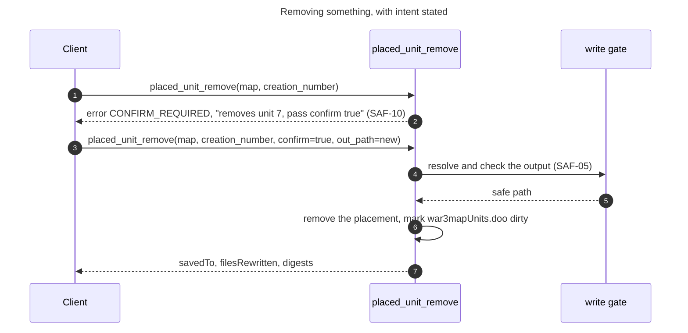

A destructive tool is not made safe by the confirmation. It is made safe by the output being a new file and the input staying untouched. The confirmation stops the call that a model made by mistake, and the output rule means a mistake costs one file the caller can delete.

### 5.5 Port a unit between maps

A port reads two maps, resolves the dependency closure, remaps colliding rawcodes and writes a third file.

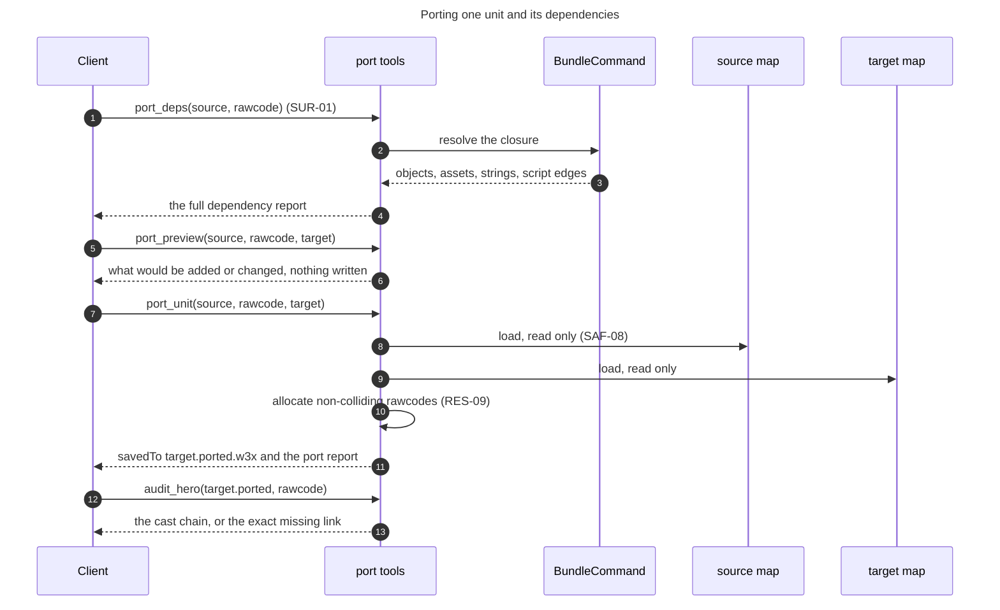

The source and the target are never modified, and the result is a third file. That is why a port can be reviewed before it is adopted, and why a failed port leaves both inputs as they were.

### 5.6 Gate a map before it ships

The project's own rule is that an edited map is not finished until a doctor check compiles the script and a load test runs. The MCP surface can do the first part and can prepare the second.

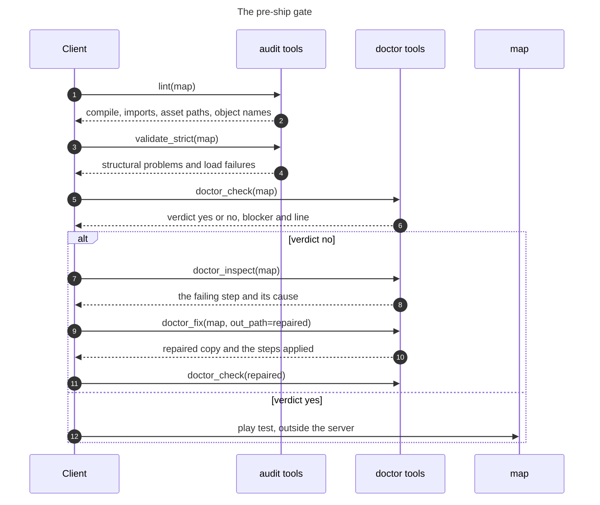

The server can prove the script compiles and that the archive is structurally sound. It cannot prove the map plays. The instructions and the prompt SHALL say so, because a green audit that reads as a play test is the failure this flow exists to prevent.

### 5.7 Search the reference documents

Search works with no download, and improves when the index is installed.

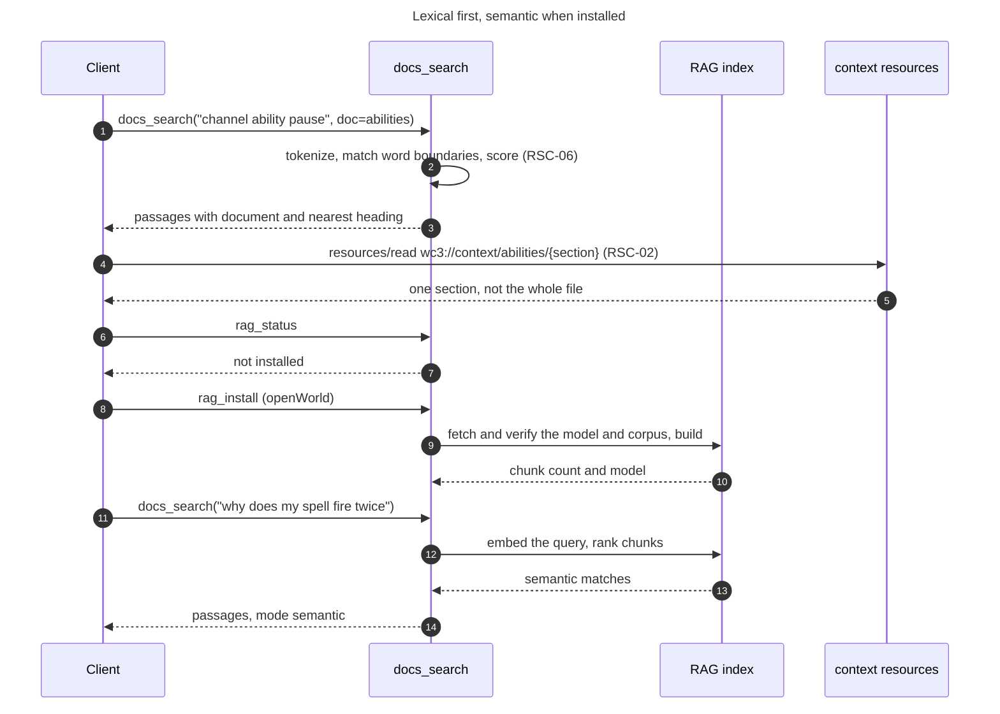

Lexical search is the contract. Semantic search is an improvement a caller opts into, and a failed index build leaves lexical search working.

### 5.8 Set up a client

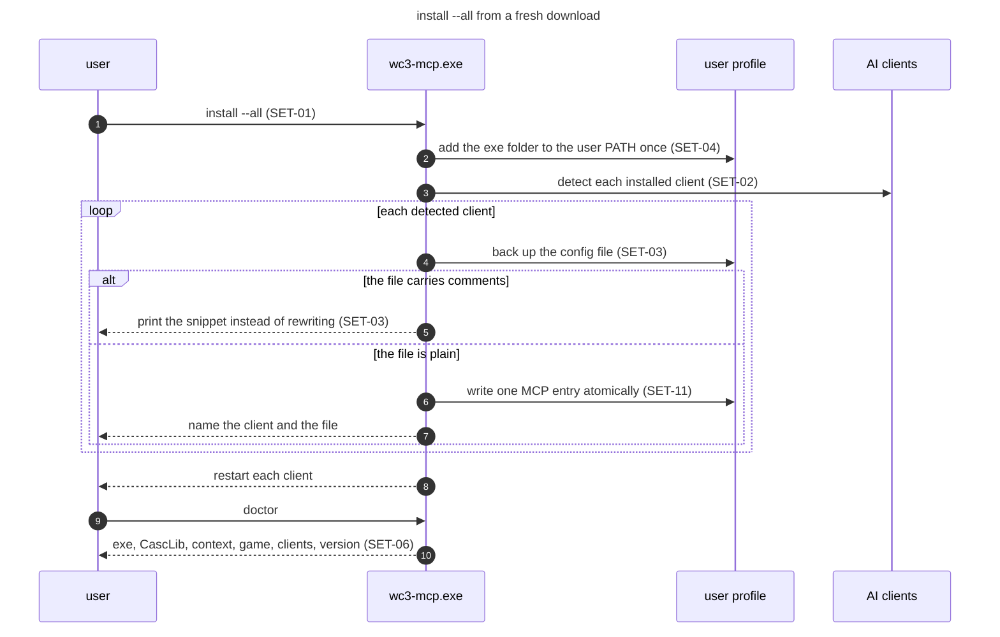

The install is idempotent, so running it again after an update changes nothing except the version the entry points at.

### 5.9 From a wc3ctl commit to an npm release

The server source is written in wc3ctl and published from the mirror. That chain has more steps than a reader expects, so it is drawn once here.

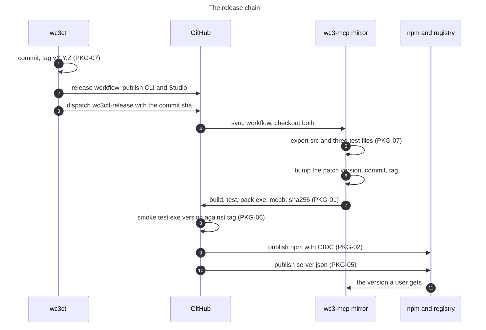

A commit that changes the MCP server is not released until the mirror has exported it, bumped its version, tagged, built and published. The specification treats that as one release with two repositories, not two releases.

## 6. Interfaces

This section is the contract a client codes against. Where a fact is a measurement, its date is 8 November 2026.

### 6.1 Protocol surface

The server negotiates MCP over stdio. It answers the revision the client offers when it supports it, and otherwise answers with its own, which is 2024-11-05 today.

| Element | Value |
|---|---|
| Transport | stdio, newline-delimited JSON-RPC |
| Protocol revisions | 2024-11-05 today. A later revision is added only after the compatibility test in CMP-01 passes for it |
| Server info | `name` from `McpServerName`, `version` from the assembly |
| Tools | 271, computed once at start |
| Resources | 3 fixed URIs, plus section templates after RSC-02 |
| Prompts | 5, fixed at start |
| Instructions | A short string, at most 1,000 characters after DSC-01 |
| Capabilities | `tools`, `resources`, `prompts`, `logging`. `listChanged` SHALL be false because the collections are fixed at start (TRN-05) |
| Progress | None today, required on the long families by PRF-04 |
| Cancellation | None today, required by PRF-04 |
| Sampling, elicitation, roots | Not used. The server requires only tools, resources and prompts (CMP-06) |

### 6.2 Naming

A tool name is `<domain>[_<subject>]_<action>`. The domain is the subject, such as `object`, `terrain` or `mpq`. The subject disambiguates a part of that domain, such as `terrain_corner`. The action is the operation and comes last, such as `list`, `get`, `set`, `add`, `remove`, `create`, `export`, `import` or `verify`. Existing names such as `object_set` already follow it, and the renames in SUR-02 bring the rest to it.

| Rule | Example that follows it | Example that does not |
|---|---|---|
| One verb per operation | `object_get`, `object_set`, `object_new`, `object_remove` | `map_info` beside `map_info_get` |
| No synonyms | `list` for a list, not `ls`, `dir` or `show` | `list_files` beside `file_list` |
| Plural only for the collection noun | `object_list` | `triggers_read` beside `trigger_*` |
| Domain first, always | `string_list`, not `list_strings` | `search` beside `docs_search` |
| The name says what it acts on | `mpq_remove_many` | a bare `remove` |

The canonical rename table below is the one SUR-02 and SUR-03 use. An old name is served as an alias for one minor release, with the new name in its description.

| Today | Canonical name | Reason |
|---|---|---|
| `map_info` | `map_metadata` | `map_info` and `map_info_get` both exist, and `get` is the read verb |
| `map_info_get` | `map_metadata_get` | The editable fields are a separate read |
| `list_files` | `file_list` | Domain first, and `file_list` already lists the archive entries |
| `file_list` | `file_list` | Kept, with `list_files`'s brief and harvest options folded in |
| `triggers_read` | `trigger_tree_get` | Domain first, and it reads the whole tree |
| `placed_units_list` | `placed_unit_list` | One noun, one collection |
| `search` | `map_search` | It searches map contents, not the docs |
| `docs_search` | `docs_search` | Kept |
| `new_map` | `map_create` | Domain first |

### 6.3 Common parameters

Every parameter has one meaning across the surface. A tool that needs a different meaning SHALL use a different name.

| Parameter | Type | Meaning | Precedence or default |
|---|---|---|---|
| `map` | string | One map file, `.w3x` or `.w3m` | Required where present. A folder is refused (PAR-01) |
| `folder` | string | A directory of maps, searched one level or recursively as stated | Required where present |
| `internal_path` | string | One archive path, either slash accepted | Required where present |
| `out_path` | string | The output file | Optional with `<map>.edited.<ext>` for a map edit. Required for a different artifact (PAR-06) |
| `out_dir` | string | An output directory | Required where present. Created if absent |
| `game_dir` | string | The Warcraft III install | Argument, then `WC3_GAME_DIR`, then auto-detect (PAR-02) |
| `schemas_dir` | string | The schema dataset folder | Argument, then the saved setting |
| `target` | string | A build name or schema folder | Argument, then `WC3_TARGET_BUILD`, then the saved setting, then the default (PAR-03) |
| `kind` | enum | Object Editor kind | `unit` when optional and omitted |
| `rawcode` | string | Four characters, case preserved as the map stores it | Required |
| `creation_number` | integer | The placement id from a list tool | Required |
| `confirm` | boolean | Explicit intent for a destructive call | Default false, and false refuses (SAF-10) |
| `expect_input_sha256` | string | The digest the caller believes the input has | Optional. A mismatch refuses (SAF-07) |
| `overwrite` | boolean | Allow replacing an existing output | Default false (SAF-05) |
| `limit` and `offset` | integer | A page of a list result | Default and maximum stated per tool (RES-03) |

Units are stated in the parameter description and never assumed. World positions are map world units. Terrain brushes are terrain cells. Pathing brushes are pathing cells, four per terrain tile. A facing angle is radians. A scale is one number for uniform, or three for `sx,sy,sz`.

### 6.4 Result and error envelope

A result is a JSON object in the text content and, after RES-02, the same object in `structuredContent`.

```json
{
  "savedTo": "C:\\maps\\MyMap.edited.w3x",
  "inputSha256": "0f1c...",
  "outputSha256": "9ab3...",
  "filesRewritten": 2,
  "bytesWritten": 767366,
  "message": "set unit u000 hit points to 500"
}
```

A list result is wrapped, so a caller always receives an object.

```json
{
  "items": [ { "rawcode": "u000", "name": "Footman" } ],
  "returnedCount": 1,
  "totalCount": 1432,
  "offset": 0,
  "limit": 100,
  "hasMore": true,
  "nextOffset": 100
}
```

An error is a tool error with a stable code.

```json
{
  "code": "OUT_PATH_IS_INPUT",
  "message": "out_path must not be the input map file itself",
  "next": "omit out_path to write a sibling .edited copy, or name a different file",
  "path": "C:\\maps\\MyMap.w3x"
}
```

The code set below is the initial one. ERR-03 keeps it in one place and TST-11 requires a test per code.

| Code | Meaning | Next step |
|---|---|---|
| `MAP_NOT_FOUND` | The path does not exist | Check the path |
| `MAP_UNREADABLE` | The archive could not be opened | Check that it is a w3x or w3m, not a folder of files |
| `OBJECT_NOT_FOUND` | The rawcode is in neither the map nor the base game | List the kind and pick a rawcode from it |
| `GAME_DATA_MISSING` | The tool needs base game data and none was found | Pass `game_dir` or set `WC3_GAME_DIR` |
| `OUT_PATH_IS_INPUT` | The output equals the input | Omit `out_path` or name a different file |
| `OUT_PATH_INSIDE_INPUT` | The output is inside a folder map | Write beside the folder |
| `OUTPUT_EXISTS` | The output exists and `overwrite` was not set | Pass `overwrite` true or choose a new name |
| `STALE_INPUT` | `expect_input_sha256` does not match the file | Read the file again and chain on the current output |
| `CONFIRM_REQUIRED` | A destructive call did not state intent | Pass `confirm` true |
| `INVALID_ARGUMENT` | A value is outside its legal set | The message lists the legal set |
| `LOSSY_DECODE` | The text would not survive a UTF-8 decode | Use the raw extract tool, or pass `allow_lossy` |
| `RESULT_TOO_LARGE` | The result would exceed the page limit | Ask for a page or a narrower query |
| `DEPENDENCY_MISSING` | A required library or file is absent, such as `CascLib.dll` | Reinstall the release |
| `UNSUPPORTED_PLATFORM` | Not Windows x64 | Use the supported release |
| `INTERNAL` | An unexpected failure | Report it with the tool name and the stderr line |

#### 6.4.1 The result as a data model

A tool returns one of three shapes, and all three share the tool envelope. The figure is the model a client codes against. A field marked as later is required across the surface. `object_set` now returns the write fields, and the other write tools do not yet.

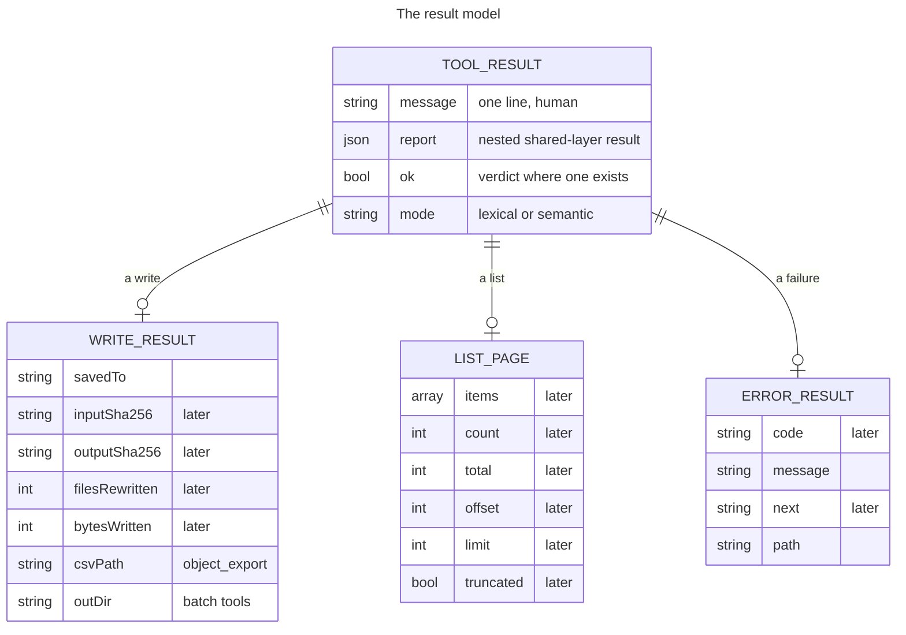

The write fields carry the digest and the rewritten count so a caller can prove what changed (SAF-06). The list fields exist so a page can be asked for rather than returned whole (RES-03, RES-10). The error fields carry a stable code and a next step, so a caller can branch rather than read prose (ERR-02).

### 6.5 Inventory

The full inventory is Appendix C, which lists every name by family. The description, parameters, result and hints of a tool live in `docs/mcp-reference.md` and in `wc3://tools`, so they are not repeated here. The figure gives the shape of the surface.

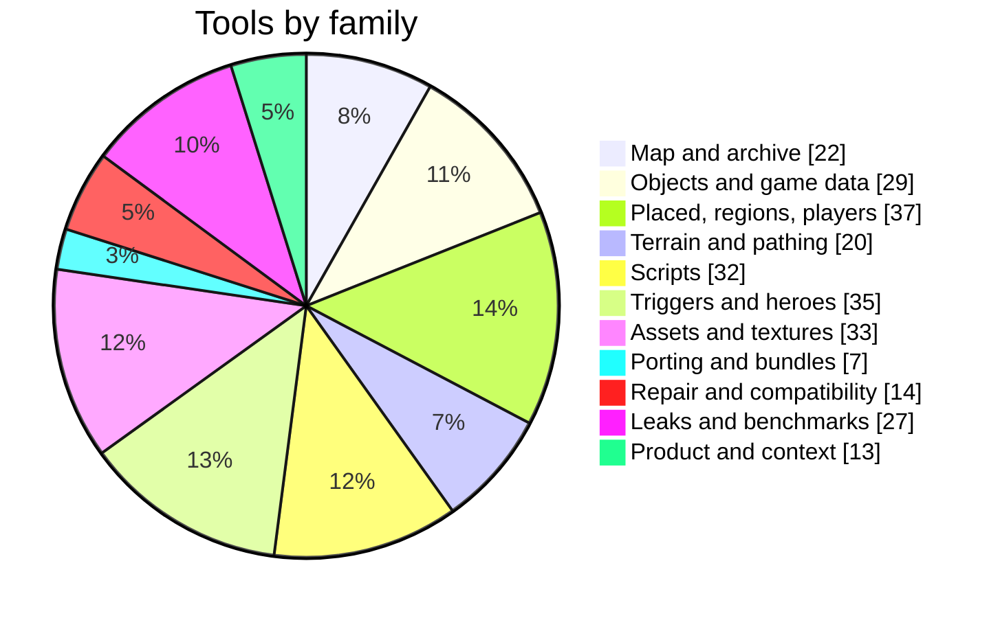

### 6.6 Resources

| URI | Kind | Contents |
|---|---|---|
| `wc3://context/ui-frames` | Document, whole | The Big UI-Frame Tutorial |
| `wc3://context/abilities` | Document, whole | The Editor Ability Insight reference |
| `wc3://tools` | Generated catalog | Every tool, family, aliases, input schema and hints |
| `wc3://spec` | Document, whole | This specification, added by RSC-04 |
| `wc3://context/ui-frames/{section}` | Template | One heading of the tutorial, added by RSC-02 |
| `wc3://context/abilities/{section}` | Template | One heading of the ability reference, added by RSC-02 |

A resource read is a file read from the installed folder and nothing else. It does not accept a caller path, it does not run a tool, and it cannot modify anything.

### 6.7 Prompts

| Prompt | Arguments | Workflow |
|---|---|---|
| `inspect_map` | `map` | Understand a map before changing it |
| `port_hero` | `source`, `target`, `unit` | Move a hero or unit and its dependencies |
| `repair_reforged_map` | `map` | Repair a map a patch broke |
| `optimize_map_size` | `map` | Shrink a map by removing duplicate and unused assets |
| `audit_hero_spells` | `map`, `hero` | Prove a placed hero's spells are wired, not just present |

Every argument is optional and carries a placeholder default. A prompt returns text only, so pulling one costs a read and changes nothing.

### 6.8 Environment variables

| Variable | Effect | Default | Read by |
|---|---|---|---|
| `WC3_GAME_DIR` | The Warcraft III install for base game data | Unset, then auto-detect | Every tool with `game_dir` |
| `WC3_TARGET_BUILD` | The target build used when no `target` argument is given | Unset, then the saved setting | `map_compat`, `lint`, `script_api_usage`, `target_get` |
| `WC3_MCP_NPX` | Set to `1` by the npm launcher, so setup registers the `npx` command | Unset | `SetupCli` |
| `WC3_MCP_LOG` | Log level on stderr, one of `error`, `warn`, `info` or `debug` | `warn` | The stdio host |
| `WC3_MCP_PROFILE` | The tool profile, `full` or `core` | `full` | The surface builder (SUR-07) |
| `CODEX_HOME` | Where Codex keeps `config.toml` | `%USERPROFILE%\.codex` | Setup |
| `USERPROFILE`, `APPDATA`, `LOCALAPPDATA` | The profile folders every client path is built from | The operating system values | Setup |

`WC3_MCP_PROFILE` and `WC3_MCP_LOG` do not exist today. They are the two additions ENV-01 and SUR-07 require, and both are listed here so a reader sees the whole set in one place.

Two further variables are read by the map model rather than by the server, and both are diagnostic only. `WC3CTL_FORCE_SALVAGE` forces the in-place patch save that keeps the source hash table, and `WC3CTL_COMPACT_SAVE` keeps the source hash table and rewrites only the block table. Neither is part of the server contract, they exist to diagnose a map that stalls on the loading screen, and they are named here so a process environment that carries one is not a mystery.

### 6.9 Command line

| Verb | What it does | Exit |
|---|---|---|
| no arguments | Run the MCP server on stdio, for the standalone exe | 0 when stdin closes |
| `serve` | Run the MCP server on stdio, for `wc3ctl mcp` | 0 when stdin closes |
| `install [client...] [--all] [--npx] [--game-dir D] [--name N] [--no-path]` | Register the server with clients and add the folder to PATH | 0 when every client succeeded |
| `uninstall [client...] [--all]` | Remove the entry and the PATH folder | 0 when every client succeeded |
| `config <client>` | Print the snippet or the command to paste | 0 |
| `clients` | List the known clients and whether each is set up | 0 |
| `doctor` | Check the exe, `CascLib.dll`, the context folder, the game and the clients | 0 when clean |
| `version` | Print the product and version | 0 |
| `help` | Print the setup help | 0 |
| `update [--check]` | Update from the product's own GitHub release | 0 on success |
| `tools` | Print the tool catalog, with `--json` | 0 |
| `audit-annotations` | Run the annotation audit, with `--json` | 0 when clean |

A bad option and an unknown client both exit 2 and name the legal set.

### 6.10 Package layout

The installed product is small. The published folder holds the exe, the native reader, the two reference documents and the context folder they are served from.

```text
wc3-mcp.exe                  the self-contained server
CascLib.dll                  native base-game reader, beside the exe
context/
  ui-frames/ui-frames.md     the frame tutorial resource
  abilities/ability-insight.md
dist-mcp/                    the published folder in wc3ctl
npm/
  bin/wc3-mcp.js             the launcher, the only file npm runs
  lib/ensure-binary.js       download, verify, cache, prune
mcpb/manifest.json           the Claude Desktop bundle manifest
server.json                  the MCP Registry entry, filled at release
%LOCALAPPDATA%/Programs/wc3-mcp/versions/v<version>/
                             the per-version binary cache
```

The per-version cache is why an upgrade never hits a Windows lock on a running exe. Two versions are kept, and a prune that cannot delete a running exe is ignored. A self-update over a fixed install follows the same idea, renaming a locked exe or DLL to a `.old` sibling and copying the new file in.

### 6.11 Threat model

The server runs as the signed-in user over that user's files. This table states what that means, what each threat reaches, and which requirement is the control.

| Threat | How it reaches the server | Control | Requirement |
|---|---|---|---|
| A hostile map exploits a parser | A client opens an untrusted `.w3x` or `.w3m` | Managed .NET, no `eval`, a parser failure becomes a tool error, and no write lands outside `out_path` | SEC-06 |
| A caller writes outside the intended path | A crafted `out_path` or internal path | The write gate refuses the input, inside-folder output and an existing output, and extract refuses traversal | SAF-05, SAF-09, SAF-12 |
| A prompt injection asks for a destructive edit | Text inside a map or a document tells the model to remove things | A destructive tool needs `confirm` true, which proves the caller stated intent and not that a person approved it. The durable controls are the new-file default, the write gate and the client's own confirmation step | SAF-03, SAF-05, SAF-10 |
| A tampered download | A release zip, the model or the corpus is replaced | A pinned SHA-256, HTTPS, a fixed corpus, and no caller-supplied URL | SEC-03 |
| Map or script text leaks in an error or a log | A failing tool puts the input in its message | An error names the path and the rule, never the content, and a log carries no file body | ERR-06, OBS-03 |
| Another local process reads the stream | A process on the same account attaches to stdio | The OS account is the boundary, stated rather than pretended | SEC-05 |
| A call runs away | A large folder, a model import or a doctor spawn | Progress and cancellation after PRF-04, a bounded page, and one map at a time | PRF-04, PRF-05 |
| A config rewrite damages a client | Install writes the wrong file or the wrong entry | Backup, atomic replace, comment refusal, and one entry only | SET-03, SEC-04 |
| Two clients race a write | Two clients edit the same base | Neither is refused by the digest, because both read the same unchanged file. The destination commit is the guard, a temp file renamed without replace, so the second writer fails with `OUTPUT_EXISTS` | SAF-05, SAF-07, SAF-11 |
| Telemetry or a phone-home | An analytics call nobody asked for | No telemetry, and every network path is listed | SEC-01, SEC-02 |

## 7. Acceptance criteria

A requirement is met when its check passes. The checks are grouped by subject and each names the requirement IDs it settles. A check that cannot be run is not an acceptance criterion, it is an intention.

| AC | Requirement IDs | The check |
|---|---|---|
| AC-01 | IDN-01, IDN-03, IDN-04, IDN-05, IDN-06 | Start the Release exe, call `initialize` and `version_info`. The name is `wc3-mcp` or `wc3ctl`, the version matches the assembly, a build without git reports `nogit`, and `version_info` states the protocol revision and the SDK version without reading the project file |
| AC-02 | IDN-02 | Read the exe version, `version_info`, `npm/package.json`, `mcpb/manifest.json`, `server.json` and the latest tag. One script reports zero disagreements, and the release refuses a tag that differs from the exe |
| AC-03 | TRN-01, TRN-02, TRN-03, TRN-06 | Pipe a raw initialize, initialized and tools/list into the exe. Every reply is valid JSON, stdout holds nothing else, closing stdin exits 0, and the process opens no network listener |
| AC-04 | TRN-04, TRN-05, TRN-07 | Call two tools in one session, then start a second server against the same maps. Both succeed, `listChanged` is false, and no lock blocks the second |
| AC-05 | SUR-01, SUR-02, SUR-03, SUR-04 | The parity test passes, the duplicate-name test passes, the canonical name table has no duplicate canonical name, two aliases may point at one canonical name, and every alias resolves to a live tool |
| AC-06 | SUR-05, SUR-06, SUR-07, SUR-08, SUR-10 | The catalog is under 300 tools and 70,000 characters, every description is at most 600 characters and names its family, no tool has more than eight required parameters, every tool has a title, and the `core` profile returns a strict subset that includes every read tool named in it |
| AC-07 | SUR-09, PAR-05 | For every tool, every parameter has a type and a description, every enum lists its values, and an unknown enum value returns `INVALID_ARGUMENT` with the legal set |
| AC-08 | SAF-01, SAF-02, SAF-03, SAF-04 | The annotation audit passes, no read tool writes a file in the read sweep, every write tool's call passes through the gate (asserted by a counter in the test), and every destructive tool declares true |
| AC-09 | SAF-05, SAF-06, SAF-08, SAF-09, SAF-11, SAF-12 | For each refusal, a call with output equal to input, output inside a folder map, and existing output without `overwrite` returns its code and writes nothing. A valid write returns both digests and a rewritten count. The temp file is gone after the call |
| AC-10 | SAF-07 | A write with a correct digest succeeds and a write with a stale digest returns `STALE_INPUT` and leaves both files untouched |
| AC-11 | SAF-10 | A destructive tool without `confirm` returns `CONFIRM_REQUIRED` and names the item. The same call with `confirm` true succeeds |
| AC-12 | PAR-01, PAR-02, PAR-03, PAR-04 | `map` on a folder is refused, `game_dir` precedence follows the argument then the variable then detection, `target_get` names the winning source, and a base-data tool with no install marks its missing fields |
| AC-13 | PAR-06, PAR-07, PAR-08, PAR-09 | Every artifact-producing tool requires its output, every coordinate description states its unit, an array above its maximum is refused, and a path with either slash resolves |
| AC-14 | RES-01, RES-02, RES-06, RES-07, RES-08 | Every result parses as JSON, every tool publishes an output schema, the structured content validates against it, the CLI `--json` shape matches, and enums are names |
| AC-15 | RES-03, RES-10 | Each list family returns its default page, states the total, and a request above the maximum returns `RESULT_TOO_LARGE` rather than a truncated page that reads as complete |
| AC-16 | RES-04 | `file_get_text` on valid ASCII, valid UTF-8 with Cyrillic, invalid UTF-8, a legacy encoding and a source that already contains a real U+FFFD reports `lossy` and a replacement count only for the invalid and legacy cases, refuses without `allow_lossy`, and `file_extract` writes bytes whose SHA-256 equals the archive entry |
| AC-17 | RES-05, RES-09 | A render under 1 MB inlines an image and reports the path, a render above it returns only the path, and two identical runs produce the same allocated identifiers |
| AC-18 | ERR-01, ERR-02, ERR-03, ERR-06, ERR-07 | Every code in the table is produced by a test, the message is one line, the next step is present where the table names one, no message contains file content, and an unknown tool name returns the protocol unknown-tool error rather than a guessed tool |
| AC-19 | ERR-04, ERR-05 | A map tool succeeds with no game install, a base-data tool returns `GAME_DATA_MISSING`, and a batch with one failure reports the failure and the rest as partial |
| AC-20 | RSC-01, RSC-02, RSC-03, RSC-04, RSC-05, RSC-06 | Every resource reads, every section template resolves to one heading, the catalog equals `tools/list`, the spec resource equals this file, each resource reports size and digest, and `docs_search` answers lexically with no index installed while `rag_status` reports what is installed before any download |
| AC-21 | PRM-01 to PRM-05 | Every prompt returns text only, every quickstart workflow has a prompt, every prompt names live tools, and a prompt naming a removed tool fails the test |
| AC-22 | DSC-01, DSC-02, DSC-03, DSC-04, DSC-05, DSC-06 | The instructions are under 1,000 characters and carry the three rules, quickstart covers every family and answers orientation with no arguments, `tool_help` returns the full detail, a missing-capability error names the tool that has it, and the four surface views agree |
| AC-23 | ENV-01 to ENV-06 | Every variable in the table is read where the table says, the precedence tests pass, no undocumented variable changes a result, and the start line appears on stderr |
| AC-24 | SET-01 to SET-11 | For each of the ten clients, install writes one entry, uninstall removes it, the backup exists, a commented file is refused and printed, PATH is unchanged apart from the one folder, and a second install changes nothing |
| AC-25 | PKG-01 to PKG-06, PKG-09, PKG-10, PKG-11, PKG-12 | The published exe runs on a machine without .NET, prints the tag version, the launcher verifies a digest, refuses a bad one and reports offline without failing, an update over a running exe renames the locked file and leaves a removable `.old`, and the manifest and `server.json` carry the tag |
| AC-26 | PKG-07, PKG-08 | The export prints a plan from HEAD, refuses an uncommitted path and a profile path, and the publish folder is empty before the build |
| AC-27 | DOC-01 to DOC-06 | The generated references regenerate byte for byte, the README counts match the live surface, every release note names a requirement or a defect, every breaking change appears in three places, and every basis that names the protocol resolves to a source in Appendix D |
| AC-28 | SEC-01 to SEC-07 | A network trace of a read-only session shows no connection, the four access paths are the only ones in the source, each download verifies a digest, no config file outside the entry changes, and a malformed map returns a tool error rather than crashing |
| AC-29 | PRF-01 to PRF-07 | Cold start is under one second, `tools/list` under 100 ms, a call loads its map once, the long families emit progress and stop on cancellation, a folder tool holds one map at a time and the perf gate passes |
| AC-30 | OBS-01 to OBS-04 | stderr carries the start line and one line per slow call, no line carries map text, and an expected error is logged once |
| AC-31 | CMP-01 to CMP-06 | The protocol test passes against the supported revisions, an SDK upgrade runs the same test, aliases follow the window, result changes are additive, and a tools-only client still works |
| AC-32 | TST-01 to TST-13 | The hermetic suite passes, the read sweep and the write sweep pass over synthetic maps, the four audits fail when sabotaged, the parity, docs and size guards run in CI, and the surface count matches in the README, the reference and this document |
| AC-33 | AUT-01 to AUT-10 | Generate a changelog over a known range and compare it with the commits, run the readiness command on a clean tree and see one verdict, change a source file under watch and see build, test, docs and publish run in order, fail a gate and see publish refused, and start each published exe and read its version |

| AC-34 | SAF-13 | A batch of three edits writes one output that reads back all three. A batch whose second edit fails returns its code, writes no output, and leaves the input unchanged |
| AC-35 | SAF-14, SAF-15 | The gate is reachable from a test without the MCP layer. A multi-file export leaves either every file and a manifest, or no output |
| AC-36 | RES-11, PKG-13, AUT-11 | A port result carries two input roles and one output role with digests. A published version resolves to a commit and an artifact digest |
| AC-37 | PRF-08, PRF-09, RSC-07 | Each named limit refuses with a code before allocation, the memory budget is measured on the reference machine, and editing a cached input invalidates its result |
| AC-39 | SAF-16 | Two Channel abilities with one order id are reported together, a hero scope checks only that hero's list, and levels that disagree and empty ids are reported apart |
| AC-38 | TST-14, CMP-07, SEC-08, DOC-07 | Each write family has a semantic assertion that fails when unrelated data changes, the revision matrix passes, the fuzz corpus runs, and the print edition builds |

The sabotage half of AC-32 matters as much as the pass half. A guard that has never been seen to fail is a guard nobody knows works, and the project has already had a linter silently exempt every case it was meant to catch.

## 8. Assumptions

These are held without an artifact. If one is false, the requirement that depends on it is wrong.

| Assumption | Why it is assumed | What would falsify it |
|---|---|---|
| A client loads every tool definition into the model's context before the first call | The context cost argument in SUR-05 and SUR-07 rests on it | A client that lists tools lazily or filters by name, measured in that client |
| The official C# SDK negotiates the revision it advertises and serializes a result POCO the way `JsonOptions` says | Every result and every protocol test depends on it | A protocol trace from a real client that disagrees |
| A Windows x64 machine is the only supported target, because CascLib is a Windows native library | The release, the launcher and the platform guard are built on it | A cross-platform CASC reader or a supported non-Windows release |
| The user's own account is the authorization boundary, and a client the user starts may do anything the account may do | SEC-05 states it, and no authentication exists | A shared machine, a remote client, or a hosted server |
| The two reference documents are shipped with the release and are small enough to read whole | RSC-01 and RSC-02 depend on it | A document that grows past a client's read limit |
| The RAG corpus and the model stay available at their pinned URLs and digests | `rag_install` has no mirror | A broken release asset or a model withdrawal |
| A map fits in memory, and the largest map a user opens is under a few hundred MB | PRF-05 and the folder tools rest on it | A measured map that fails to load |
| The mirror repository keeps the same export contract and the same tag-driven release | PKG-07 and IDN-02 rest on it | A change to the mirror's workflows |
| Blizzard's current build exposes the game data through CASC in the layout `Wc3.GameData` reads | Every base-data tool depends on it | A game patch that moves or encrypts the data |
| An agent reads a tool description before it calls the tool | SUR-05 spends its budget on that assumption | A client that calls by name from a cached plan |

## 9. Open questions

Each question has the evidence that would settle it. None of them blocks the requirements already stated, and none is answered by guessing.

| Question | Why it is open | What settles it |
|---|---|---|
| Q1 Should the surface split into several servers, one per family, instead of one server with 270 tools | A small model may do better with 40 tools than with 270, and a user may not want to install five servers | A task success comparison on the same ten prompts, one server against five, with the token cost of each recorded |
| Q2 Should the `core` profile be the default, with the full surface opt-in | The default decides what most users get, and SUR-07 currently keeps full as the default | The same comparison as Q1, plus a count of how often each family is actually called in real sessions |
| Q3 Is an output schema on all 270 tools worth its cost | It is the largest mechanical change in this document, and its value depends on client support | A check of the four most used clients for `structuredContent`, and one family implemented as a trial |
| Q4 Do clients act on the destructive hint in a way a caller can perceive | If no client reads it, SAF-03 and SAF-10 are the only safety, and the hint is metadata | A test in Claude Desktop, Claude Code, Cursor and VS Code, recording whether a confirmation appears |
| Q5 How long should an alias live | One minor release is the proposal. Too short breaks a saved prompt, too long doubles the surface | A count of real client configs and prompts that name a renamed tool, over one release cycle |
| Q6 How far should the batch extend beyond object edits | `object_batch_set` answers it for objects, and the other families have different arguments and validations | The share of real sessions that edit more than one family in one task, and whether a general batch stays explainable in one description |
| Q7 Should the server confine reads and writes to a workspace root the caller names | It would stop an agent reading a path it should not, and it would break every caller that passes an absolute path today | The threat model in SEC-05, plus a check of whether any client supplies a root it could use |
| Q8 What page size belongs to each list family | The right number depends on the tokens per row, which differ from a file list to an object dump | A token count of each family's first page over the reference map, then a stated maximum per family |
| Q9 Should `map` keep accepting a folder map | A folder map is a real workflow in the Studio, and every description promises a file | A count of folder maps in the user's library, and whether the tools that accept one behave correctly |
| Q10 Should `quickstart` stay a tool when the same plans are prompts | Two copies of one plan drift, and the catalogue already carries both | A comparison of the two texts after the prompt set is completed to ten, and a decision on which is generated from which |
| Q11 Should the changelog be generated from requirement IDs rather than commit types | A commit type says what kind of change it was, and a requirement ID says which promise it keeps, and a release note a reader acts on needs the second | A release where every commit names a requirement, and the count of commits that would land under other |

## 10. Where the build differs today

This is the work queue. Each row names the measured state, the requirement it fails and where the change lands. The rows are grouped by subject and are in no particular build order. The last paragraph names the six that touch the most.

| Gap | What is wrong today | Requirement | Where the change lands |
|---|---|---|---|
| G-01 | The initialize instructions are one line naming the target and the game build | DSC-01 | `Wc3McpServer.BuildInstructions` |
| G-02 | No tool publishes an output schema, and no result carries structured content | RES-02 | Tool creation options and the result POCOs |
| G-03 | No result size limit. `list_files` has `brief` and `docs_search` cuts at 1,600 characters, and nothing else has a bound | RES-03, RES-10 | One result envelope in `Wc3.Mcp` |
| G-04 | No progress notification and no cancellation token, on a surface that includes folder audits and model import | PRF-04 | Tool signatures and the long commands |
| G-05 | `file_get_text` decodes UTF-8 with replacement characters, silently, and no tool extracts raw bytes | RES-04 | `FileEditCommand.ReadText` and a new extract tool |
| G-06 | 18 descriptions exceed the 600 character cap and two exceed 1,000, while 33 are under 150 and do not state a trap | SUR-05 | Every `[Description]` on the surface |
| G-07 | The surface is 270 tools and 82,116 characters, with no profile | SUR-07 | The surface builder and a profile filter |
| G-08 | Nine names need a canonical rename, including one true duplicate pair, `list_files` and `file_list` | SUR-02, SUR-03 | `Wc3Tools`, the alias table, the parity map |
| G-09 | No tool has a title annotation | SUR-10 | Every `[McpServerTool]` |
| G-10 | Six writing tools leave `destructiveHint` unset, which the protocol reads as true, and the audit does not check the hint against behaviour. Two of the six, `terrain_export_heightmap` and `pathing_export_png`, also say "Read-only" in their description while they write a file and declare `ReadOnly` false | SAF-01, SAF-02, TST-04 | The attributes, the descriptions and `McpToolAudit` |
| G-11 | The output rule is implemented twice, in `ResolveOutPath` and again inside several commands | SAF-04 | One gate in `Wc3.Mcp` and the command defaults |
| G-12 | `object_set`, `object_bulk_set`, `object_batch_set` and the tools behind `SaveEdit` and `SaveTerrain` return digests, a rewritten count and bytes. The remaining direct writes carry none | SAF-06 | The write gate, one family at a time |
| G-13 | `object_set`, `object_bulk_set` and `object_batch_set` accept `expect_input_sha256`. The other writes cannot refuse a call whose input changed after it was read. The digest verifies the input revision and does not prevent an unchanged base being used twice | SAF-07 | The write gate, one family at a time |
| G-14 | No destructive tool requires stated intent | SAF-10 | The destructive tools |
| G-15 | A save writes the destination directly, so a failure can leave a truncated map | SAF-11 | `MapDocument.Save` path used by the server |
| G-16 | `map` accepts a directory although its description says a file | PAR-01 | `LoadMap` and the parameter descriptions |
| G-17 | No error carries a code and there is no documented code set | ERR-02, ERR-03 | `Run` and the error table |
| G-18 | No error code has a test | TST-11 | The MCP test suite |
| G-19 | The two documents are served whole and there is no section resource | RSC-02 | `Wc3Context.CreateResources` |
| G-20 | This specification is not served as a resource | RSC-04 | `Wc3Context.CreateResources` |
| G-21 | Five prompts exist and `quickstart` names ten workflows | PRM-02 | `Wc3Prompts` |
| G-22 | `quickstart` covers ten workflows and leaves replay, MPQ, library and game data in none | DSC-02 | `QuickstartCommand` |
| G-23 | No `tool_help`, so the long rationale has nowhere to live once descriptions are capped | DSC-03 | A new tool and the generated reference |
| G-24 | Every collection advertises `listChanged` true while nothing changes at run time | TRN-05 | `Wc3McpServer.CreateOptions` |
| G-25 | Six live artifacts carry five different versions, and the published npm package is 0.5.19 while the mirror's tags stop at v0.5.9 and its tree says 0.5.16, so the tree cannot reproduce what a user installs | IDN-02 | Both `Directory.Build.props`, npm, mcpb, `server.json`, the tag, CI |
| G-26 | `doctor` checks the exe, CascLib, the game and the clients, not the context folder or the version | SET-06 | `SetupCli.Doctor` |
| G-27 | The read sweep selects read-only tools by name prefix and needs a real map, so a write tool with a read-like name escapes it | TST-02 | `McpToolSweepTests` over synthetic maps |
| G-28 | No test calls every writing tool, checks that the output loads, or checks that the input is unchanged | TST-03 | A new write sweep |
| G-29 | The generated MCP reference carries no parameters, no result shape and no error codes | DOC-01 | `DocsReference.RenderMcp` |
| G-30 | The npm launcher has no test for its version path, cache, digest mismatch or offline behaviour | TST-08 | A new launcher test |
| G-31 | No start line names the build, target, game directory and profile on stderr | ENV-04 | `Program.RunServerAsync` |
| G-32 | The log level is fixed and there is no `WC3_MCP_LOG` | ENV-05 | The host builder |
| G-33 | No test names `WC3_TARGET_BUILD` or the placeholder rule, so the precedence is only read in code | ENV-02 | The setup and MCP tests |
| G-34 | No tool reports its family, and the catalog carries description and hints only | SUR-06, RSC-03 | The catalog record and the resource |
| G-35 | No map or archive list tool has `limit` or `offset`. `list_files` has `brief` and the graph tools have a count limit, and an object list or a script function list is still returned whole | RES-03 | The list tools |
| G-36 | The README and the generated reference quote counts that nothing checks against the live surface | DOC-03, TST-12 | A CI count check |
| G-37 | The changelog ignores requirement IDs and the breaking-change marker, and a non-conventional commit falls under other without failing anything | AUT-02 | `ChangelogCommand` |
| G-38 | A changelog entry is not produced or committed by the release, so the notes can lag the tag | AUT-09 | The release workflow and `changelog/` |
| G-39 | No watch mode rebuilds, tests, regenerates docs and publishes on a change | AUT-05 | A new command and the publish script |
| G-40 | No release-readiness command folds the existing gates into one verdict | AUT-06 | A new command |
| G-41 | `publish-all.ps1` is PowerShell only, is not run by CI, and neither tests nor regenerates the docs | AUT-04 | `scripts/publish-all.ps1` and `ci.yml` |
| G-42 | A local publish is not verified by starting the exe, and only the release does that | AUT-08 | The publish script and the smoke script |
| G-43 | `docs` and the publish script answer no `--json`, so an agent cannot drive them from one shape | AUT-07 | `DocsCommand` and the publish script |
| G-44 | Nothing checks the committed changelog against the commits since the last tag | AUT-10 | A changelog guard test |
| G-45 | The capability catalogue in section 14 is hand-written and can drift from the surface, the way a stale README can | DOC-03, TST-12 | A generated capability map from the tool families |
| G-46 | The document cites no external source, so a basis that claims a protocol rule or a client behaviour cannot be checked by its reader | DOC-06 | Appendix D and the Basis column |
| G-47 | The body numbers are a snapshot with no guard, and one description edit moved the total by 157 characters and two parameter counts by one each before anyone noticed | DOC-03, TST-12 | The docs guard and section 3.13 |
| G-48 | `terrain_export_heightmap` and `pathing_export_png` say "Read-only" in their description while both declare `ReadOnly` false and write a file | SAF-02 | The two descriptions |
| G-49 | The protocol target is 2024-11-05 while four later revisions are published, and no test names the revision set the pinned SDK negotiates | CMP-01 | The protocol test and the SDK pin |

| G-50 | Batches exist for object edits only. Placed instances, terrain, strings and triggers still need a chain | SAF-13 | `ObjectBatchSetCommand` and the write families |
| G-51 | The write gate lives in `Wc3.Mcp`, so the CLI and the Studio cannot use it | SAF-14 | The shared layer and the three front ends |
| G-52 | Exports write several files directly, with no staged directory, manifest or multi-output envelope | SAF-15, RES-11 | The export commands and the result records |
| G-53 | No explicit limit exists on entry count, decompressed bytes, parser depth, array size or child-process time | PRF-08 | The loader, the commands and the host |
| G-54 | PRF-05 counts the input and output bytes and ignores parsed sections, assets, schemas and concurrent calls | PRF-09 | `MapDocument.Load` and the command layer |
| G-55 | The doctor cache is keyed by path, so an edited file at the same path keeps a stale verdict | RSC-07 | The doctor cache |
| G-56 | No artifact records its commit, digest and tag, and npm 0.5.19 has no tag that explains it | PKG-13, AUT-11 | The release workflow and the mirror |
| G-57 | The write sweep asserts that an output loads, not that the intended change is present and the rest is preserved | TST-14 | The write sweep |
| G-58 | No protocol revision matrix exists, and only 2024-11-05 is tested | CMP-07 | The protocol test |
| G-59 | No fuzz corpus runs against the archive, object, trigger or script parsers | SEC-08 | The test suite and the native reader |
| G-60 | The print edition is one dark theme at 7.2pt, and a light edition for annotation is not built | DOC-07 | `tools/build_pdf.py` |

The six narrowest rows are G-20, G-24, G-32, G-34, G-36 and G-45, and the six broadest are G-02, G-04, G-07, G-11, G-39 and G-40. That ordering is an inference from the shape of the change, not a measurement of effort, and the only honest statement about effort is that the first row is visible in one function and the broadest rows touch the whole surface.

## 11. What has been done

The server did not arrive as a plan. It grew from a seam stub in July 2026 to a surface of 270 tools, and the record of how it grew is the strongest evidence this specification has. Every row below is a commit or a release, and every one is cited.

### 11.1 The timeline

| Date | What landed | Evidence |
|---|---|---|
| 2026-07-12 | An MCP seam stub that proved the shared command layer boundary before any protocol work | `ae7f41b` |
| 2026-07-16 | The stdio server on the official C# SDK, with `map_info` and `list_files` | `e4970f7` |
| 2026-07-16 | `object_list` and `object_get` | `d53dc5f` |
| 2026-07-16 | `bundle_unit` and `render_model` | `f826c50` |
| 2026-07-16 | `port_unit`, the first writing tool, which always writes a `.ported` copy | `6d18536` |
| 2026-07-16 | The MCP README, with build, registration and the tool reference | `06f6d53` |
| 2026-07-19 | The blank map, palette, placement, pathing and field options layer, on the CLI and MCP | `910ca82` |
| 2026-07-20 | The sound catalog, on the CLI and MCP | `0f6e84c` |
| 2026-07-21 | The World Editor trigger catalog | `4932e44` |
| 2026-07-26 | MCP parity for the commands added since the skeleton | `a720d88` |
| 2026-10-05 | Target build settings, so a tool can check against a named build | `5d39842` |
| 2026-10-12 | The catalog resource, brief listings, the surface dump, the annotation audit, generated references and the instructions computed once | `ba2d4c8`, and the six other MCP commits that day |
| 2026-10-13 | 0.4.0, the model and asset optimiser, the schema dataset and the leak workflow | `changelog/0.4.0.md` |
| 2026-10-14 | 0.4.1, 0.4.2 and 0.4.3, three full tool sweeps and 26 fixes | `changelog/0.4.1.md` to `0.4.3.md` |
| 2026-10-14 | 0.4.4, a parallel audit of every tool group and 11 fixes | `changelog/0.4.4.md` |
| 2026-10-14 | 0.4.5 and 0.4.6, the corpus run and the schema performance pass | `changelog/0.4.5.md`, `0.4.6.md` |
| 2026-10-15 | 0.4.7, the first macOS run, three cross-platform fixes and doctor caching | `changelog/0.4.7.md` |
| 2026-10-16 | 0.4.8, the npx launcher, the self-updater, the comment-preserving config writer, `quickstart` and the five prompts | `changelog/0.4.8.md` |
| 2026-10-17 | The bundled reference documents and the local RAG index and graph | `2f77601`, `6bb935c`, `9103e59` |
| 2026-10-19 | The corpus pinned to `dataset-v2` | `feat(rag): pin the corpus to dataset-v2` |
| 2026-10-21 | 0.4.9 to 0.4.12, the verifier, the cost bench, trigger moves and the gated model squish | `changelog/0.4.9.md` to `0.4.12.md` |
| 2026-10-21 | The release handoff to the npm mirror | `ci(release): hand off to the npm mirror` |
| 2026-10-22 | 0.4.13, model path repair as one command | `changelog/0.4.13.md` |

Two things about this timeline matter to the requirements. The reading and writing rule was there from the first writing tool, `port_unit`, which wrote `.ported` rather than touching its inputs. And the surface was swept against real maps three times before anyone wrote a specification for it, which is why section 3 can state measured behaviour rather than intended behaviour.

### 11.2 The sweep, and why it is the model for the tests

The releases from 0.4.1 to 0.4.4 record a method, not a set of unrelated fixes.

- 0.4.1 swept every MCP tool with real inputs and then reviewed the classes of defect the sweep exposed. Twelve fixes.
- 0.4.2 re-ran every tool against the fixed build and checked each output against the tool's own description. Seven fixes.
- 0.4.3 ran a third pass against a real map and read the output against the description again. Seven fixes.
- 0.4.4 audited every tool group in parallel against real maps, reproduced each defect before and after, and swept the punctuation of the whole repository. Eleven fixes.
- 0.4.6 measured the sweep, 181 read-only tools, and cut the total from 73,248 ms to 41,507 ms.
- 0.4.7 ran the suite on macOS for the first time and found three cross-platform bugs and a category that ran when it should not.

The lesson is that the sweep found defects no reflection test could see, and that a sweep against a real map is slow and machine-dependent. TST-02 and TST-03 turn that method into a hermetic test over synthetic maps, so the same class of defect is caught on every pull request rather than in a manual pass after a release.

### 11.3 Guards that exist because of that history

| Guard | What it prevents | Evidence |
|---|---|---|
| The annotation audit | A writing tool that claims to be read-only | Added after `deprotect_map` carried `ReadOnly = true` while writing a whole map, `3f531ed` |
| The parity map | A tool wired on one surface and forgotten on the other | `CliMcpParityTests`, with a documented allowlist of deliberately CLI-only verbs |
| The generated reference and its CI guard | Documentation that drifts from the surface | `feat(docs): generate command and mcp references`, `2026-10-12` |
| The catalog resource | A client listing tools while the documentation says something else | `feat(mcp): serve the tool catalog as a resource` |
| The instructions computed once | A full schema scan per session, which made the suite take minutes | `perf(mcp): compute server instructions once` |
| The export verify tool | A mirror checkout that silently holds different source | `fix(mcp): export verify compared against nothing`, `2026-10-13` |
| The tool safety regression tests | A converter that damages a map it was never meant for | `ToolSafetyRegressionTests`, added after `script_to_lua` broke a Wurst map and `repair_portraits` advertised a version stamp that crashed a map |
| The smoke tests | A tool that returns an empty answer that reads as correct | `McpToolSmokeTests.*`, which put content into a synthetic map through MCP before reading it back |
| The setup tests | A config writer that damages a client file | `SetupTests` over a temporary profile |
| The tool sweep | A tool that throws on a real map | `McpToolSweepTests`, which the changelogs cite as the source of most of the fixes |

## 12. Recorded defects and the rule each produced

Every row below happened. The evidence column names the release or commit that records it, and the rule column names the requirement that exists so it does not happen again. A defect with no rule is a defect this specification has not learned from, and there are none in this table.

| Defect | Evidence | Rule |
|---|---|---|
| `deprotect_map` declared read-only while writing a whole map, so a client could write a file believing nothing would be written | `3f531ed`, `0.4.4` | SAF-01, SAF-02 |
| `terrain_corner_set` and its siblings refused an omitted `out_path` although every description promised a sibling `.edited` default | `c81c959`, `0.4.2` | SAF-08, PAR-06 |
| `target_get` promised the target's schema sections and never carried them | `c81c959`, `0.4.2` | RES-01, PAR-04, TST-02 |
| `replay_players` described team and race as unknown when absent, while the parser never reads them | `c81c959`, `0.4.2` | PAR-04 |
| A write result omitted the `name` key for an unnamed archive entry instead of writing null, so a client read undefined | `fix(mcp): write the null name on an unnamed entry`, `0.4.4` | RES-01, RES-08 |
| `model_optimize` and `model_lod` dropped every UV, and `map_optimize` inherited it | `0.4.1` | TST-03, and the render comparison in `model_compare`, because a load check does not see a missing UV |
| `terrain_deform` and `terrain_water` wrote an unbounded value into a 16-bit field and wrapped, while reporting the tiles changed | `0.4.1` | PAR-05, ERR-05 |
| `object_clone` and `object_rename` ignored the `war3mapSkin.*` twin, so a clone lost its name, model and icon | `0.4.1` | TST-03 |
| `trigger_remove --recursive` walked by id, and ids are numbered per type, so it emptied an unrelated subtree | `0.4.1` | RES-09, TST-03 |
| `hero_lint` and `hero_install` threw a raw exception on a camelCase `hero.json` | `0.4.1` | ERR-01, PAR-09 |
| `player_list` serialized the team color as an empty object because a tuple's components are fields | `0.4.1` | RES-07 |
| `mcp export verify` fell back to the working directory, compared against nothing and reported every file as removed | `0.4.1` | PKG-07 |
| `terrain_import_heightmap` wrapped the top of the height range and inverted the highest exported height | `0.4.2` | PAR-05, TST-03 |
| `hero_roster` missed a Wurst hex rawcode form, and on another map invented a roster out of item and ability codes | `0.4.2`, `0.4.4` | TST-02, ERR-05 |
| `model_export_obj` wrote an `mtllib` name that did not match the MTL file it wrote | `0.4.2` | TST-03 |
| The wc3-mcp build carried no assembly stamp, so `version_info` reported `nogit` and `unknown` | `0.4.2` | IDN-05 |
| `terrain_optimize` refused every real map because the `0xF` no-cliff sentinel was read as a dangling index, 12,429 of 25,921 corners on the map tested | `0.4.3` | TST-02 |
| `script_semantic_diff` reported a chunk-level `local` rename as a change | `0.4.3` | TST-02 |
| `script_leaks` found no periodic driver when a Wurst map assigned the callback to a code variable first | `0.4.3` | TST-02 |
| `port_into_version` and the compat check reported call tokens and keywords as undeclared identifiers | `0.4.3` | TST-02 |
| `trigger_lint` silently skipped custom-text triggers and understated what it had not examined | `0.4.3` | ERR-05 |
| `version_info` baked git's fatal message in as the build hash on a tree with no `.git` | `0.4.3` | IDN-05 |
| `deprotect_map` wrote a byte-identical copy and dropped every recovered name, 26 names where 1,529 were recovered | `0.4.4` | TST-03, RES-06 |
| Saving a protected map could re-emit its block-table stuffing and grow the table, 1,623 rows to 1,853 | `0.4.4` | SAF-06 |
| `terrain_audit` counted the `0xF` sentinel as a distinct cliff texture | `0.4.4` | TST-02 |
| `terrain_cliff`, `terrain_water` and `terrain_deform` echoed the requested value while the tile held the clamped one | `0.4.4` | ERR-05, PAR-05 |
| `object_new` reported success when the base rawcode was unknown to the map and the game | `0.4.4` | ERR-05 |
| `object_rename` left the `war3map.wct` custom-text bodies naming the old rawcode | `0.4.4` | TST-03 |
| `object_import` re-walked the object files per CSV cell, over fifteen minutes for 2,265 objects | `0.4.4` | PRF-03, PRF-05 |
| `map_optimize` reported the per-file byte sum as the saving, which read positive on a run whose map grew | `0.4.4` | RES-06 |
| `compat_explain` took 19.9 seconds because every call re-parsed 203 MB of schema JSON | `0.4.6` | PRF-06 |
| `TargetBuildSettings.List` loaded 400 MB of schema to read a name and a section list | `0.4.7` | PRF-06 |
| The three `doctor_*` tools cost 16 seconds of the sweep because each spawns a process | `0.4.7` | PRF-04, PRF-06 |
| `target_get` reported its version source in its on-disk case, so a caller matching on the value had to guess | `0.4.5` | RES-06, RES-08 |
| `replay_summary` listed the running game's `TempReplay.w3g` as a finished game | `0.4.5` | RES-09 |
| A map with an unreadable listfile failed to load at all instead of retrying without it | `0.4.5` | ERR-01, SEC-06 |
| `script_to_lua` silently converted a Wurst map, whose package runtime does not survive, and the map failed in play with "Could not initialize package" | `ToolSafetyRegressionTests` | SAF-10, ERR-05 |
| `repair_portraits` advertised a VERS re-stamp that the project's own Reforged report records as crashing the map on load | `ToolSafetyRegressionTests` | SAF-10, DOC-03 |
| A config writer left a trailing comma in the last entry | `4d9b58d`, `2026-10-16` | SET-03 |
| MCP sessions hung CI on a two-core runner | `fix(tests): MCP sessions hung CI on two cores`, `2026-10-12` | TST-13, TRN-03 |
| A non-ASCII script read through `file_get_text` came back with replacement characters, and rewriting it corrupted the map while validate, compat and script check all reported OK | `CLAUDE.md`, ACA 0.32A, 2026-10-22 | RES-04, TST-03 |
| A missing dummy model left 2,586 object references pointing at nothing, 137 of them redirected | `changelog/0.4.13.md`, `CLAUDE.md` | RES-05, PAR-04 |

The two safety regressions deserve their own sentence. Both were tools that did exactly what they were asked, on a map where the right answer was to refuse. The Wurst conversion produced valid Lua that could not run, and the portrait stamp produced a model change the project's own report had already marked as a crash. That is why SAF-10 exists and why the smoke tests put content into a map before reading it back.

## 13. Tool knowledge the surface depends on

These are measured facts about the format and the toolkit that shape what a tool description has to say. They are not requirements. They are the reason several requirements read the way they do.

| Fact | Evidence | Where it shows |
|---|---|---|
| Reading `war3map.j` as text and writing it back is lossy on a non-ASCII script. On ACA 0.32A, `file get-text` returned 13,730,509 bytes against a raw 13,733,096, turned a real colour code into `A??"A?`, and the map then failed to load while three checks reported OK | `CLAUDE.md`, measured 2026-10-22 | RES-04, and the requirement to transform bytes and never decode them |
| A blank dummy model at `war3mapImported\dummy.mdx`, 35,040 bytes, is the redirect target for a model path that cannot resolve. Its absence is what turns a repair into 2,586 dangling references | `CLAUDE.md`, `0.4.13` | `object_fix_model_ext`, and PAR-04 for a missing file |
| `leak model` reports base-game textures as missing because it does not resolve textures through the game install, 1,368 false findings on one map | `CLAUDE.md` | The tool description and PAR-04 |
| The `war3map.wct` custom-text decoder is lossy for bytes that are not valid UTF-8, so a body is written through a byte-level splice and every untouched slot is copied verbatim | `0.4.8` | `trigger_set_code`, SAF-06 |
| The `0xF` value in a corner's cliff texture field means "no cliff", and most corners on a real map carry it | `0.4.3`, `0.4.4` | `terrain_*` validation, TST-02 |
| An object's data is split across `war3map.*` and `war3mapSkin.*`, and a clone or rename that touches one half loses or leaves the other | `0.4.1` | `object_clone`, `object_rename` |
| `MpqArchiveBuilder.RemoveFile` followed by `AddFile` of the same name silently drops the file, so a rewrite adds and never removes | `CLAUDE.md` | `mpq_*` and SAF-05 |
| A map archive carries bookkeeping entries, `(listfile)` and `(attributes)`, which are regenerated or dropped on a round trip and are excluded from a fidelity comparison | `CLAUDE.md` | `roundtrip`, SAF-06 |
| A protected map can have an unreadable listfile and a block table that points past the end, and both have to be survivable | `0.4.5` | `deprotect_map`, `mpq_rebuild`, SEC-06 |
| An edited map is not finished until the script compiles and the load is tested. `doctor_check` gives `verdict: yes` or `no` with the blocker and line, and the project's own checks have missed a corrupted script before | `CLAUDE.md` | The pre-ship flow in 5.6 and DSC-01 |
| A map is CRLF and byte-faithful at rest, so an edit re-serializes only the internal files it changed | `CLAUDE.md` | SAF-06, `filesRewritten` |
| `file_get_text` is the wrong tool for a script payload, and the right one is an extract of raw bytes followed by a byte-level transform | `CLAUDE.md` | RES-04 |
| A Reforged patch can leave a map referencing names the build no longer defines, and the answer is a compat report plus a repair, never a version stamp | `docs/reforged-3.0.0-blizzard-bug-report.md`, `0.4.9` | `map_compat`, `compat_explain`, `repair_*` |
| The doctor is a pinned third-party binary that costs about five seconds per spawn, which is why its answers are cached for the life of the process | `0.4.7` | PRF-04, PRF-06 |

## 14. Capability catalogue

Section 6.5 answers what tools exist. This section answers what jobs a caller can finish, grouped by outcome, with the tools and the CLI that carry it and the measured limit that matters. A job with no limit named has none that a caller is likely to hit.


### 14.1 Understand a map before changing it

- **The whole shape in one call.** `map_overview`. A protected map reports unnamed entries, so the file list can be shorter than the archive
- **Metadata and editable fields.** `map_info`, `map_info_get`. The two reads answer different questions, which is why SUR-02 renames them
- **Archive contents.** `list_files`, `file_list`, `imports_list`, `mpq_verify`, `mpq_listfile`, `mpq_name_recover`. `list_files` with `harvest` recovers names from the map's own data, which is worth its cost on a protected map
- **Object and placement counts.** `object_list`, `object_search`, `placed_stats`, `terrain_stats`. Base names need the game install, see PAR-04
- **Trigger tree.** `triggers_read`, `trigger_export`, `trigger_to_script`, `trigger_dead`. A map with no `war3map.wtg` has no GUI tree to read, only the compiled script
- **Script shape.** `script_functions`, `script_callgraph`, `script_complexity`, `script_reachable`. Static only, a call through a code variable is not an edge
- **Release readiness.** `lint`, `validate`, `validate_strict`, `roundtrip`. A pass is not a play test, see 5.6


### 14.2 Read and write object data

- **Read one object.** `object_get`, `object_form`, `object_field_options`. `object_field_options` needs base game data
- **Write one object.** `object_set`, `object_new`, `object_clone`, `object_rename`, `object_bulk_set`. Each call writes a new file, so a second edit names the first output
- **Carry objects as data.** `object_export`, `object_import`. A CSV export carries the merged view, not only the map's delta
- **Find silent problems.** `object_noop_fields`, `object_deprecated`, `object_rawcode_suggest`, `object_fix_model_ext`. A no-op field is not an error, it is an edit that changes nothing
- **Port across builds.** `object_migrate`, `gamedata_schema_diff`, `gamedata_changelog`. Dropped fields are reported, never silently kept
- **Ability lists.** `unit_abilities`, `uabi_profile`. `uabi_profile` compares many maps without starting the game


### 14.3 Edit the world

- **Place anything.** `place_unit`, `place_doodad`, `place_item`, `place_region`, `place_start_location`, `place_grid`, `place_scatter`. Every placement returns its creation number, which is the handle the edit tools take
- **Edit what is placed.** `placed_units_list`, `placed_unit_get`, `placed_unit_set`, `placed_unit_remove`, `placed_doodads_list`, `placed_doodad_get`, `placed_doodad_set`, `placed_doodad_remove`. A facing angle is radians, a scale is one value or three
- **Repair placements.** `placed_missing_refs`, `placed_fix_refs`. A rewrite needs a rawcode that exists
- **Terrain.** `terrain_corner_get`, `terrain_corner_set`, `terrain_deform`, `terrain_cliff`, `terrain_ramp`, `terrain_paint`, `terrain_water`, `terrain_blight`, `terrain_fill`, `terrain_smooth`. The `0xF` cliff value means no cliff, see 13
- **Terrain as an image.** `terrain_export_heightmap`, `terrain_import_heightmap`. A 16-bit PNG, one pixel per corner
- **Pathing.** `pathing_paint`, `pathing_export_png`, `pathing_import_png`, `pathing_validate`. A set bit restricts the capability
- **Cameras and regions.** `camera_list`, `camera_add`, `camera_set`, `camera_remove`, `camera_tour`, `region_list`, `region_create`, `region_remove`, `region_to_rect`, `region_validate`. A camera tour generates names in order
- **Players and forces.** `player_list`, `player_set_name`, `player_set_color`, `player_set_race`, `player_set_force`, `force_list`, `force_set_flags`, `force_rename`, `force_set_players`. `war3map.w3i` has no per-player colour, so colour is a script call
- **A blank map.** `new_map`. The result opens in the World Editor


### 14.4 Analyse and convert scripts

- **Handle leaks.** `script_leaks`, `leak_list`, `leak_model`, `script_lua_leaks`. `leak_model` reports base-game textures as missing, see 13
- **Runtime cost.** `script_bench`, `script_complexity`. Static cost, not a profile
- **Correctness checks.** `script_verify`, `script_check`, `script_lua_check`, `lint`, `validate_strict`. Reachability aware, so a pause in one function and a resume in another is not flagged
- **Dead code.** `script_unused_functions`, `script_unused_globals`, `script_null_locals`, `script_duplicate_bodies`. A function reached only by a string name is not dead
- **Port between languages.** `script_to_lua`, `script_lua_to_jass`, `script_decompile`. Wurst is refused without an override, see 12
- **Explain the conversion.** `script_conversion_notes`, `script_semantic_diff`, `script_api_usage`, `script_lua_api`, `script_modernize`, `script_format`. A faithful row is byte exact, an approximated row is not
- **GUI triggers.** `triggers_read`, `trigger_add`, `trigger_remove`, `trigger_rename`, `trigger_move`, `trigger_add_category`, `trigger_add_eca`, `trigger_remove_eca`, `trigger_set_eca_enabled`, `trigger_set_enabled`, `trigger_set_initially_on`, `trigger_set_run_on_map_init`, `trigger_set_code`, `trigger_sync_bodies`. A GUI trigger is inert until the World Editor saves the map
- **Trigger variables.** `trigger_var_list`, `trigger_var_add`, `trigger_var_set`, `trigger_var_remove`. Names must be unique in the map
- **Rebuild a tree.** `trigger_recover_from_script`. Best effort from the compiled script
- **Trigger functions.** `trigger_catalog_list`, `trigger_catalog_describe`. From the installed `TriggerData.txt`


### 14.5 Audit, optimise and convert assets

- **Audit.** `asset_list`, `asset_unused`, `asset_duplicates`, `asset_audit`, `asset_report`, `asset_size_report`, `asset_model_lint`, `model_lint`, `model_audit`, `model_compare`. An unused import is a lead, not an instruction to delete
- **Shrink.** `map_optimize`, `model_optimize`, `model_squish`, `model_lod`, `texture_optimize`, `texture_atlas`, `terrain_optimize`, `sound_optimize`. A lossy run needs a render gate, and `model_squish` states its own limit
- **Import.** `model_import`, `asset_import_wire`, `asset_convert_batch`. OBJ, glTF, STL, PLY and ASCII FBX
- **Export and preview.** `model_export_obj`, `render_model`, `asset_thumbnails`. A render above 1 MB is a path, not inline image content
- **Rename a path.** `asset_replace`. The archive entry is not renamed, only the references
- **Sound.** `sound_list`, `sound_add`, `sound_set`, `sound_remove`, `sound_optimize`. An MP3 encoder may be absent, the fallback is WAV


### 14.6 Heroes and porting

- **A hero definition.** `hero_roster`, `hero_lint`, `hero_install`. A definition is linted before it is installed
- **What a unit needs.** `bundle_unit`, `bundle_diff`, `bundle_merge`. The closure includes objects, assets, strings and script edges
- **Move it.** `port_deps`, `port_preview`, `port_unit`, `port_into_version`. The source and target are never modified, the output is a third file
- **Prove it is wired.** `audit_hero`, `audit_ability`, `audit_fidelity`, `audit_readiness`. A missing link is the useful result, not a pass


### 14.7 Diagnose, repair and gate a map

- **The doctor.** `doctor_check`, `doctor_inspect`, `doctor_compare`, `doctor_fix`. The doctor is a third-party binary at about five seconds a spawn, cached for the process
- **Build compatibility.** `map_compat`, `compat_matrix`, `compat_explain`, `target_get`, `target_set`, `target_list`. The target resolution order is PAR-03
- **Game data history.** `gamedata_schema_diff`, `gamedata_history`, `gamedata_changelog`, `gamedata_field_lookup`, `gamedata_bounds`, `gamedata_enum`, `gamedata_coverage`, `gamedata_sources`, `gamedata_export_schemas`. The dataset is per build, and provenance carries input hashes
- **Repair.** `repair_generated`, `repair_portraits`, `repair_audit_errors`, `lint_baseline`. A repair that cannot be proven is refused, see 12
- **Whole-map audit.** `audit_map`, `audit_trend`. Findings are structural, not a play test


### 14.8 Runtime evidence and replays

- **Replay reports.** `replay_summary`, `replay_diff`, `replay_players`, `replay_timeline`, `replay_find_map`, `replay_stats`. Team and race are not carried by the parser, and the game's `TempReplay.w3g` is skipped
- **Join static to runtime.** `leak_join`, `leak_ab`. Needs a wc3watch session folder
- **Measure the detector.** `leak_benchmark`. Synthetic maps with a known injected leak
- **Reproduce a leak in seconds.** `leak_harness`. Writes source, it does not start the game


### 14.9 Whole libraries and CI

- **Survey a folder.** `library_scan`, `library_validate`, `library_audit`, `library_compare`, `library_report`. One map at a time, see PRF-05
- **Gate one map.** `ci_lint`, `ci_validate`, `ci_compat`, `ci_schema`, `ci_all`. `ci_all` folds lint, validate and compat into one exit code
- **Benchmarks.** `bench_schema_coverage`, `bench_compat`, `bench_leaks`, `bench_open`, `bench_perf_gate`. The perf gate is the regression guard
- **Trend.** `audit_trend`, `uabi_profile`. Both compare maps over time or across variants


### 14.10 Knowledge and retrieval

- **Read a reference.** `docs_search`. The whole document is served, not a section, until RSC-02
- **Search it.** `docs_search`. Lexical by default, semantic only after `rag_install`
- **Explore the corpus.** `graph_neighbors`, `graph_hubs`, `graph_path`, `rag_status`, `rag_install`. The graph is built beside the index
- **Find the right tool.** `quickstart`, `mcp_audit_annotations`, `version_info`, `changelog`. `quickstart` names ten workflows, not every family


### 14.11 Set up, distribute and update

| Job | Command | Result |
|---|---|---|
| Register with an AI app | `install --all`, `install cursor vscode`, `config <app>` | One entry per client, a backup, and a printed snippet where the file is not safe to rewrite |
| Remove it | `uninstall --all` | The entry and the PATH folder are removed, other entries are left alone |
| Check the install | `clients`, `doctor` | The exe, CascLib, the game, the clients and, after SET-06, the context folder and the version |
| Update | `update`, `update --check` | A lock-safe in-place replacement |
| Run the product without installing it | `npx -y wc3-mcp@latest` | A per-version binary cache with a verified download |
| Install into Claude Desktop | The `.mcpb` bundle | One setting, the game folder, which can stay empty |
| Install from the registry | `io.github.GodMephisto/wc3-mcp` | The same server, by registry entry |

### 14.12 Author, document and release

| Job | Tool or command | Result |
|---|---|---|
| Release notes | `changelog`, `wc3ctl changelog --out` | Markdown grouped by commit type |
| Tool reference | `wc3ctl docs mcp --force` | `docs/mcp-reference.md`, guarded against staleness |
| Command reference | `wc3ctl docs cli --force` | `docs/wc3ctl-command-reference.md` |
| Surface audit | `mcp_audit_annotations`, `wc3ctl mcp audit-annotations` | Every annotation problem in one list |
| Surface dump | `wc3://tools`, `wc3ctl mcp tools --json` | The same reflection the client sees |
| Mirror check | `mcp_export_verify` | Every file where the public checkout differs from this commit |
| Build every front end | `pwsh scripts/publish-all.ps1` | CLI, Studio and MCP published into fresh folders, with timestamps |
| Smoke the server | `pwsh scripts/smoke-mcp.ps1 -Exe ...` | Initialize and `tools/list` over stdio, with a minimum tool count |
| Release | A `v*` tag | The CLI release, the mirror sync, npm, the bundle and the registry |

## 15. Automation

The toolkit is unusually well served by commands that generate what a person would otherwise write by hand. This section states what each one does, what it does not do, and what the requirements add.

### 15.1 The changelog maker

`changelog` is a tool and `wc3ctl changelog` is its CLI twin. It reads `git log --no-merges` over a range and renders release notes as markdown.

| Element | Behaviour |
|---|---|
| Range | `from` defaults to the latest tag reachable from `to`, and `to` defaults to `HEAD` |
| Grouping | `feat`, `fix`, `perf`, `docs` and `chore` first in that order, then every other conventional type alphabetically, then `other` |
| Parsing | A Conventional Commit subject is split into type, scope, subject and hash. A subject that does not parse lands under `other` and is kept, never dropped |
| Output | The tool returns the groups and the rendered markdown. The CLI writes the markdown to `--out` and prints the path |
| Repository | `repo_dir` or `--repo` names the checkout, defaulting to the wc3ctl repository |

```text
wc3ctl changelog --from v0.4.12 --to v0.4.13 --out changelog/0.4.13.md
```

The limit is in what it cannot see. It does not read requirement IDs, it does not put a `BREAKING CHANGE` paragraph in its own section, it does not link an issue, and it cannot tell a commit that shipped from one that was later reverted. Those are AUT-02, AUT-10 and G-37.

### 15.2 The reference document makers

`wc3ctl docs cli|mcp|all` renders the command tree and the live tool surface into the two reference documents in `docs/`. The formatting lives in `DocsReference`, so the same render runs in a test and in the command.

| Behaviour | Why it matters |
|---|---|
| A changed file is reported, not overwritten, unless `--force` is passed | A silent overwrite hides the fact that the surface and the document disagreed |
| The output names the exact command that regenerates it | A reader never has to guess |
| The CI guard regenerates both in memory and compares them byte for byte | A stale reference fails the build rather than surviving to a release |

The MCP reference carries the description and the four hints but not the parameters, the result shape or the error codes. DOC-01 and G-29 close that gap.

### 15.3 Build and publish

`scripts/publish-all.ps1` publishes three targets into fresh folders and then swaps them in. That detail is not ceremony. Publishing over an old folder copies a file only when the source is newer, so a stale DLL with a later date survives. The script also prints the timestamp of each published exe, which answers the first question after a fix, whether the binary being tested is the one that was just built.

| Target | Project | Folder | Exe |
|---|---|---|---|
| CLI | `src/wc3ctl/wc3ctl.csproj` | `dist` | `wc3ctl.exe` |
| Studio | `src/Wc3.Studio/Wc3.Studio.csproj` | `dist-studio` | `Wc3.Studio.exe` |
| MCP | `src/Wc3.Mcp/Wc3.Mcp.csproj` | `dist-mcp` | `Wc3.Mcp.exe` |

`-Also <path>` publishes into a second tree as well, which is how the same build reaches a mirror checkout. A locked Studio is reported and the other two targets still publish. `scripts/smoke-mcp.ps1` then starts the published exe over stdio, sends initialize and `tools/list`, and fails under a minimum tool count.

What is missing is the loop. A source change does not trigger a build, a test run, a docs regeneration and a publish. The rule is written in the project manual and followed by hand, and G-39 and AUT-05 make it a command.

### 15.4 The release chain

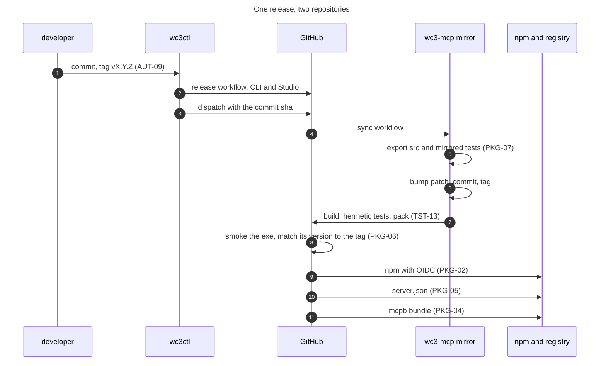

The chain is automated from the tag onward. The parts before it, the changelog, the docs, the publish and the local test run, are commands a person or an agent runs in an order they have to remember. That is the gap the automation requirements target.

### 15.5 What runs by itself, and what does not

| Step | Automatic today | Where it runs | Requirement |
|---|---|---|---|
| Hermetic test suite | Yes, on push and pull request | `ci.yml` | TST-13 |
| Docs freshness | Yes, as a test in the suite | The test suite | TST-06 |
| CLI and MCP parity | Yes, as a test in the suite | The test suite | TST-05 |
| Release build and packaging | Yes, on a `v*` tag | `release.yml` | PKG-01 to PKG-06 |
| Export into the mirror | Yes, on a dispatch from the release | `sync.yml` | PKG-07 |
| Version bump in the mirror | Yes, in the sync workflow | `sync.yml` | IDN-02 |
| npm, bundle and registry publish | Yes, after the release | `release.yml` | PKG-02, PKG-04, PKG-05 |
| Changelog generation | A command, run by hand | `changelog` | AUT-01 |
| Docs regeneration | A command, run by hand after a surface change | `docs` | AUT-03 |
| Publish to `dist` | A script, run by hand | `publish-all.ps1` | AUT-04 |
| Build, test, docs and publish after a change | No | none | AUT-05 |
| One release-readiness verdict | No | none | AUT-06 |

### 15.6 What the automation requirements add

AUT-01 to AUT-10 in section 4 turn this list into one loop. The changelog gains requirement IDs and a breaking-change section. The docs gain the parameters and results. The publish gains the test run and the docs regeneration. A watch command rebuilds on a change. A release-readiness command runs every gate and prints one verdict. Every step answers `--json`, so an agent can drive the same loop the person drives.

None of that exists today. That is why the rows are in section 10 as G-37 to G-45 and not in this section as behaviour.

### 15.7 Release checklist

The order matters. A failed gate stops the release rather than being noted and left for later.

1. Every requirement in scope has its acceptance check passing.
2. Generate the changelog with `wc3ctl changelog --from <last> --to HEAD --out changelog/<version>.md` and read it.
3. Regenerate both references with `wc3ctl docs cli --force` and `wc3ctl docs mcp --force`.
4. Bump the version in `Directory.Build.props`, and commit the changelog, the references and the code as the release candidate. The version is now part of the commit under test, not a change made after the test.
5. Run the hermetic suite, `dotnet test --filter "Category!=Corpus&Category!=GameData&Category!=Doctor"`, on that commit.
6. Run `pwsh scripts/publish-all.ps1` from that commit and confirm every exe timestamp is now.
7. Smoke both surfaces, `scripts/smoke-mcp.ps1 -Exe dist\wc3ctl.exe -Arguments 'mcp serve'` and the same against `dist-mcp\Wc3.Mcp.exe`, and record the commit and the artifact hashes beside the result.
8. Tag the tested commit `v<version>` and push only when asked.
9. Watch the release, the dispatch, the mirror sync, npm, the bundle and the registry.
10. Verify the published exe prints the tag version, and that npm, `server.json` and the bundle carry it.

Step 8 is the only one that changes a remote, and it happens only on an explicit request. A timestamp is diagnostic, not proof of identity. The proof is the full commit, the artifact hash and the tag pointing at the commit that was tested.

## 16. Adding a tool

A new tool touches more than one layer, and the tests fail until each layer is updated. The figure is the order, and the gates are the tests.

**1 Logic.** The behaviour lives in the shared layer, and the CLI gets the same verb.

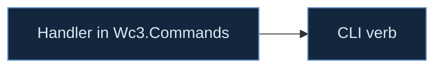

**2 Surface.** The tool is declared once, and the tests hold its name and its hints.

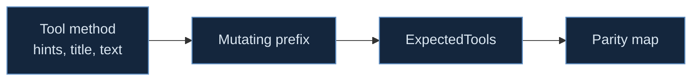

**3 Proof.** A write is proven against a synthetic map, and a publish is proven against the exe.


The gates belong to the layers. The logic layer is held by SUR-01, one behaviour for the CLI, the Studio and MCP, and by the parity test (TST-05). The surface layer is held by the description, parameter and title rules (SUR-05, SUR-09, SUR-10), the annotation audit (SAF-01) and the exact tool list (TST-01). The proof layer is held by the smoke test (TST-02), the write sweep (TST-03), the docs guard (TST-06), the hermetic suite (TST-13) and the publish check (AUT-04, AUT-08).

Two rules apply to every layer. A tool never writes in place, and a tool never learns the map format. If a change seems to need either, the logic belongs in `Wc3.Commands` and the tool is only its front door.

## 17. How the spec stays true

A specification that lives only in prose drifts. This one is kept as data, and the prose is the view.

- `requirements.json` holds every requirement with its group, statement, basis, gap link and status.
- The Status column and the gap link are generated from that file by `tools/sync_requirements.py`. The command is run before a commit that changes a requirement, and it rewrites the column rather than asking a person to edit 174 rows.
- The legend is three values. `gap` means a row in section 10 names the requirement. `unassessed` means no gap names it, which is not the same as proven. `met` is set only when a named test passes against the live surface.

### Definition of done

A change is done when all six are true.

1. The code is in `Wc3.Commands` and the front end only renders it.
2. A test named after the requirement fails before the change and passes after it.
3. The two generated references are regenerated.
4. The changelog entry names the requirement the change satisfies.
5. Every dist target is republished into a fresh folder, and the exe timestamp is now.
6. The requirement's status is `met` in `requirements.json`, with the test name recorded.

A change that meets five of the six is not done, and the spec says so rather than letting a green build stand in for a published binary.

### Change protocol

- A new requirement needs a failing test first, then the statement in the data file, then the code.
- A removed requirement needs a decision record that names what replaces it.
- A rename needs the alias window in SUR-03, and the old name stays served for one minor release.
- An open question is closed by the experiment named in section 9, not by an opinion in a meeting.

### What is measured

Four numbers, locally, with no telemetry. The size of `tools/list` in tokens, the cold start, the five slowest tools, and the share of requirements at `met`. A release note quotes the first three, and the fourth is the one that says whether the spec is being kept.

## 18. The slice queue

The work is pulled in vertical slices. Each slice closes a small set of requirements, ships a capability a client can use, and ends with a demo in a real client and its acceptance run. No dates, because a slice ends when its gates pass.

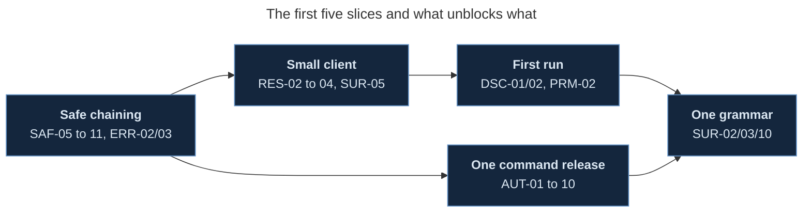

- **Safe chaining.** The write gate, the digests, `expect_input_sha256`, `confirm`, atomic save and the error codes. It unlocks every workflow where an agent makes more than one edit. The first part is in, and `object_batch_set` removes the chained-edit mistake for object fields by applying up to 500 edits in one load and one save.
- **Small client.** Output schemas, the result cap and paging, the lossy decode report, `file_extract` and `tool_help`. It makes the server usable from a context that cannot hold 270 descriptions.
- **First run.** Real initialize instructions, `quickstart` covering every family, the ten prompts and a capability report. It is what a new user meets.
- **One command release.** Changelog with requirement IDs, docs with schemas, watch and rebuild, the readiness verdict and JSON output. It is what keeps the spec true between releases.
- **One grammar.** The canonical renames with aliases, the alias window, titles and the description cap. It is the last slice because it touches every tool and is safest after the surface settles.

A slice is pulled when its dependencies are met. A new gap can reorder the queue, and a slice that grows past its requirement list is split rather than widened.

## 19. Change log

| Version | Date | Change |
|---|---|---|
| 1 | 8 November 2026 | First draft. States the server as measured on this date, the capability catalogue, the automation, the requirements for the version that follows, the acceptance checks, the assumptions, the open questions, the recorded history, the defects that produced each rule, and the requirement status data |
| 1.1 | 8 November 2026 | Verified the measured claims against the published exe, added Appendix D for external sources and Appendix E for the verification log, recorded the re-measurement deltas in section 3.13, added DOC-06, and added G-46 to G-49 for the citation, guard, description and revision gaps the audit found |
| 1.2 | 8 November 2026 | Adds `object_batch_set` and routes `object_bulk_set` through the gate, states the nine hardening items as SAF-13 to SAF-15, RES-11, PRF-08, PRF-09, RSC-07, PKG-13, TST-14, CMP-07, SEC-08, AUT-11 and DOC-07, with gaps G-50 to G-60 and checks AC-34 to AC-38, and re-measures the surface at 270 tools |
| 1.3 | 8 November 2026 | Adds the read-only `audit_ability_orders` tool and `audit orders` verb, measured on Anime Choice Arena V0.33A and Anime WoS2 v0.34h, SAF-16 and AC-39, section 21 for the anime-map workstreams, and re-measures the surface at 271 tools |

## 20. Hardening beyond safe chaining

The first slice makes one write safe to chain. The second review named nine things that slice does not reach. This section states what each one means and where it lands, so the requirement has a design behind it rather than a sentence.

### 20.1 A batch that removes the chaining mistake

`object_batch_set` applies up to 500 edits in one load and one save. The logic is `ObjectBatchSetCommand` in the shared layer, the CLI verb is `object batch-set`, and the MCP tool carries the gate's `overwrite` and `expect_input_sha256`. The batch is all or nothing, so a failing edit leaves the input and the output folder untouched.

It closes the common case of several fields on one object. It does not close two edits that must land in different families, which is why SAF-13 stays a gap for the rest.

### 20.2 One gate, three front ends

The gate belongs in the shared layer. The MCP adapter should bind arguments, map errors and present results, and do nothing else. The change is to move the gate out of `Wc3.Mcp` as an artifact writer in `Wc3.Commands`, have the MCP tools call it, and route the CLI and Studio save paths through the same type. The test is that the same refusal is produced with no MCP session open.

### 20.3 Multi-file outputs

An export that writes an OBJ, an MTL and textures cannot be atomic file by file. The choice is a staged directory renamed into place, or files written first and a manifest written last, with a result that lists each artifact and its digest. The second works for a folder the caller names and survives a crash with an obvious missing manifest. RES-11 is the envelope and SAF-15 is the publish rule.

### 20.4 Lifecycle

A progress token arrives with the request, so progress cannot be invented when work becomes slow. The contract is a phase list, a tick rate, cancellation checked at named points, child processes terminated with the call, temporary files removed, and a commit point after which the artifact exists even if the client disconnects. The lost reply is the case to test, because a retry has to survive it.

### 20.5 Limits before allocation

A hostile map is a resource threat as much as a parser threat. The limits are entry count, decompressed bytes per entry and per call, parser depth, array length, temporary disk and child-process time, each refusing with a code before the allocation. The memory budget is measured on the reference machine, and PRF-09 states the measured number rather than a formula.

### 20.6 Cache identity

A cache key is the input digest, the options, the target build and the tool version. A path is not an identity, because the file at a path changes. The doctor cache moves first, since its verdict is the one a user acts on.

### 20.7 Provenance

A version number is a name, not a provenance. The release record names the commit, the artifact digest and the tag, and a published package resolves to that record. That is how the 0.5.19 question is answered without guessing.

### 20.8 Semantic write tests

A write sweep that asserts the output loads is what the recorded defects already beat. Each family gets one assertion that the intended change is present and one that unrelated data is unchanged, on a fixture that fails if the change leaks.

### 20.9 The print edition

The tables are 7.2pt because the document is dense. A light edition at a larger size, with the same content, is a build flag rather than a second source. The cover statistics are already generated from the document, which is the part that matters for truth.

## 21. Building a playable anime map

The two reference maps are the target, not a hypothetical. Both were read on 8 November 2026 with `wc3ctl overview`.

| Map | Players | Files | Content | BLP | MDX | MP3 | Abilities | Units |
|---|---|---|---|---|---|---|---|---|
| Anime Choice Arena V0.33A | 10 | 11,540 | 677 MB | 8,303 | 3,091 | 2 | 2,728 | 2,522 |
| Anime WoS2 v0.34h | 15 | 7,099 | 356 MB | 4,134 | 1,207 | 1,374 | 763 | 100 |

Every workstream below is a design recommendation, not a claim about the build. One has shipped, and it is the model for the rest because it produced numbers on both maps before any new content was generated.

### 21.1 Ability packages and order conflicts

An anime skill is a timeline, not one damage event, and a hero is a set of packages that must not collide. The first shipped check is the collision that costs a player a key press.

`audit_ability_orders`, or `wc3ctl audit orders`, groups Channel-based abilities by their Base Order ID (`Ncl6`) and reports every string used twice or more. It also reports levels that disagree and empty ids. Read-only, no game install, no script run.

| Map | Channel abilities | Distinct orders | Shared orders |
|---|---|---|---|
| Anime Choice Arena V0.33A | 1,105 | 172 | 105 |
| Anime WoS2 v0.34h | 389 | 97 | 53 |

The largest group in the arena map is `acidbomb` on 92 abilities, then `channel` and `decouple` on 75 each. In WoS2 it is `acolyteharvest` on 92. A hero that carries two abilities from one group can fire both from one press, and which one wins is not something the map author chose.

The hero scope exists but WoS2 keeps its ability lists in the script rather than in `uabi`, so the whole-map mode is the one that works there. That is itself a finding, and the next check is a reader for `UnitAddAbility` in the script.

The rest of the workstream is the cast model. A timeline with gameplay and presentation tracks, interruption rules per phase, a resource commitment point, independent state per cast, damage tags, a multi-hit policy, a hitbox shape independent of the model, and a swept-segment projectile test. Each is a requirement rather than a paragraph when it is implemented.

### 21.2 The hero as a package

Identity, presentation, combat, abilities, forms, an animation map, attachments, progression and bot behaviour. `hero export`, `hero lint` and `hero install` already carry a portable definition. The next step is to make the package complete and auditable, so a hero cannot install with a missing model, icon, sound or attachment point.

### 21.3 Content roles and asset substitution

A logical role such as `hero.flame_swordsman.ultimate_impact` lets placeholder art be replaced without finding every filename in every trigger. The role is authored, the file is bound to it, and a substitution edits the binding.

### 21.4 Combat semantics

A damage sequence with named stages, damage tags that stop reflection chains, explicit multi-hit rules, hitboxes that are not the visual model, projectile collision along the travelled segment, separate rules for dash, blink, leap, knockback and pull, an airborne state, and status stacking that explains why a unit cannot act.

### 21.5 Presentation budgets

Model cost by geoset, material, texture, bone, track and emitter, then per animation. Texture memory from decoded dimensions rather than compressed bytes. VFX as a composition with a live-particle estimate and a screen-coverage warning. Audio as semantic events with concurrency limits and a warning priority above spectacle.

### 21.6 Encounters and world

Terrain laid out for dashes and projectiles, route checks for knockback and summons, boss phases with ordered transitions, telegraph scheduling that cannot demand two contradictory safe zones, and a complete match reset.

### 21.7 Progression and UI

A project manifest for player count, match length, camera and progression, scaling rules that say what adds and what multiplies, generated UI that reads the same data as the gameplay, camera changes that restore, and per-player presentation intensity that cannot change combat state.

### 21.8 Verification on the real maps

The order audit is the pattern. Each workstream gets a read-only check that runs against these two maps and reports numbers, before a generator is allowed to write anything. The next three are hero package completeness, ability timeline coverage, and a VFX budget per simultaneous ultimate. A generation step earns its place only after its audit can measure the maps it is meant to improve.

## Appendix A. Prior documents and decisions


These are the documents this specification builds on. Where one of them is authoritative, this document cites it rather than restating it.

| Document | What it settles | Used here for |
|---|---|---|
| `CLAUDE.md`, the project manual | The build, test and publish rules, the map optimisation playbook and the recorded traps | The fidelity rules, the doctor gate, the get-text corruption, the dummy model, the leak model caveat |
| `src/Wc3.Mcp/README.md` | The server's own architecture, registration and tool subset | Section 3, section 6 |
| `docs/mcp-reference.md` | The generated per-tool reference, guarded against staleness | Section 3.3, DOC-01 |
| `docs/wc3ctl-command-reference.md` | The generated CLI reference | The parity map and RES-06 |
| `changelog/0.4.0.md` to `0.4.13.md` | The release record, including every MCP sweep and its findings | Sections 11, 12 and 13 |
| `docs/superpowers/plans/2026-10-16-oneclick-npm-qol-master-plan.md` | The checklist every new tool follows, annotations, mutating prefixes, the expected tool list, the parity map and the docs regeneration | SUR-01, SAF-01, DSC-04, TST-05, TST-06 |
| `docs/superpowers/specs/2026-07-12-mapdocument-core-design.md` | The map model, raw preservation and the round-trip gate | SAF-06 and the fidelity rule |
| `docs/superpowers/specs/2026-07-12-object-data-merge-casc-design.md` | The object-data merge over CASC and the base game overlay | PAR-02, PAR-04 |
| `docs/superpowers/specs/2026-07-23-functional-audit-and-plan.md` | The gaps that led to the CLI and MCP parity push, including the missing trigger, player, force, camera and pathing access | SUR-01, TST-05 |
| `docs/superpowers/specs/2026-10-21-model-compression.md` | The gated lossy model pipeline and its acceptance thresholds | `model_squish`, SAF-03 |
| `docs/schemas.md` | The per-build schema dataset and its provenance | PAR-03, PRF-06 |
| `docs/leaks.md` | The static and runtime leak method and its accuracy | `script_leaks`, `leak_*`, TST-02 |
| `docs/model-optimization.md` | The model audit, decimation and the perceptual gate | `model_*`, `texture_*` |
| `docs/reforged-3.0.0-blizzard-bug-report.md` | What a Reforged patch broke and what a repair may not claim | `repair_*`, DOC-03 |
| `docs/reforged-world-editor-gap-analysis.md` | Where the World Editor stops and this toolkit has to carry the work | The tool families |
| `docs/third-party-editor-survey.md` | The other editors and the features a user expects | The surface, and Q1 |
| `.superpowers/sdd/version-schemas-progress.md` | The schema, compat and target-build work, and the state it was left in | PAR-03, `gamedata_*`, `compat_*` |
| The mirror's `README.md`, `REQUIREMENTS.md`, `SECURITY.md`, `CONTRIBUTING.md`, `server.json` and `mcpb/manifest.json` | The public product's install, registry entry, bundle and security posture | Sections 3.6, 3.7 and 6.10, PKG-02 to PKG-05, SEC-01 |

### Related work in the vault

The vault holds the README of `wc3-forge-mcp`, a separate Warcraft III MCP server, at `raw/vendor-docs/warcraft/StephenSHorton-wc3-forge@HEAD/StephenSHorton-wc3-forge-mcp-README.md`. It is related work to compare against, not a source this server is built from, and the comparison is useful because it takes the opposite architecture at three points.

| Point | wc3-forge-mcp | This server | What the comparison settles |
|---|---|---|---|
| Where the work happens | A live editor process, reached over a JSON-RPC bridge on a TCP port | A map file on disk, read and written byte faithfully with no editor running | The offline claim in section 3.12 and SAF-01, because a file server can be checked by reading a file and a bridge cannot |
| Trust | A per-instance lockfile carrying a token, sent as `_token` on every request | The user's own account and file permissions, with no token | SEC-05, and why this document says a local process is not a security boundary |
| Several editors | Two tools, `sessions_list` and `session_select`, route calls to one running instance | No session concept, because two calls never share state | Q1 and Q7, and the reason TRN-04 requires two servers to run against the same maps without a lock |

The two servers do not overlap in what they can do. wc3-forge edits inside a running editor and can see what the engine accepts, which this server can only measure through a probe. This server reads and writes a map without the editor, which the bridge cannot do for a map nobody has open.

The assistant session record in WikiGraph is also a source, and `wg-code sessions` and `wg-code session <id>` replay it. It was not used for this draft because the repository record is more precise and citable, and a session replay cannot be quoted as a file and a line. Where a session and a changelog disagree, the changelog wins, because it is what shipped.

## Appendix B. Measurement and traceability

The surface numbers in this document come from one capture, not from the generated reference. The Release build of `Wc3.Mcp` was started with no arguments and driven over stdio with four requests, `initialize`, `tools/list`, `resources/list` and `prompts/list`, after the initialized notification. The reply was saved as JSON and the counts, the annotation matrix, the parameter frequencies and the description lengths were computed from it. The inventory in section 6.5 is generated from the same capture.

The version values come from five files read directly, `Directory.Build.props` in each repository, `npm/package.json`, `mcpb/manifest.json` and `server.json`.

The test result comes from a Release run on 8 November 2026 with the filter described in section 3.8. It was 50 passed, 0 failed, 0 skipped, 3 seconds. The two corpus-gated suites were not run and are reported as gated, not as passing.

The description and parameter counts are measured over that capture. The statements about what the code does, such as the presence of `ResolveOutPath`, the UTF-8 decode and the stderr logging, come from reading the source named beside them and are labelled as measured only where the behaviour is visible in the code path. A behaviour that depends on a client, such as whether a client displays a destructive hint, is an assumption or an open question, never a measurement.

### Traceability

Every requirement group maps to at least one acceptance check. The pairing is listed here so a reader can go from a promise to its proof without searching.

| Requirement group | Requirements | Acceptance checks |
|---|---|---|
| IDN, identity and version | 6 | AC-01, AC-02 |
| TRN, transport and lifecycle | 7 | AC-03, AC-04 |
| SUR, tool surface and naming | 10 | AC-05, AC-06 |
| SAF, safety and annotations | 16 | AC-08, AC-09, AC-10, AC-11, AC-34, AC-35, AC-39 |
| PAR, parameters and environment | 9 | AC-07, AC-12, AC-13 |
| RES, results and the context budget | 11 | AC-14, AC-15, AC-16, AC-17, AC-36 |
| ERR, errors | 7 | AC-18, AC-19 |
| RSC, resources | 7 | AC-20, AC-37 |
| PRM, prompts | 5 | AC-21 |
| DSC, discovery and guidance | 6 | AC-22 |
| ENV, environment and configuration | 6 | AC-23 |
| SET, setup and registration | 11 | AC-24 |
| PKG, packaging and release | 13 | AC-25, AC-26, AC-36 |
| DOC, documentation | 7 | AC-27, AC-38 |
| SEC, security and privacy | 8 | AC-28, AC-38 |
| PRF, performance and resources | 9 | AC-29, AC-37 |
| OBS, observability | 4 | AC-30 |
| CMP, compatibility and deprecation | 7 | AC-31, AC-38 |
| TST, testing and CI | 14 | AC-32, AC-38 |
| AUT, automation | 11 | AC-33, AC-36 |

Two checks are wider than one group. AC-07 settles the type and enum half of SUR-09 as well as PAR-05, and AC-08 settles the write half of SAF-02 that AC-09 also exercises. Where two checks overlap, the stricter one is the gate.

## Appendix C. Tool index

Every tool name, grouped by family. A name alone is the index, and the tool itself is described in `docs/mcp-reference.md` and in `wc3://tools`.

**Map and archive inspection** (22). `file_get_text`, `file_list`, `file_set`, `imports_list`, `list_files`, `map_compat`, `map_info`, `map_info_get`, `map_info_set`, `map_optimize`, `map_overview`, `mpq_add`, `mpq_bytes_diff`, `mpq_extract_all`, `mpq_listfile`, `mpq_merge`, `mpq_name_recover`, `mpq_rebuild`, `mpq_remove`, `mpq_remove_many`, `mpq_strip_bookkeeping`, `mpq_verify`.

**Objects and game data** (30). `gamedata_bounds`, `gamedata_changelog`, `gamedata_coverage`, `gamedata_enum`, `gamedata_export_schemas`, `gamedata_field_lookup`, `gamedata_history`, `gamedata_schema_diff`, `gamedata_sources`, `object_batch_set`, `object_bulk_set`, `object_clone`, `object_deprecated`, `object_export`, `object_field_options`, `object_fix_model_ext`, `object_form`, `object_get`, `object_import`, `object_list`, `object_migrate`, `object_new`, `object_noop_fields`, `object_rawcode_suggest`, `object_rename`, `object_search`, `object_set`, `palette_doodad`, `uabi_profile`, `unit_abilities`.

**Placed instances, regions, players** (37). `camera_add`, `camera_list`, `camera_remove`, `camera_set`, `camera_tour`, `force_list`, `force_rename`, `force_set_flags`, `force_set_players`, `place_doodad`, `place_grid`, `place_item`, `place_region`, `place_scatter`, `place_start_location`, `place_unit`, `placed_doodad_get`, `placed_doodad_remove`, `placed_doodad_set`, `placed_doodads_list`, `placed_fix_refs`, `placed_missing_refs`, `placed_stats`, `placed_unit_get`, `placed_unit_remove`, `placed_unit_set`, `placed_units_list`, `player_list`, `player_set_color`, `player_set_force`, `player_set_name`, `player_set_race`, `region_create`, `region_list`, `region_remove`, `region_to_rect`, `region_validate`.

**Terrain, pathing and time of day** (20). `pathing_export_png`, `pathing_import_png`, `pathing_paint`, `pathing_validate`, `terrain_audit`, `terrain_blight`, `terrain_cliff`, `terrain_corner_get`, `terrain_corner_set`, `terrain_deform`, `terrain_export_heightmap`, `terrain_fill`, `terrain_import_heightmap`, `terrain_info`, `terrain_optimize`, `terrain_paint`, `terrain_ramp`, `terrain_smooth`, `terrain_stats`, `terrain_water`.

**Scripts** (32). `diff`, `lint`, `lint_baseline`, `roundtrip`, `script_api_usage`, `script_bench`, `script_callgraph`, `script_check`, `script_complexity`, `script_conversion_notes`, `script_decompile`, `script_duplicate_bodies`, `script_format`, `script_functions`, `script_leaks`, `script_lua_api`, `script_lua_check`, `script_lua_globals`, `script_lua_leaks`, `script_lua_to_jass`, `script_modernize`, `script_null_locals`, `script_reachable`, `script_references`, `script_semantic_diff`, `script_to_lua`, `script_unused_functions`, `script_unused_globals`, `script_verify`, `search`, `validate`, `validate_strict`.

**Triggers and hero wiring** (35). `audit_ability`, `audit_fidelity`, `audit_hero`, `audit_map`, `audit_readiness`, `audit_trend`, `hero_install`, `hero_lint`, `hero_roster`, `trigger_add`, `trigger_add_category`, `trigger_add_eca`, `trigger_catalog_describe`, `trigger_catalog_list`, `trigger_dead`, `trigger_diff`, `trigger_export`, `trigger_lint`, `trigger_move`, `trigger_recover_from_script`, `trigger_remove`, `trigger_remove_eca`, `trigger_rename`, `trigger_set_code`, `trigger_set_eca_enabled`, `trigger_set_enabled`, `trigger_set_initially_on`, `trigger_set_run_on_map_init`, `trigger_sync_bodies`, `trigger_to_script`, `trigger_var_add`, `trigger_var_list`, `trigger_var_remove`, `trigger_var_set`, `triggers_read`.

**Assets, models and textures** (33). `asset_audit`, `asset_convert_batch`, `asset_duplicates`, `asset_import_wire`, `asset_list`, `asset_model_lint`, `asset_replace`, `asset_report`, `asset_size_report`, `asset_thumbnails`, `asset_unused`, `model_audit`, `model_compare`, `model_export_obj`, `model_import`, `model_lint`, `model_lod`, `model_optimize`, `model_squish`, `render_model`, `sound_add`, `sound_list`, `sound_optimize`, `sound_remove`, `sound_set`, `strings_diff`, `strings_find`, `strings_list`, `strings_missing`, `strings_set`, `strings_unused`, `texture_atlas`, `texture_optimize`.

**Porting and bundles** (7). `bundle_diff`, `bundle_merge`, `bundle_unit`, `port_deps`, `port_into_version`, `port_preview`, `port_unit`.

**Repair, doctor and compatibility** (15). `audit_ability_orders`, `compat_explain`, `compat_matrix`, `deprotect_map`, `doctor_check`, `doctor_compare`, `doctor_fix`, `doctor_inspect`, `new_map`, `repair_audit_errors`, `repair_generated`, `repair_portraits`, `target_get`, `target_list`, `target_set`.

**Leaks and benchmarks** (27). `bench_compat`, `bench_leaks`, `bench_open`, `bench_perf_gate`, `bench_schema_coverage`, `ci_all`, `ci_compat`, `ci_lint`, `ci_schema`, `ci_validate`, `leak_ab`, `leak_benchmark`, `leak_harness`, `leak_join`, `leak_list`, `leak_model`, `library_audit`, `library_compare`, `library_report`, `library_scan`, `library_validate`, `replay_diff`, `replay_find_map`, `replay_players`, `replay_stats`, `replay_summary`, `replay_timeline`.

**Product, catalog and context** (13). `changelog`, `docs_search`, `editor_catalog_get`, `editor_catalog_list`, `graph_hubs`, `graph_neighbors`, `graph_path`, `mcp_audit_annotations`, `mcp_export_verify`, `quickstart`, `rag_install`, `rag_status`, `version_info`.


## Appendix D. External sources

A requirement whose basis names the protocol, a client behaviour or a published measurement cites one of these. The copies were read from the vendor documentation in WikiGraph under `raw/vendor-docs/reference/modelcontextprotocol-modelcontextprotocol@HEAD/`, and every quotation below was checked against that text rather than recalled.

| Source | What it settles | Requirements |
|---|---|---|
| The MCP specification, revision 2024-11-05, server tools | The tool object, `name`, `description`, `inputSchema` and the message flow. This revision has no `outputSchema`, no `structuredContent` and no tool `title` | SUR-01, RES-01, CMP-01 |
| The MCP specification, revision 2025-06-18, server tools | The first revision with `outputSchema` and `structuredContent`. An output schema is optional, and a server that publishes one MUST conform to it. `title` is part of the tool object. Servers MUST validate tool inputs and sanitize tool outputs. Clients SHOULD prompt for confirmation on sensitive operations | RES-02, SUR-10, SEC-01, SAF-10 |
| The `ToolAnnotations` interface | `readOnlyHint` defaults false, `destructiveHint` defaults true, `idempotentHint` defaults false and `openWorldHint` defaults true. The spec says the hints are not guaranteed to describe behaviour and a client MUST treat them as untrusted unless the server is trusted | SAF-01, SAF-02, SAF-03, SAF-10 |
| Client best practices, every revision from 2024-11-05 to the draft | Filtering the catalog so the model focuses on a few relevant tools rather than scanning hundreds of irrelevant ones reduces token use and improves tool selection accuracy | SUR-07, Q1, Q2 |
| Tool Annotations as Risk Vocabulary, the protocol blog of 16 March 2026 | The hints drive confirmation prompts in clients that honour them, and they are informational only from an untrusted server. That is why a server side `confirm` is required and the hint alone is not enough | SAF-10, Q4 |
| The protocol roadmap of 22 August 2026 | Tool calling has held up over the life of the protocol and result handling is the part that needs work, which is where the result envelope requirements sit | RES-02, RES-03 |

Three limits belong with these sources. The protocol allows an output schema, it does not require one, so RES-02 requiring one on every tool is a stronger design decision and not a protocol mandate. The published specification has four revisions after the one this server answers, which is G-49 and not a claim that the server is behind, because the pinned SDK decides what it can negotiate. The description cap of 600 characters in SUR-05 and the surface cap of 300 tools in SUR-07 are this document's judgement. The client best practices source supports a smaller filtered surface, and nothing published supports the exact number 600.

The vault page `wiki/topics/The MCP Surface.md` was also read. It is a useful capability map and it is stale on counts, saying 252 tools against the 270 this document measures, so its status column is worth reading and its numbers are not.

## Appendix E. Verification log

The numbers in section 3 were re-derived on 8 November 2026 from the published exe rather than from the document. The log below records the 269 tool capture. Two later slices added `object_batch_set` and `audit_ability_orders`, so the current surface is 271 and the live values in section 3.1 are the ones to use. The question the log answers is whether this document is a measurement or a composition.

The method is five requests over stdio and one read of each version file. The server is started with no arguments and driven with `initialize`, the initialized notification, `tools/list`, `prompts/list` and `resources/list`. The reply is parsed and every count below is computed from it. No number was taken from an earlier draft, and the script was written before the numbers were compared, so it could disagree.

| Claim | Where | Result |
|---|---|---|
| 269 tools, 156 read-only, 113 writing | 3.1 | Confirmed |
| 9 destructive, 6 unset, 1 open world, 0 with no annotations | 3.1 | Confirmed, and the six are the six named |
| 5 tools with no parameters, 18 that require none, maximum 8 required | 3.1, 3.4 | Confirmed |
| 3 resources, 5 prompts, revision 2024-11-05, SDK 1.4.1 | 3.1 | Confirmed |
| The initialize line is 60 characters and names the target and the game build | 3.1, 3.9 | Confirmed, byte for byte |
| 81,615 description characters, median 259, longest 1,126, shortest 94 | 3.3 | Confirmed, now 81,772 as section 3.13 explains |
| 0 titles and 0 output schemas | 3.1, 3.3 | Confirmed |
| 18 descriptions over 600 characters, 2 over 1,000, 33 under 150 | 3.3, G-06 | Confirmed |
| 619 strings, 96 integers, 38 numbers, 38 booleans and 12 arrays, with the stated optional counts | 3.4 | Confirmed under the nullable rule, now 620 and 39 after the slice |
| `map` on 198 tools, `out_path` on 107, `game_dir` on 36 and `kind` on 20 | 3.4 | Confirmed |
| 269 tools in 55 families, 33 families under five tools, largest 25 | 3.2 | Confirmed |
| Six committed version values, 0.4.13, 0.5.16, 0.5.8, 0.3.0 twice and a stale 0.5.9 | 3.7 | Confirmed, and the npm registry adds a seventh, 0.5.19, that no tag explains |
| Ten workflows in `quickstart` and five prompts | 3.5, G-21 | Confirmed |
| `file_get_text` decodes UTF-8 with replacement rather than throwing | 3.11, G-05 | Confirmed in `FileEditCommand.ReadText`, which uses a `UTF8Encoding` with the default fallback |
| `listChanged` true on all three collections | 3.1, G-24 | Confirmed |

Two claims needed a definition before they could be checked. The parameter counts treat a nullable type as its base type and count it as optional, which section 3.4 does not state and this appendix now does. The description total moved because of the first slice, and the 157 character delta matches the growth of the `object_set` description exactly.

One claim failed on the first reading and passed on the second. A count of top level parameter types gave 483 strings against the stated 619, which reads as a fabricated number. The difference is the 136 nullable strings, and once they are counted the two agree to the unit. The first reading was wrong, not the document. That is recorded here rather than quietly corrected, because a verification that reports only its successes is not a verification.
