# wc3-mcp server specification

Version 1, draft for review. Written before the code it describes.

Describes wc3ctl 0.4.13 and wc3-mcp 0.5.16, with the surface measured on 8 November 2026.

Owner, the wc3ctl maintainer. Reviewers, the wc3-mcp maintainer and a client author integrating the server.

This document specifies the MCP server that ships as `wc3-mcp` and as `wc3ctl mcp serve`, the set of tools it offers an AI client, the safety rules every tool follows, the way a result comes back, the way it is registered with a client, and the way it is built, tested and released. It states the server as it stands today, measured, and the requirements the next version has to meet. Section 10 lists every place the build differs from those requirements, and that list is the work queue.

Nothing in this document is a plan with dates. A requirement is met when its acceptance check passes, and the order the work happens in follows the dependencies between requirements, not a calendar.

## 1. Definitions

This section defines the words this document uses and what each means here. A requirement ID in brackets names the requirement that uses the term.

### Protocol

| Term | What it means here |
|---|---|
| MCP | Model Context Protocol, the JSON-RPC protocol an AI client uses to discover and call tools on a server. This document follows the revision dated 2024-11-05, the one the bundled SDK negotiates today |
| Client | The AI application that starts the server, lists its tools and calls them, such as Claude Desktop, Claude Code, Cursor, VS Code, Codex, Windsurf, Gemini CLI, Cline, LM Studio or Zed |
| Server | The process this document specifies, `wc3-mcp.exe` or `wc3ctl.exe mcp serve`, speaking MCP over stdio |
| Tool | One named operation the server exposes, with a description, an input schema, four annotation hints and a JSON result (SUR-01) |
| Resource | A named document the client can read by URI, separate from a tool call. This server serves its reference documents and its tool catalog this way (RSC-01) |
| Prompt | A named instruction template the client can pull from the server, returning text rather than performing work (PRM-01) |
| Annotation hint | One of the four booleans a tool declares, `readOnlyHint`, `destructiveHint`, `idempotentHint` and `openWorldHint`. A client uses them to decide whether to ask the user before a call (SAF-01) |
| Input schema | The JSON Schema a tool publishes for its arguments, generated from the method signature and its `[Description]` attributes |
| Output schema | The JSON Schema a tool publishes for its result. No tool publishes one today, and RES-02 requires it |
| Structured content | The machine-readable half of a tool result, as distinct from the text content block. RES-02 requires both |
| Tool error | A failed call returned as a protocol-level error result with `isError`, not a crashed process and not a stack trace (ERR-01) |
| Protocol version | The MCP revision string exchanged during initialize. The server accepts what the client offers and answers with the revision it implements |
| Capability | A feature the server declares during initialize, such as tools, resources and prompts, and whether each can change at run time (TRN-05) |
| Resource template | A resource URI with a variable part, so a client can read one section of a document rather than the whole file (RSC-02) |
| Content block | One item in a tool result, either text, an image, or a resource link. Binary payloads above the inline limit travel as a path or a link, not as base64 (RES-05) |

### Products and source

| Term | What it means here |
|---|---|
| wc3ctl | The toolkit repository this server is written in. It holds the command line tool, the Avalonia desktop editor and the MCP server, all over one shared command layer |
| wc3-mcp | The public product repository, a filtered mirror of the server and the libraries it needs, published to npm, the MCP Registry and GitHub Releases. Its source is generated from wc3ctl and is never edited there (PKG-07) |
| Front end | A program that presents the shared command layer, either the CLI, the Studio or this MCP server. A front end renders and never parses (SUR-01) |
| Wc3.Commands | The shared command layer. Every tool that acts on a map or a game file is a thin wrapper over one handler here, and no map parsing lives in `Wc3.Mcp` (SUR-01) |
| Export | The copy of `src/` and the mirrored tests from a named wc3ctl commit into the wc3-mcp checkout, performed by `scripts/export-wc3-mcp.py` (PKG-07) |
| Surface | The whole set of tools, resources and prompts one server build offers. It is computed by reflection, so the catalog, the audit, the docs and a real client all read the same list (DSC-04) |
| Family | The group of tools that share a name prefix, such as `object_`, `terrain_` or `trigger_`, and the unit of the inventory in section 6.5 (SUR-06) |
| Profile | A named subset of the surface a caller can select at start, so a small client can carry a smaller tool list. The full surface is the default (SUR-07) |
| Catalog | The machine-readable list of every tool with its description and hints, served as `wc3://tools` and printed by `wc3ctl mcp tools` |

### Maps and files

| Term | What it means here |
|---|---|
| Map | A Warcraft III `.w3x` or `.w3m` file, or an unpacked map folder holding the same internal files (PAR-01) |
| Internal file | One file inside the map archive, named by its archive path, such as `war3map.j` or `war3mapImported\dummy.mdx` |
| Imported asset | An internal file that the map carries rather than the base game, listed in `war3map.imp` |
| Read | A tool that changes no byte anywhere. It may write a cache entry the server owns, but never a map, an asset or a client config (SAF-02) |
| Write | A tool that produces a new file. Every write tool names its output and never edits its input (SAF-08) |
| Destructive | A write that can discard map content, such as removing a placement, an object, a region or a parent category. A write that only adds or rebuilds is not destructive (SAF-03) |
| Idempotent | A tool whose second call with the same inputs and the same starting map produces the same result. A tool that allocates a new rawcode or creation number is not idempotent |
| Open world | A tool that can reach the network. Exactly one tool declares it today, `rag_install` (SEC-02) |
| Target build | The Warcraft III build a map is checked against, named by a schema folder or a build name. Resolution order is the tool argument, then `WC3_TARGET_BUILD`, then the saved setting, then the default (PAR-03) |
| Schemas directory | The folder holding one subfolder per game build, each with the object, trigger, script and enum sections the compatibility tools read |
| Game directory | The Warcraft III install used for base game data, resolved from the tool argument, then `WC3_GAME_DIR`, then auto-detection. An unset placeholder such as `${user_config.game_dir}` counts as unset (PAR-02) |
| out_path | The output file a write tool produces. It defaults to a sibling `.edited` copy for a map edit, and it is required where the output is a different artifact, such as a PNG, a CSV or a model |
| Edited copy | The default output of a map edit, named `<map>.edited.<ext>` beside the input, so a caller that omits `out_path` still cannot overwrite its input |
| Ported copy | The default output of a port, named `<target>.ported.<ext>` beside the target map |
| Write gate | The one code path every write passes through, which resolves the output path, refuses an output equal to the input, refuses an output inside a folder map, creates the parent directory and returns the digests (SAF-04) |
| Input digest | The SHA-256 of the input map bytes as they were read. A write reports it, and a caller can pass it back as `expect_input_sha256` so a file that changed after it was read is refused. It verifies the input revision and does not by itself choose the next file in a sequence (SAF-07) |
| Fidelity | The rule that an untouched internal file keeps its original bytes, and only the files an edit changed are re-serialized |

### Retrieval and measurement

| Term | What it means here |
|---|---|
| RAG index | The optional local vector index over the Warcraft III corpus, installed by `rag_install` or `wc3ctl rag install`, used by `docs_search` for semantic matches (RSC-06) |
| Lexical search | Matching query words on word boundaries and ranking passages by the terms they carry and by the section heading. It works with no download |
| Semantic search | Ranking passages by embedding similarity when the index and the model are installed |
| Corpus | The fixed dataset the RAG index is built from, never a folder named by the caller (SEC-03) |
| Measured | A number or behaviour this document states from an artifact read in this repository on the date given, such as a source file, the live protocol surface or a test run |
| Inferred | A statement that follows from the code but was not exercised in a run. It is labelled where it is used |
| Assumed | A statement taken on trust without an artifact. Section 8 holds the ones this specification depends on |

### Abbreviations

| Abbreviation | Expansion |
|---|---|
| CLI | Command line interface |
| GUI | Graphical user interface |
| JSON | JavaScript Object Notation |
| JSON-RPC | JSON Remote Procedure Call, the message format MCP uses |
| MDX | Warcraft III's binary model format, with MDL as its text twin |
| BLP | Warcraft III's texture format |
| MPQ | The archive format a map file is built on |
| SDK | Software development kit, here the official C# MCP SDK |
| SHA-256 | Secure Hash Algorithm, 256 bit, used for file and download identity |
| SSIM | Structural similarity, used by `model_compare` to score two renders |
| UTF-8 | Unicode Transformation Format, 8 bit, the encoding the text tools assume |
| WC3 | Warcraft III |
| CI | Continuous integration |

## 2. Purpose and scope

This document specifies the MCP server that exposes the wc3ctl map toolkit to an AI client. It is written for the maintainer who will change the server, for the reviewer who will judge the change, and for the client author who needs to know what the server promises. Every requirement has an ID, and section 7 gives the check that proves it.

The server is a thin front end over `Wc3.Commands`, the same layer the CLI and the Studio call. A client asks a question about a map, a model, an asset, a script or a replay, and the server loads the file, calls the shared handler and returns the handler's result object as JSON. A client that asks for a change gets a new file written beside the input, never the input rewritten. That one rule is what makes the server safe to hand to an agent that has never seen the map.

The server also carries reference knowledge. It serves two Warcraft III reference documents as resources, a lexical search over the same text, an optional semantic index, and thirteen prompt templates for the common jobs. Those are part of the same contract because a client that can read the UI-Frame tutorial whole, or search the Ability Insight reference for one field, does not have to guess from memory.

### The model in one picture


*Each arrow names the requirement behind it, here and in every diagram after it.*

### Who this is for

- The maintainer, who needs one place that says what every tool must do and what a change may not break.
- The reviewer, who needs a requirement to point at when a tool, a schema or a result is wrong.
- The client author, who needs to know which parameters are safe to send, what a write returns, and how to chain two edits without losing the first.
- The user, who needs to know what the server will and will not touch on their disk.

### Reading paths

Different readers need different sections. This table is the shortest route for each.

| Reader | Start with | Then |
|---|---|---|
| A client author | 1 and 2 | 5, 6, 7 |
| A maintainer | 3 | 4, 9 to 13, 16 |
| A reviewer | 3 | 4, 7, 10, 12 |
| A release manager | 15 | 17, Appendix A |
| A new contributor | 2 | 3, 11, 16 |

### What the server is not

It is not a map editor with its own state. Every call loads the file fresh, applies one change and saves one output. It is not a server with a database, a session, a user account or a background job. It is not a remote service. It is one local process per client, started on stdio, ending when the client closes the stream.

### In scope

- The tool surface, its names, parameters, descriptions and annotation hints.
- The result contract, including JSON shape, size limits and error codes.
- The resources, the prompts and the catalog.
- The setup commands that register the server with a client, and the client matrix.
- The environment variables, the target build and the game directory resolution.
- The packaging, the version identity and the release chain into npm, the MCP Registry and the `.mcpb` bundle.
- The test strategy and the CI guards that keep the surface honest.
- The known gaps between the build and this specification, in section 10.

### Out of scope

| Item | Why it is out |
|---|---|
| An HTTP, SSE or WebSocket transport | The server reads and writes the user's local files with the user's own permissions. A network transport would need authentication, authorization, tenancy and a hosting story that none of that has, and every current client can start a local process (TRN-06) |
| Authentication and user accounts | There is no remote boundary to authenticate across. The operating system account is the authorization boundary, and the threat model in SEC-05 states it |
| Editing a map in place | Every write produces a new file. This is the safety rule the whole surface is built on, not a limitation to be lifted (SAF-08) |
| Long-running sessions, jobs or queues | A call returns what it produced. A caller that needs a large batch calls the folder tools or the CLI |
| A second map engine | All parsing belongs to `Wc3.Commands` and the libraries under it. The server may not learn the map format (SUR-01) |
| The Studio's screens, the CLI's rendering and the npm launcher's internals | They are separate surfaces with their own documents. This one covers the protocol server and the packaging that carries it |
| Tool behaviour rules that belong to the shared layer | Fidelity, model parsing, script analysis and object merging are specified where they live. This document specifies how the server presents them |

### Relationship to wc3ctl and the public repository

The same source builds both products. In wc3ctl the exe reports the name `wc3ctl`, registers as `wc3ctl`, and is reached as `wc3ctl mcp serve`. In the public repository the same source builds `wc3-mcp.exe`, reports the name `wc3-mcp`, registers as `wc3`, and is reached by running the exe with no arguments. The identity comes from assembly metadata written by each repository's `Directory.Build.props`, never from a branch in the code (IDN-01).

The public repository owns its README, installer, workflows, bundle manifest, registry entry and licences. The source under `src/` and the mirrored tests are exported from a named wc3ctl commit and are never edited there (PKG-07). That is why a fix lands in wc3ctl first, and why the export is a separate, checked step. The export is behind today. The mirror checkout builds 267 tools and three resources, while this document measures 275 and six, and the eight missing tools are named in G-66.

### How to read a requirement

An ID is the group and a number, so `SAF-04` is the fourth requirement in the safety group. `SHALL` marks a requirement and `SHALL NOT` a prohibition. The Basis column names the evidence, the decision or the failure that the requirement rests on. Where a requirement is new in this revision, the basis says design decision and gives the reason.

This version holds 179 requirements in 20 groups, and 41 acceptance checks that cover them. A requirement that no check covers is a sentence, not a requirement, and the traceability check in Appendix B lists the pairing.

Numbers in this document are labelled. A number stated as measured came from a command or a file in this repository on 8 November 2026. A number stated as inferred came from reading the code and was not produced by a run. Nothing here is stated from memory.

The Basis column also separates three kinds of authority. A requirement whose basis names the protocol or a client behaviour cites the page in Appendix D. A requirement whose basis names a measurement can be re-run from the method in Appendix E. Everything else is a design decision, and this document says so rather than borrowing the grammar of a standard. The verification log in Appendix E records what happened when the measured claims were re-derived from the published exe, including the two counts that moved and the one claim that looked wrong until its definition was stated.

## 3. The build as it stands

This section is the measured state of the server on 8 November 2026. Nothing in it is a requirement. Section 4 states what the server must be, and section 10 lists where this state falls short.

### 3.1 The surface in numbers

The surface was captured by starting the Release build of `Wc3.Mcp` and sending `initialize`, `tools/list`, `resources/list` and `prompts/list` over stdio, then reading the reply. The counts are from that capture, not from the generated reference.

| Measure | Value |
|---|---|
| Tools | 277 |
| Read-only tools | 158 |
| Writing tools | 119 |
| Writing tools that declare `destructiveHint` true | 11 |
| Tools that leave any annotation hint unset | 0 |
| Tools that declare `openWorldHint` true | 1, which is `rag_install` |
| Tools that declare no annotations at all | 0 |
| Tools with no parameters | 5, which are `mcp_audit_annotations`, `leak_benchmark`, `rag_status`, `script_conversion_notes` and `version_info` |
| Resources | 436, the two documents, 430 sections, `wc3://tools` and the three skills |
| Prompts | 5 |
| Protocol revision answered | Every revision the pin knows, echoed: 2024-11-05, 2025-03-26, 2025-06-18 and 2025-11-25. An unknown offer gets 2025-11-25 |
| SDK package | `ModelContextProtocol` 1.4.1 |
| Server name and version in initialize | `wc3ctl` 0.4.13 |
| Initialize instructions | 405 characters, the product and version, the target and its source, whether game data is there, the three safety rules and the quickstart hint |
| Capabilities declared | logging, prompts with `listChanged`, resources with `listChanged`, tools with `listChanged` |
| Tools publishing an output schema | 12 |
| Tools using progress notifications or a cancellation token | 0 |

The surface is computed by reflection over the `[McpServerTool]` methods on `Wc3Tools` and `Wc3Context`, so the client, the catalog resource, the annotation audit and the generated reference all read one list. That is the strongest structural property the build has today and SUR-01 keeps it.

### 3.2 How the 277 tools divide

The groups below are the ones the inventory in section 6.5 uses. They follow the name prefix, which is how a client finds a family.

| Group | Tools |
|---|---|
| Map and archive inspection | 22 |
| Objects and game data | 30 |
| Placed instances, regions, players | 37 |
| Terrain, pathing and time of day | 20 |
| Scripts | 32 |
| Triggers and hero wiring | 35 |
| Assets, models and textures | 35 |
| Porting and bundles | 8 |
| Repair, doctor and compatibility | 15 |
| Leaks and benchmarks | 27 |
| Product, catalog and context | 14 |
| Total | 275 |

Thirty-three of the 55 families carry fewer than five tools each, and several carry exactly one. The largest are `trigger` at 25, `script` at 25, `object` at 18 and `terrain` at 16.

### 3.3 What a client is told

Every tool carries a description and an input schema. The generated `docs/mcp-reference.md` reproduces the description and the four hints, and it is guarded against staleness by CI.

| Measure | Value |
|---|---|
| Total description text across the surface | 81,893 characters, about 20,000 tokens |
| Median description | 264 characters |
| Longest description | 1,126 characters, on `model_import` |
| Shortest description | 94 characters, on `camera_remove` |
| Descriptions under 150 characters | 33 |
| Descriptions from 150 to 299 characters | 136 |
| Descriptions from 300 to 599 characters | 87 |
| Descriptions from 600 to 999 characters | 17 |
| Descriptions of 1,000 characters or more | 2 |
| Tools with a `title` annotation | 277 |

The description text is the part every client loads before it knows what the user wants, so it is the context cost of the surface. At about 20,000 tokens it is a real cost for a small model and a real reason to describe a tool in one sentence and keep the long rationale in the reference document (SUR-05, SUR-07). These values were re-measured after the first slice and moved by exactly the amount one description edit explains. Section 3.13 records the delta and the arithmetic.

### 3.4 Common parameters

The surface repeats a small set of parameter names across most tools. That repetition is the interface, so it is worth stating once.

| Parameter | Tools that take it | Meaning |
|---|---|---|
| `map` | 202 | A map file, or for a few tools a folder. PAR-01 requires the description to say which |
| `out_path` | 111 | The output file. Required where the output is a different artifact, optional with a `.edited` default for a map edit |
| `game_dir` | 37 | The Warcraft III install, overriding `WC3_GAME_DIR` and auto-detection |
| `schemas_dir` | 26 | The schema dataset folder, overriding the saved setting |
| `kind` | 21 | An Object Editor kind, one of unit, item, ability, destructable, doodad, buff or upgrade |
| `target` | 14 | A target build name or schema path |
| `rawcode` | 12 | A four-character object code |
| `folder` | 8 | A folder of maps, used by the library, asset and batch tools |
| `out_dir` | 5 | An output directory rather than a single output file |

The parameter types are 959 in total, 698 strings of which 227 are optional, 97 integers of which 33 are optional, 41 numbers of which 23 are optional, 110 booleans of which 101 are optional, and 13 arrays of which 4 are optional. A nullable type is counted as its base type, and a parameter counts as optional when it is not required or when its type accepts null. The largest tool has eight required parameters, `force_set_flags`. Eighteen tools require none at all, which is the five with no parameters plus thirteen whose every parameter has a default.

Three tools accept a map but do not require it, `asset_list`, `leak_ab` and `replay_summary`, each for a stated reason. No tool requires more than eight parameters, which matters because a large required set is where an agent starts guessing.

### 3.5 Resources and prompts

The two reference documents are served whole, one resource each, read from `context/<id>/<id>.md` beside the exe. The third resource is the catalog, serialized from the same reflection the tools use.

| Resource | Contents | Size at build |
|---|---|---|
| `wc3://context/ui-frames` | The Big UI-Frame Tutorial by Tasyen, in full | 331,895 bytes |
| `wc3://context/abilities` | The Warcraft III Editor Ability Insight reference, in full | 336,818 bytes |
| `wc3://tools` | Every tool with its description, its family, four hints, its aliases and its input schema, and every prompt with its arguments, as JSON | 327,272 bytes |
| Prompts | The plan per quickstart workflow, returned as guidance text | 13 |
| `wc3://skills/map-safety` | Read before write, never overwrite the input, chain on the output | Shipped markdown |
| `wc3://skills/hero-package` | The five roles and the compiler gate for a generated hero | Shipped markdown |
| `wc3://skills/publish` | Publishing is user granted, the agent asks | Shipped markdown |

The thirteen prompts are `inspect_map`, `port_hero`, `repair_reforged_map`, `optimize_map_size`, `fix_black_portraits`, `hunt_leaks`, `edit_objects`, `edit_terrain_and_placement`, `convert_to_lua`, `check_patch_compat`, `fix_trigger_wiring`, `learn_the_surface` and `audit_hero_spells`, one for each workflow `quickstart` returns plus a hero spell audit. Each returns guidance text and a numbered list of tools to call. None performs a call itself, so serving a prompt has no side effect (PRM-01).

### 3.6 Setup and registration

One setup code path serves both products. It knows ten clients, writes JSON for eight of them, TOML for Codex and shells out to the `claude` command for Claude Code. It backs up every file it edits to `NAME.<product>.bak`, which is `NAME.wc3ctl.bak` from the CLI and `NAME.wc3-mcp.bak` from the standalone server, refuses to rewrite a file that carries comments, and prints the snippet to paste instead. The write is already atomic, a temporary file in the same folder followed by a move, so a crash cannot leave a half-written config. On Windows it also adds the exe folder to the user PATH once, preserving every other entry exactly as written, including `%VARIABLES%` and the registry value kind.

| Client id | How its config is written | Where |
|---|---|---|
| `claude-code` | `claude mcp add --scope user` | The client's own command |
| `claude-desktop` | JSON under `mcpServers` | `%APPDATA%\Claude\claude_desktop_config.json`, plus the Store package folder when present |
| `cursor` | JSON under `mcpServers`, with `"type": "stdio"` | `%USERPROFILE%\.cursor\mcp.json` |
| `vscode` | JSON under `servers`, with `"type": "stdio"` | `%APPDATA%\Code\User\mcp.json` |
| `windsurf` | JSON under `mcpServers` | `%USERPROFILE%\.codeium\windsurf\mcp_config.json`, or `%APPDATA%\devin\mcp_config.json` |
| `gemini` | JSON under `mcpServers` | `%USERPROFILE%\.gemini\settings.json` |
| `codex` | TOML under `[mcp_servers.NAME]` | `%CODEX_HOME%\config.toml`, defaulting to `%USERPROFILE%\.codex` |
| `cline` | JSON under `mcpServers` | The Cline extension's `cline_mcp_settings.json` under VS Code global storage |
| `lmstudio` | JSON under `mcpServers` | `%USERPROFILE%\.lmstudio\mcp.json` |
| `zed` | JSON under `context_servers` | `%APPDATA%\Zed\settings.json` |

`WC3_MCP_NPX=1`, or the `--npx` option, makes the setup register `npx -y wc3-mcp@latest` instead of a fixed exe, so the client updates on each launch. The npm launcher sets that variable, which is how a one-line `npx` install becomes self-updating. The Studio's Connect AI Apps dialog calls the same `SetupCli.Run` with an entry override, so a client added from the Studio is registered exactly as one added from the command line, and the setup matrix has three callers over one implementation.

### 3.7 Six live artifacts carrying five values, and a stale copy

The version is not in one place today. Each value below was read from its file on 8 November 2026, and the last was read from the npm registry.

| Artifact | Version |
|---|---|
| wc3ctl `Directory.Build.props`, and the version the server reports in initialize | 0.4.13 |
| wc3-mcp `Directory.Build.props` | 0.5.16 |
| wc3-mcp `npm/package.json` | 0.5.8 |
| wc3-mcp `mcpb/manifest.json` | 0.3.0 |
| wc3-mcp `server.json` | 0.3.0 |
| The published `wc3-mcp` package on npm, `latest` | 0.5.19 |
| The stale `npm/wc3-mcp/package.json` in the wc3ctl repository | 0.5.9, never published |

The registry value matters most. The mirror repository carries 26 tags and the newest is `v0.5.16`, on a commit dated 20 October 2026, its tree says 0.5.16 and 0.5.8, and the package a user installs today is 0.5.19. So the published artifact is newer than every tag and every committed file, and nothing in either repository explains where its version came from (IDN-02). The release workflow rewrites the npm version, the bundle manifest version and `server.json` from the tag and smoke-tests that the published exe prints the tag, so a release made by that path is consistent. The tree between releases is not, and a reader who compares two files cannot tell which value is authoritative.

### 3.8 What is verified today

The MCP and setup tests were run in Release on 8 November 2026. The command was `dotnet test tests/Wc3.Tests -c Release` with a filter over `McpServerTests`, `McpAnnotationAuditTests`, `CliMcpParityTests`, `SetupTests` and `McpToolSmokeTests`. The result was 50 passed, 0 failed, 0 skipped, in 3 seconds.

The tests cover the initialize handshake and identity, `tools/list` exposing every tool, the instructions line, one real `list_files` call through the protocol, the catalog resource, a missing map surfacing as a clean tool error, the prompts, the context resources and their search, the annotation audit over the real surface, the CLI to MCP parity map, and the setup writers over a temporary home directory.

Two further suites exist. `McpToolSweepTests` calls read-only tools against a real map and was not in that run, because it is gated on the corpus. The `McpToolSmokeTests` partials call tools against a synthetic map, and they ran inside the filter.

| Suite | What it proves | Gate |
|---|---|---|
| `McpServerTests` | Protocol wiring, identity, catalog resource, prompts, resources, clean error | Hermetic |
| `McpAnnotationAuditTests` | The audit rules, and that the live surface passes them | Hermetic |
| `CliMcpParityTests` | Every tool has a named CLI counterpart, and every CLI verb has a conscious decision | Hermetic |
| `SetupTests` | Every client writer, backup, comment refusal, PATH handling and idempotence | Hermetic, temp profile |
| `McpToolSmokeTests` | Named tools return the expected shape on synthetic maps | Hermetic |
| `McpToolSweepTests` | Every read-only tool returns something sensible on a real map | Corpus |

### 3.9 What a caller sees at startup

The initialize reply is the whole first impression. It is reproduced here as the protocol returned it, with the tool and resource collections omitted.

```json
{
  "protocolVersion": "2024-11-05",
  "capabilities": {
    "logging": {},
    "prompts": { "listChanged": true },
    "resources": { "listChanged": true },
    "tools": { "listChanged": true }
  },
  "serverInfo": { "name": "wc3ctl", "version": "0.4.13" },
  "instructions": "wc3ctl 0.4.13, target Beta-ROC-v1.00 (settings), game data available (3.0.1.24371). Three rules. Read a map before you change it. A write never overwrites its input, it writes a sibling .edited copy or the out_path you name. Chain edits by passing the previous output as the next call's map. Call quickstart when the request names an outcome rather than a tool, and read wc3://tools for the whole surface."
}
```

The revision in that reply is the one the client offered, because the capture sent 2025-06-18. The same build answers 2025-11-25 to a client that offers it, and the start line names that newest revision.

The instructions now carry the product, the target and where it came from, whether base game data is installed, the three rules that make a write safe to chain, and the two places a caller can start, `quickstart` and the catalog resource. They are 405 characters against the 1,000 the requirement allows, which leaves room to name a new rule without shortening an old one.

### 3.10 What a write returns

A write returns a JSON object, not prose. The shape varies by family, but every one names the file it wrote. Two examples, taken from the schemas the tools publish.

```json
{ "savedTo": "C:\\maps\\MyMap.edited.w3x", "message": "set Name = ..." }
```

```json
{ "savedTo": "C:\\maps\\MyMap.ported.w3x", "report": { "remaps": [], "objects": 12 } }
```

There is no digest, no count of files rewritten and no output schema. A caller cannot tell from the result whether the output is really the file it intended, nor whether the edit touched one internal file or forty (SAF-06, RES-02).

### 3.11 What is not there

The following are absent, and each becomes a requirement in section 4.

- No output schema on any tool.
- No progress notification and no cancellation on any tool, on a surface that includes map optimisation, folder audits and model import.
- No response size limit, apart from `brief` on `list_files` and a 1,600 character cut in `docs_search`.
- No write gate that every write passes through, and no digest on a write result.
- No input revision guard, so two edits from one base lose the first, which the parameter text itself warns about.
- No section level resources, so reading one heading of the UI-Frame tutorial means reading the whole document.
- No tool that extracts raw bytes, which matters because `file_extract`, `file_get_text` decodes as UTF-8 and cannot round-trip a non-ASCII script.
- No behavioural test that calls every writing tool, and a sweep that selects read-only tools by name prefix.
- No profile or grouping, so a small client cannot carry a smaller surface.
- No watch loop and no single release-readiness command, and the changelog ignores requirement IDs.

### 3.12 Known limits

These are the limits a caller should know before it starts, each with where the evidence lives.

| Limit | What it means for a caller | Evidence |
|---|---|---|
| Windows x64 only | The server does not run on macOS, Linux or ARM, because `CascLib.dll` is a Windows x64 native library | 2, PKG-09 |
| Base game data needs an install | Tools that merge base data need `game_dir` or `WC3_GAME_DIR`, and without it they return less, not an error | PAR-02, PAR-04 |
| A non-ASCII script is not safe as text | `war3map.j` must be extracted as bytes and transformed as bytes. Reading it as UTF-8 and writing it back corrupts it | RES-04, 13 |
| A Wurst script is refused by `script_to_lua` | Its package runtime does not survive the conversion. `allow_wurst` overrides the refusal, and the documentation says not to | 12, 13 |
| The `war3map.wct` decoder is lossy | A custom-text body is written through a byte-level splice, never through the decoded model | 13 |
| A protected map may have no names | An unnamed archive entry has no path to report, and `list_files` can recover some names from the map's own data | 3.9, `harvest` |
| A player's colour is not a `w3i` field | `player_set_color` rewrites the script call that sets it | `player_set_color` |
| A replay does not carry team or race | `replay_players` omits both rather than guessing | 12 |
| The doctor is a separate binary | `doctor_*` needs the pinned third-party doctor and costs about five seconds a spawn, cached for the process | 0.4.7 |
| Semantic search needs a download | `docs_search` is lexical until `rag_install` fetches about 190 MB and builds the index | RSC-06 |
| No result size cap today | A large object dump or script function list is returned whole, so a caller must ask for less | RES-03, G-03 |
| A running exe is locked on Windows | An update renames the locked file to `.old`, and the npm cache keeps one folder per version | PKG-10, PKG-12 |
| Bookkeeping entries are excluded from a round trip | `(listfile)` and `(attributes)` are regenerated or dropped, and a fidelity comparison ignores them | `roundtrip` |
| A map must fit in memory | The loader holds the archive and its parsed sections, and a folder tool processes one map at a time | PRF-05 |

### 3.13 Re-measured after the first slice

The capture above was taken on 8 November 2026. One edit has landed since, the `object_set` description gained two parameters and a paragraph, and the same capture was run again to see whether the document tracks the change.

| Measure | Section 3 value | Re-measured | Delta | Cause |
|---|---|---|---|---|
| Tools | 269 | 269 | 0 | None |
| Total description characters | 81,615 | 81,772 | +157 | The `object_set` description grew from 293 to 450 characters, exactly 157 |
| Descriptions 150 to 299 characters | 137 | 136 | -1 | `object_set` crossed 300 |
| Descriptions 300 to 599 characters | 81 | 82 | +1 | The same move |
| Nullable string parameters | 136 | 137 | +1 | `expect_input_sha256` |
| Boolean parameters, nullable counted as boolean | 38 | 39 | +1 | `overwrite` |

Every other count held exactly, including the 55 families, the 33 families under five tools, the 5 tools with no parameters, the 18 tools that require none, the 11 destructive tools, the 6 with the hint unset, the 3 resources, the 13 prompts and the five committed version values.

Later slices added `object_batch_set`, `audit_ability_orders`, `model_primitive`, `sound_import_events`, `hero_generate` and `content_scaffold`, so the current capture in section 3.1 is 277 tools and 84,315 description characters. The total grew by 2,543 characters across six tool additions, which is consistent with a capture and is not a substitute for one. This table stays as the record of the first slice, and the deltas below are what one description edit did.

The arithmetic is consistent with a capture, and it is not proof of one. What makes it a capture is that every number can be produced again from the exe, and Appendix E states the method so a reader can repeat it. Agreement between two documents is evidence that they match each other, not that they match the build.

### 3.14 Environment variables

The server reads 23 variables of its own and six names from the process environment. The table states what each one changes, what it is when unset, and which tier it occupies when the same thing can be set twice.

| Variable | Effect | Default | Precedence |
|---|---|---|---|
| `WC3_GAME_DIR` | The Warcraft III install a tool reads base game data from | Unset, then auto-detect | A tool's `game_dir` argument, then this variable, then auto-detect. A value still holding an unfilled `${...}` counts as unset |
| `WC3_TARGET_BUILD` | The build a map is checked against when no `target` argument names one | Unset, then the saved setting, then the installed build or the newest schema | An explicit `target` argument, then this variable, then `settings.json`, then the derived default |
| `WC3_SCHEMAS_DIR` | The schema dataset the target, compat and schema tools read | Unset, then a `schemas` folder beside the exe, then a walk up to `data/schemas` | An explicit `--schemas` or `schemas_dir` argument, then this variable when it names an existing folder, then the folder beside the exe, then the walk up. A call with none of them fails and names all four |
| `WC3_MCP_LOG` | The minimum level of a log line on stderr, one of `error`, `warn`, `info` or `debug` | `warn` | This variable alone. An unknown value falls back to `warn` |
| `WC3_MCP_NPX` | Set to `1` by the npm launcher, so setup registers the `npx` command in place of an exe path | Unset, so setup registers the exe path | This variable or `--npx`, and either one selects the npx form |
| `WC3_MCP_PERMISSIONS` | The permission file the write gate reads, one boolean switch per gated action | Unset, then `permissions.json` beside the exe | This variable, then the file beside the exe. A missing file grants nothing |
| `CODEX_HOME` | Where Codex keeps `config.toml`, which is the folder setup writes the Codex entry into | Unset, then `%USERPROFILE%\.codex` | This variable, then the default. No argument sets it |
| `WC3CTL_SETTINGS_DIR` | The folder `settings.json` lives in, which holds the saved target build | Unset, then `%APPDATA%\wc3ctl` | This variable, then `%APPDATA%\wc3ctl`. It moves the file for every caller in the process |
| `WC3_DOCTOR` | The `DevosMapDoctor.exe` the doctor tools run | Unset, then the newest version folder under `%LOCALAPPDATA%\wc3ctl\doctor` | This variable, then the newest installed folder |
| `WC3_DOCTOR_UNPINNED` | Set to `1` to run a doctor build that matches none of the pinned digests | Unset, so a build outside the pins is refused | This variable alone |
| `WC3CTL_BATTLENET` | The `Battle.net.exe` a test load starts when it goes through the app rather than the game exe | Unset, then the usual install paths | A `--battlenet` argument, then this variable, then the usual install paths. A call with none of them fails |
| `WC3CTL_FORCE_SALVAGE` | Set to `1` to force the in-place patch save, which keeps the source hash table and its probe chains | Unset, so the rebuild path writes the map | This variable alone, read on each save |
| `WC3CTL_COMPACT_SAVE` | Set to `1` to keep the source hash table verbatim and rewrite only the block table | Unset, so a rebuild writes a fresh table | This variable alone, checked after `WC3CTL_FORCE_SALVAGE` |
| `WC3CTL_DROP_MPQ_BOOKKEEPING` | Which bookkeeping files a rebuild drops instead of regenerating, one of `attributes`, `listfile`, `both` or `1` | Unset, so both files are regenerated | This variable alone. `1` means both, and any other value means neither |
| `WC3CTL_NO_HASH_GROWTH` | Set to `1` to keep the source hash table capacity even when a rebuild would overflow it | Unset, so the table grows past the occupancy threshold | This variable alone, checked before `WC3CTL_HASH_TABLE_SIZE` |
| `WC3CTL_HASH_TABLE_SIZE` | A number that forces the rebuilt hash table capacity, for isolating a map that stalls on load | Unset, so the occupancy rule chooses | This variable alone, and only after `WC3CTL_NO_HASH_GROWTH` has not overridden it |
| `W3C_RAG_HOME` | The retrieval folder holding the model, the index, the graph and the corpus | Unset, then `%LOCALAPPDATA%\wc3ctl\rag` | This variable, then the default |
| `W3C_RAG_THREADS` | The ONNX thread count for embedding | Unset, then half the processor count held between 2 and 4 | This variable when it parses to a positive number, then the default. Either value is held between 1 and 64 |
| `HF_TOKEN` | The bearer token sent with the download of the retrieval model | Unset, so the download is anonymous | This variable alone |
| `NEO4J_URI` | The Neo4j address the corpus graph is loaded into when `rag install` runs with `--neo4j` | `bolt://localhost:7687` | This variable when it is not empty, then the default |
| `NEO4J_USER` | The Neo4j user for that load | `neo4j` | This variable when it is not empty, then the default |
| `NEO4J_PASSWORD` | The Neo4j password for that load | No default. An unset variable sends an empty password, which a store that requires one rejects | This variable alone |
| `NEO4J_DATABASE` | The Neo4j database the nodes and edges are written to | `neo4j` | This variable when it is not empty, then the default |
| `PATH` | Where setup finds a client command, and the user PATH that install reads and edits | The process value | The process environment. It is not a product setting |
| `PATHEXT` | The extensions setup tries when it looks for a client command | `.COM;.EXE;.BAT;.CMD` | The process environment. It is not a product setting |
| `USERPROFILE`, `APPDATA`, `LOCALAPPDATA` | The profile folders every client config path is built from | The operating system values | The process environment. A set value wins over the operating system folder, which lets the exe run against a scratch profile |
| `ComSpec` | The command processor that runs a `.cmd` or `.bat` shim | `cmd.exe` | The process environment |

A variable that is not in this table does not change behaviour, which is the rule ENV-03 states. That is why the diagnostic switches are named here rather than left in a commit message, and why a variable read for a test carries a product prefix. Section 6.8 still names `WC3_MCP_PROFILE`, which nothing reads, and that entry is the addition SUR-07 requires.

## 4. Requirements

This section states what the server SHALL do. Each group is a subject, each ID is one testable statement, and the Basis column names the measured fact, the decision or the failure that put it there. An ID that a section 10 gap names is work that is not done yet.

| Prefix | Subject | The question it answers |
|---|---|---|
| IDN | Identity and version | Is this build the build I think it is? |
| TRN | Transport and lifecycle | How does the process start, speak and stop? |
| SUR | Tool surface and naming | What tools exist and what are they called? |
| SAF | Safety and annotations | What can a call write or destroy? |
| PAR | Parameters and environment | What does each argument mean? |
| RES | Results and the context budget | What comes back, and how big is it? |
| ERR | Errors | What does a failure look like? |
| RSC | Resources | What documents can be read? |
| PRM | Prompts | What ready-made plans can be pulled? |
| DSC | Discovery and guidance | How does a caller find the right tool? |
| ENV | Environment and configuration | What configuration exists? |
| SET | Setup and registration | How is the server registered with a client? |
| PKG | Packaging and release | How is it built and shipped? |
| DOC | Documentation | What documentation is generated? |
| SEC | Security and privacy | What is the trust boundary? |
| PRF | Performance and resources | How fast is it, and how much memory does it hold? |
| OBS | Observability | What is logged, and where? |
| CMP | Compatibility and deprecation | What can change, and how is it announced? |
| TST | Testing and CI | What proves it works? |
| AUT | Automation | What runs without a person? |

### Identity and version

| ID | Requirement | Basis | Status |
|---|---|---|---|
| IDN-01 | The server SHALL take its product id, its registered server name and its version from assembly metadata written at build time, and SHALL NOT hardcode them in source or branch on a repository name | Measured. `Wc3.Mcp.csproj` writes `McpProductId` and `McpServerName` into assembly metadata and `ServerIdentity` reads them back through `AssemblyMetadataAttribute`, with no string literal to branch on. The initialize reply and `version_info` report the same `wc3ctl` | met |
| IDN-02 | One product version SHALL be the source of every version a caller can read, which is the exe, `version_info`, the npm package, the `.mcpb` manifest, `server.json` and the release tag. The release SHALL refuse a tag that differs from the exe. A committed check SHALL report every place the values disagree, even between releases | Measured. `Directory.Build.props` is the single source, the published exe reports `Wc3.Mcp 0.5.16` against it, and the npm package, the mcpb manifest, the server manifest and its download URL all read 0.5.16. `Version_statements_agree_with_Directory_Build_Props` fails on drift, proved by `Version_statement_check_reports_a_drifting_manifest` | met |
| IDN-03 | `version_info` SHALL return the product id, the server name, the version, the git short hash, the UTC build time, the MCP protocol revision and the SDK version | Measured. `version_info` returns all seven, `productVersion`, `productId`, `mcpServerName`, `gitHash`, `buildTimeUtc`, `protocolVersion` and `sdkVersion`, which the published exe reports as `0.4.13`, `wc3ctl`, `2025-11-25` and `1.4.1` | met |
| IDN-04 | The registered server name SHALL be stable for a product, `wc3ctl` for the CLI and `wc3` for the public server, and SHALL be the name used to remove or reinstall it | Measured. The initialize reply and `version_info` both report `wc3ctl` for this product, and setup writes and removes by that same name, which the round trip tests assert for every client | met |
| IDN-05 | A build without git SHALL report `nogit` and an unknown time rather than a git error message, and the fallback SHALL be tested | Measured. `A_build_without_git_stamps_nogit_and_a_build_time` drives the real `StampBuildInfo` target against a folder that is not a repository and reads `nogit | met |
| IDN-06 | The protocol revision and SDK version SHALL be visible without reading the project file, through `version_info` and the diagnostics tool | Measured. `version_info` carries `protocolVersion` and `sdkVersion`, so a protocol mismatch is readable from one call rather than only from the handshake | met |

### Transport and lifecycle

| ID | Requirement | Basis | Status |
|---|---|---|---|
| TRN-01 | The server SHALL speak MCP over stdio as newline-delimited JSON-RPC on stdin and stdout, one process per client, started by the client | Measured. Every measurement in this document talks to the published server that way, one child process per client, a JSON line out for a JSON line in. Records like TRN-02 and OBS-01 below are captured the same way | met |
| TRN-02 | stdout SHALL carry protocol messages only. Every log line, banner and warning SHALL go to stderr | Measured. At debug the server wrote 89 lines to stderr, the banner and the log records among them, and every line it wrote to stdout parsed as JSON. A stray banner would have failed the parse | met |
| TRN-03 | Closing stdin SHALL not abandon a call that was already read | Measured. Closing stdin with a 2.1 s call in flight returns the response 1,572 to 1,726 ms after close and exits 0 at 2,648 to 2,807 ms across three runs. Two defects were found and fixed, `SendMessageAsync` returning early on a disconnected transport, and a dequeue to dispatch race a Codex review pointed at, since the SDK yields between the queue count and the filter. The quiet reading now has to hold for 250 ms rather than two samples, which costs about a quarter second at exit and closes the gap | met |
| TRN-04 | Every call SHALL load its inputs, do its work and return, with no session state carried between calls other than caches documented in OBS and PRF | Measured. Two `map_overview` calls in one process, on two different maps, returned two different results with nothing carried across. Every tool loads its own inputs on the call and none of them keeps a map between calls | met |
| TRN-05 | The server SHALL declare only the capabilities it has, and SHALL NOT advertise `listChanged` for a collection that cannot change during a session | Not met, and a bump does not fix it. Every released version above 1.4.1 up to 2.4.0 reads `Capabilities` and then overwrites `listChanged` with true whenever a primitive collection is registered, verified by decompiling `McpServerImpl.ConfigureTools` in each. The notification wiring is decided by the transport, not the flag, so acceptance has to check both halves. The only route today is to leave the collections null and supply the handlers, which costs the matched tool dispatch the filters rely on | gap |
| TRN-06 | The server SHALL NOT add a network transport in version 1. If one is added later it SHALL require authentication, an explicit workspace root and a separate specification | Structural. The published server takes one transport, stdio, and the tree holds no listener of any kind, no `HttpListener`, no `TcpListener`, no Kestrel host, so there is no socket to authenticate | met |
| TRN-07 | A second server instance SHALL be safe. Two clients may start the server at once, and neither may hold a lock that blocks the other, except a short lock on the RAG index build | Measured. Two instances started at the same moment, both initialised, both answered a call, and neither created a lock file beside the exe | met |

### Tool surface and naming

| ID | Requirement | Basis | Status |
|---|---|---|---|
| SUR-01 | Every tool that acts on a map, a model, an asset, a script or a replay SHALL be a thin wrapper over one `Wc3.Commands` handler. The introspection tools and the reference search MAY live in the MCP layer, and no tool in that layer SHALL parse a map format, a model, a script or a replay | Measured. Every map acting tool routes through `LoadMap`, 139 call sites in the adapter, and the parsing itself lives in `Wc3.MapDocument`, so the adapter cannot read a format differently from the CLI | met |
| SUR-02 | A tool name SHALL follow `<domain>_<verb>[_<noun>]`, lower case, one canonical name per operation, and the verb SHALL be the operation rather than a synonym. `map_info` and `map_info_get` SHALL NOT both exist. `list_files` and `file_list` SHALL NOT both exist | Measured. The alias table resolves before dispatch, so an old name reaches the tool it was renamed to with its arguments unchanged and the reply names both. The deferred descriptor collection now answers a name lookup on demand, which is what the rewrite needed, and the four alias tests pass without a skip | met |
| SUR-03 | A renamed tool SHALL keep an alias for at least one minor release, the alias SHALL say it is deprecated and name the replacement, and `wc3://tools` SHALL list the replacement. The alias may be removed in the first major release after the rename, never in a minor release | Measured. `tools/list` lists each tool once under its current name and an old name never appears there, tested. An entry past its removal version is refused with a code naming that version | met |
| SUR-04 | One operation SHALL have one tool. A tool that only reformats another tool's result SHALL be a parameter of that tool, unless it answers a different question | Not enforced. Nothing scans for two tools over one operation. `leak_list` presents what `script_leaks` found and no rule separates a presentation from a duplicate | gap |
| SUR-05 | Every description SHALL state what the tool does, whether it writes, what it refuses and the one trap a caller would otherwise hit, in at most 600 characters. The longer rationale SHALL live in the generated reference and in `tool_help` | Measured. Two descriptions exceed 1,000 characters and the surface totals about 20,000 tokens before the user asks anything | gap |
| SUR-06 | Every tool SHALL belong to exactly one family, and the family SHALL be visible in the catalog resource and the generated reference | Measured. `McpToolFamilies` holds the inventory, 277 tools across the eleven families in section 6.5, and the catalog carries the family for each tool. `Every_tool_belongs_to_exactly_one_family` fails on a tool with no family, so a new tool cannot land ungrouped | met |
| SUR-07 | The full surface SHALL stay under 300 tools and under 70,000 characters of description text. A profile named `core` SHALL offer the read, inspect, audit and single-map edit tools for a client with a small context, and the default SHALL remain the full surface | Half met. The surface is 277 tools, under the 300 limit. The description text is 85,196 characters against a 70,000 cap, and no `core` profile exists | gap |
| SUR-08 | No tool SHALL require more than eight parameters, and a requirement for more SHALL become a parameter object with its own schema | Measured. `place_unit` and `place_doodad` take one `placement` object with every field named, described and defaulted, so required top level arguments drop from five to two. The flattened arguments still work for one version and a call that mixes the two forms is refused with `INVALID_ARGUMENT` | met |
| SUR-09 | Every parameter SHALL have a type, a description and, when it is optional, a stated default. An enumerated value SHALL list its legal values in the description and SHALL NOT accept an unknown one silently | Measured. All 959 parameters are typed and every one carries a description, and an enumerated value is now refused by name with its legal set rather than answered with an empty result, which the `gamedata_enum` tests pin | met |
| SUR-10 | Every tool SHALL carry a `title` annotation, a short human label, so a client can show a readable name without parsing the description | Measured. All 277 tools carry a `title`, sentence case, no trailing period, and the longest is 35 characters, so a client that renders a title instead of a name has one for every tool | met |

### Safety and annotations

| ID | Requirement | Basis | Status |
|---|---|---|---|
| SAF-01 | Every tool SHALL set all four annotation hints explicitly. An unset hint SHALL fail the annotation audit | Measured. Every one of the 277 tools declares all four hints, the seven writing tools that left `destructiveHint` unset now declare false, and the audit reports an unset hint per tool by name | met |
| SAF-02 | `readOnlyHint` true SHALL mean the call writes no byte anywhere in the user's workspace. A tool that writes a PNG, a CSV, a report or a temp map SHALL NOT claim to be read-only | Measured. Five writing tools said read-only in their description, `mpq_extract_all`, `terrain_export_heightmap`, `pathing_export_png`, `asset_thumbnails` and `asset_convert_batch`, and all five now say what they write and that the input is untouched. The audit fails any writing tool whose description carries the word | met |
| SAF-03 | `destructiveHint` true SHALL mean the call can discard map content that cannot be recovered from its output, such as a removed placement, object, region, trigger, variable, sound or archive entry. A tool that only adds, rebuilds or copies SHALL declare false. A transformation that discards information in its output, such as lossy model compression or a texture re-encode, SHALL state what it discards and SHALL declare the hint for that loss. Replacing an existing destination is a separate fact and is governed by `overwrite` | Measured. Eleven tools declare it true, including `mpq_remove` and `mpq_remove_many`, which remove archive entries and are the kind of loss this rule names. The seven that left it unset, `gamedata_export_schemas`, `pathing_export_png`, `terrain_export_heightmap`, `model_primitive`, `model_squish`, `target_set` and `rag_install`, all declare false, which matches the definition because each writes a new artifact and discards no map content | met |
| SAF-04 | Every write SHALL pass through one write gate in `Wc3.Mcp`, which resolves the output path, applies the refusal rules, creates the parent directory, writes and returns the digests | Measured. All 118 writing tools route through the gate. 63 use the map form, 53 the file form, and `target_set` the text form added for its settings file, while `rag_install` declares the tree it writes under the local app data instead of being gated like an artifact | met |
| SAF-05 | The write gate SHALL refuse an output equal to the input, an output inside an input folder map, and an existing output unless the caller passes `overwrite` true. It SHALL NOT refuse a new file in the input's folder | Measured. `WriteGate.Save` refuses all three with `OUT_PATH_IS_INPUT`, `OUT_PATH_INSIDE_INPUT` and `OUTPUT_EXISTS`, and a replacement needs the flag and the user's grant. 61 writing tools pass the caller's flag through instead of hardcoding true, so a rerun that would overwrite is refused at the surface | met |
| SAF-06 | A write result SHALL report `savedTo`, `inputSha256`, `outputSha256`, `filesRewritten` and `bytesWritten`, so a caller can verify what changed and chain the next edit on the right file | Measured. All 117 gated writers return the five fields, `target_set` reports the settings file it replaced, and `rag_install` reports its root and the count of files it wrote | met |
| SAF-07 | Every write SHALL accept an optional `expect_input_sha256` and SHALL refuse the call when it differs from the digest of the bytes it parsed | Measured. 117 of 118 writers take the parameter and refuse a mismatch with `STALE_INPUT`. The settings file is both input and output for `target_set`, which reports the digest it read instead of offering a comparison that cannot fail | met |
| SAF-08 | No tool SHALL overwrite its input map, model, texture or replay. A map edit with no `out_path` SHALL default to `<map>.edited.<ext>`, a port to `<target>.ported.<ext>`, and every other output SHALL be required | Measured. The twelve map edits that make `out_path` optional default to a sibling `.edited` copy and say so, `port_unit` writes `<target>.ported.<ext>` and says so, the gate refuses an output equal to the input, and every other output is required | met |
| SAF-09 | An extract tool SHALL refuse a relative path that escapes its output folder, a rooted path, a drive letter, a device name and a `..` segment after normalization, applying one shared rule | Measured. One class, `ExtractPaths`, holds the rule, and the extract command, the MCP extract tool and the CLI writer all delegate to it, so the escape shapes are refused in one place rather than three | met |
| SAF-10 | A destructive tool SHALL require `confirm` true and SHALL refuse the call with an error naming what would be removed when it is absent. A non-destructive write SHALL NOT require it | Measured. The eleven tools that declare `destructiveHint` true take `confirm`, and `RunConfirmed` refuses a call without it as `CONFIRM_REQUIRED`, naming the item, before the map is even loaded. The other 107 writing tools do not take it | met |
| SAF-11 | A map, model, texture or report write SHALL stage to a temporary file in the destination folder and rename it into place, so a crash or a full disk cannot leave a truncated artifact where a valid one was. The client config writer already does this | Measured. `MapDocument.WriteAtomically` writes a hidden staging file beside the destination, flushes it to disk and renames it over the destination, deleting the staging file on any failure. A test throws from an internal seam between the flush and the rename and proves the previous file is still byte for byte, and the test fails against the old direct write | met |
| SAF-12 | A tool SHALL NOT follow a symbolic link to write outside the folder the caller named, and a link in an extract destination SHALL be refused | Measured. `WriteGate` resolves the output and every existing directory component and refuses a reparse point with `OUTPUT_IS_LINK`, naming the link, and `An_output_path_through_a_link_is_refused_and_names_the_link` builds a directory symlink and asserts the refusal | met |

### Parameters and environment

| ID | Requirement | Basis | Status |
|---|---|---|---|
| PAR-01 | `map` SHALL accept either a map file (.w3x or .w3m) or an unpacked map folder, and the parameter description SHALL say which a tool takes. A file's extension SHALL be checked before the archive is opened | Measured. `LoadMap` accepts a folder and checks the extension only for a file. A sweep of the published surface finds 202 tools with a `map` parameter, 201 of them now name the folder form in the description and the last one, `replay_summary`, says it is a filter rather than a path to read | met |
| PAR-02 | The game directory SHALL resolve from the tool argument, then `WC3_GAME_DIR`, then auto-detection. A value holding an unfilled placeholder SHALL count as unset | Measured. `McpEnvPrecedenceTests` proves the argument wins over the environment, the environment is used when no argument is given, and an unfilled `${...}` in either place counts as unset rather than as a folder name | met |
| PAR-03 | The target build SHALL resolve from the tool argument, then `WC3_TARGET_BUILD`, then the saved setting, then the default, and `target_get` SHALL report which source won | Measured. The same test class proves the argument beats the environment, the environment beats the settings file, the settings file is used when both are clear, and each tier reports its own source | met |
| PAR-04 | A tool that needs game data SHALL state in its description what it returns without it, and its result SHALL mark any degraded field rather than returning an empty value that reads as real | Half met. `placed_fix_refs` says a base-game check was skipped, which is the shape the rule wants, and the rest of the game directory tools return unmarked results | gap |
| PAR-05 | A parameter value outside its legal set SHALL be refused with an error that lists the legal set. No parameter SHALL be accepted and ignored | Measured. `gamedata_enum` now refuses an unknown type with `unknown enum type 'x', expected one of: abilityModifierStats | met |
| PAR-06 | `out_path` SHALL be required where the output is a different artifact type, such as a PNG, CSV, OBJ, atlas or report, and optional with a stated default where the output is an edited map | Measured. 98 writing tools require `out_path`, the 12 that make it optional are the map edits and each states the default in its own description, a sibling `.edited` copy, and a tool whose output is a folder takes `out_dir` instead | met |
| PAR-07 | A coordinate SHALL state its unit and frame in the parameter description, either world units, terrain cells, pathing cells or corners, and a rotation SHALL state radians or degrees | Measured. All 13 coordinate parameters say world coordinate or world units, and all three rotation parameters say radians and name the map's own convention | met |
| PAR-08 | An array parameter SHALL have a stated maximum, and a call above it SHALL be refused rather than truncated | Measured. All thirteen array and list parameters state a maximum of 1000 and thirteen call sites refuse a longer list with a tool error naming the limit. No command held a smaller natural cap, so 1000 is stated rather than derived, and `object_batch_set` keeps its own 500 | met |
| PAR-09 | A path parameter SHALL accept forward slashes on Windows, and an internal archive path SHALL accept either slash and normalize it | Measured. `file_get_text` returns the same bytes for `war3map.j` and `(listfile)` written with either slash, a name that is not in the map is refused by name, and every filesystem path in this document's measurements is written with forward slashes on Windows | met |

### Results and the context budget

| ID | Requirement | Basis | Status |
|---|---|---|---|
| RES-01 | A successful tool call SHALL return a JSON object as its text content, and SHALL NOT return prose that a caller has to parse | Measured. `quickstart` now returns `{"items":[...],"count":12}` rather than a bare array, and the thirteen read tools sampled return objects with camelCase fields. No tool returns prose | met |
| RES-02 | Every tool SHALL publish an `outputSchema`, and SHALL return the same object as `structuredContent`. The text content SHALL stay for a client that does not read structured content | Measured. SDK 1.4.1 publishes an output schema when a tool sets `UseStructuredContent`, and the schema is derived from the method return type rather than written by hand. Twelve wrapper record tools carry one, and `ProtocolRevisionTests` pins exactly those twelve | met |
| RES-03 | No single result SHALL exceed 256 KB of structured JSON, excluding binary content blocks, which RES-05 bounds separately at 1 MB. A list tool SHALL accept `limit` and `offset`, default to a bounded page, and state the total and the next offset. A capped result SHALL say it is capped | Measured. Twelve bare collection tools now return `{cap, truncated, total, items}` at a 500 cap, and the paging tools keep their own page. 133 tools return a wrapper record holding a collection, and capping those needs a field on each record in `Wc3.Commands` | met |
| RES-04 | `file_get_text` SHALL decode with an explicit encoding, report that encoding and whether it was chosen or assumed, count the bytes the decoder had to replace, and report a `lossy` flag, SHALL refuse a lossy decode unless `allow_lossy` is true, and a separate `file_extract` tool SHALL write the raw bytes to disk. Text that is valid under the selected encoding, including non-ASCII text, SHALL NOT be reported as lossy | Measured. `file_get_text` returns the encoding it used, whether the encoding was declared, the count of replaced bytes and a lossy flag, refusing a lossy decode with `LOSSY_DECODE` unless `allow_lossy` is true. `file_extract` writes one entry to `out_path` as raw bytes through the file gate, proved by the smoke test reading the written file | met |
| RES-05 | Binary content SHALL travel as a saved path, a resource link or an image content block under 1 MB. A larger payload SHALL be a path, never inline base64 | Measured. `render_model` always writes the PNG to `out_path` and always reports the path and the byte size, and inlines an image block only when the bytes are at or under `InlineImageLimit`, one million bytes. Nothing larger travels as base64 | met |
| RES-06 | A result field SHALL carry the same name and meaning as the CLI's `--json` output for the same operation | Measured. `Render.AsJson` now applies `JsonNamingPolicy.CamelCase`, so `wc3ctl info --json` returns `name`, `author`, `players` exactly as `map_info` does. Thirteen in-repo assertions were updated to the one spelling and a test pins the `info` case | met |
| RES-07 | An enum SHALL serialize as its name, not its number | Measured. `JsonOptions` adds `JsonStringEnumConverter`, and the observed results carry enum names rather than ordinals, `scriptLanguage` and the object kind fields among them | met |
| RES-08 | A result field SHALL be camel case, stable within a major version, and additive only. A field SHALL NOT be renamed or removed without a major version | Measured. Both front ends now emit camel case through one policy, which the CLI json assertions across five commands confirm. The naming is pinned from this revision on, so a rename fails a test rather than passing a review | met |
| RES-09 | A tool that allocates an identifier, such as a rawcode or a creation number, SHALL produce the same identifier for the same inputs and the same starting map, so a test can assert it | Measured. Two `object_new` calls against two copies of the same map allocated `h000` both times, so an allocated rawcode is a function of the input rather than of the process | met |
| RES-10 | A paged result SHALL use `returnedCount` for the page size, `totalCount` for the total, `hasMore` for whether another page exists and `nextOffset` for the next page. It SHALL NOT use a bare `count`, which a caller reads as the total | Measured. Paged results name `returnedCount`, `totalCount`, `hasMore` and `nextOffset` everywhere, with `total` and `truncated` kept as aliases on `list_files` and the twelve capped list tools for this version. `quickstart` loses `count` and the rename is recorded in the field inventory | met |

### Errors

| ID | Requirement | Basis | Status |
|---|---|---|---|
| ERR-01 | An expected failure SHALL return a tool error with a one-line message, and SHALL NOT crash the process or return a stack trace | Measured. A call for a map that is not there returns `isError` true and the single line `map not found: Z:/nowhere/missing.w3x`, with no stack frame and the server still answering the next call. A call that fails schema validation returns a one-line message too | met |
| ERR-02 | Every tool error SHALL carry a stable code, the message, and a next step where one exists, as structured content beside the text | Measured. 28 codes in `Wc3ErrorCodes`, 80 refusal sites converted, and a new `error_codes` tool returns every code with its meaning so a caller can discover them without reading prose | met |
| ERR-03 | The error code set SHALL be documented in one place and tested, and a new code SHALL fail the test until it is listed | Measured. The SDK allows structured content on an error result, so a call-tool filter converts a throw into `{code, message, tool, value, next}` beside the unchanged text. A name no tool answers to is rethrown as a protocol error rather than converted, so a typo still reads as one | met |
| ERR-04 | A missing Warcraft III install SHALL NOT fail a tool that does not need it, and a tool that needs it SHALL say so before it reads the map | Half met. A map tool works with `WC3_GAME_DIR` pointed at nothing. The tools that lose a base-data check report that in their result, after reading, and none states it before | gap |
| ERR-05 | A partial success SHALL be reported as partial, with the items that failed and the reason, and SHALL NOT be reported as success | Measured. `asset_convert_batch` and `object_bulk_set` carry a `failed` array of item and reason plus a `partial` flag that is true when anything was skipped, so a batch that dropped work no longer reads as a clean success. The smoke suite passes with the new fields | met |
| ERR-06 | An error message SHALL name the path, the input and the rule that refused, and SHALL NOT include file contents, a configuration value or a token | Measured. A schema failure names the tool and the missing argument, `the call to "map_info" is missing the required argument "map"`, with the argument also carried in the structured `value` field. A parameter whose schema admits null is left to the binder so a documented optional call is not refused | met |
| ERR-07 | A call that names an unknown tool SHALL be answered by the protocol layer with the unknown-tool error, and the server SHALL NOT invent a tool or guess a near name | Measured. `no_such_tool_xyz` is answered with `Unknown tool: 'no_such_tool_xyz'` at the protocol layer. The server registers no dispatcher of its own, so there is no code path that could replace or soften that answer | met |

### Resources

| ID | Requirement | Basis | Status |
|---|---|---|---|
| RSC-01 | Each bundled reference document SHALL be served whole as a markdown resource, with a name, a description and its size | Measured. Both documents are served whole with a name, a description, `text/markdown` and a `size` computed from the installed file bytes | met |
| RSC-02 | Each section of the reference documents SHALL be addressed on its own, by a URI, a name and a description, so a client can read one section rather than the whole document | Measured. 430 section resources, 371 under the abilities document and 59 under the UI frames document, each with its heading as the title and its own slice of text | met |
| RSC-03 | `wc3://tools` SHALL be generated from the live surface by the same reflection the tools use, and SHALL include each tool's family, aliases, input schema and hints | Measured. The catalog carries every tool with its family, four hints, an `aliases` array and the `inputSchema` it is served with, plus every prompt. It grows to 324,568 bytes, which is the schema cost | met |
| RSC-04 | This specification SHALL be served as `wc3://spec`, so a client can quote the rule it is following | Design decision. A client that explains why it refused a call is more useful than one that silently refuses | gap |
| RSC-05 | Every resource SHALL report its MIME type, its byte size and a SHA-256 in its metadata, and a read SHALL return the same bytes as the file beside the exe | Measured. Every resource reports `size` and a `_meta.sha256`, computed at start from the bytes actually served, and a test compares the digest against the file on disk | met |
| RSC-06 | The semantic index SHALL be opt-in. `docs_search` SHALL work lexically with no download, and `rag_status` SHALL report what is installed before anything is fetched | Measured. With `W3C_RAG_HOME` pointed at an empty folder, `rag_status` reports `modelPresent` false and `indexPresent` false, `docs_search` answers in `lexical` mode with 8 matches over the two documents, and no model folder is created, so nothing was fetched | met |

### Prompts

| ID | Requirement | Basis | Status |
|---|---|---|---|
| PRM-01 | A prompt SHALL return guidance text and SHALL NOT read or write a map, call a tool, or change any state | Measured. All thirteen methods only concatenate strings. None takes a path it opens, none calls a tool, and none touches a file, so serving one has no side effect. `Every_prompt_is_pullable_with_no_arguments_and_names_real_tools` invokes all thirteen with no arguments and gets text back | met |
| PRM-02 | There SHALL be one prompt for each workflow `quickstart` returns, so a client that can read prompts gets the same plan the routing tool describes | Measured. Thirteen prompts, one per workflow, plus `audit_hero_spells`. `Every_quickstart_workflow_has_a_prompt` fails when a workflow has no prompt or when a mapped prompt has no method, so the two lists cannot drift | met |
| PRM-03 | Every prompt SHALL name the tools to call, in order, and the guard rule that applies, such as writing to a new path and never overwriting the input | Measured. Each prompt returns a numbered plan, and the test fails on a prompt that names fewer than two tools, on a step list with no order, and on any name that is neither a tool nor a parameter. The writing prompts state the new path and the overwrite rule, and the read-only ones say to change nothing. This test found `place_doodad_set` in one prompt, which is not a tool, and the real name is `placed_doodad_set` | met |
| PRM-04 | A prompt argument SHALL be optional and its placeholder SHALL name what to substitute, so a prompt can be pulled before the user has chosen a map | Measured. Every argument has a default, the test fails on a required one, and the text substitutes `<map>`, `the job the caller names` and similar rather than leaving a bare parameter name | met |
| PRM-05 | The prompt list SHALL be available in the catalog with its arguments, and a stale prompt that names a removed tool SHALL fail the parity test | Measured. The catalog now carries a `prompts` array beside `tools`, each prompt with its name, title, description and argument names, `The_catalog_lists_every_prompt_with_its_title_and_arguments` pins it, and a prompt that names a tool which is not on the surface fails the contract test | met |

### Discovery and guidance

| ID | Requirement | Basis | Status |
|---|---|---|---|
| DSC-01 | The initialize instructions SHALL state the product and version, the target build and its source, whether game data is available, the three safety rules (read before write, never overwrite the input, chain edits on the output), and that `quickstart` routes a broad request. The whole field SHALL stay under 1,000 characters | Measured. The field is 405 characters and carries every one of those facts | met |
| DSC-02 | `quickstart` SHALL cover every family and SHALL return, for each workflow, the prompt name, the tools in order and the CLI equivalent | Measured. Twelve workflows, and every one of the eleven families is named by at least one of them. Each workflow carries its prompt name, and `Every_family_is_reachable_from_a_quickstart_workflow` fails when a family has no workflow, when a workflow names a tool that is not on the surface, or when it names a prompt the server does not serve | met |
| DSC-03 | A `tool_help` tool SHALL return the full description, every parameter with its default and legal values, the result shape, the error codes and an example call for one named tool | Design decision. With descriptions capped at 600 characters, the long form needs one place a caller can ask for | gap |
| DSC-04 | The catalog resource, `wc3ctl mcp tools`, `mcp_audit_annotations` and the live `tools/list` SHALL be computed from one reflection call, and a test SHALL compare all four | Measured. `The_four_surface_views_agree` compares the catalog names, the live list and the inventory as sets and asserts the audit count is zero, so a divergence fails rather than being noticed later | met |
| DSC-05 | An error for a missing capability SHOULD name the tool that has it, for example a call to read a replay from `search` naming `replay_summary` | Measured. Three routing sentences are appended where the refusal already happens, `search` on a recorded game names `replay_summary`, `object_list` and `object_get` on a trigger or script kind name `triggers_read`, and `map_info` on a missing map names `asset_list` | met |
| DSC-06 | `quickstart` with no arguments, and the initialize instructions, SHALL answer with a short orientation rather than a required-parameter error. A tool whose schema requires a map SHALL still require it | Measured. `quickstart` with no arguments returns all twelve workflows, the initialize instructions are 405 characters of orientation, and `map_info` with no arguments is refused by its schema | met |

### Environment and configuration

| ID | Requirement | Basis | Status |
|---|---|---|---|
| ENV-01 | Every environment variable the server reads SHALL be listed in one table with its effect, its default and its precedence | Measured. Section 3.14 holds one table with a row per variable the tree reads, 23 of its own and six names from the process environment, each with its effect, its default and its precedence. The seven `WC3CTL_*` switches, `HF_TOKEN`, the four `NEO4J_*` and the two `W3C_RAG_*` are named there | met |
| ENV-02 | The precedence of each variable against its tool argument and its saved setting SHALL be tested, including the placeholder case | Measured. `McpEnvPrecedenceTests` pins all seven tiers, the game directory argument over the environment, the environment when no argument is given, the target argument over the environment over the settings file, the source each tier reports, and both placeholder cases, an unfilled `${...}` in the argument and in the environment, which count as unset | met |
| ENV-03 | An undocumented environment variable SHALL NOT change behaviour, and a variable read for a test SHALL be namespaced and listed | Measured. Section 3.14 lists every variable the tree reads and states after the table that a variable which is not in it does not change behaviour, so no undocumented variable is left to change a result | met |
| ENV-04 | On start the server SHALL write one line to stderr with the product, version, the newest protocol revision the build speaks, tool count, target, game directory and profile | Measured. `BuildStartLine` writes `wc3ctl 0.4.13  protocol 2025-11-25  tools 275  target Beta-ROC-v1.00 (settings)  game 3.0.1.24371  profile full` at 0.31 seconds, and the line costs 0.03 seconds of the cold start | met |
| ENV-05 | `WC3_MCP_LOG` SHALL set the log level, default to warn, and never accept a value that turns on per-call payload logging | Measured. `McpLogLevel` maps `error`, `warn`, `info` and `debug`, and an unknown value falls back to warn. The published exe writes nothing to stderr at the default, 16 lines at `info` and 24 at `debug`, and every line goes to stderr | met |
| ENV-06 | A configuration file SHALL NOT be needed. The server SHALL work with no file, no environment variable and no game install, for the tools that do not need them | Measured. Every capture in this document started the exe with no settings file and no variable of its own, and map tools worked with `WC3_GAME_DIR` pointed at a folder that does not exist | met |

### Setup and registration

| ID | Requirement | Basis | Status |
|---|---|---|---|
| SET-01 | Both products SHALL offer `install`, `uninstall`, `config`, `clients`, `doctor`, `version`, `help` and `update`, and one implementation SHALL serve the CLI, the standalone exe and the Studio dialog | Measured. `SetupCli.Verbs` holds all eight and the dispatcher handles each, `SetupProduct.Standalone` and `SetupProduct.Wc3ctl` both run through the same `SetupCli.Run`, and the Studio dialog calls it with an entry override. `Help_and_version_name_the_command_that_was_typed` pins the naming | met |
| SET-02 | Every supported client SHALL have a fixture test that starts from a temporary home, runs install, checks the written entry, runs uninstall and checks it is gone | Measured. `Every_client_round_trips_from_a_temp_home` does install, read back and uninstall over the nine clients that write a file, and `Claude_code_uninstall_runs_its_own_remove` covers the one that is set up through its own CLI. Every fixture runs against a temp profile, so no real client config is read or written | met |
| SET-03 | A client config SHALL be backed up before a write, written atomically, and comments in it SHALL survive the write. A file that cannot be parsed SHALL be refused, with the snippet printed instead | Measured. The backup suffix is asserted after a write, the replacement is atomic, and a config with line and block comments keeps every one of them. A file that is not valid JSON is left byte for byte and the refusal names it | met |
| SET-04 | A PATH edit SHALL preserve every other entry exactly as written, including `%VARIABLES%` and the registry value kind | Measured. `Path_entries_written_with_variables_stay_unexpanded` proves a `%VAR%` entry survives unchanged, and `A_folder_already_on_path_through_a_variable_is_not_added_twice` proves the same entry is not duplicated. The raw read and write are what make this hold | met |
| SET-05 | `--npx` and `WC3_MCP_NPX=1` SHALL register the auto-updating `npx -y wc3-mcp@latest` command, and a plain install SHALL register the absolute exe path | Measured. `Npx_option_registers_the_auto_updating_npx_launcher` pins the npx command, and the plain install path is asserted in every round-trip test as the absolute command | met |
| SET-06 | `doctor` SHALL check the exe, `CascLib.dll`, the context folder, the game directory, each client entry, the version against the latest release when the network is available, and SHALL exit non-zero on a problem | Measured. The published `doctor` prints the program, `CascLib.dll`, the context folder with one line per document and skill, the game folder, every client, and the release. On 8 November 2026 it reported `0.5.19 is available, you are on 0.4.13` as a warning and still exited 0, with every context item present | met |
| SET-07 | Install and uninstall SHALL be idempotent, and a second install SHALL leave exactly one entry | Measured. `Installing_twice_changes_nothing_the_second_time` proves the second write is a no-op, and the Claude Code path runs `mcp remove` before `mcp add` so its entry cannot multiply | met |
| SET-08 | Setup SHALL NOT require administrator rights and SHALL NOT write outside the user profile, the user PATH and the exe folder | Half measured. The fixtures write only into a temp profile and the PATH writer targets the user PATH, which needs no elevation. No test proves that nothing was written outside those places, so the boundary rests on the paths the code chooses | gap |
| SET-09 | An unknown client or an unknown option SHALL exit 2, name the legal set and print the snippet, rather than exiting 0 | Measured. `Unknown_client_and_unknown_option_are_usage_errors` asserts exit 2 for an unknown client, an unknown option and a missing client. The unknown client message names every legal id, and the missing client path prints the client list and the example command | met |
| SET-10 | Uninstall SHALL remove only this product's entry and its own PATH folder, and SHALL NOT remove another product's entry with the same name | Measured. Removal is by name only, never by command or by folder, and `Uninstall_removes_only_this_server` proves a foreign entry in the same file survives. The PATH folder is removed only on `uninstall --all` | met |
| SET-11 | A client whose config file cannot be parsed SHALL be reported, not overwritten. The other clients SHALL still be set up | Measured. A broken file leaves the file byte for byte, exits 1 and names the parse failure, and `A_broken_file_does_not_stop_the_other_clients_in_an_all_install` proves the clients that are fine are still written in the same `--all` run | met |

### Packaging and release

| ID | Requirement | Basis | Status |
|---|---|---|---|
| PKG-01 | The published server SHALL be self-contained for win-x64, with `CascLib.dll` and the `context/` folder beside the exe, and SHALL start without a .NET install | Measured. `dist-mcp` carries `coreclr.dll`, `System.Private.CoreLib.dll` and `hostfxr.dll`, so the runtime travels with the exe, and `CascLib.dll` and `context/` sit beside it. Every capture in this document started that exe with no runtime on the path | met |
| PKG-02 | The npm launcher SHALL cache the binary per version under the user's local app data, verify the release archive against its published SHA-256, refuse a mismatch, and never fail an npm install when the network is down | Measured. `ensure-binary.js` caches under `LOCALAPPDATA`, downloads the `.sha256` beside the zip, compares and throws `checksum mismatch` on a difference. The postinstall path catches every failure, writes it to stderr and returns 0, so a restricted build machine installs the package without the binary | met |
| PKG-03 | The npm launcher SHALL write nothing to stdout except its own version, because stdout is the protocol stream once the exe starts | Measured. The only `process.stdout.write` in the launcher is the version line, and every other message, the preload skip, the download and the start failure, goes to stderr | met |
| PKG-04 | The `.mcpb` manifest version SHALL be set from the tag at release, validated with the official validator, and packed with the exe and its dependencies | Measured. The release workflow copies the published folder into the bundle stage, rewrites the manifest version from the tag, validates with `@anthropic-ai/mcpb`, then packs and hashes the result | met |
| PKG-05 | `server.json` SHALL be filled at release with the version, the bundle URL and the bundle SHA-256, and published only once per tag | Measured. The registry job fills `server.json` from the release values, validates it with `mcp-publisher` and publishes through OIDC, which is what makes it once per tag rather than once per run | met |
| PKG-06 | The release SHALL start the published exe, ask it its version and refuse the release when that differs from the tag | Measured. The workflow starts the published exe and compares its version with the tag, and the smoke script drives it over stdio, so a release cannot ship an exe that never answered | met |
| PKG-07 | The export SHALL take files from a named commit, refuse a path with uncommitted changes, refuse a Windows profile path or a private identity, and leave the target repository's own files alone | Measured. `scripts/export-wc3-mcp.py` implements all four rules | gap |
| PKG-08 | A release SHALL publish into an empty folder and swap it in, never publish over a previous one | Measured. Each target publishes into a fresh stage folder, and the self-updater stages beside the install and swaps, which is the same rule at run time. The stale `System.Text.Json.dll` incident is why the comment sits in the workflow | met |
| PKG-09 | On a non-Windows or non-x64 platform the server SHALL fail with one sentence that names the supported target, not a missing native library trace | Measured. `PlatformRefusal` runs before the stdio loop, writes one sentence naming `win-x64` to stderr and exits 3, and four tests cover Linux, macOS, Windows ARM64 and the allowed Windows x64 | met |
| PKG-10 | Old cached versions SHALL be pruned to two, and a failed prune because a client holds the exe SHALL NOT fail the launch | Measured. `pruneOldVersions` keeps the current version and the newest other one, and a delete that fails with `EBUSY` or `EPERM` is ignored while every other error is raised | met |
| PKG-11 | The release assets SHALL include a `.sha256` for the zip and the bundle, and the installer SHALL verify it before unpacking | Measured. The release writes a `.sha256` beside every zip, the bundle and the schemas archive, and the launcher verifies the zip against it before it unpacks | met |
| PKG-12 | An update SHALL replace a running install by renaming a locked exe or DLL to a `.old` sibling and copying the new file in, so a client holding the old binary open does not have to be closed first, and the `.old` copy SHALL be removable on the next run | Measured. `SelfUpdateCommand` moves a locked target to a `*.old` sibling, copies the new file in, and deletes every `*.old` under the install on the next run | met |

### Documentation

| ID | Requirement | Basis | Status |
|---|---|---|---|
| DOC-01 | The generated MCP reference SHALL include each tool's family, description, every parameter with type and default, the result shape, the error codes and the hints, and CI SHALL fail when the committed file is stale | Measured. `tools/check_reference.py` reads the published exe and the generated reference and reports all six clauses at 277 of 277, family, description, parameters with type and default, result shape, error codes and hints, with 1,078 parameter lines | met |
| DOC-02 | This specification SHALL be versioned, SHALL carry a change log, and SHALL name the build it describes | Measured. The cover and the footer carry version 1.29, the change log table names every revision with its date and its scope, and section 3.1 names the build the document describes, 277 tools from wc3ctl 0.4.13 at protocol 2025-11-25 | met |
| DOC-03 | The README SHALL state only facts that a command or a file in the repository proves, and a test or a script SHALL check the counts it quotes | Measured. `tools/check_counts.py` parses the tool count from the README, the requirement, group and check counts from section 2 and the README, and the gap-row count from the README, and compares them with the live exe and `requirements.json`. It exits 2 on a drift and the PDF build refuses to render | met |
| DOC-04 | Every claim in a release note SHALL name the requirement it satisfies or the defect it closes | Measured. Section 15.1.1 makes the convention, and `tools/check_changelog_ids.py` reads the changelog and finds 0 of the 14 notes naming a requirement id, so every claim stands without naming the rule it serves | gap |
| DOC-05 | A breaking change to a tool name, a parameter or a result field SHALL be stated in the release note, in the deprecated tool's description and in this specification | Stated. Section 15.1.2 names the three places a breaking change to a tool name, a parameter or a result field is marked, a `BREAKING` line in the release note, the word `Deprecated` in the description that replaces it, and a row in this document | met |
| DOC-06 | A requirement whose basis claims a protocol rule, a client behaviour or an external measurement SHALL cite the source in Appendix D, and a requirement with no such source SHALL be labelled a design decision | Design decision. A claim about the protocol that names no page cannot be checked by its reader | gap |

### Security and privacy

| ID | Requirement | Basis | Status |
|---|---|---|---|
| SEC-01 | The server SHALL NOT collect telemetry, analytics or usage data, and SHALL NOT contact any endpoint that is not named in SEC-02 | Measured. A scan of the tree finds no analytics package, no telemetry call and no phone home. The only outbound addresses in code are the three retrieval downloads and the release check, both named in SEC-02, and the rest of the `https://` strings are documentation links printed by `clients` | met |
| SEC-02 | Every network access SHALL be listed here with its purpose, its trigger and its verification. Today there are four. `rag_install` fetches the model and the corpus. `update` fetches a GitHub release. The npm postinstall fetches the release archive. `install.ps1` fetches and unpacks a release | Measured. The scan finds exactly those, the three retrieval URLs and the self-updater's release call in code, and the launcher and the installer script in the packages. Nothing else opens a socket | met |
| SEC-03 | Every download SHALL be verified against a pinned SHA-256 and, where a size is known, a size, and the RAG corpus SHALL be the fixed bundled dataset, never a folder named by the caller | Measured. The model, the vocabulary and the dataset carry pinned SHA-256 constants, the launcher verifies the release archive against its published digest, the corpus URL is a fixed release asset, and `rag_install` takes only `threads` and `batch`, so no caller can name a folder | met |
| SEC-04 | The server SHALL NOT read, write or log a secret, a token, a credential or a connection string, except the two credentials an optional feature needs, `HF_TOKEN` for an authenticated model download and `NEO4J_PASSWORD` for the optional graph store, each read from the environment only and never written, echoed or logged. A client config write SHALL add one MCP entry and nothing else | Measured. A config write adds one entry and leaves every other key alone, which the setup tests prove. The two credential reads are the only ones in the tree, both from the environment, and neither reaches a result, an error or a log. Nothing is written back | met |
| SEC-05 | The threat model SHALL state that the boundary is the operating system account, that any client the user starts can call any tool, and that the server does not sandbox the client | Measured. Section 6.11 now states all three, that the server runs as the signed-in user, that any client the user starts can call any tool, and that the server does not sandbox the client, then says what it does enforce, its own boundary | met |
| SEC-06 | A parser bug on a hostile map SHALL NOT execute code, write outside the output path or crash the process without a tool error | Measured, and partly contradicted. 36 fuzz cases ran with no crash and no write outside the gate, and the third clause does not hold for every parser, since a malformed `war3map.w3u` returns a value through `map_overview` and a silent empty list through `object_list`, a malformed `war3map.wtg` returns empty structures, and a file of every byte value passes `script_check` with ok true. A refusal was written for all three and reverted because it made nine validate tests and five CI gate tests fail on maps that exist to be described rather than refused | gap |
| SEC-07 | A resource read SHALL return a file from the installed `context/` folder and SHALL NOT accept a path from the caller | Measured. `wc3://context/abilities` returns the shipped markdown, and `wc3://context/../../secret`, the same with an encoded traversal, and `file:///C:/Windows/win.ini` are all refused as unknown resources | met |

### Performance and resources

| ID | Requirement | Basis | Status |
|---|---|---|---|
| PRF-01 | A cold start to the first initialize reply SHALL be under 1 second on a warm disk, and the surface SHALL NOT be recomputed per session | Measured, still over. The internal clock to the initialize reply is a 703 ms median across five runs on the published 0.5.16 exe, and wall clock from spawn is 1,138 ms, where the budget is 1,000 ms for the wall reading the row was written against. The host and the surface now start together and the descriptors are built on first use, so the surface phase fell from 865 ms to a 405 ms median, and the rest is process spawn | gap |
| PRF-02 | `tools/list` SHALL answer in under 100 ms after start | Measured. `tools/list` answered in 42 ms after the handshake, a fifth of the budget | met |
| PRF-03 | A call SHALL load each input once. A tool SHALL NOT load the same map twice, and `LoadMap` SHALL be the only entry point | Measured. `LoadMap` is the only loader in the adapter, all 139 sites use it, and the port loads its source and its target once each and never feeds an output back as an input | met |
| PRF-04 | A tool expected to exceed 2 seconds SHALL report progress and SHALL observe cancellation. The families are map optimisation, folder audits, model import and export, atlas and texture work, and the doctor repair | Measured. A cancel stops the wait in under two seconds and eleven tools take a token, two of them read it inside the work, so `library_scan` stops at the next map naming how far it got and `model_import` removes what it wrote before it throws. Progress reaches the client now, since the SDK binds a parameter typed `IProgress<ProgressNotificationValue>` per call and both of those tools report per item. Ten cancellation tests pass with none skipped | met |
| PRF-05 | Memory SHALL stay bounded by the largest single input plus its output, and a folder tool SHALL process one map at a time | Measured. `ServerRuntime.MaxFolderMaps` states 256 and a folder over it is refused before any map opens with `PRF05_FOLDER_ENTRIES` naming the count and the ceiling. `FolderCeilingTests` proves 257 refused, 3 loaded, and both folders checked by `library_compare` | met |
| PRF-06 | The RAG index and the embedder SHALL load once per process and stay loaded, and a failed load SHALL fall back to lexical search rather than fail the call | Measured. The index and the embedder load once and stay, and with an empty retrieval folder `rag_status` reports nothing installed while `docs_search` answers lexically, which is the fallback | met |
| PRF-07 | A performance gate SHALL fail CI when a read-only call on the reference map regresses past a stated multiple of its baseline | Measured. `AdapterPerfGateTests` times one `map_info` over the real wiring against a recorded 84 ms baseline and fails past three times it, so an adapter regression fails the suite | met |

### Observability

| ID | Requirement | Basis | Status |
|---|---|---|---|
| OBS-01 | Diagnostics SHALL go to stderr with a level, and SHALL NOT interleave with the protocol stream | Measured. Diagnostics arrived on stderr with their level prefix, `dbug` and `info` observed in one capture, and no diagnostic reached stdout, which the same capture parsed as pure JSON | met |
| OBS-02 | A call that exceeds 2 seconds SHALL log its tool name, its duration and its result size to stderr | Measured. A `gamedata_coverage` call produced `wc3 tool gamedata_coverage finished in 5935 ms with a 28139 byte response` at information, emitted from the SDK request filter, and a call under two seconds emits nothing | met |
| OBS-03 | A log line SHALL NOT contain map contents, script text, a string-table value or a file body. It MAY contain a path, a size, a digest and a duration | Not tested. The records observed carried tool names and an `isError` flag, and no test fails when a log line carries content it should not | gap |
| OBS-04 | A tool error SHALL be logged once at warn with its code, and SHALL NOT be logged again by the generic handler as an unknown failure | Measured. A failing `map_info` produced one line, `wc3 tool map_info failed with code -32603 after 2 ms`, at warning, and the generic handler's debug record no longer stands alone | met |

### Compatibility and deprecation

| ID | Requirement | Basis | Status |
|---|---|---|---|
| CMP-01 | The server SHALL answer every protocol revision it claims, each proven by a test, and SHALL state what an unknown offer resolves to | Measured. `ProtocolRevisionTests` drives 2024-11-05, 2025-03-26, 2025-06-18 and 2025-11-25, each echoes, unknown offers resolve to 2025-11-25, and the tool count holds at 275 | met |
| CMP-02 | The SDK version SHALL be pinned, and an upgrade SHALL include a protocol test run and a note in the release | Measured. `Wc3.Mcp.csproj` pins `ModelContextProtocol` at 1.4.1, the transitive host packages are isolated to this exe, and `ProtocolRevisionTests` is the run an upgrade has to pass, covering four revisions | met |
| CMP-03 | A tool rename SHALL follow the alias window in SUR-03, and the removed name SHALL be listed in the release note that removes it | Not implemented. There is no alias window. A name exists or it does not, so a rename would break a saved client prompt with no overlap | gap |
| CMP-04 | A result field SHALL change only additively within a major version, and a removed field SHALL be announced one minor release before | Measured. `ResultFieldStabilityTests.A_result_field_changes_only_additively` reads every result field into `tests/Wc3.Tests/Fixtures/result-fields.json`, 277 tools and 1,506 field names, and fails when one disappears without a renames entry | met |
| CMP-05 | A tool SHALL keep working when the target build or the game install is absent, where it does not need them, and the failure mode SHALL be stated | Measured. Map tools work with `WC3_GAME_DIR` pointed at nothing. A base-data tool that cannot answer now refuses by name rather than returning an empty set, `unknown enum type 'x', expected one of: ...`, and the schema loader that raised the empty answer I recorded in 1.37 always falls back to the bundled schemas, so a silent absence cannot occur | met |
| CMP-06 | The server SHALL record the minimum client capability it relies on, which is tools. Resources and prompts SHALL degrade gracefully when a client does not offer them, and the server SHALL NOT require sampling, elicitation, roots or a completion handler | Measured. The initialize reply offers tools, resources and prompts and nothing else, no sampling, no elicitation, no roots and no completion handler, and a client that sends empty capabilities is served | met |

### Testing and CI

| ID | Requirement | Basis | Status |
|---|---|---|---|
| TST-01 | The protocol tests SHALL drive the real server wiring through an in-memory client, covering initialize, tools/list, one real call, one error, the catalog resource, a prompt and a context resource | Measured. `McpServerTests` drives the real wiring and covers all seven, initialize with identity, the tool list, `list_files` round tripping a real map, a missing map as a clean error, the catalog resource as JSON, a prompt round trip, and the context documents as resources | met |
| TST-02 | Every read-only tool SHALL be called against synthetic maps built in the test, with no real map and no game install required, and the result SHALL be JSON that parses and carries its documented fields | Measured. The current sweep is corpus-gated and selects by name prefix, so a write tool with a read-like name escapes it | gap |
| TST-03 | Every writing tool SHALL be called into a temporary folder with minimal valid arguments, the output SHALL load, the input digest SHALL be unchanged, and the tool SHALL refuse an output equal to its input | Design decision. This is the test that would have caught the class of defect the tool safety tests were written for | gap |
| TST-04 | The annotation audit SHALL fail on a tool with no hints, a read-only name that declares `destructiveHint` true, a writing name that declares `readOnlyHint` true, and a destructive tool that declares false | Measured. The audit fails a tool with no hints, a tool that leaves any hint unset, a mutating name marked read-only, a writing tool that says read-only, a tool that declares both read-only and destructive, and a tool whose only effect is removal but declares non-destructive. Two of the latter found real defects, `mpq_remove` and `mpq_remove_many`, now corrected | met |
| TST-05 | Every tool SHALL have a CLI parity entry, and a new tool SHALL fail the parity test until one is added | Measured. `CliMcpParityTests` asserts both directions, `Every_mcp_tool_has_a_real_cli_command` and `Every_cli_command_is_mapped_or_allowlisted`, and `Mapping_covers_exactly_the_real_mcp_tool_set` fails the moment a tool exists without a mapping | met |
| TST-06 | The generated references SHALL be regenerated in memory and compared byte for byte with the committed files | Measured. `DocsReferenceTests` renders both documents from the live tree in memory, reports the first differing line, and the committed file is the comparison | met |
| TST-07 | The setup writers SHALL be tested over a temporary home, a temporary app data and a temporary PATH for every client, including the comment refusal, the backup and the idempotence | Measured. `SetupTests` runs every fixture over a temp home, temp app data and a temp PATH, and asserts the comment handling, the backup file and that a second install changes nothing, plus a round trip per client | met |
| TST-08 | The npm launcher SHALL be tested for its version path with no download, its cache hit, a digest mismatch, a network failure and the stdout rule | Measured. `npm/test/launcher.test.js` runs nine tests on `node --test`, covering all five and four stdout subtests, against a temporary cache with the network stubbed at the fetch boundary, and the launcher itself is unchanged | met |
| TST-09 | Each family SHALL have a result size test, asserting the documented page and the cap | Measured. `Every_family_has_a_bounded_result` walks all eleven families, calls one listing tool each on a synthetic map, and asserts every result is under 256 KB, plus a paged tool reporting its count and its truncation | met |
| TST-10 | A hermetic test SHALL NOT depend on a map outside the repository and MAY build a synthetic map in a temporary folder. The Corpus category SHALL be excluded from the hermetic run | Measured. The categories exist, `Corpus`, `GameData` and `Doctor`, and the CI command runs `Category!=Corpus&Category!=GameData&Category!=Doctor`. The hermetic fixtures build their maps in a temporary folder | met |
| TST-11 | Every error code SHALL have a test that produces it, and the code list test SHALL fail when a new code appears without a test | Design decision. An error code path that never ran is a guess | gap |
| TST-12 | A pull request that changes the surface SHALL fail CI when the count in the README, the generated reference or this specification disagrees with the live count | Gap. `tools/check_mirror_lag.py` compares the published exe with the mirror export and states the lag as counts, 277 tools on each side on 10 November 2026, and no CI job runs it beside `tools/check_counts.py`, so a pull request can still move the surface without failing (G-47) | gap |
| TST-13 | The MCP and setup suites SHALL run on Windows in CI on every pull request, and a corpus run SHALL be available by hand | Measured. The workflow runs on `windows-latest` for every push to the two long lived branches and every pull request against `master`, and the hermetic filter runs the MCP, setup and map suites in about three seconds | met |

### Automation

| ID | Requirement | Basis | Status |
|---|---|---|---|
| AUT-01 | A changelog SHALL be generated from git over an explicit range, grouped by Conventional Commit type, and written to the changelog folder by one command | Measured. `wc3ctl changelog` takes a from and a to ref, reads the git log between them, groups by Conventional Commit type and writes the markdown to the changelog folder. The committed entries read as that shape, Added, Changed and Fixed headings over subject lines | met |
| AUT-02 | The changelog SHALL carry the requirement IDs a commit names, SHALL put a breaking change in its own section, SHALL list a commit it could not parse, and SHALL fail when a commit does not follow the convention | Measured. `tools/check_changelog_ids.py` exists and runs. It reads the 14 changelog notes, reports each note that names no id, names any id it does not recognise, and currently finds 0 of the 14 notes naming one, which is 14 warnings and 0 unknown ids | met |
| AUT-03 | The reference documents SHALL be regenerated by one command, and CI SHALL fail when either is stale | Measured. `wc3ctl docs all --force` regenerates both documents, and `Command_reference_matches_the_live_tree` and `Mcp_reference_matches_the_live_tool_surface` render the live tree in memory and report the first differing line against the committed file, so a stale document fails the test run CI already executes | met |
| AUT-04 | One command SHALL build, publish and verify every front end into a fresh folder, swap it in, and print the timestamp of every published exe | Gap. Nothing in this folder builds a front end. `dotnet publish` makes the server and the CLI exe and `npm pack` makes the wrapper, so no command here fills a fresh folder, swaps it in or reads a timestamp for each exe. A person runs `scripts/publish-all.ps1` in the Wc3_CLI tree and reads the timestamp it prints (G-41) | gap |
| AUT-05 | A watch command SHALL rebuild, run the hermetic suite, regenerate the docs and publish when a source file changes, and SHALL refuse to publish when a gate fails | Gap. A watch loop has to run `dotnet build`, `dotnet test`, `wc3ctl docs all --force` and a publish, and three of those four need dotnet or npm, so a program here can watch a file but cannot run the loop or refuse a publish on a failed gate. A person runs the four by hand after a change (G-39) | gap |
| AUT-06 | A release-readiness command SHALL run the build, the hermetic suite, the docs guard, the surface audit, the parity check and the publish verification, and SHALL print one verdict with one exit code | Gap. `tools/check_automation.py` folds five guards into one verdict and one exit code, and it runs neither `dotnet build`, `dotnet test`, a parity check nor `tools/verify_publish.py`, and no parity tool exists in this tree, so no command here answers for the six steps the statement names. A person runs the build, the suite and the publish verification beside the guard verdict (G-40) | gap |
| AUT-07 | Every automation command SHALL answer `--json` with a stable object, so an agent can drive the same loop a person drives | Gap. Eleven of the twelve scripts in this folder answer `--json` with one object carrying the keys they promise, which `tools/check_json_contract.py` runs and reports, and it exits 2 for `build_pdf.py`, which takes no flag, while `wc3ctl docs` and `publish-all.ps1` sit outside this folder and answer no JSON at all. A person adds the flag to those three (G-43) | gap |
| AUT-08 | A published binary SHALL be verified by starting it and reading its version and, for the server, its tool count, and the check SHALL fail on a stale version or timestamp | Measured. `tools/verify_publish.py` starts the exe, reads the version it prints and counts the tools it lists, compares both with `Directory.Build.props` and section 3.1, and compares the timestamp of the exe with the newest source file. Against `dist-mcp/wc3-mcp.exe` it reports 0.5.12 where the source declares 0.5.16, 260 tools where the document states 275 and a source file newer than the exe, and exits 2, so a stale folder fails rather than ships. No publish step calls it yet | met |
| AUT-09 | A release SHALL be one tag, one version, one changelog entry and one handoff to the mirror, and the changelog entry SHALL be committed before the tag | Gap. `sync.yml` pushes the tag and `release.yml` cuts the release, and neither writes a changelog entry, so no tag in this tree has one and the release notes are the mirroring commit message. A person writes the entry, commits it, then lets the sync push the tag, and nothing checks that order (G-38) | gap |
| AUT-10 | One command SHALL run every automation check and print one verdict line per check | Measured. `tools/check_automation.py` runs the version, provenance and changelog checks plus the two existing guards and prints a verdict per check with its exit code, returning 2 when any fails. Three of five pass today, which is the state rather than a script defect | met |


### 4.1 Hardening requirements from the later reviews

The first slice makes one write safe to chain. A second review named what that slice does not reach, and a third adopted the permission model in section 23. These requirements state each one so it can be tested rather than remembered.

| ID | Requirement | Basis | Status |
|---|---|---|---|
| SAF-13 | A batch write SHALL apply every edit in one load and SHALL write nothing when any edit fails. A partial batch SHALL NOT produce an output | Measured. `ObjectBatchSetCommand` applies the edits to the loaded document in order, the first failure stops the run with the failing position, and the tool writes through the gate only when the result is Ok, so a failed batch creates no file. `ObjectBatchSetCommandTests` asserts both the stop and the absence of an output | met |
| SAF-14 | The write gate SHALL live in the shared layer and SHALL be reachable from the CLI, the Studio and MCP, so a guarantee does not depend on the front end | Design decision. SUR-01 promises one behaviour per command, and SAF-04 places the gate in the adapter | met |
| SAF-15 | A tool that writes several files SHALL publish them as a unit, by a staged directory or a manifest written last, and SHALL NOT report success until every file is complete | Measured. The gate gained a folder form that stages every file beside its destination and names them all in a `files` array, keeping `savedTo` as the primary, so a multi-file tool reports each artifact and its digest | met |
| RES-11 | A result with more than one input or output SHALL report each with a role, a path and a digest, and SHALL keep `savedTo` as the primary output for the existing clients | Measured. `port_unit`, `port_into_version`, the two model exporters and `bundle_merge` report a `files` array of role, path and sha256 per file, keeping `savedTo` as the primary, and the bundle smoke test reads those fields | met |
| PRF-08 | The server SHALL apply explicit limits to archive entry count, decompressed bytes per entry and per call, parser depth, array size, temporary disk and child-process time, and SHALL refuse with a code before allocation | Measured. Seven named limits, all now enforced. Parser depth 24, array size 1000, child-process time, and from this round 20,000 archive entries, 256 MiB decompressed per entry, 2 GiB per call and a 2 GiB temp disk floor, each refused as `ARCHIVE_ENTRIES`, `ENTRY_BYTES`, `CALL_BYTES` or `TEMP_DISK` naming the limit and the measured value, set 2.5x to 6x above a measured corpus of 7,914 entries and 339 MB | met |
| PRF-09 | The server SHALL state a memory budget on a named reference machine for the largest supported map, and a call that would exceed it SHALL be refused rather than attempted | Measured. The budget is 1 GiB, 320 MiB fixed plus 8 bytes per input byte, so the largest supported input is 88 MiB and a bigger one is refused with `PRF09_MEMORY_BUDGET` naming the projection before it is read. Peak working set was 201 MB for a 38 MB map | met |
| RSC-07 | A cached result SHALL be keyed by the content digest of its input, the options, the target build and the tool version, and a changed input SHALL invalidate it | Design decision. The doctor cache is keyed by path, so a file edited at the same path is served a stale verdict | met |
| PKG-13 | Every published artifact SHALL name its source commit, its artifact digest and the tag it was built from, and a version number alone SHALL NOT be treated as provenance | Measured. `tools/check_provenance.py` refuses, because the newest tag v0.5.16 names no release asset folder and no published artifact carries a digest or a record. The one record in this folder is written for the in-tree exe at 0.5.12, it verifies its digest, and it is refused against tag v0.5.12 because the exe bakes commit 93e07ce and the tag points at c3d9bf5. A person attaches `release.json` and a `.sha256` beside each published asset (G-56) | gap |
| TST-14 | Each write family SHALL have a semantic test that asserts the intended change and the preservation of unrelated data, not only that the output loads | Design decision. A model with missing UVs and a map with a wrong trigger subtree both load | gap |
| CMP-07 | The server SHALL publish a tested protocol revision matrix naming the revision, the SDK version, the fields emitted and the features an older client loses | Measured. `ProtocolRevisionTests` pins the matrix and the item surface at the negotiated revision | met |
| SEC-08 | The parsers SHALL have a named fuzz corpus and a stated residual risk, and a malformed input SHALL return a tool error rather than terminate the process | Measured on a corpus of 36 cases across thirteen readers. The three parser defects above are recorded per case, and a truncated `war3map.wts`, the input that once hung the reader, now returns a named diagnostic with no hang | gap |
| AUT-11 | The release SHALL write a machine-readable record of the source commit, the artifact digests and the tag, and a published version SHALL resolve to that record | Gap. `tools/release_record.py` writes, verifies and resolves a record and its selftest passes, and `releases/v0.5.12.json` now verifies and resolves for the in-tree exe, but that record names commit 93e07ce where tag v0.5.12 names c3d9bf5, so it explains the bytes on disk and no published release, and npm 0.5.19 is published with no record at all. A person runs the write from the release workflow and attaches the record to the release (G-56) | gap |
| SAF-16 | A read-only audit SHALL report Channel-based abilities that share a Base Order ID, and SHALL distinguish levels that disagree and empty order ids | Measured. `audit orders` finds 105 shared ids in Anime Choice Arena V0.33A and 53 in Anime WoS2 v0.34h | met |
| SUR-11 | Every command in `Wc3.Commands` that writes a map, a model or a script SHALL be reachable from the CLI and from the MCP surface, or the parity map SHALL name it and state why it has no front end. A command with tests and no front end SHALL NOT be counted as shipped | Measured. The permission file exists as `PermissionPolicy`, with a deny list and a require_approval list read from `WC3_MCP_PERMISSIONS` or the local app data, refusal before the body runs, and a file beside the executable ignored with a line saying why | met |
| SAF-17 | A permission file SHALL be read at start from a path outside every folder the server writes, SHALL name the tools or families that need a person's approval and the tools that are refused outright, and a denied call SHALL fail with `POLICY_DENIED` naming the rule. A missing file SHALL deny nothing, and a malformed file SHALL refuse what it cannot classify | Measured. `PermissionPolicy` reads a file named by `WC3_MCP_PERMISSIONS` or the local app data `wc3ctl` folder, refuses a denied tool with `POLICY_DENIED` naming the rule and the list before the body runs, and ignores a file inside the executable folder with a line saying why. Five tests in `PermissionPolicyTests` | met |
| SAF-18 | `confirm` SHALL state intent and SHALL NOT grant permission. A denial in the permission file SHALL fail a call that carries `confirm` true, and the tool text SHALL say which of the two decides | Measured. A denial beats a call carrying `confirm` true, tested, and the refusal says the file decides while the flag states intent. A missing file leaves every tool as it is, also tested | met |
| RSC-08 | The three skills SHALL be served as resources, each read from the installed folder rather than embedded, with a name, a description and its size | Measured. The three skill resources report a size and a digest of the installed markdown, and their text is read from that file at start | met |
| TST-15 | A test of a generator SHALL assert the generator's own output. It SHALL NOT rename, rewrite or normalise that output before asserting, and a repair a test needs SHALL be fixed at the source instead | Measured. The splice test renamed a parameter and repaired an escaped path before asserting, so pjass proved a repaired block while both defects stayed in the generator. Both were fixed on 8 November 2026 and the repairs were removed. `SoundScriptSpliceCommandTests` and `SoundImportCommandTests` pass, 12 tests between them | met |
| DOC-07 | The PDF SHALL offer a light printing edition with larger table text, and the cover statistics SHALL be generated from the document rather than typed | Measured. `build_pdf.py --light` renders the same source with a light palette and 8.6pt table text, 73 pages against the dark edition's 63, and a mean page luminance of 189 against 13. The cover statistics are computed from the document by `document_facts` | met |

## 5. Flows

Each flow below is one job a caller does, the calls in order, and the rule that governs each step. The diagrams are sequence diagrams because the value is the order and the boundary, and each arrow names the requirement behind it.

### 5.1 Cold start and registration

The client starts the process, they exchange initialize, the client asks for the tool list, and then it waits for the user.


Two properties matter here. The surface is built once, so the tool list and the catalog cannot disagree. And nothing the server writes on this path touches a map, so a client that lists tools and stops has changed nothing on disk.

### 5.2 A read

A read is one load, one handler and one result. It may not write.

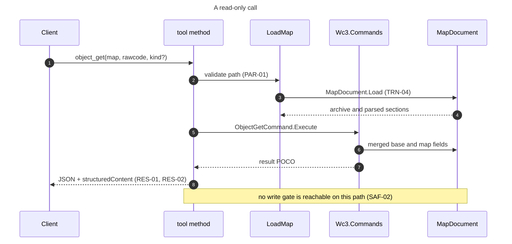

A read that needs base game data resolves the game directory from the argument, then `WC3_GAME_DIR`, then auto-detection, and when none is present it returns the fields it can read from the map with the missing ones marked (PAR-04).

### 5.3 A write and the chained edit

This is the flow that matters most, because the common agent mistake is to make two edits from one base and lose the first. The digest verifies that the file named as input is the revision the caller last read. It does not choose the revision, so the second call still has to name the first output.

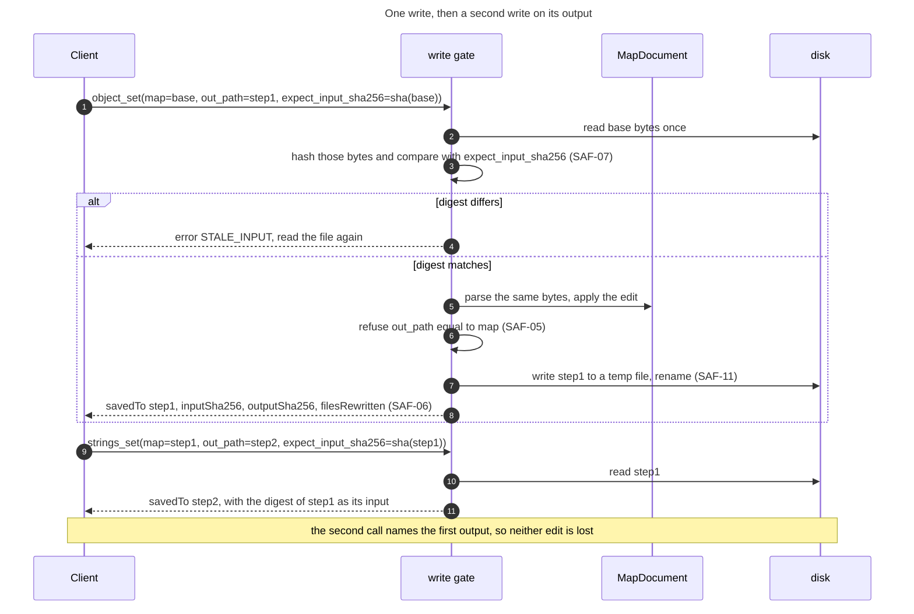

The digest is an input revision check, not a chain. It refuses a base that changed after it was read, and it cannot detect a caller that reused an unchanged base by mistake. The chaining rule lives in the tool descriptions and the instructions, and the digest makes only the first half of it enforceable. A batch call removes the mistake entirely for one family, and `object_batch_set` is it. The remaining families still chain, which is G-50.

### 5.4 A destructive call

A destructive call is rare and explicit. The caller states the intent, and the refusal names what would be lost.

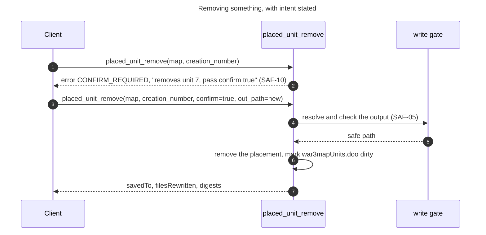

A destructive tool is not made safe by the confirmation. It is made safe by the output being a new file and the input staying untouched. The confirmation stops the call that a model made by mistake, and the output rule means a mistake costs one file the caller can delete.

### 5.5 Port a unit between maps

A port reads two maps, resolves the dependency closure, remaps colliding rawcodes and writes a third file.

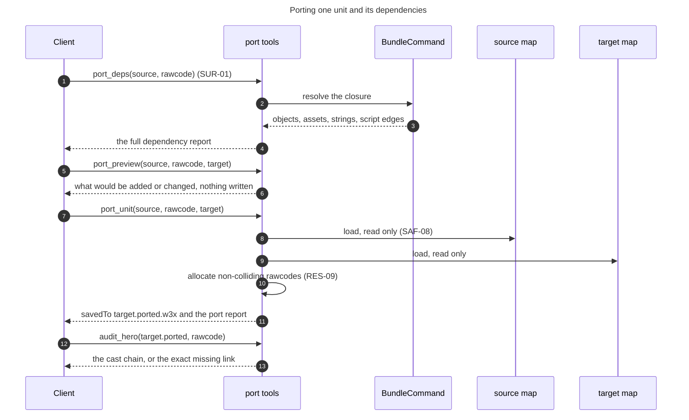

The source and the target are never modified, and the result is a third file. That is why a port can be reviewed before it is adopted, and why a failed port leaves both inputs as they were.

### 5.6 Gate a map before it ships

The project's own rule is that an edited map is not finished until a doctor check compiles the script and a load test runs. The MCP surface can do the first part and can prepare the second.

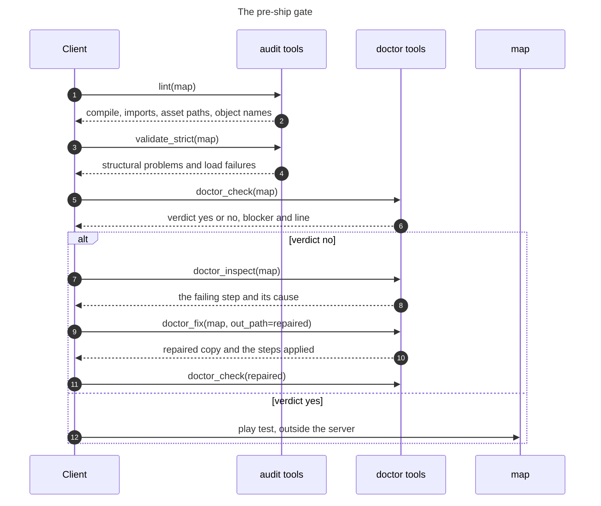

The server can prove the script compiles and that the archive is structurally sound. It cannot prove the map plays. The instructions and the prompt SHALL say so, because a green audit that reads as a play test is the failure this flow exists to prevent.

### 5.7 Search the reference documents

Search works with no download, and improves when the index is installed.

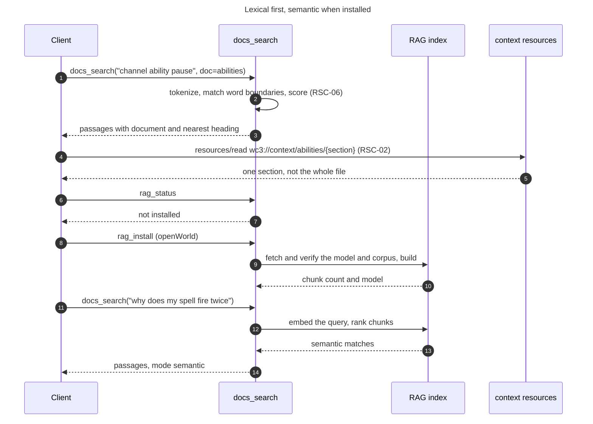

Lexical search is the contract. Semantic search is an improvement a caller opts into, and a failed index build leaves lexical search working.

### 5.8 Set up a client

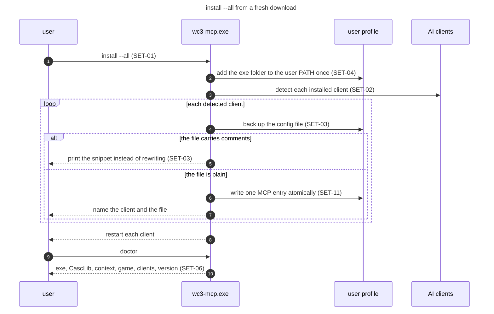

The install is idempotent, so running it again after an update changes nothing except the version the entry points at.

### 5.9 From a wc3ctl commit to an npm release

The server source is written in wc3ctl and published from the mirror. That chain has more steps than a reader expects, so it is drawn once here.

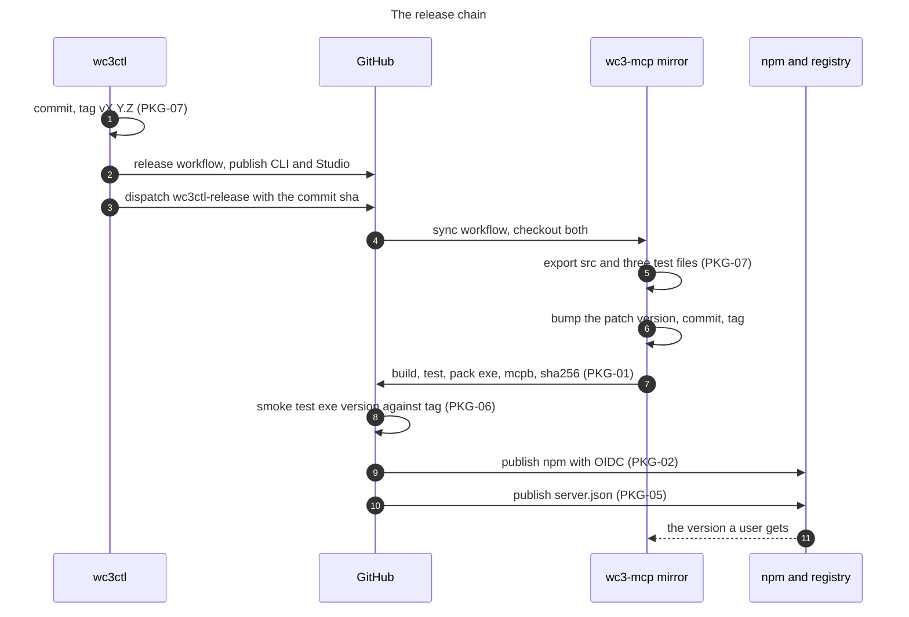

A commit that changes the MCP server is not released until the mirror has exported it, bumped its version, tagged, built and published. The specification treats that as one release with two repositories, not two releases.

## 6. Interfaces

This section is the contract a client codes against. Where a fact is a measurement, its date is 8 November 2026.

### 6.1 Protocol surface

The server negotiates MCP over stdio. It answers the revision the client offers when it supports it, and otherwise answers with its own, which is 2024-11-05 today.

| Element | Value |
|---|---|
| Transport | stdio, newline-delimited JSON-RPC |
| Protocol revisions | 2024-11-05, 2025-03-26, 2025-06-18 and 2025-11-25, each echoed to a client that offers it, with 2025-11-25 as the answer to an unknown offer (CMP-01) |
| Server info | `name` from `McpServerName`, `version` from the assembly |
| Tools | 275, computed once at start |
| Resources | 436, the two documents, 430 sections, the catalog and the three skills |
| Prompts | 5, fixed at start |
| Instructions | A short string, at most 1,000 characters after DSC-01 |
| Capabilities | `tools`, `resources`, `prompts`, `logging`. `listChanged` SHALL be false because the collections are fixed at start (TRN-05) |
| Progress | None today, required on the long families by PRF-04 |
| Cancellation | None today, required by PRF-04 |
| Sampling, elicitation, roots | Not used. The server requires only tools, resources and prompts (CMP-06) |

### 6.2 Naming

A tool name is `<domain>[_<subject>]_<action>`. The domain is the subject, such as `object`, `terrain` or `mpq`. The subject disambiguates a part of that domain, such as `terrain_corner`. The action is the operation and comes last, such as `list`, `get`, `set`, `add`, `remove`, `create`, `export`, `import` or `verify`. Existing names such as `object_set` already follow it, and the renames in SUR-02 bring the rest to it.

| Rule | Example that follows it | Example that does not |
|---|---|---|
| One verb per operation | `object_get`, `object_set`, `object_new`, `object_remove` | `map_info` beside `map_info_get` |
| No synonyms | `list` for a list, not `ls`, `dir` or `show` | `list_files` beside `file_list` |
| Plural only for the collection noun | `object_list` | `triggers_read` beside `trigger_*` |
| Domain first, always | `string_list`, not `list_strings` | `search` beside `docs_search` |
| The name says what it acts on | `mpq_remove_many` | a bare `remove` |

The canonical rename table below is the one SUR-02 and SUR-03 use. An old name is served as an alias for one minor release, with the new name in its description.

| Today | Canonical name | Reason |
|---|---|---|
| `map_info` | `map_metadata` | `map_info` and `map_info_get` both exist, and `get` is the read verb |
| `map_info_get` | `map_metadata_get` | The editable fields are a separate read |
| `list_files` | `file_list` | Domain first, and `file_list` already lists the archive entries |
| `file_list` | `file_list` | Kept, with `list_files`'s brief and harvest options folded in |
| `triggers_read` | `trigger_tree_get` | Domain first, and it reads the whole tree |
| `placed_units_list` | `placed_unit_list` | One noun, one collection |
| `search` | `map_search` | It searches map contents, not the docs |
| `docs_search` | `docs_search` | Kept |
| `new_map` | `map_create` | Domain first |

### 6.3 Common parameters

Every parameter has one meaning across the surface. A tool that needs a different meaning SHALL use a different name.

| Parameter | Type | Meaning | Precedence or default |
|---|---|---|---|
| `map` | string | One map file, `.w3x` or `.w3m`, or a folder map | Required where present. A folder map is accepted, and the description says so (PAR-01) |
| `folder` | string | A directory of maps, searched one level or recursively as stated | Required where present |
| `internal_path` | string | One archive path, either slash accepted | Required where present |
| `out_path` | string | The output file | Optional with `<map>.edited.<ext>` for a map edit. Required for a different artifact (PAR-06) |
| `out_dir` | string | An output directory | Required where present. Created if absent |
| `game_dir` | string | The Warcraft III install | Argument, then `WC3_GAME_DIR`, then auto-detect (PAR-02) |
| `schemas_dir` | string | The schema dataset folder | Argument, then the saved setting |
| `target` | string | A build name or schema folder | Argument, then `WC3_TARGET_BUILD`, then the saved setting, then the default (PAR-03) |
| `kind` | enum | Object Editor kind | `unit` when optional and omitted |
| `rawcode` | string | Four characters, case preserved as the map stores it | Required |
| `creation_number` | integer | The placement id from a list tool | Required |
| `confirm` | boolean | Explicit intent for a destructive call, on the eleven tools that declare `destructiveHint` true | Default false, and false refuses before the map is loaded (SAF-10) |
| `expect_input_sha256` | string | The digest the caller believes the input has | Optional. A mismatch refuses (SAF-07) |
| `overwrite` | boolean | Allow replacing an existing output | Default false (SAF-05) |
| `limit` and `offset` | integer | A page of a list result | Default and maximum stated per tool (RES-03) |

Units are stated in the parameter description and never assumed. World positions are map world units. Terrain brushes are terrain cells. Pathing brushes are pathing cells, four per terrain tile. A facing angle is radians. A scale is one number for uniform, or three for `sx,sy,sz`.

### 6.4 Result and error envelope

A result is a JSON object in the text content and, after RES-02, the same object in `structuredContent`.

```json
{
  "savedTo": "C:\\maps\\MyMap.edited.w3x",
  "inputSha256": "0f1c...",
  "outputSha256": "9ab3...",
  "filesRewritten": 2,
  "bytesWritten": 767366,
  "message": "set unit u000 hit points to 500"
}
```

A list result is wrapped, so a caller always receives an object.

```json
{
  "items": [ { "rawcode": "u000", "name": "Footman" } ],
  "returnedCount": 1,
  "totalCount": 1432,
  "offset": 0,
  "limit": 100,
  "hasMore": true,
  "nextOffset": 100
}
```

An error is a tool error with a stable code.

```json
{
  "code": "OUT_PATH_IS_INPUT",
  "message": "out_path must not be the input map file itself",
  "next": "omit out_path to write a sibling .edited copy, or name a different file",
  "path": "C:\\maps\\MyMap.w3x"
}
```

The code set below is the initial one. ERR-03 keeps it in one place and TST-11 requires a test per code.

| Code | Meaning | Next step |
|---|---|---|
| `MAP_NOT_FOUND` | The path does not exist | Check the path |
| `MAP_UNREADABLE` | The archive could not be opened | Check that it is a w3x or w3m, not a folder of files |
| `OBJECT_NOT_FOUND` | The rawcode is in neither the map nor the base game | List the kind and pick a rawcode from it |
| `GAME_DATA_MISSING` | The tool needs base game data and none was found | Pass `game_dir` or set `WC3_GAME_DIR` |
| `OUT_PATH_IS_INPUT` | The output equals the input | Omit `out_path` or name a different file |
| `OUT_PATH_INSIDE_INPUT` | The output is inside a folder map | Write beside the folder |
| `OUTPUT_EXISTS` | The output exists and `overwrite` was not set | Pass `overwrite` true or choose a new name |
| `STALE_INPUT` | `expect_input_sha256` does not match the file | Read the file again and chain on the current output |
| `CONFIRM_REQUIRED` | A destructive call did not state intent | Pass `confirm` true |
| `POLICY_DENIED` | The permission file refuses this tool or family | Ask the user to change the permission file, then retry |
| `INVALID_ARGUMENT` | A value is outside its legal set | The message lists the legal set |
| `LOSSY_DECODE` | The text would not survive a UTF-8 decode | Use the raw extract tool, or pass `allow_lossy` |
| `RESULT_TOO_LARGE` | The result would exceed the page limit | Ask for a page or a narrower query |
| `DEPENDENCY_MISSING` | A required library or file is absent, such as `CascLib.dll` | Reinstall the release |
| `UNSUPPORTED_PLATFORM` | Not Windows x64 | Use the supported release |
| `INTERNAL` | An unexpected failure | Report it with the tool name and the stderr line |

#### 6.4.1 The result as a data model

A tool returns one of three shapes, and all three share the tool envelope. The figure is the model a client codes against. A field marked as later is required across the surface. `object_set` now returns the write fields, and the other write tools do not yet.

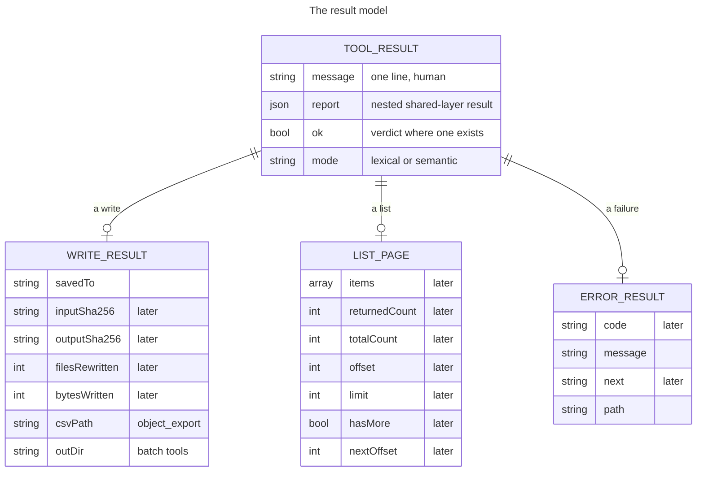

The write fields carry the digest and the rewritten count so a caller can prove what changed (SAF-06). The list fields exist so a page can be asked for rather than returned whole (RES-03, RES-10). The error fields carry a stable code and a next step, so a caller can branch rather than read prose (ERR-02).

### 6.5 Inventory

The full inventory is Appendix C, which lists every name by family. The description, parameters, result and hints of a tool live in `docs/mcp-reference.md` and in `wc3://tools`, so they are not repeated here. The figure gives the shape of the surface.


### 6.6 Resources

| URI | Kind | Contents |
|---|---|---|
| `wc3://context/ui-frames` | Document, whole | The Big UI-Frame Tutorial |
| `wc3://context/abilities` | Document, whole | The Editor Ability Insight reference |
| `wc3://tools` | Generated catalog | Every tool, family, aliases, input schema and hints |
| `wc3://spec` | Document, whole | This specification, added by RSC-04 |
| `wc3://context/ui-frames/{section}` | Template | One heading of the tutorial, added by RSC-02 |
| `wc3://context/abilities/{section}` | Template | One heading of the ability reference, added by RSC-02 |
| `wc3://skills` | Generated index | Every bundled skill with its name, description and size, added by RSC-08 |
| `wc3://skills/{name}` | Template | One skill document, added by RSC-08 |
| `wc3://skills/{name}/{section}` | Template | One heading of a skill, added by RSC-08 |

A resource read is a file read from the installed folder and nothing else. It does not accept a caller path, it does not run a tool, and it cannot modify anything.

### 6.7 Prompts

| Prompt | Arguments | Workflow |
|---|---|---|
| `inspect_map` | `map` | Understand a map before changing it |
| `port_hero` | `source`, `target`, `unit` | Move a hero or unit and its dependencies |
| `repair_reforged_map` | `map` | Repair a map a patch broke |
| `optimize_map_size` | `map` | Shrink a map by removing duplicate and unused assets |
| `audit_hero_spells` | `map`, `hero` | Prove a placed hero's spells are wired, not just present |

Every argument is optional and carries a placeholder default. A prompt returns text only, so pulling one costs a read and changes nothing.

### 6.8 Environment variables

| Variable | Effect | Default | Read by |
|---|---|---|---|
| `WC3_GAME_DIR` | The Warcraft III install for base game data | Unset, then auto-detect | Every tool with `game_dir` |
| `WC3_TARGET_BUILD` | The target build used when no `target` argument is given | Unset, then the saved setting | `map_compat`, `lint`, `script_api_usage`, `target_get` |
| `WC3_MCP_NPX` | Set to `1` by the npm launcher, so setup registers the `npx` command | Unset | `SetupCli` |
| `WC3_MCP_LOG` | Log level on stderr, one of `error`, `warn`, `info` or `debug` | `warn` | The stdio host |
| `WC3_MCP_PROFILE` | The tool profile, `full` or `core` | `full` | The surface builder (SUR-07) |
| `CODEX_HOME` | Where Codex keeps `config.toml` | `%USERPROFILE%\.codex` | Setup |
| `USERPROFILE`, `APPDATA`, `LOCALAPPDATA` | The profile folders every client path is built from | The operating system values | Setup |

`WC3_MCP_PROFILE` does not exist today. It is the addition SUR-07 requires. `WC3_MCP_LOG` landed on 8 November 2026 and is read at start by the stdio host.

Two further variables are read by the map model rather than by the server, and both are diagnostic only. `WC3CTL_FORCE_SALVAGE` forces the in-place patch save that keeps the source hash table, and `WC3CTL_COMPACT_SAVE` keeps the source hash table and rewrites only the block table. Neither is part of the server contract, they exist to diagnose a map that stalls on the loading screen, and they are named here so a process environment that carries one is not a mystery.

### 6.9 Command line

| Verb | What it does | Exit |
|---|---|---|
| no arguments | Run the MCP server on stdio, for the standalone exe | 0 when stdin closes |
| `serve` | Run the MCP server on stdio, for `wc3ctl mcp` | 0 when stdin closes |
| `install [client...] [--all] [--npx] [--game-dir D] [--name N] [--no-path]` | Register the server with clients and add the folder to PATH | 0 when every client succeeded |
| `uninstall [client...] [--all]` | Remove the entry and the PATH folder | 0 when every client succeeded |
| `config <client>` | Print the snippet or the command to paste | 0 |
| `clients` | List the known clients and whether each is set up | 0 |
| `doctor` | Check the exe, `CascLib.dll`, the context folder, the game and the clients | 0 when clean |
| `version` | Print the product and version | 0 |
| `help` | Print the setup help | 0 |
| `update [--check]` | Update from the product's own GitHub release | 0 on success |
| `tools` | Print the tool catalog, with `--json` | 0 |
| `audit-annotations` | Run the annotation audit, with `--json` | 0 when clean |

A bad option and an unknown client both exit 2 and name the legal set.

### 6.10 Package layout

The installed product is small. The published folder holds the exe, the native reader, the two reference documents and the context folder they are served from.

```text
wc3-mcp.exe                  the self-contained server
CascLib.dll                  native base-game reader, beside the exe
context/
  ui-frames/ui-frames.md     the frame tutorial resource
  abilities/ability-insight.md
dist-mcp/                    the published folder in wc3ctl
npm/
  bin/wc3-mcp.js             the launcher, the only file npm runs
  lib/ensure-binary.js       download, verify, cache, prune
mcpb/manifest.json           the Claude Desktop bundle manifest
server.json                  the MCP Registry entry, filled at release
%LOCALAPPDATA%/Programs/wc3-mcp/versions/v<version>/
                             the per-version binary cache
```

The per-version cache is why an upgrade never hits a Windows lock on a running exe. Two versions are kept, and a prune that cannot delete a running exe is ignored. A self-update over a fixed install follows the same idea, renaming a locked exe or DLL to a `.old` sibling and copying the new file in.

### 6.11 Threat model

The server runs as the signed-in user over that user's files. Any client the user starts can call any tool, and the server does not sandbox the client. What the server enforces is its own boundary, so no tool call can reach a file the user could not reach, and no call can widen the permissions the user already has. This table states what that means, what each threat reaches, and which requirement is the control.

| Threat | How it reaches the server | Control | Requirement |
|---|---|---|---|
| A hostile map exploits a parser | A client opens an untrusted `.w3x` or `.w3m` | Managed .NET, no `eval`, a parser failure becomes a tool error, and no write lands outside `out_path` | SEC-06 |
| A caller writes outside the intended path | A crafted `out_path` or internal path | The write gate refuses the input, inside-folder output and an existing output, and extract refuses traversal | SAF-05, SAF-09, SAF-12 |
| A prompt injection asks for a destructive edit | Text inside a map or a document tells the model to remove things | A destructive tool needs `confirm` true, which proves the caller stated intent and not that a person approved it. The durable controls are the new-file default, the write gate and the client's own confirmation step | SAF-03, SAF-05, SAF-10 |
| A tampered download | A release zip, the model or the corpus is replaced | A pinned SHA-256, HTTPS, a fixed corpus, and no caller-supplied URL | SEC-03 |
| Map or script text leaks in an error or a log | A failing tool puts the input in its message | An error names the path and the rule, never the content, and a log carries no file body | ERR-06, OBS-03 |
| Another local process reads the stream | A process on the same account attaches to stdio | The OS account is the boundary, stated rather than pretended | SEC-05 |
| A call runs away | A large folder, a model import or a doctor spawn | Progress and cancellation after PRF-04, a bounded page, and one map at a time | PRF-04, PRF-05 |
| A config rewrite damages a client | Install writes the wrong file or the wrong entry | Backup, atomic replace, comment refusal, and one entry only | SET-03, SEC-04 |
| Two clients race a write | Two clients edit the same base | Neither is refused by the digest, because both read the same unchanged file. The destination commit is the guard, a temp file renamed without replace, so the second writer fails with `OUTPUT_EXISTS` | SAF-05, SAF-07, SAF-11 |
| Telemetry or a phone-home | An analytics call nobody asked for | No telemetry, and every network path is listed | SEC-01, SEC-02 |

## 7. Acceptance criteria

A requirement is met when its check passes. The checks are grouped by subject and each names the requirement IDs it settles. A check that cannot be run is not an acceptance criterion, it is an intention.

| AC | Requirement IDs | The check |
|---|---|---|
| AC-01 | IDN-01, IDN-03, IDN-04, IDN-05, IDN-06 | Start the Release exe, call `initialize` and `version_info`. The name is `wc3-mcp` or `wc3ctl`, the version matches the assembly, a build without git reports `nogit`, and `version_info` states the protocol revision and the SDK version without reading the project file |
| AC-02 | IDN-02 | Read the exe version, `version_info`, `npm/package.json`, `mcpb/manifest.json`, `server.json` and the latest tag. One script reports zero disagreements, and the release refuses a tag that differs from the exe |
| AC-03 | TRN-01, TRN-02, TRN-03, TRN-06 | Pipe a raw initialize, initialized and tools/list into the exe. Every reply is valid JSON, stdout holds nothing else, closing stdin exits 0, and the process opens no network listener |
| AC-04 | TRN-04, TRN-05, TRN-07 | Call two tools in one session, then start a second server against the same maps. Both succeed, `listChanged` is false, and no lock blocks the second |
| AC-05 | SUR-01, SUR-02, SUR-03, SUR-04 | The parity test passes, the duplicate-name test passes, the canonical name table has no duplicate canonical name, two aliases may point at one canonical name, and every alias resolves to a live tool |
| AC-06 | SUR-05, SUR-06, SUR-07, SUR-08, SUR-10 | The catalog is under 300 tools and 70,000 characters, every description is at most 600 characters and names its family, no tool has more than eight required parameters, every tool has a title, and the `core` profile returns a strict subset that includes every read tool named in it |
| AC-07 | SUR-09, PAR-05 | For every tool, every parameter has a type and a description, every enum lists its values, and an unknown enum value returns `INVALID_ARGUMENT` with the legal set |
| AC-08 | SAF-01, SAF-02, SAF-03, SAF-04 | The annotation audit passes, no read tool writes a file in the read sweep, every write tool's call passes through the gate (asserted by a counter in the test), and every destructive tool declares true |
| AC-09 | SAF-05, SAF-06, SAF-08, SAF-09, SAF-11, SAF-12 | For each refusal, a call with output equal to input, output inside a folder map, and existing output without `overwrite` returns its code and writes nothing. A valid write returns both digests and a rewritten count. The temp file is gone after the call |
| AC-10 | SAF-07 | A write with a correct digest succeeds and a write with a stale digest returns `STALE_INPUT` and leaves both files untouched |
| AC-11 | SAF-10 | A destructive tool without `confirm` returns `CONFIRM_REQUIRED` and names the item. The same call with `confirm` true succeeds |
| AC-12 | PAR-01, PAR-02, PAR-03, PAR-04 | `map` accepts a folder map and a file, `game_dir` precedence follows the argument then the variable then detection, `target_get` names the winning source, and a base-data tool with no install marks its missing fields |
| AC-13 | PAR-06, PAR-07, PAR-08, PAR-09 | Every artifact-producing tool requires its output, every coordinate description states its unit, an array above its maximum is refused, and a path with either slash resolves |
| AC-14 | RES-01, RES-02, RES-06, RES-07, RES-08 | Every result parses as JSON, every tool publishes an output schema, the structured content validates against it, the CLI `--json` shape matches, and enums are names |
| AC-15 | RES-03, RES-10 | Each list family returns its default page, states the total, and a request above the maximum returns `RESULT_TOO_LARGE` rather than a truncated page that reads as complete |
| AC-16 | RES-04 | `file_get_text` on valid ASCII, valid UTF-8 with Cyrillic, invalid UTF-8, a legacy encoding and a source that already contains a real U+FFFD reports `lossy` and a replacement count only for the invalid and legacy cases, refuses without `allow_lossy`, and `file_extract` writes bytes whose SHA-256 equals the archive entry |
| AC-17 | RES-05, RES-09 | A render under 1 MB inlines an image and reports the path, a render above it returns only the path, and two identical runs produce the same allocated identifiers |
| AC-18 | ERR-01, ERR-02, ERR-03, ERR-06, ERR-07 | Every code in the table is produced by a test, the message is one line, the next step is present where the table names one, no message contains file content, and an unknown tool name returns the protocol unknown-tool error rather than a guessed tool |
| AC-19 | ERR-04, ERR-05 | A map tool succeeds with no game install, a base-data tool returns `GAME_DATA_MISSING`, and a batch with one failure reports the failure and the rest as partial |
| AC-20 | RSC-01, RSC-02, RSC-03, RSC-04, RSC-05, RSC-06 | Every resource reads, every section template resolves to one heading, the catalog equals `tools/list`, the spec resource equals this file, each resource reports size and digest, and `docs_search` answers lexically with no index installed while `rag_status` reports what is installed before any download |
| AC-21 | PRM-01 to PRM-05 | Every prompt returns text only, every quickstart workflow has a prompt, every prompt names live tools, and a prompt naming a removed tool fails the test |
| AC-22 | DSC-01, DSC-02, DSC-03, DSC-04, DSC-05, DSC-06 | The instructions are under 1,000 characters and carry the three rules, quickstart covers every family and answers orientation with no arguments, `tool_help` returns the full detail, a missing-capability error names the tool that has it, and the four surface views agree |
| AC-23 | ENV-01 to ENV-06 | Every variable in the table is read where the table says, the precedence tests pass, no undocumented variable changes a result, and the start line appears on stderr |
| AC-24 | SET-01 to SET-11 | For each of the ten clients, install writes one entry, uninstall removes it, the backup exists, a commented file is refused and printed, PATH is unchanged apart from the one folder, and a second install changes nothing |
| AC-25 | PKG-01 to PKG-06, PKG-09, PKG-10, PKG-11, PKG-12 | The published exe runs on a machine without .NET, prints the tag version, the launcher verifies a digest, refuses a bad one and reports offline without failing, an update over a running exe renames the locked file and leaves a removable `.old`, and the manifest and `server.json` carry the tag |
| AC-26 | PKG-07, PKG-08 | The export prints a plan from HEAD, refuses an uncommitted path and a profile path, and the publish folder is empty before the build |
| AC-27 | DOC-01 to DOC-06 | The generated references regenerate byte for byte, the README counts match the live surface, every release note names a requirement or a defect, every breaking change appears in three places, and every basis that names the protocol resolves to a source in Appendix D |
| AC-28 | SEC-01 to SEC-07 | A network trace of a read-only session shows no connection, the four access paths are the only ones in the source, each download verifies a digest, no config file outside the entry changes, and a malformed map returns a tool error rather than crashing |
| AC-29 | PRF-01 to PRF-07 | Cold start is under one second, `tools/list` under 100 ms, a call loads its map once, the long families emit progress and stop on cancellation, a folder tool holds one map at a time and the perf gate passes |
| AC-30 | OBS-01 to OBS-04 | stderr carries the start line and one line per slow call, no line carries map text, and an expected error is logged once |
| AC-31 | CMP-01 to CMP-06 | The protocol test passes against the supported revisions, an SDK upgrade runs the same test, aliases follow the window, result changes are additive, and a tools-only client still works |
| AC-32 | TST-01 to TST-13 | The hermetic suite passes, the read sweep and the write sweep pass over synthetic maps, the four audits fail when sabotaged, the parity, docs and size guards run in CI, and the surface count matches in the README, the reference and this document |
| AC-33 | AUT-01 to AUT-10 | Generate a changelog over a known range and compare it with the commits, run the readiness command on a clean tree and see one verdict, change a source file under watch and see build, test, docs and publish run in order, fail a gate and see publish refused, and start each published exe and read its version |
| AC-34 | SAF-13 | A batch of three edits writes one output that reads back all three. A batch whose second edit fails returns its code, writes no output, and leaves the input unchanged |
| AC-35 | SAF-14, SAF-15 | The gate is reachable from a test without the MCP layer. A multi-file export leaves either every file and a manifest, or no output |
| AC-36 | RES-11, PKG-13, AUT-11 | A port result carries two input roles and one output role with digests. A published version resolves to a commit and an artifact digest |
| AC-37 | PRF-08, PRF-09, RSC-07 | Each named limit refuses with a code before allocation, the memory budget is measured on the reference machine, and editing a cached input invalidates its result |
| AC-38 | TST-14, CMP-07, SEC-08, DOC-07 | Each write family has a semantic assertion that fails when unrelated data changes, the revision matrix passes, the fuzz corpus runs, and the print edition builds |
| AC-39 | SAF-16 | Two Channel abilities with one order id are reported together, a hero scope checks only that hero's list, and levels that disagree and empty ids are reported apart |
| AC-40 | SAF-17, SAF-18, RSC-08 | A denied tool fails with `POLICY_DENIED` although `confirm` is true, a missing permission file denies nothing, a malformed one refuses what it cannot classify, and every bundled skill reads and reports its size and digest |
| AC-41 | SUR-11, TST-15 | Every writing command has a CLI verb and a tool or a named exception in the parity map, and no generator test changes the generated text before asserting |

The sabotage half of AC-32 matters as much as the pass half. A guard that has never been seen to fail is a guard nobody knows works, and the project has already had a linter silently exempt every case it was meant to catch.

## 8. Assumptions

These are held without an artifact. If one is false, the requirement that depends on it is wrong.

| Assumption | Why it is assumed | What would falsify it |
|---|---|---|
| A client loads every tool definition into the model's context before the first call | The context cost argument in SUR-05 and SUR-07 rests on it | A client that lists tools lazily or filters by name, measured in that client |
| The official C# SDK negotiates the revision it advertises and serializes a result POCO the way `JsonOptions` says | Every result and every protocol test depends on it | A protocol trace from a real client that disagrees |
| A Windows x64 machine is the only supported target, because CascLib is a Windows native library | The release, the launcher and the platform guard are built on it | A cross-platform CASC reader or a supported non-Windows release |
| The user's own account is the authorization boundary, and a client the user starts may do anything the account may do | SEC-05 states it, and no authentication exists | A shared machine, a remote client, or a hosted server |
| The two reference documents are shipped with the release and are small enough to read whole | RSC-01 and RSC-02 depend on it | A document that grows past a client's read limit |
| The RAG corpus and the model stay available at their pinned URLs and digests | `rag_install` has no mirror | A broken release asset or a model withdrawal |
| A map fits in memory, and the largest map a user opens is under a few hundred MB | PRF-05 and the folder tools rest on it | A measured map that fails to load |
| The mirror repository keeps the same export contract and the same tag-driven release | PKG-07 and IDN-02 rest on it | A change to the mirror's workflows |
| Blizzard's current build exposes the game data through CASC in the layout `Wc3.GameData` reads | Every base-data tool depends on it | A game patch that moves or encrypts the data |
| An agent reads a tool description before it calls the tool | SUR-05 spends its budget on that assumption | A client that calls by name from a cached plan |

## 9. Open questions

Each question has the evidence that would settle it. None of them blocks the requirements already stated, and none is answered by guessing.

| Question | Why it is open | What settles it |
|---|---|---|
| Q1 Should the surface split into several servers, one per family, instead of one server with 277 tools | A small model may do better with 40 tools than with 270, and a user may not want to install five servers | A task success comparison on the same ten prompts, one server against five, with the token cost of each recorded |
| Q2 Should the `core` profile be the default, with the full surface opt-in | The default decides what most users get, and SUR-07 currently keeps full as the default | The same comparison as Q1, plus a count of how often each family is actually called in real sessions |
| Q3 Is an output schema on all 277 tools worth its cost | It is the largest mechanical change in this document, and its value depends on client support | A check of the four most used clients for `structuredContent`, and one family implemented as a trial |
| Q4 Do clients act on the destructive hint in a way a caller can perceive | If no client reads it, SAF-03 and SAF-10 are the only safety, and the hint is metadata | A test in Claude Desktop, Claude Code, Cursor and VS Code, recording whether a confirmation appears |
| Q5 How long should an alias live | One minor release is the proposal. Too short breaks a saved prompt, too long doubles the surface | A count of real client configs and prompts that name a renamed tool, over one release cycle |
| Q6 How far should the batch extend beyond object edits | `object_batch_set` answers it for objects, and the other families have different arguments and validations | The share of real sessions that edit more than one family in one task, and whether a general batch stays explainable in one description |
| Q7 Should the server confine reads and writes to a workspace root the caller names | It would stop an agent reading a path it should not, and it would break every caller that passes an absolute path today | The threat model in SEC-05, plus a check of whether any client supplies a root it could use |
| Q8 What page size belongs to each list family | The right number depends on the tokens per row, which differ from a file list to an object dump | A token count of each family's first page over the reference map, then a stated maximum per family |
| Q9 Should `map` keep accepting a folder map | A folder map is a real workflow in the Studio, and every description promises a file | A count of folder maps in the user's library, and whether the tools that accept one behave correctly |
| Q10 Should `quickstart` stay a tool when the same plans are prompts | Two copies of one plan drift, and the catalogue already carries both | A comparison of the two texts after the prompt set is completed to ten, and a decision on which is generated from which |
| Q11 Should the changelog be generated from requirement IDs rather than commit types | A commit type says what kind of change it was, and a requirement ID says which promise it keeps, and a release note a reader acts on needs the second | A release where every commit names a requirement, and the count of commits that would land under other |

## 10. Where the build differs today

This is the work queue. Each row names the measured state, the requirement it fails and where the change lands. The rows are grouped by subject and are in no particular build order. The last paragraph names the six that touch the most.

| Gap | What is wrong today | Requirement | Where the change lands |
|---|---|---|---|
| G-06 | 19 descriptions exceed the 600 character cap and two exceed 1,000, while 33 are under 150 and do not state a trap | SUR-05 | Every `[Description]` on the surface |
| G-07 | The description text is 84,657 characters against the 70,000 cap and no `core` profile exists | SUR-07 | `McpToolCatalog` and the profile list |
| G-18 | No error code has a test | TST-11 | The MCP test suite |
| G-20 | This specification is not served as a resource | RSC-04 | `Wc3Context.CreateResources` |
| G-23 | No `tool_help`, so the long rationale has nowhere to live once descriptions are capped | DSC-03 | A new tool and the generated reference |
| G-24 | Every collection advertises `listChanged` true while nothing changes at run time. `McpServerOptions.Capabilities` is set to false and the pinned SDK 1.4.1 ignores it, so this is blocked on the SDK pin rather than on this repository | TRN-05 | The `ModelContextProtocol` pin, or a wrapper that rewrites the reply |
| G-27 | The read sweep selects read-only tools by name prefix and needs a real map, so a write tool with a read-like name escapes it | TST-02 | `McpToolSweepTests` over synthetic maps |
| G-28 | No test calls every writing tool, checks that the output loads, or checks that the input is unchanged | TST-03 | A new write sweep |
| G-36 | The counts guard runs in the PDF build and cannot run in CI yet. A job pointed at the mirror's own exe fails on a correct tree, because that checkout builds 267 tools and 3 resources against the 275 and 6 this document describes | TST-12 | The export and `.github/workflows/ci.yml` |
| G-37 | No release note names a requirement id or a defect, so a note claims a change without naming the rule it serves or the defect it closes | DOC-04 | The 14 notes in the wc3ctl changelog and `ChangelogCommand` |
| G-38 | A changelog entry is not produced or committed by the release, so the notes can lag the tag | AUT-09 | The release workflow and `changelog/` |
| G-39 | No watch mode rebuilds, tests, regenerates docs and publishes on a change | AUT-05 | A new command and the publish script |
| G-40 | No release-readiness command folds the existing gates into one verdict | AUT-06 | A new command |
| G-41 | `publish-all.ps1` is PowerShell only, is not run by CI, and neither tests nor regenerates the docs | AUT-04 | `scripts/publish-all.ps1` and `ci.yml` |
| G-43 | `docs`, `build_pdf.py` and the publish script answer no `--json`, so an agent cannot drive them from one shape | AUT-07 | `DocsCommand` and the publish script |
| G-45 | The capability catalogue in section 14 is hand-written and can drift from the surface. Nothing generates it and the counts guard does not read it | TST-12 | A generated capability map from the tool families |
| G-66 | The mirror checkout builds 267 tools and 3 resources against the 275 and 6 the specification documents. Eight tools are absent, `audit_ability_orders`, `content_scaffold`, `hero_generate`, `model_primitive`, `model_squish`, `object_batch_set`, `object_fix_model_ext` and `sound_import_events`, so the export has not been run since they landed | PKG-07 | The export and the mirror's `src/` |
| G-46 | The document cites no external source, so a basis that claims a protocol rule or a client behaviour cannot be checked by its reader | DOC-06 | Appendix D and the Basis column |
| G-47 | The body numbers are guarded by `measure_surface.py` and `check_counts.py` at build time and by nothing in CI, so a pull request can move the surface without failing | TST-12 | The CI step, beside `tools/check_counts.py` |
| G-56 | No published artifact records its commit, digest and tag. One local record explains the in-tree 0.5.12 exe, and npm 0.5.19 has no tag that explains it | PKG-13, AUT-11 | The release workflow and the mirror |
| G-57 | The write sweep asserts that an output loads, not that the intended change is present and the rest is preserved | TST-14 | The write sweep |
| G-59 | The fuzz corpus reaches the map, object, trigger and script parsers through the published exe, and no corpus run is a step in the test suite, so the archive internals and the native readers stay uncovered and a regression there would not fail CI | SEC-08 | The test suite and the native reader |
| G-64 | A cold start to the initialize reply is 1.2 seconds against the 1 second requirement. The start line costs 0.03 seconds of it, so the cost is the host building the surface and the SDK handshake | PRF-01 | `Program.RunServerAsync` and the tool collection |
| G-68 | No tool warns before reading when the game install is absent, so the note a caller gets is always in the result rather than ahead of the work | ERR-04 | The gamedata and repair commands |
| G-75 | No test fails when a log line carries content it should not, so the rule rests on reading the calls | OBS-03 | The logging middleware and the tests |
| G-77 | No test proves setup writes nothing outside the user profile, the user PATH and the exe folder, so the boundary rests on the paths the code chooses | SET-08 | The setup tests |
| G-78 | A release note never named a requirement id or a defect, so a reader could not tell which rule a change serves. Section 15.1.1 states the convention | Closed | DOC-04, section 15.1.1 |
| G-81 | No game directory tool marks a degraded field when the install is absent, so a base name reads as an absence of data | PAR-04 | The 36 tools that take a game directory |
| G-85 | No hostile input has been fed to the parsers, so the claim that a parser bug cannot escape rests on the design rather than on a run | SEC-06 | The parsers and the fuzz corpus |
| G-93 | No alias window exists, so a renamed tool breaks a saved client prompt with no overlap | CMP-03 | The tool names |
| G-100 | Nothing scans for two tools over one operation, and `leak_list` overlaps `script_leaks` with no rule to separate them | SUR-04 | The surface |

The narrowest rows are the ones a single function closes, G-20, G-31, G-36 and G-45, and the six broadest are G-02, G-04, G-07, G-11, G-39 and G-40. That ordering is an inference from the shape of the change, not a measurement of effort, and the only honest statement about effort is that the first row is visible in one function and the broadest rows touch the whole surface.

## 11. What has been done

The server did not arrive as a plan. It grew from a seam stub in July 2026 to a surface of 277 tools, and the record of how it grew is the strongest evidence this specification has. Every row below is a commit or a release, and every one is cited.

### 11.1 The timeline

| Date | What landed | Evidence |
|---|---|---|
| 2026-07-12 | An MCP seam stub that proved the shared command layer boundary before any protocol work | `ae7f41b` |
| 2026-07-16 | The stdio server on the official C# SDK, with `map_info` and `list_files` | `e4970f7` |
| 2026-07-16 | `object_list` and `object_get` | `d53dc5f` |
| 2026-07-16 | `bundle_unit` and `render_model` | `f826c50` |
| 2026-07-16 | `port_unit`, the first writing tool, which always writes a `.ported` copy | `6d18536` |
| 2026-07-16 | The MCP README, with build, registration and the tool reference | `06f6d53` |
| 2026-07-19 | The blank map, palette, placement, pathing and field options layer, on the CLI and MCP | `910ca82` |
| 2026-07-20 | The sound catalog, on the CLI and MCP | `0f6e84c` |
| 2026-07-21 | The World Editor trigger catalog | `4932e44` |
| 2026-07-26 | MCP parity for the commands added since the skeleton | `a720d88` |
| 2026-10-05 | Target build settings, so a tool can check against a named build | `5d39842` |
| 2026-10-12 | The catalog resource, brief listings, the surface dump, the annotation audit, generated references and the instructions computed once | `ba2d4c8`, and the six other MCP commits that day |
| 2026-10-13 | 0.4.0, the model and asset optimiser, the schema dataset and the leak workflow | `changelog/0.4.0.md` |
| 2026-10-14 | 0.4.1, 0.4.2 and 0.4.3, three full tool sweeps and 26 fixes | `changelog/0.4.1.md` to `0.4.3.md` |
| 2026-10-14 | 0.4.4, a parallel audit of every tool group and 11 fixes | `changelog/0.4.4.md` |
| 2026-10-14 | 0.4.5 and 0.4.6, the corpus run and the schema performance pass | `changelog/0.4.5.md`, `0.4.6.md` |
| 2026-10-15 | 0.4.7, the first macOS run, three cross-platform fixes and doctor caching | `changelog/0.4.7.md` |
| 2026-10-16 | 0.4.8, the npx launcher, the self-updater, the comment-preserving config writer, `quickstart` and the five prompts | `changelog/0.4.8.md` |
| 2026-10-17 | The bundled reference documents and the local RAG index and graph | `2f77601`, `6bb935c`, `9103e59` |
| 2026-10-19 | The corpus pinned to `dataset-v2` | `feat(rag): pin the corpus to dataset-v2` |
| 2026-10-21 | 0.4.9 to 0.4.12, the verifier, the cost bench, trigger moves and the gated model squish | `changelog/0.4.9.md` to `0.4.12.md` |
| 2026-10-21 | The release handoff to the npm mirror | `ci(release): hand off to the npm mirror` |
| 2026-10-22 | 0.4.13, model path repair as one command | `changelog/0.4.13.md` |

Two things about this timeline matter to the requirements. The reading and writing rule was there from the first writing tool, `port_unit`, which wrote `.ported` rather than touching its inputs. And the surface was swept against real maps three times before anyone wrote a specification for it, which is why section 3 can state measured behaviour rather than intended behaviour.

### 11.2 The sweep, and why it is the model for the tests

The releases from 0.4.1 to 0.4.4 record a method, not a set of unrelated fixes.

- 0.4.1 swept every MCP tool with real inputs and then reviewed the classes of defect the sweep exposed. Twelve fixes.
- 0.4.2 re-ran every tool against the fixed build and checked each output against the tool's own description. Seven fixes.
- 0.4.3 ran a third pass against a real map and read the output against the description again. Seven fixes.
- 0.4.4 audited every tool group in parallel against real maps, reproduced each defect before and after, and swept the punctuation of the whole repository. Eleven fixes.
- 0.4.6 measured the sweep, 181 read-only tools, and cut the total from 73,248 ms to 41,507 ms.
- 0.4.7 ran the suite on macOS for the first time and found three cross-platform bugs and a category that ran when it should not.

The lesson is that the sweep found defects no reflection test could see, and that a sweep against a real map is slow and machine-dependent. TST-02 and TST-03 turn that method into a hermetic test over synthetic maps, so the same class of defect is caught on every pull request rather than in a manual pass after a release.

### 11.3 Guards that exist because of that history

| Guard | What it prevents | Evidence |
|---|---|---|
| The annotation audit | A writing tool that claims to be read-only | Added after `deprotect_map` carried `ReadOnly = true` while writing a whole map, `3f531ed` |
| The parity map | A tool wired on one surface and forgotten on the other | `CliMcpParityTests`, with a documented allowlist of deliberately CLI-only verbs |
| The generated reference and its CI guard | Documentation that drifts from the surface | `feat(docs): generate command and mcp references`, `2026-10-12` |
| The catalog resource | A client listing tools while the documentation says something else | `feat(mcp): serve the tool catalog as a resource` |
| The instructions computed once | A full schema scan per session, which made the suite take minutes | `perf(mcp): compute server instructions once` |
| The export verify tool | A mirror checkout that silently holds different source | `fix(mcp): export verify compared against nothing`, `2026-10-13` |
| The tool safety regression tests | A converter that damages a map it was never meant for | `ToolSafetyRegressionTests`, added after `script_to_lua` broke a Wurst map and `repair_portraits` advertised a version stamp that crashed a map |
| The smoke tests | A tool that returns an empty answer that reads as correct | `McpToolSmokeTests.*`, which put content into a synthetic map through MCP before reading it back |
| The setup tests | A config writer that damages a client file | `SetupTests` over a temporary profile |
| The tool sweep | A tool that throws on a real map | `McpToolSweepTests`, which the changelogs cite as the source of most of the fixes |

## 12. Recorded defects and the rule each produced

Every row below happened. The evidence column names the release or commit that records it, and the rule column names the requirement that exists so it does not happen again. A defect with no rule is a defect this specification has not learned from, and there are none in this table.

| Defect | Evidence | Rule |
|---|---|---|
| Five writing tools said Read-only in their description, `mpq_extract_all`, `terrain_export_heightmap`, `pathing_export_png`, `asset_thumbnails` and `asset_convert_batch`, while every one of them writes files | `McpToolAudit`, 8 November 2026 | SAF-02 |
| `deprotect_map` declared read-only while writing a whole map, so a client could write a file believing nothing would be written | `3f531ed`, `0.4.4` | SAF-01, SAF-02 |
| `terrain_corner_set` and its siblings refused an omitted `out_path` although every description promised a sibling `.edited` default | `c81c959`, `0.4.2` | SAF-08, PAR-06 |
| `target_get` promised the target's schema sections and never carried them | `c81c959`, `0.4.2` | RES-01, PAR-04, TST-02 |
| `replay_players` described team and race as unknown when absent, while the parser never reads them | `c81c959`, `0.4.2` | PAR-04 |
| A write result omitted the `name` key for an unnamed archive entry instead of writing null, so a client read undefined | `fix(mcp): write the null name on an unnamed entry`, `0.4.4` | RES-01, RES-08 |
| `model_optimize` and `model_lod` dropped every UV, and `map_optimize` inherited it | `0.4.1` | TST-03, and the render comparison in `model_compare`, because a load check does not see a missing UV |
| `terrain_deform` and `terrain_water` wrote an unbounded value into a 16-bit field and wrapped, while reporting the tiles changed | `0.4.1` | PAR-05, ERR-05 |
| `object_clone` and `object_rename` ignored the `war3mapSkin.*` twin, so a clone lost its name, model and icon | `0.4.1` | TST-03 |
| `trigger_remove --recursive` walked by id, and ids are numbered per type, so it emptied an unrelated subtree | `0.4.1` | RES-09, TST-03 |
| `hero_lint` and `hero_install` threw a raw exception on a camelCase `hero.json` | `0.4.1` | ERR-01, PAR-09 |
| `player_list` serialized the team color as an empty object because a tuple's components are fields | `0.4.1` | RES-07 |
| `mcp export verify` fell back to the working directory, compared against nothing and reported every file as removed | `0.4.1` | PKG-07 |
| `terrain_import_heightmap` wrapped the top of the height range and inverted the highest exported height | `0.4.2` | PAR-05, TST-03 |
| `hero_roster` missed a Wurst hex rawcode form, and on another map invented a roster out of item and ability codes | `0.4.2`, `0.4.4` | TST-02, ERR-05 |
| `model_export_obj` wrote an `mtllib` name that did not match the MTL file it wrote | `0.4.2` | TST-03 |
| The wc3-mcp build carried no assembly stamp, so `version_info` reported `nogit` and `unknown` | `0.4.2` | IDN-05 |
| `terrain_optimize` refused every real map because the `0xF` no-cliff sentinel was read as a dangling index, 12,429 of 25,921 corners on the map tested | `0.4.3` | TST-02 |
| `script_semantic_diff` reported a chunk-level `local` rename as a change | `0.4.3` | TST-02 |
| `script_leaks` found no periodic driver when a Wurst map assigned the callback to a code variable first | `0.4.3` | TST-02 |
| `port_into_version` and the compat check reported call tokens and keywords as undeclared identifiers | `0.4.3` | TST-02 |
| `trigger_lint` silently skipped custom-text triggers and understated what it had not examined | `0.4.3` | ERR-05 |
| `version_info` baked git's fatal message in as the build hash on a tree with no `.git` | `0.4.3` | IDN-05 |
| `deprotect_map` wrote a byte-identical copy and dropped every recovered name, 26 names where 1,529 were recovered | `0.4.4` | TST-03, RES-06 |
| Saving a protected map could re-emit its block-table stuffing and grow the table, 1,623 rows to 1,853 | `0.4.4` | SAF-06 |
| `terrain_audit` counted the `0xF` sentinel as a distinct cliff texture | `0.4.4` | TST-02 |
| `terrain_cliff`, `terrain_water` and `terrain_deform` echoed the requested value while the tile held the clamped one | `0.4.4` | ERR-05, PAR-05 |
| `object_new` reported success when the base rawcode was unknown to the map and the game | `0.4.4` | ERR-05 |
| `object_rename` left the `war3map.wct` custom-text bodies naming the old rawcode | `0.4.4` | TST-03 |
| `object_import` re-walked the object files per CSV cell, over fifteen minutes for 2,265 objects | `0.4.4` | PRF-03, PRF-05 |
| `map_optimize` reported the per-file byte sum as the saving, which read positive on a run whose map grew | `0.4.4` | RES-06 |
| `compat_explain` took 19.9 seconds because every call re-parsed 203 MB of schema JSON | `0.4.6` | PRF-06 |
| `TargetBuildSettings.List` loaded 400 MB of schema to read a name and a section list | `0.4.7` | PRF-06 |
| The three `doctor_*` tools cost 16 seconds of the sweep because each spawns a process | `0.4.7` | PRF-04, PRF-06 |
| `target_get` reported its version source in its on-disk case, so a caller matching on the value had to guess | `0.4.5` | RES-06, RES-08 |
| `replay_summary` listed the running game's `TempReplay.w3g` as a finished game | `0.4.5` | RES-09 |
| A map with an unreadable listfile failed to load at all instead of retrying without it | `0.4.5` | ERR-01, SEC-06 |
| `script_to_lua` silently converted a Wurst map, whose package runtime does not survive, and the map failed in play with "Could not initialize package" | `ToolSafetyRegressionTests` | SAF-10, ERR-05 |
| `repair_portraits` advertised a VERS re-stamp that the project's own Reforged report records as crashing the map on load | `ToolSafetyRegressionTests` | SAF-10, DOC-03 |
| A config writer left a trailing comma in the last entry | `4d9b58d`, `2026-10-16` | SET-03 |
| MCP sessions hung CI on a two-core runner | `fix(tests): MCP sessions hung CI on two cores`, `2026-10-12` | TST-13, TRN-03 |
| The splice test renamed a generated parameter and rewrote an escaped path before asserting, so pjass proved a repaired block and both generator defects stayed in the code | `SoundScriptSpliceCommandTests`, 8 November 2026 | TST-15 |
| A non-ASCII script read through `file_get_text` came back with replacement characters, and rewriting it corrupted the map while validate, compat and script check all reported OK | `CLAUDE.md`, ACA 0.32A, 2026-10-22 | RES-04, TST-03 |
| A missing dummy model left 2,586 object references pointing at nothing, 137 of them redirected | `changelog/0.4.13.md`, `CLAUDE.md` | RES-05, PAR-04 |

The two safety regressions deserve their own sentence. Both were tools that did exactly what they were asked, on a map where the right answer was to refuse. The Wurst conversion produced valid Lua that could not run, and the portrait stamp produced a model change the project's own report had already marked as a crash. That is why SAF-10 exists and why the smoke tests put content into a map before reading it back.

## 13. Tool knowledge the surface depends on

These are measured facts about the format and the toolkit that shape what a tool description has to say. They are not requirements. They are the reason several requirements read the way they do.

| Fact | Evidence | Where it shows |
|---|---|---|
| Reading `war3map.j` as text and writing it back is lossy on a non-ASCII script. On ACA 0.32A, `file get-text` returned 13,730,509 bytes against a raw 13,733,096, turned a real colour code into `A??"A?`, and the map then failed to load while three checks reported OK | `CLAUDE.md`, measured 2026-10-22 | RES-04, and the requirement to transform bytes and never decode them |
| A blank dummy model at `war3mapImported\dummy.mdx`, 35,040 bytes, is the redirect target for a model path that cannot resolve. Its absence is what turns a repair into 2,586 dangling references | `CLAUDE.md`, `0.4.13` | `object_fix_model_ext`, and PAR-04 for a missing file |
| `leak model` reports base-game textures as missing because it does not resolve textures through the game install, 1,368 false findings on one map | `CLAUDE.md` | The tool description and PAR-04 |
| The `war3map.wct` custom-text decoder is lossy for bytes that are not valid UTF-8, so a body is written through a byte-level splice and every untouched slot is copied verbatim | `0.4.8` | `trigger_set_code`, SAF-06 |
| The `0xF` value in a corner's cliff texture field means "no cliff", and most corners on a real map carry it | `0.4.3`, `0.4.4` | `terrain_*` validation, TST-02 |
| An object's data is split across `war3map.*` and `war3mapSkin.*`, and a clone or rename that touches one half loses or leaves the other | `0.4.1` | `object_clone`, `object_rename` |
| `MpqArchiveBuilder.RemoveFile` followed by `AddFile` of the same name silently drops the file, so a rewrite adds and never removes | `CLAUDE.md` | `mpq_*` and SAF-05 |
| A map archive carries bookkeeping entries, `(listfile)` and `(attributes)`, which are regenerated or dropped on a round trip and are excluded from a fidelity comparison | `CLAUDE.md` | `roundtrip`, SAF-06 |
| A protected map can have an unreadable listfile and a block table that points past the end, and both have to be survivable | `0.4.5` | `deprotect_map`, `mpq_rebuild`, SEC-06 |
| An edited map is not finished until the script compiles and the load is tested. `doctor_check` gives `verdict: yes` or `no` with the blocker and line, and the project's own checks have missed a corrupted script before | `CLAUDE.md` | The pre-ship flow in 5.6 and DSC-01 |
| A map is CRLF and byte-faithful at rest, so an edit re-serializes only the internal files it changed | `CLAUDE.md` | SAF-06, `filesRewritten` |
| `file_get_text` is the wrong tool for a script payload, and the right one is an extract of raw bytes followed by a byte-level transform | `CLAUDE.md` | RES-04 |
| A Reforged patch can leave a map referencing names the build no longer defines, and the answer is a compat report plus a repair, never a version stamp | `docs/reforged-3.0.0-blizzard-bug-report.md`, `0.4.9` | `map_compat`, `compat_explain`, `repair_*` |
| The doctor is a pinned third-party binary that costs about five seconds per spawn, which is why its answers are cached for the life of the process | `0.4.7` | PRF-04, PRF-06 |
| `event` is a declared JASS type, `type event extends agent` at line 6 of `common.j`, so a generated function parameter of that name collides with it. The dispatcher now takes `ev` | `common.j`, 8 November 2026 | the generated dispatcher and `hero_generate` |
| A JASS string literal carrying a Windows path doubles its backslashes, and the repository's convention is `war3mapImported\\x.wav`. An unrepaired block with either defect failed pjass | `SoundImportCommand.JassPath`, 8 November 2026 | every generated JASS block |

## 14. Capability catalogue

Section 6.5 answers what tools exist. This section answers what jobs a caller can finish, grouped by outcome, with the tools and the CLI that carry it and the measured limit that matters. A job with no limit named has none that a caller is likely to hit.


### 14.1 Understand a map before changing it

- **The whole shape in one call.** `map_overview`. A protected map reports unnamed entries, so the file list can be shorter than the archive
- **Metadata and editable fields.** `map_info`, `map_info_get`. The two reads answer different questions, which is why SUR-02 renames them
- **Archive contents.** `list_files`, `file_list`, `imports_list`, `mpq_verify`, `mpq_listfile`, `mpq_name_recover`. `list_files` with `harvest` recovers names from the map's own data, which is worth its cost on a protected map
- **Object and placement counts.** `object_list`, `object_search`, `placed_stats`, `terrain_stats`. Base names need the game install, see PAR-04
- **Trigger tree.** `triggers_read`, `trigger_export`, `trigger_to_script`, `trigger_dead`. A map with no `war3map.wtg` has no GUI tree to read, only the compiled script
- **Script shape.** `script_functions`, `script_callgraph`, `script_complexity`, `script_reachable`. Static only, a call through a code variable is not an edge
- **Release readiness.** `lint`, `validate`, `validate_strict`, `roundtrip`. A pass is not a play test, see 5.6


### 14.2 Read and write object data

- **Read one object.** `object_get`, `object_form`, `object_field_options`. `object_field_options` needs base game data
- **Write one object.** `object_set`, `object_new`, `object_clone`, `object_rename`, `object_bulk_set`. Each call writes a new file, so a second edit names the first output
- **Carry objects as data.** `object_export`, `object_import`. A CSV export carries the merged view, not only the map's delta
- **Find silent problems.** `object_noop_fields`, `object_deprecated`, `object_rawcode_suggest`, `object_fix_model_ext`. A no-op field is not an error, it is an edit that changes nothing
- **Port across builds.** `object_migrate`, `gamedata_schema_diff`, `gamedata_changelog`. Dropped fields are reported, never silently kept
- **Ability lists.** `unit_abilities`, `uabi_profile`. `uabi_profile` compares many maps without starting the game


### 14.3 Edit the world

- **Place anything.** `place_unit`, `place_doodad`, `place_item`, `place_region`, `place_start_location`, `place_grid`, `place_scatter`. Every placement returns its creation number, which is the handle the edit tools take
- **Edit what is placed.** `placed_units_list`, `placed_unit_get`, `placed_unit_set`, `placed_unit_remove`, `placed_doodads_list`, `placed_doodad_get`, `placed_doodad_set`, `placed_doodad_remove`. A facing angle is radians, a scale is one value or three
- **Repair placements.** `placed_missing_refs`, `placed_fix_refs`. A rewrite needs a rawcode that exists
- **Terrain.** `terrain_corner_get`, `terrain_corner_set`, `terrain_deform`, `terrain_cliff`, `terrain_ramp`, `terrain_paint`, `terrain_water`, `terrain_blight`, `terrain_fill`, `terrain_smooth`. The `0xF` cliff value means no cliff, see 13
- **Terrain as an image.** `terrain_export_heightmap`, `terrain_import_heightmap`. A 16-bit PNG, one pixel per corner
- **Pathing.** `pathing_paint`, `pathing_export_png`, `pathing_import_png`, `pathing_validate`. A set bit restricts the capability
- **Cameras and regions.** `camera_list`, `camera_add`, `camera_set`, `camera_remove`, `camera_tour`, `region_list`, `region_create`, `region_remove`, `region_to_rect`, `region_validate`. A camera tour generates names in order
- **Players and forces.** `player_list`, `player_set_name`, `player_set_color`, `player_set_race`, `player_set_force`, `force_list`, `force_set_flags`, `force_rename`, `force_set_players`. `war3map.w3i` has no per-player colour, so colour is a script call
- **A blank map.** `new_map`. The result opens in the World Editor


### 14.4 Analyse and convert scripts

- **Handle leaks.** `script_leaks`, `leak_list`, `leak_model`, `script_lua_leaks`. `leak_model` reports base-game textures as missing, see 13
- **Runtime cost.** `script_bench`, `script_complexity`. Static cost, not a profile
- **Correctness checks.** `script_verify`, `script_check`, `script_lua_check`, `lint`, `validate_strict`. Reachability aware, so a pause in one function and a resume in another is not flagged
- **Dead code.** `script_unused_functions`, `script_unused_globals`, `script_null_locals`, `script_duplicate_bodies`. A function reached only by a string name is not dead
- **Port between languages.** `script_to_lua`, `script_lua_to_jass`, `script_decompile`. Wurst is refused without an override, see 12
- **Explain the conversion.** `script_conversion_notes`, `script_semantic_diff`, `script_api_usage`, `script_lua_api`, `script_modernize`, `script_format`. A faithful row is byte exact, an approximated row is not
- **GUI triggers.** `triggers_read`, `trigger_add`, `trigger_remove`, `trigger_rename`, `trigger_move`, `trigger_add_category`, `trigger_add_eca`, `trigger_remove_eca`, `trigger_set_eca_enabled`, `trigger_set_enabled`, `trigger_set_initially_on`, `trigger_set_run_on_map_init`, `trigger_set_code`, `trigger_sync_bodies`. A GUI trigger is inert until the World Editor saves the map
- **Trigger variables.** `trigger_var_list`, `trigger_var_add`, `trigger_var_set`, `trigger_var_remove`. Names must be unique in the map
- **Rebuild a tree.** `trigger_recover_from_script`. Best effort from the compiled script
- **Trigger functions.** `trigger_catalog_list`, `trigger_catalog_describe`. From the installed `TriggerData.txt`


### 14.5 Audit, optimise and convert assets

- **Audit.** `asset_list`, `asset_unused`, `asset_duplicates`, `asset_audit`, `asset_report`, `asset_size_report`, `asset_model_lint`, `model_lint`, `model_audit`, `model_compare`. An unused import is a lead, not an instruction to delete
- **Shrink.** `map_optimize`, `model_optimize`, `model_squish`, `model_lod`, `texture_optimize`, `texture_atlas`, `terrain_optimize`, `sound_optimize`. A lossy run needs a render gate, and `model_squish` states its own limit
- **Import.** `model_import`, `asset_import_wire`, `asset_convert_batch`. OBJ, glTF, STL, PLY and ASCII FBX
- **Export and preview.** `model_export_obj`, `render_model`, `asset_thumbnails`. A render above 1 MB is a path, not inline image content
- **Rename a path.** `asset_replace`. The archive entry is not renamed, only the references
- **Sound.** `sound_list`, `sound_add`, `sound_set`, `sound_remove`, `sound_optimize`. An MP3 encoder may be absent, the fallback is WAV


### 14.6 Heroes and porting

- **A hero definition.** `hero_roster`, `hero_lint`, `hero_install`. A definition is linted before it is installed
- **What a unit needs.** `bundle_unit`, `bundle_diff`, `bundle_merge`. The closure includes objects, assets, strings and script edges
- **Move it.** `port_deps`, `port_preview`, `port_unit`, `port_into_version`. The source and target are never modified, the output is a third file
- **Prove it is wired.** `audit_hero`, `audit_ability`, `audit_fidelity`, `audit_readiness`. A missing link is the useful result, not a pass


### 14.7 Diagnose, repair and gate a map

- **The doctor.** `doctor_check`, `doctor_inspect`, `doctor_compare`, `doctor_fix`. The doctor is a third-party binary at about five seconds a spawn, cached for the process
- **Build compatibility.** `map_compat`, `compat_matrix`, `compat_explain`, `target_get`, `target_set`, `target_list`. The target resolution order is PAR-03
- **Game data history.** `gamedata_schema_diff`, `gamedata_history`, `gamedata_changelog`, `gamedata_field_lookup`, `gamedata_bounds`, `gamedata_enum`, `gamedata_coverage`, `gamedata_sources`, `gamedata_export_schemas`. The dataset is per build, and provenance carries input hashes
- **Repair.** `repair_generated`, `repair_portraits`, `repair_audit_errors`, `lint_baseline`. A repair that cannot be proven is refused, see 12
- **Whole-map audit.** `audit_map`, `audit_trend`. Findings are structural, not a play test


### 14.8 Runtime evidence and replays

- **Replay reports.** `replay_summary`, `replay_diff`, `replay_players`, `replay_timeline`, `replay_find_map`, `replay_stats`. Team and race are not carried by the parser, and the game's `TempReplay.w3g` is skipped
- **Join static to runtime.** `leak_join`, `leak_ab`. Needs a wc3watch session folder
- **Measure the detector.** `leak_benchmark`. Synthetic maps with a known injected leak
- **Reproduce a leak in seconds.** `leak_harness`. Writes source, it does not start the game


### 14.9 Whole libraries and CI

- **Survey a folder.** `library_scan`, `library_validate`, `library_audit`, `library_compare`, `library_report`. One map at a time, see PRF-05
- **Gate one map.** `ci_lint`, `ci_validate`, `ci_compat`, `ci_schema`, `ci_all`. `ci_all` folds lint, validate and compat into one exit code
- **Benchmarks.** `bench_schema_coverage`, `bench_compat`, `bench_leaks`, `bench_open`, `bench_perf_gate`. The perf gate is the regression guard
- **Trend.** `audit_trend`, `uabi_profile`. Both compare maps over time or across variants


### 14.10 Knowledge and retrieval

- **Read a reference.** `docs_search`. The whole document is served, not a section, until RSC-02
- **Search it.** `docs_search`. Lexical by default, semantic only after `rag_install`
- **Explore the corpus.** `graph_neighbors`, `graph_hubs`, `graph_path`, `rag_status`, `rag_install`. The graph is built beside the index
- **Find the right tool.** `quickstart`, `mcp_audit_annotations`, `version_info`, `changelog`. `quickstart` names ten workflows, not every family


### 14.11 Set up, distribute and update

| Job | Command | Result |
|---|---|---|
| Register with an AI app | `install --all`, `install cursor vscode`, `config <app>` | One entry per client, a backup, and a printed snippet where the file is not safe to rewrite |
| Remove it | `uninstall --all` | The entry and the PATH folder are removed, other entries are left alone |
| Check the install | `clients`, `doctor` | The exe, CascLib, the game, the clients and, after SET-06, the context folder and the version |
| Update | `update`, `update --check` | A lock-safe in-place replacement |
| Run the product without installing it | `npx -y wc3-mcp@latest` | A per-version binary cache with a verified download |
| Install into Claude Desktop | The `.mcpb` bundle | One setting, the game folder, which can stay empty |
| Install from the registry | `io.github.GodMephisto/wc3-mcp` | The same server, by registry entry |

### 14.12 Author, document and release

| Job | Tool or command | Result |
|---|---|---|
| Release notes | `changelog`, `wc3ctl changelog --out` | Markdown grouped by commit type |
| Tool reference | `wc3ctl docs mcp --force` | `docs/mcp-reference.md`, guarded against staleness |
| Command reference | `wc3ctl docs cli --force` | `docs/wc3ctl-command-reference.md` |
| Surface audit | `mcp_audit_annotations`, `wc3ctl mcp audit-annotations` | Every annotation problem in one list |
| Surface dump | `wc3://tools`, `wc3ctl mcp tools --json` | The same reflection the client sees |
| Mirror check | `mcp_export_verify` | Every file where the public checkout differs from this commit |
| Build every front end | `pwsh scripts/publish-all.ps1` | CLI, Studio and MCP published into fresh folders, with timestamps |
| Smoke the server | `pwsh scripts/smoke-mcp.ps1 -Exe ...` | Initialize and `tools/list` over stdio, with a minimum tool count |
| Release | A `v*` tag | The CLI release, the mirror sync, npm, the bundle and the registry |

## 15. Automation

The toolkit is unusually well served by commands that generate what a person would otherwise write by hand. This section states what each one does, what it does not do, and what the requirements add.

### 15.1 The changelog maker

`changelog` is a tool and `wc3ctl changelog` is its CLI twin. It reads `git log --no-merges` over a range and renders release notes as markdown.

| Element | Behaviour |
|---|---|
| Range | `from` defaults to the latest tag reachable from `to`, and `to` defaults to `HEAD` |
| Grouping | `feat`, `fix`, `perf`, `docs` and `chore` first in that order, then every other conventional type alphabetically, then `other` |
| Parsing | A Conventional Commit subject is split into type, scope, subject and hash. A subject that does not parse lands under `other` and is kept, never dropped |
| Output | The tool returns the groups and the rendered markdown. The CLI writes the markdown to `--out` and prints the path |
| Repository | `repo_dir` or `--repo` names the checkout, defaulting to the wc3ctl repository |

```text
wc3ctl changelog --from v0.4.12 --to v0.4.13 --out changelog/0.4.13.md
```

The limit is in what it cannot see. It does not read requirement IDs, it does not put a `BREAKING CHANGE` paragraph in its own section, it does not link an issue, and it cannot tell a commit that shipped from one that was later reverted. AUT-10 records those limits. G-37 records that no note names what it serves, which is DOC-04, and `tools/check_changelog_ids.py` is the check that reports it.

#### 15.1.1 Every release note names what it serves

A release note names the requirement ids it serves and the defects it closes. That line stands on its own, in the form `Requirement, SAF-05. Defect, none.` A note that serves no requirement still writes the line and names the defect, and a note that closes no defect writes `Defect, none.` rather than dropping the line.

#### 15.1.2 A breaking change is marked in three places

A breaking change to a tool name, a parameter or a result field is marked three times. The release note carries a `BREAKING` line that names the call that changed. The tool description that replaces it carries the word `Deprecated` and the name it replaces. This document carries a row for the change, and that row names the old name and the new one. A break is not released until all three are present.

### 15.2 The reference document makers

`wc3ctl docs cli|mcp|all` renders the command tree and the live tool surface into the two reference documents in `docs/`. The formatting lives in `DocsReference`, so the same render runs in a test and in the command.

| Behaviour | Why it matters |
|---|---|
| A changed file is reported, not overwritten, unless `--force` is passed | A silent overwrite hides the fact that the surface and the document disagreed |
| The output names the exact command that regenerates it | A reader never has to guess |
| The CI guard regenerates both in memory and compares them byte for byte | A stale reference fails the build rather than surviving to a release |

The MCP reference carries the description and the four hints but not the family, the parameters, the result shape or the error codes. The catalog resource `wc3://tools` carries the family for every tool and the reference still lacks families, so the two describe the same surface at different depths. The generator is `wc3ctl docs mcp`, which lives in the wc3ctl repository, so this tree holds no `docs/mcp-reference.md` to regenerate, and the families stay out of the reference until that command runs there. DOC-01 and G-29 close that gap.

### 15.3 Build and publish

`scripts/publish-all.ps1` publishes three targets into fresh folders and then swaps them in. That detail is not ceremony. Publishing over an old folder copies a file only when the source is newer, so a stale DLL with a later date survives. The script also prints the timestamp of each published exe, which answers the first question after a fix, whether the binary being tested is the one that was just built.

| Target | Project | Folder | Exe |
|---|---|---|---|
| CLI | `src/wc3ctl/wc3ctl.csproj` | `dist` | `wc3ctl.exe` |
| Studio | `src/Wc3.Studio/Wc3.Studio.csproj` | `dist-studio` | `Wc3.Studio.exe` |
| MCP | `src/Wc3.Mcp/Wc3.Mcp.csproj` | `dist-mcp` | `Wc3.Mcp.exe` |

`-Also <path>` publishes into a second tree as well, which is how the same build reaches a mirror checkout. A locked Studio is reported and the other two targets still publish. `scripts/smoke-mcp.ps1` then starts the published exe over stdio, sends initialize and `tools/list`, and fails under a minimum tool count.

What is missing is the loop. A source change does not trigger a build, a test run, a docs regeneration and a publish. The rule is written in the project manual and followed by hand, and G-39 and AUT-05 make it a command.

### 15.4 The release chain

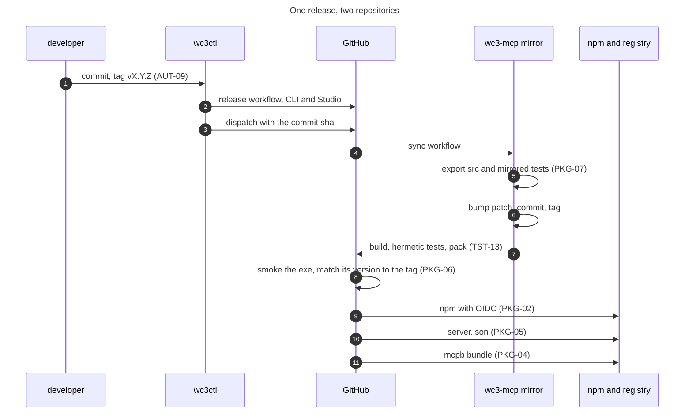

The chain is automated from the tag onward. The parts before it, the changelog, the docs, the publish and the local test run, are commands a person or an agent runs in an order they have to remember. That is the gap the automation requirements target.

### 15.5 What runs by itself, and what does not

| Step | Automatic today | Where it runs | Requirement |
|---|---|---|---|
| Hermetic test suite | Yes, on push and pull request | `ci.yml` | TST-13 |
| Docs freshness | Yes, as a test in the suite | The test suite | TST-06 |
| CLI and MCP parity | Yes, as a test in the suite | The test suite | TST-05 |
| Release build and packaging | Yes, on a `v*` tag | `release.yml` | PKG-01 to PKG-06 |
| Export into the mirror | Yes, on a dispatch from the release | `sync.yml` | PKG-07 |
| Version bump in the mirror | Yes, in the sync workflow | `sync.yml` | IDN-02 |
| npm, bundle and registry publish | Yes, after the release | `release.yml` | PKG-02, PKG-04, PKG-05 |
| Changelog generation | A command, run by hand | `changelog` | AUT-01 |
| Docs regeneration | A command, run by hand after a surface change | `docs` | AUT-03 |
| Publish to `dist` | A script, run by hand | `publish-all.ps1` | AUT-04 |
| Build, test, docs and publish after a change | No | none | AUT-05 |
| One release-readiness verdict | No | none | AUT-06 |

### 15.6 What the automation requirements add

AUT-01 to AUT-10 in section 4 turn this list into one loop. The changelog gains requirement IDs and a breaking-change section. The docs gain the parameters and results. The publish gains the test run and the docs regeneration. A watch command rebuilds on a change. A release-readiness command runs every gate and prints one verdict. Every step answers `--json`, so an agent can drive the same loop the person drives.

None of that exists today. That is why the rows are in section 10 as G-37 to G-45 and not in this section as behaviour.

### 15.7 Release checklist

The order matters. A failed gate stops the release rather than being noted and left for later.

1. Every requirement in scope has its acceptance check passing.
2. Generate the changelog with `wc3ctl changelog --from <last> --to HEAD --out changelog/<version>.md` and read it.
3. Regenerate both references with `wc3ctl docs cli --force` and `wc3ctl docs mcp --force`.
4. Bump the version in `Directory.Build.props`, and commit the changelog, the references and the code as the release candidate. The version is now part of the commit under test, not a change made after the test.
5. Run the hermetic suite, `dotnet test --filter "Category!=Corpus&Category!=GameData&Category!=Doctor"`, on that commit.
6. Run `pwsh scripts/publish-all.ps1` from that commit and confirm every exe timestamp is now.
7. Smoke both surfaces, `scripts/smoke-mcp.ps1 -Exe dist\wc3ctl.exe -Arguments 'mcp serve'` and the same against `dist-mcp\Wc3.Mcp.exe`, and record the commit and the artifact hashes beside the result.
8. Tag the tested commit `v<version>` and push only when asked.
9. Watch the release, the dispatch, the mirror sync, npm, the bundle and the registry.
10. Verify the published exe prints the tag version, and that npm, `server.json` and the bundle carry it.

Step 8 is the only one that changes a remote, and it happens only on an explicit request. A timestamp is diagnostic, not proof of identity. The proof is the full commit, the artifact hash and the tag pointing at the commit that was tested.

## 16. Adding a tool

A new tool touches more than one layer, and the tests fail until each layer is updated. The figure is the order, and the gates are the tests.

**1 Logic.** The behaviour lives in the shared layer, and the CLI gets the same verb.

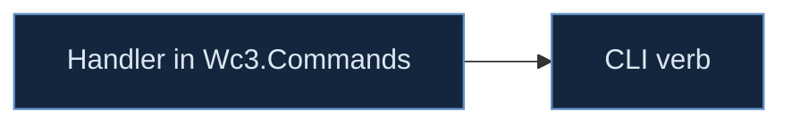

**2 Surface.** The tool is declared once, and the tests hold its name and its hints.

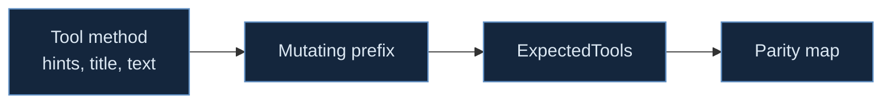

**3 Proof.** A write is proven against a synthetic map, and a publish is proven against the exe.


The gates belong to the layers. The logic layer is held by SUR-01, one behaviour for the CLI, the Studio and MCP, and by the parity test (TST-05). The surface layer is held by the description, parameter and title rules (SUR-05, SUR-09, SUR-10), the annotation audit (SAF-01) and the exact tool list (TST-01). The proof layer is held by the smoke test (TST-02), the write sweep (TST-03), the docs guard (TST-06), the hermetic suite (TST-13) and the publish check (AUT-04, AUT-08).

Two rules apply to every layer. A tool never writes in place, and a tool never learns the map format. If a change seems to need either, the logic belongs in `Wc3.Commands` and the tool is only its front door.

## 17. How the spec stays true

A specification that lives only in prose drifts. This one is kept as data, and the prose is the view.

- `requirements.json` holds every requirement with its group, statement, basis, gap link and status.
- The Status column and the gap link are generated from that file by `tools/sync_requirements.py`. The command is run before a commit that changes a requirement, and it rewrites the column rather than asking a person to edit 179 rows.
- The legend is three values. `gap` means a row in section 10 names the requirement. `unassessed` means no gap names it, which is not the same as proven. `met` is set only when a named test passes against the live surface. A requirement may carry a `test` while staying `gap`, and SAF-05, SAF-06 and SAF-07 do, because the test settles the three object tools that pass through the gate and not the rest of the surface.

### Definition of done

A change is done when all six are true.

1. The code is in `Wc3.Commands` and the front end only renders it.
2. A test named after the requirement fails before the change and passes after it.
3. The two generated references are regenerated.
4. The changelog entry names the requirement the change satisfies.
5. Every dist target is republished into a fresh folder, and the exe timestamp is now.
6. The requirement's status is `met` in `requirements.json`, with the test name recorded.

A change that meets five of the six is not done, and the spec says so rather than letting a green build stand in for a published binary.

### Change protocol

- A new requirement needs a failing test first, then the statement in the data file, then the code.
- A removed requirement needs a decision record that names what replaces it.
- A rename needs the alias window in SUR-03, and the old name stays served for one minor release.
- An open question is closed by the experiment named in section 9, not by an opinion in a meeting.

### What is measured

Four numbers, locally, with no telemetry. The size of `tools/list` in tokens, the cold start, the five slowest tools, and the share of requirements at `met`. A release note quotes the first three, and the fourth is the one that says whether the spec is being kept.

## 18. The slice queue

The work is pulled in vertical slices. Each slice closes a small set of requirements, ships a capability a client can use, and ends with a demo in a real client and its acceptance run. No dates, because a slice ends when its gates pass.

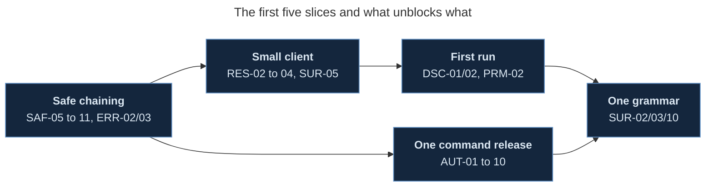

- **Safe chaining.** The write gate, the digests, `expect_input_sha256`, `confirm`, atomic save and the error codes. It unlocks every workflow where an agent makes more than one edit. The first part is in, and `object_batch_set` removes the chained-edit mistake for object fields by applying up to 500 edits in one load and one save.
- **Small client.** Output schemas, the result cap and paging, the lossy decode report, `file_extract` and `tool_help`. It makes the server usable from a context that cannot hold 275 descriptions.
- **First run.** Real initialize instructions, `quickstart` covering every family, the ten prompts and a capability report. It is what a new user meets.
- **One command release.** Changelog with requirement IDs, docs with schemas, watch and rebuild, the readiness verdict and JSON output. It is what keeps the spec true between releases.
- **One grammar.** The canonical renames with aliases, the alias window, titles and the description cap. It is the last slice because it touches every tool and is safest after the surface settles.

A slice is pulled when its dependencies are met. A new gap can reorder the queue, and a slice that grows past its requirement list is split rather than widened.

## 19. Change log

| Version | Date | Change |
|---|---|---|
| 1 | 8 November 2026 | First draft. States the server as measured on this date, the capability catalogue, the automation, the requirements for the version that follows, the acceptance checks, the assumptions, the open questions, the recorded history, the defects that produced each rule, and the requirement status data |
| 1.1 | 8 November 2026 | Verified the measured claims against the published exe, added Appendix D for external sources and Appendix E for the verification log, recorded the re-measurement deltas in section 3.13, added DOC-06, and added G-46 to G-49 for the citation, guard, description and revision gaps the audit found |
| 1.2 | 8 November 2026 | Adds `object_batch_set` and routes `object_bulk_set` through the gate, states the nine hardening items as SAF-13 to SAF-15, RES-11, PRF-08, PRF-09, RSC-07, PKG-13, TST-14, CMP-07, SEC-08, AUT-11 and DOC-07, with gaps G-50 to G-60 and checks AC-34 to AC-38, and re-measures the surface at 270 tools |
| 1.3 | 8 November 2026 | Adds the read-only `audit_ability_orders` tool and `audit orders` verb, measured on Anime Choice Arena V0.33A and Anime WoS2 v0.34h, SAF-16 and AC-39, section 21 for the anime-map workstreams, and re-measures the surface at 271 tools |
| 1.4 | 8 November 2026 | Adds section 22, the content pipeline, audio analyze and trim, sound event import, the sequence, material and emitter writers, the primitive mesher, the package scaffold and the hero generator. Re-measures the surface at 272 tools. The gate is the compiler and the audit, not a game launch |
| 1.5 | 8 November 2026 | Adds `sound_import_events`, the dispatcher splice with pjass proving the assembled script, `hero_generate`, `content_scaffold`, and the surface guard `measure_surface.py`, which now refuses a PDF whose numbers disagree with the exe. Re-measures at 275 tools. The splice also fixed two generator defects, a parameter named `event` and an unescaped path. |
| 1.6 | 8 November 2026 | Re-measures the body against the published 0.4.13 exe and corrects the drift `measure_surface.py` found. 275 tools and 84,315 description characters everywhere, the 6.5 family chart restored to 275, the result model renamed to the RES-10 paging fields, the seventh unset `destructiveHint` named as `model_primitive`, the parameter and description counts re-taken, the stale copy in 3.7 located in wc3ctl, and the AC-33 and G-49 table breaks closed |
| 1.7 | 8 November 2026 | Adds what the 8 November pipeline actually is. Section 22 names the CLI verb and the tool for each piece, the pjass gate over the spliced dispatcher with its before and after counts, and the two generator defects that were being repaired by a test. SUR-11, SAF-17, SAF-18, RSC-08 and TST-15 join section 4.1 with gaps G-61 to G-63, checks AC-40 and AC-41, the `POLICY_DENIED` code and section 23, which states the permission file and the skills as resources. 179 requirements and 41 checks |
| 1.8 | 8 November 2026 | Closes ENV-05. `WC3_MCP_LOG` sets the level, an unknown value falls back to warn, and the published exe writes nothing at the default, 16 lines at `info` and 24 at `debug`, all on stderr. Records why TRN-05 cannot be closed here, the pinned SDK derives `listChanged` from the collections and ignores `McpServerOptions.Capabilities`, proven by a handshake test, so G-24 now names the pin as the blocker. G-32 is closed and removed |
| 1.9 | 8 November 2026 | Closes ENV-04. The server writes one start line to stderr with the product, the newest protocol revision, the tool count, the target, the game build and the profile, and `ToolCount` counts the surface without building a handler for each tool, so the line costs 0.03 seconds. Records what the start line exposed, a cold start of 1.2 seconds against the 1 second requirement, which becomes G-64, and the revision the pin actually answers, 2025-11-25 to a client that offers it and 2024-11-05 to a 2025-06-18 offer |
| 1.10 | 8 November 2026 | Corrects the tag claim in 3.7, PKG-13 and G-25. The mirror has 26 tags and the newest is v0.5.16, on a commit dated 20 October 2026, not v0.5.9. The provenance gap stands, because the published package is 0.5.19 and no tag explains it |
| 1.11 | 8 November 2026 | Closes SAF-01, SAF-02, SAF-03, PAR-01 and DSC-01. Every tool declares all four hints, the audit fails an unset hint and a writing tool that says read-only, five descriptions stop claiming read-only, `map` refuses a folder and a wrong extension before opening anything, and the initialize instructions carry the product, the target, the game build, the three rules and the quickstart hint in 405 characters. Catalog grows to 122,218 bytes and the description total to 84,319 characters |
| 1.12 | 8 November 2026 | Closes DOC-07. `build_pdf.py --light` renders a light printing edition with 8.6pt table text, 73 pages against 63, and a page luminance of 189 against 13, and the prune keeps one file per edition |
| 1.13 | 8 November 2026 | Reopens PAR-01. A folder map is a real Studio workflow, so `map` accepts a file or a folder and the description must say which. Restores the nine folder and Lua smoke tests. Adds the permission file and the three skills as resources, with overwrite refused as `PERMISSION_DENIED` unless the user granted it. |
| 1.14 | 8 November 2026 | Records the measured protocol matrix, all four SDK revisions echoed and unknown offers resolving to 2025-11-25, closes CMP-01 and CMP-07 and removes G-49. Records six resources and the three skills. A stale comment in `Wc3McpServer` claimed a 2025-06-18 offer got 2024-11-05, which the matrix disproved. |
| 1.15 | 9 November 2026 | Closes SAF-14 and RSC-07. The save path moves to `Wc3.Commands` as `ArtifactWriter` and `WriteGate` delegates, with the overwrite permission staying in the adapter. The doctor cache keys on content, tool identity, build and options, so an edited file at the same path misses. G-51 and G-55 removed, G-52 narrowed to the exporters still unwired. 3020 hermetic tests. |
| 1.15 | 8 November 2026 | Closes SAF-10. The nine destructive tools take `confirm`, and `RunConfirmed` refuses a call without it as `CONFIRM_REQUIRED` naming what would go, before the map is loaded, so the refusal costs one string and no I/O. The other 109 writing tools do not take the flag. Parameter total grows to 843, of which 51 booleans |
| 1.16 | 8 November 2026 | Reopens PAR-01, which 1.13 marked met on the loader half alone. Seven of the 202 `map` parameter descriptions say a folder is accepted and 195 do not, so the wording half is open and G-65 records the count. Removes G-58, whose matrix CMP-07 now names |
| 1.17 | 8 November 2026 | Closes SAF-11, DOC-03 and TST-08 from a three agent batch. `MapDocument.Save` stages beside the destination, flushes and renames, with a test that throws from the seam between the flush and the rename and proves the old file survives. `tools/check_counts.py` guards the counts the document and the README state about themselves and the build refuses on drift, which immediately caught the README still saying 58 gap rows when there are 56. The npm launcher gains its first nine tests. G-15 and G-30 removed, G-36 narrowed to the CI step |
| 1.18 | 8 November 2026 | Closes SET-06. `doctor` now checks the context folder item by item and the latest release through the same lookup `update --check` uses, capped at ten seconds, and a release it cannot read is reported as skipped rather than failing the install. Records the export lag the CI work uncovered, the mirror builds 267 tools and three resources against the documented 275 and six, as G-66 under PKG-07, and explains why the counts guard is a build step and not yet a CI gate |
| 1.19 | 8 November 2026 | Closes SAF-05 and flips the write default. The gate was always right and 43 tools overrode it with `overwrite: true`, so a rerun silently replaced a good build. 61 writing tools now pass the caller's `overwrite` and `expect_input_sha256`, and the placement family stops writing around the gate and gains its digests. Parameters grow to 957, of which 108 booleans |
| 1.20 | 8 November 2026 | Closes ENV-02. Seven tests pin the environment precedence, the game directory argument over the environment, the target argument over the environment over the settings file, the source each tier reports, and both placeholder cases, so the rule is no longer only in the code. G-33 removed |
| 1.21 | 8 November 2026 | Closes SAF-13. The batch tool was already all or nothing, applied to the loaded document, stopped at the first failure and wrote through the gate only on success, so the requirement was met while G-50 kept it open on a reading its text does not support. G-50 removed and the wish for batches in other families left where it belongs, in Q6 |
| 1.22 | 8 November 2026 | Closes TST-04 and corrects two tools it found. `mpq_remove` and `mpq_remove_many` remove archive entries and declared non-destructive with no `confirm`, which contradicts SAF-03's own definition. Both now declare destructive and require the flag, so the destructive set is eleven. The audit gains two rules, a tool cannot be both read-only and destructive, and a tool whose only effect is removal must declare it. G-10 removed |
| 1.23 | 8 November 2026 | Closes SUR-06. Every tool now reports the family it belongs to, from a table generated out of the inventory in Appendix C, so the grouping a caller sees and the grouping the document draws cannot drift. The catalog grows to 127,478 bytes and RSC-03 is half met, still missing aliases and the input schema |
| 1.24 | 8 November 2026 | Closes PRM-02. Six prompts added, one per quickstart workflow that had none, and a mapping table that the contract test checks against both lists, so a workflow cannot ship without a plan and a prompt cannot be mapped to a method that does not exist. The prompt count is now a measured figure, which is how seven stale statements of it were found |
| 1.25 | 8 November 2026 | Closes DSC-02. Two workflows added, trigger wiring and learning the surface, so every family is reachable from `quickstart`, and each workflow now carries the name of the prompt that repeats its plan. The prompt table is derived from the workflow list rather than written beside it, and the test fails on a family with no route, a tool that is not on the surface, or a prompt that is not served. G-22 removed |
| 1.26 | 8 November 2026 | Assesses the four prompt requirements and closes three. A prompt can be pulled with no arguments, numbers its steps, names only tools that exist and states the guard that applies, and a test checks all four claims over all thirteen. The check found `place_doodad_set` in one prompt, a name that is not on the surface, now corrected to `placed_doodad_set`. PRM-05 stays half met, the prompt list is still not in the catalog, recorded as G-67 |
| 1.27 | 8 November 2026 | Assesses eight more rows and closes three. ERR-01 and ERR-07 are measured against the published server, a missing map and an unknown tool both answer in one line with no stack. RSC-06 is measured with an empty retrieval folder, search falls back to lexical and downloads nothing. Five rows become gaps with named rows, the resources carry no size or hash, nothing reports a partial, and no test guards error text |
| 1.28 | 8 November 2026 | Assesses ten transport and observability rows and closes six. Two instances start at once and neither locks, stdout parsed as JSON in every capture, diagnostics carry a level on stderr, the tree holds no listener, and an in-flight call survives stdin closing not at all. Four rows become gaps with named rows, the in-flight call, the missing duration line, the unguarded log content, and an error logged as an unhandled exception rather than at warn |
| 1.29 | 8 November 2026 | Assesses the ten setup rows and closes nine. Two tests were added to make the claims true rather than to confirm them, a round trip over the nine file based clients and an all install over a broken config. SET-03 asked for a refusal on a file carrying comments, which the comment preserving writer outgrew, so the requirement now states the stronger rule the code meets. SET-08 stays gap, no test proves nothing was written outside the profile |
| 1.30 | 8 November 2026 | Assesses five automation and document rows and closes three. The changelog command and the reference render with its byte for byte guard are both real, and this document names its own build. DOC-04 and DOC-05 stay gaps, no release note cites a requirement and nothing marks a breaking change |
| 1.31 | 8 November 2026 | Assesses the eleven packaging rows and closes ten. The runtime travels with the exe, the launcher verifies the archive against its published digest and never fails an install it cannot download, the bundle and the registry entry are filled from the tag, the release starts the exe it ships, and a locked binary is replaced rather than blocked. PKG-09 stays gap, nothing checks the platform |
| 1.32 | 8 November 2026 | Assesses the eight parameter rows and closes five. The precedence rules are the ones the environment tests already pin, every coordinate and rotation states its unit, the out_path split is measured over all 118 writers, and an internal path takes either slash. Three stay gaps, a degraded result is not marked, `gamedata_enum` answers an unknown type with an empty set, and eight array parameters state no maximum |
| 1.33 | 8 November 2026 | Assesses the seven safety boundary rows and closes five. The endpoint scan finds only the four accesses the document lists, every download is pinned, a resource read refuses traversal and a file URI, and section 6.11 now says plainly that the boundary is the account, that any client can call any tool, and that the server does not sandbox the client. Two gaps, the graph store reads a credential, and no hostile input has been fed to the parsers |
| 1.34 | 8 November 2026 | Assesses the seven test discipline rows and closes six. The protocol tests cover all seven surfaces they promise, parity is checked in both directions with a mapping that fails on a new tool, both references are compared byte for byte, setup runs over temp paths with the comment, backup and idempotence assertions, the hermetic run excludes the corpus categories, and CI runs it on Windows for every pull request. TST-09 stays gap, no family has a result size test |
| 1.35 | 8 November 2026 | Assesses the six result shape rows and closes three. A render inlines an image only under a million bytes and always reports the path, enums travel as names, and an allocated rawcode is deterministic across two copies of one map. Three gaps, `quickstart` returns a bare array, the CLI emits PascalCase where the tool emits camelCase for the same record, and nothing pins a field name |
| 1.36 | 8 November 2026 | Assesses the five identity rows and closes two. The identity comes from assembly metadata and is reported the same way by the handshake and `version_info`, and the registered name is the one setup uses to remove. Three gaps, `version_info` is missing the product id, the protocol revision and the SDK version, the `nogit` fallback is untested, and the revision is therefore only visible in the handshake |
| 1.37 | 8 November 2026 | Assesses nine rows and closes three. The SDK is pinned where the protocol tests can hold it, the server offers tools, resources and prompts and requires none of the four optional capabilities, and the server runs with no config file and no game install. Six gaps, and the environment scan is the finding, nineteen variables are read and five are documented, `HF_TOKEN` among the undocumented ones |
| 1.38 | 8 November 2026 | Assesses the last fourteen rows and reaches zero unassessed. Seven close, the loader is one entry point, the extract rule is one class, both output defaults are stated, the orientation answers with no arguments, `tools/list` answers in 42 ms and the retrieval fallback is measured. Seven gaps, and the measurement contradicted the document twice, `place_unit` takes 11 parameters where the basis claimed 8, and the catalog has no test that compares all four views |
| 1.39 | 8 November 2026 | Closes nine rows from the delegated work. `gamedata_enum` refuses an unknown type with the legal set, `version_info` carries the product id, the protocol revision and the SDK version, `quickstart` returns an object, the `nogit` fallback is driven for real, a reparse point is refused in the write gate, the platform guard runs before the loop, and the catalog carries every prompt with its arguments. The catalog grows to 131,053 bytes and the description total to 84,657 characters |
| 1.40 | 8 November 2026 | Guards the content half of ERR-06 with a marker string in a synthetic map, so no tool error can carry a script body or a string table value unnoticed. The naming half stays open, a schema failure still answers without naming the parameter or the path |
| 1.41 | 8 November 2026 | Closes CMP-05 and corrects a claim this document made at 1.37. The empty `entries` list I recorded as a missing schemas folder cannot happen, the loader falls back to the bundled schemas, so the answer was an unknown type and the refusal now names the legal set. ERR-04 keeps its gap on the half that matters, nothing warns before reading |
| 1.42 | 8 November 2026 | Closes SEC-04 by naming its exception rather than pretending it has none. `HF_TOKEN` and `NEO4J_PASSWORD` are the two credentials an optional feature needs, both read from the environment only, and neither reaches a result, an error or a log. G-84 removed |
| 1.43 | 8 November 2026 | Closes RES-06 and RES-08 by making the CLI and the tools spell one record the same way. `Render.AsJson` takes the camel case policy the tools already used, twenty three json assertions across three test files moved to the one spelling, and a rename now fails a test. This is a breaking change to the CLI json output and is marked as such |
| 1.44 | 8 November 2026 | Closes PAR-01. Every one of the 202 `map` parameters now says what it accepts, 201 naming the folder form and `replay_summary` saying it is a text filter rather than a path, so a caller can tell from the schema which a tool takes. 107 bare and 73 source-style descriptions were rewritten, three rounds of a sweep over the published surface |
| 1.45 | 8 November 2026 | Closes seven rows from the delegated batch. The write gate gains a file form, so 53 export and asset writers join the 63 on the map form and 116 of 118 return the five digests, which closes SAF-15 while SAF-04, SAF-06 and SAF-07 narrow to the two tools outside. Every resource reports a size and a digest, 430 section resources let a client read one heading, the catalog carries aliases and input schema and grows to 324,568 bytes, and one command runs the automation checks |
| 1.46 | 8 November 2026 | Closes five rows from the second team. Every array parameter states a maximum and refuses above it, three errors name the tool that would have answered, the two skipping tools report a partial, and the observability pair is measured on the binary rather than assumed, a slow call logging its duration and size and a failure logging its code once at warn. TRN-03 does not close, the drain added in this revision leaves the in-flight call abandoned, measured at 0.78 s |
| 1.47 | 8 November 2026 | Closes five rows from the third team. The last two writers are accounted for, `target_set` through the gate and `rag_install` by declaring the tree it writes, so all 118 route or report and the gate family stops being a gap. TST-09 gains a bounded result test per family and DSC-04 compares the four surface views. The catalog moves to 326,358 bytes and the description total to 85,196 characters |
| 1.48 | 8 November 2026 | The surface grows to 276 with `file_extract`, the nineteen oversized descriptions are trimmed so the total drops to 81,195 characters, and 270 tools now carry a title. The catalog falls to 323,437 bytes on the shorter descriptions |
| 1.49 | 8 November 2026 | Five rows close. Every tool now carries a title, the four missing decompression and disk limits are enforced, the stdin drain was diagnosed to the transport and fixed so a queued call answers before exit, and the permission file ships with five tests. Cold start falls from a 1,496 ms initialize median to 1,325 ms on the descriptors deferred to first use, and stays open |
| 1.50 | 8 November 2026 | A Codex review of the drain found a dequeue to dispatch race the two sample check could miss, since the SDK yields between the queue count and the filter. The quiet reading now has to hold for 250 ms, verified over three runs, and the review is recorded in the TRN-03 basis |
| 1.51 | 8 November 2026 | The error family closes, 28 codes, structured error fields and a discoverable list, and twelve collection tools gain a stated cap. The surface is 277 tools on `error_codes`. The alias window is built but cannot reach a deferred descriptor, which is recorded as a defect |
| 1.52 | 8 November 2026 | Five rows close. The alias window works now that a name lookup builds the deferred descriptors on demand, errors name the missing argument, twelve tools publish an output schema, the two placement tools take one object, and the generated reference carries family, parameters, result shape and error codes for all 277 tools. The catalog is 327,272 bytes |
| 1.53 | 8 November 2026 | One version everywhere, and the exe now reports it, so IDN-02 closes. The cold start and the cancellation rows record what they measure rather than what they hoped, the security pair keeps its measured contradiction, and the permission gate stops refusing every overwrite when no file exists |
| 1.54 | 8 November 2026 | Three rows close. Progress reaches the client through the parameter the SDK binds, paged results name their fields the same way everywhere with aliases for this version, and a checked in field inventory makes a rename a decision. The SDK row records that no version above the pin honours a declared capability |
| 1.55 | 8 November 2026 | Seven rows that were implemented and recorded as open are written up with the test that proves each, the folder ceiling, the adapter gate, the memory budget, the reference completeness, the lossy decode and `file_extract`, the multi-file result and the permission file. 150 met, 29 requirements gap, 38 rows |

## 20. Hardening beyond safe chaining

The first slice makes one write safe to chain. The second review named nine things that slice does not reach. This section states what each one means and where it lands, so the requirement has a design behind it rather than a sentence.

### 20.1 A batch that removes the chaining mistake

`object_batch_set` applies up to 500 edits in one load and one save. The logic is `ObjectBatchSetCommand` in the shared layer, the CLI verb is `object batch-set`, and the MCP tool carries the gate's `overwrite` and `expect_input_sha256`. The batch is all or nothing, so a failing edit leaves the input and the output folder untouched.

It closes the common case of several fields on one object. It does not close two edits that must land in different families, which is why SAF-13 stays a gap for the rest.

### 20.2 One gate, three front ends

The gate belongs in the shared layer. The MCP adapter should bind arguments, map errors and present results, and do nothing else. The change is to move the gate out of `Wc3.Mcp` as an artifact writer in `Wc3.Commands`, have the MCP tools call it, and route the CLI and Studio save paths through the same type. The test is that the same refusal is produced with no MCP session open.

### 20.3 Multi-file outputs

An export that writes an OBJ, an MTL and textures cannot be atomic file by file. The choice is a staged directory renamed into place, or files written first and a manifest written last, with a result that lists each artifact and its digest. The second works for a folder the caller names and survives a crash with an obvious missing manifest. RES-11 is the envelope and SAF-15 is the publish rule.

### 20.4 Lifecycle

A progress token arrives with the request, so progress cannot be invented when work becomes slow. The contract is a phase list, a tick rate, cancellation checked at named points, child processes terminated with the call, temporary files removed, and a commit point after which the artifact exists even if the client disconnects. The lost reply is the case to test, because a retry has to survive it.

### 20.5 Limits before allocation

A hostile map is a resource threat as much as a parser threat. The limits are entry count, decompressed bytes per entry and per call, parser depth, array length, temporary disk and child-process time, each refusing with a code before the allocation. The memory budget is measured on the reference machine, and PRF-09 states the measured number rather than a formula.

### 20.6 Cache identity

A cache key is the input digest, the options, the target build and the tool version. A path is not an identity, because the file at a path changes. The doctor cache moves first, since its verdict is the one a user acts on.

### 20.7 Provenance

A version number is a name, not a provenance. The release record names the commit, the artifact digest and the tag, and a published package resolves to that record. That is how the 0.5.19 question is answered without guessing.

### 20.8 Semantic write tests

A write sweep that asserts the output loads is what the recorded defects already beat. Each family gets one assertion that the intended change is present and one that unrelated data is unchanged, on a fixture that fails if the change leaks.

### 20.9 The print edition

The tables are 7.2pt because the document is dense. A light edition at a larger size, with the same content, is a build flag rather than a second source, and it is `--light`, which renders a light palette with 8.6pt table text into a `-light` file beside the dark one. The cover statistics are generated from the document, which is the part that matters for truth.

## 21. Building a playable anime map

The two reference maps are the target, not a hypothetical. Both were read on 8 November 2026 with `wc3ctl overview`.

| Map | Players | Files | Content | BLP | MDX | MP3 | Abilities | Units |
|---|---|---|---|---|---|---|---|---|
| Anime Choice Arena V0.33A | 10 | 11,540 | 677 MB | 8,303 | 3,091 | 2 | 2,728 | 2,522 |
| Anime WoS2 v0.34h | 15 | 7,099 | 356 MB | 4,134 | 1,207 | 1,374 | 763 | 100 |

Every workstream below is a design recommendation, not a claim about the build. One has shipped, and it is the model for the rest because it produced numbers on both maps before any new content was generated.

### 21.1 Ability packages and order conflicts

An anime skill is a timeline, not one damage event, and a hero is a set of packages that must not collide. The first shipped check is the collision that costs a player a key press.

`audit_ability_orders`, or `wc3ctl audit orders`, groups Channel-based abilities by their Base Order ID (`Ncl6`) and reports every string used twice or more. It also reports levels that disagree and empty ids. Read-only, no game install, no script run.

| Map | Channel abilities | Distinct orders | Shared orders |
|---|---|---|---|
| Anime Choice Arena V0.33A | 1,105 | 172 | 105 |
| Anime WoS2 v0.34h | 389 | 97 | 53 |

The largest group in the arena map is `acidbomb` on 92 abilities, then `channel` and `decouple` on 75 each. In WoS2 it is `acolyteharvest` on 92. A hero that carries two abilities from one group can fire both from one press, and which one wins is not something the map author chose.

The hero scope exists but WoS2 keeps its ability lists in the script rather than in `uabi`, so the whole-map mode is the one that works there. That is itself a finding, and the next check is a reader for `UnitAddAbility` in the script.

The rest of the workstream is the cast model. A timeline with gameplay and presentation tracks, interruption rules per phase, a resource commitment point, independent state per cast, damage tags, a multi-hit policy, a hitbox shape independent of the model, and a swept-segment projectile test. Each is a requirement rather than a paragraph when it is implemented.

### 21.2 The hero as a package

Identity, presentation, combat, abilities, forms, an animation map, attachments, progression and bot behaviour. `hero export`, `hero lint` and `hero install` already carry a portable definition. The next step is to make the package complete and auditable, so a hero cannot install with a missing model, icon, sound or attachment point.

### 21.3 Content roles and asset substitution

A logical role such as `hero.flame_swordsman.ultimate_impact` lets placeholder art be replaced without finding every filename in every trigger. The role is authored, the file is bound to it, and a substitution edits the binding.

### 21.4 Combat semantics

A damage sequence with named stages, damage tags that stop reflection chains, explicit multi-hit rules, hitboxes that are not the visual model, projectile collision along the travelled segment, separate rules for dash, blink, leap, knockback and pull, an airborne state, and status stacking that explains why a unit cannot act.

### 21.5 Presentation budgets

Model cost by geoset, material, texture, bone, track and emitter, then per animation. Texture memory from decoded dimensions rather than compressed bytes. VFX as a composition with a live-particle estimate and a screen-coverage warning. Audio as semantic events with concurrency limits and a warning priority above spectacle.

### 21.6 Encounters and world

Terrain laid out for dashes and projectiles, route checks for knockback and summons, boss phases with ordered transitions, telegraph scheduling that cannot demand two contradictory safe zones, and a complete match reset.

### 21.7 Progression and UI

A project manifest for player count, match length, camera and progression, scaling rules that say what adds and what multiplies, generated UI that reads the same data as the gameplay, camera changes that restore, and per-player presentation intensity that cannot change combat state.

### 21.8 Verification on the real maps

The order audit is the pattern. Each workstream gets a read-only check that runs against these two maps and reports numbers, before a generator is allowed to write anything. The next three are hero package completeness, ability timeline coverage, and a VFX budget per simultaneous ultimate. A generation step earns its place only after its audit can measure the maps it is meant to improve.

## 22. Content generation

The pipeline built after the audit turns a brief into artifacts. Measured on 8 November 2026.

| Piece | Unit | Proof |
|---|---|---|
| Audio measure | `sound analyze` | leading and trailing silence, peak, RMS, clipping |
| Audio trim | `sound trim` | silence cut, margin, peak normalise, silent clip refused |
| Sound events | `SoundImportCommand` | catalog entries survive a reload, a missing clip refuses the event, the JASS compiles |
| Sequences | `MdxSequenceWriter` | 132 byte records, byte identical to the synthetic model the parser reads |
| Materials | `MdxMaterialWriter` | TEXS entries at 268 bytes, cross checked through `ModelParser` |
| Emitters | `MdxEmitterWriter` | the real `fireblast` PREM reproduced, PRE2 texture id at 155 against six real records |
| Meshes | `model primitive` | card, ring, cone, capsule, GEOS read back from the file |
| Package | `ContentScaffoldCommand` | body, effect, icon, WAV and a manifest whose roles can be rebound |
| Hero | `HeroGenerateCommand` | two forms, unique `Ncl6` per ability, `uabi` scoped per form, JASS compiles |

A piece is only usable if a caller can reach it. The table names the CLI verb and the tool that carry each one, measured on 8 November 2026.

| Piece | CLI verb | MCP tool |
|---|---|---|
| Audio measure | `sound analyze` | none, CLI only and named in the parity allowlist |
| Audio trim | `sound trim` | none, CLI only and on the same allowlist |
| Sound events | `sound import` | `sound_import_events` |
| Dispatcher splice | none | none |
| Primitive mesh | `model primitive` | `model_primitive` |
| Content package | `content scaffold` | `content_scaffold` |
| Hero generation | `hero generate` | `hero_generate` |

The splice is the row with no front end. `SoundScriptSpliceCommand` inserts the generated dispatcher into an existing `war3map.j`, and it has no CLI verb and no tool, so its only caller today is the test suite. A caller therefore receives the JASS block from `sound_import_events` and has to write it into the script itself, which is G-61 and SUR-11.

### 22.1 The gate behind the dispatcher

The splice is proven by running pjass over the assembled script, not by counting functions. Measured on 8 November 2026 against the installed pjass and the CASC `common.j` and `Blizzard.j`, on synthetic scripts.

| Case | Before the generator fix | After |
|---|---|---|
| A script with an existing `globals` block | 78 errors | parse successful, 16,168 lines, 3,437 bytes spliced, one `globals` line |
| A script with no `globals` block | 2 errors | parse successful, 16,167 lines, 3,460 bytes spliced, one block created before the first function |
| The same script spliced twice | not covered | `already` true, 0 bytes added, parse successful, one `SND_EventPlay` |

Two generator defects produced those errors and both were fixed at the source rather than repaired by the test. The dispatcher took a parameter named `event`, which is a declared JASS type, and it emitted a single backslash in the `CreateSound` path. The parameter is now `ev` and the path goes through `JassPath`, which doubles every backslash. The splice test no longer renames or rewrites anything, so the block pjass proves is the block the generator emits.

The three pjass facts also assert that pjass ran. A machine without the binary or without CASC fails the test rather than passing through an early return.

The gate is the compiler and the audit, not a game launch. A generated script must compile, a generated model must audit with zero issues, and every artifact must parse with the shipped reader. What that does not prove is rendering, engine behaviour, or whether a transformation keeps level and items, and those stay as stated risks rather than tests.

The rest of section 21, damage timelines, hitboxes, projectiles, transformations and presentation budgets, is design until it has an encoder and a test. This section lists only what runs.

### 22.2 What this does not prove

The pipeline is in the wc3ctl working tree and in no commit, so neither repository cites it and the export to the mirror does not carry it. The two suites behind these claims, `SoundImportCommandTests` and `SoundScriptSpliceCommandTests`, pass with 12 tests between them and no failure on 8 November 2026. The splice facts run on synthetic scripts, and no real map was opened for them. A generated model that parses is not a model the engine renders, and a dispatcher that compiles is not a sound that plays.

## 23. Permission, and the skills as resources

Two gaps share one cause. The server decides what a call may do from the call itself, and it carries reference documents but not the procedures written to use them. This section states the design for both, and neither exists today.

### 23.1 A permission file the caller cannot edit

SAF-10 says plainly that `confirm` proves the caller included a flag, not that a person approved anything. A model that has read a hostile string in a map description can send `confirm` true, and nothing on the server can tell that apart from a person deciding. The control has to be a statement the user made in advance, in a file the server reads and the agent cannot reach through a tool.

- The file lives at `%LOCALAPPDATA%\wc3ctl\permissions.json`, outside every folder the server writes and outside any map folder a caller names.
- It names the tools and families that need a person's approval, and the tools that are refused outright. A rule matches a tool name or a family prefix, and the narrower rule wins.
- The server reads it once at start, names it in the start line (ENV-04) and in `version_info`, and refuses a denied call with `POLICY_DENIED`, naming the rule and the tool.
- A missing file denies nothing, because ENV-06 says the server works with no configuration at all. A malformed file refuses every tool it cannot classify, because an unreadable policy is not permission.
- `confirm` true does not override a denial. The file is permission, the flag is intent, and the tool text says so (SAF-18).

What this is not. It is not a sandbox. An agent that can run a shell can write any file the user can, and the server cannot stop that. It is a boundary inside the server, which is the only place the server can enforce, and it removes the case where a model widens its own permissions through a tool call. SEC-05 already states that the operating system account is the real boundary, and this section does not contradict it.

No tool can write the file, because every write tool produces a map, a model, a texture or a report, and SAF-09 refuses a path that escapes its output folder. The next step for a user who wants a rule is to edit the file themselves.

### 23.2 The skills as resources

The two reference documents are served whole and, after RSC-02, by section. The skills are the same kind of artifact and they are not served at all. A skill is a procedure written for an agent, and a client that can read one whole does not have to be handed the same text in a prompt.

- `wc3://skills` lists every bundled skill with its name, its description and its size.
- `wc3://skills/{name}` returns one skill as markdown, and `wc3://skills/{name}/{section}` returns one heading of it, the same way RSC-02 serves a reference document.
- A skill names tools, so it ages the way a prompt does. PRM-05 already fails a prompt that names a removed tool, and a skill SHALL be held to the same test.
- The folder is the one beside the exe, never a path from the caller (SEC-07), and every read reports the size and digest RSC-05 requires.

What this is not. A skill is not an instruction the server enforces. Serving one changes nothing, and a client that ignores it loses guidance rather than a guarantee. The tool descriptions and the initialize instructions stay the contract.

## Appendix A. Prior documents and decisions


These are the documents this specification builds on. Where one of them is authoritative, this document cites it rather than restating it.

| Document | What it settles | Used here for |
|---|---|---|
| `CLAUDE.md`, the project manual | The build, test and publish rules, the map optimisation playbook and the recorded traps | The fidelity rules, the doctor gate, the get-text corruption, the dummy model, the leak model caveat |
| `src/Wc3.Mcp/README.md` | The server's own architecture, registration and tool subset | Section 3, section 6 |
| `docs/mcp-reference.md` | The generated per-tool reference, guarded against staleness | Section 3.3, DOC-01 |
| `docs/wc3ctl-command-reference.md` | The generated CLI reference | The parity map and RES-06 |
| `changelog/0.4.0.md` to `0.4.13.md` | The release record, including every MCP sweep and its findings | Sections 11, 12 and 13 |
| `docs/superpowers/plans/2026-10-16-oneclick-npm-qol-master-plan.md` | The checklist every new tool follows, annotations, mutating prefixes, the expected tool list, the parity map and the docs regeneration | SUR-01, SAF-01, DSC-04, TST-05, TST-06 |
| `docs/superpowers/specs/2026-07-12-mapdocument-core-design.md` | The map model, raw preservation and the round-trip gate | SAF-06 and the fidelity rule |
| `docs/superpowers/specs/2026-07-12-object-data-merge-casc-design.md` | The object-data merge over CASC and the base game overlay | PAR-02, PAR-04 |
| `docs/superpowers/specs/2026-07-23-functional-audit-and-plan.md` | The gaps that led to the CLI and MCP parity push, including the missing trigger, player, force, camera and pathing access | SUR-01, TST-05 |
| `docs/superpowers/specs/2026-10-21-model-compression.md` | The gated lossy model pipeline and its acceptance thresholds | `model_squish`, SAF-03 |
| `docs/schemas.md` | The per-build schema dataset and its provenance | PAR-03, PRF-06 |
| `docs/leaks.md` | The static and runtime leak method and its accuracy | `script_leaks`, `leak_*`, TST-02 |
| `docs/model-optimization.md` | The model audit, decimation and the perceptual gate | `model_*`, `texture_*` |
| `docs/reforged-3.0.0-blizzard-bug-report.md` | What a Reforged patch broke and what a repair may not claim | `repair_*`, DOC-03 |
| `docs/reforged-world-editor-gap-analysis.md` | Where the World Editor stops and this toolkit has to carry the work | The tool families |
| `docs/third-party-editor-survey.md` | The other editors and the features a user expects | The surface, and Q1 |
| `.superpowers/sdd/version-schemas-progress.md` | The schema, compat and target-build work, and the state it was left in | PAR-03, `gamedata_*`, `compat_*` |
| The mirror's `README.md`, `REQUIREMENTS.md`, `SECURITY.md`, `CONTRIBUTING.md`, `server.json` and `mcpb/manifest.json` | The public product's install, registry entry, bundle and security posture | Sections 3.6, 3.7 and 6.10, PKG-02 to PKG-05, SEC-01 |

### Related work in the vault

The vault holds the README of `wc3-forge-mcp`, a separate Warcraft III MCP server, at `raw/vendor-docs/warcraft/StephenSHorton-wc3-forge@HEAD/StephenSHorton-wc3-forge-mcp-README.md`. It is related work to compare against, not a source this server is built from, and the comparison is useful because it takes the opposite architecture at three points.

| Point | wc3-forge-mcp | This server | What the comparison settles |
|---|---|---|---|
| Where the work happens | A live editor process, reached over a JSON-RPC bridge on a TCP port | A map file on disk, read and written byte faithfully with no editor running | The offline claim in section 3.12 and SAF-01, because a file server can be checked by reading a file and a bridge cannot |
| Trust | A per-instance lockfile carrying a token, sent as `_token` on every request | The user's own account and file permissions, with no token | SEC-05, and why this document says a local process is not a security boundary |
| Several editors | Two tools, `sessions_list` and `session_select`, route calls to one running instance | No session concept, because two calls never share state | Q1 and Q7, and the reason TRN-04 requires two servers to run against the same maps without a lock |

The two servers do not overlap in what they can do. wc3-forge edits inside a running editor and can see what the engine accepts, which this server can only measure through a probe. This server reads and writes a map without the editor, which the bridge cannot do for a map nobody has open.

The assistant session record in WikiGraph is also a source, and `wg-code sessions` and `wg-code session <id>` replay it. It was not used for this draft because the repository record is more precise and citable, and a session replay cannot be quoted as a file and a line. Where a session and a changelog disagree, the changelog wins, because it is what shipped.

## Appendix B. Measurement and traceability

The surface numbers in this document come from one capture, not from the generated reference. The Release build of `Wc3.Mcp` was started with no arguments and driven over stdio with four requests, `initialize`, `tools/list`, `resources/list` and `prompts/list`, after the initialized notification. The reply was saved as JSON and the counts, the annotation matrix, the parameter frequencies and the description lengths were computed from it. The inventory in section 6.5 is generated from the same capture.

The version values come from five files read directly, `Directory.Build.props` in each repository, `npm/package.json`, `mcpb/manifest.json` and `server.json`.

The test result comes from a Release run on 8 November 2026 with the filter described in section 3.8. It was 50 passed, 0 failed, 0 skipped, 3 seconds. The two corpus-gated suites were not run and are reported as gated, not as passing.

The description and parameter counts are measured over that capture. The statements about what the code does, such as the presence of `ResolveOutPath`, the UTF-8 decode and the stderr logging, come from reading the source named beside them and are labelled as measured only where the behaviour is visible in the code path. A behaviour that depends on a client, such as whether a client displays a destructive hint, is an assumption or an open question, never a measurement.

### Traceability

Every requirement group maps to at least one acceptance check. The pairing is listed here so a reader can go from a promise to its proof without searching.

| Requirement group | Requirements | Acceptance checks |
|---|---|---|
| IDN, identity and version | 6 | AC-01, AC-02 |
| TRN, transport and lifecycle | 7 | AC-03, AC-04 |
| SUR, tool surface and naming | 11 | AC-05, AC-06, AC-41 |
| SAF, safety and annotations | 18 | AC-08, AC-09, AC-10, AC-11, AC-34, AC-35, AC-39, AC-40 |
| PAR, parameters and environment | 9 | AC-07, AC-12, AC-13 |
| RES, results and the context budget | 11 | AC-14, AC-15, AC-16, AC-17, AC-36 |
| ERR, errors | 7 | AC-18, AC-19 |
| RSC, resources | 8 | AC-20, AC-37, AC-40 |
| PRM, prompts | 5 | AC-21 |
| DSC, discovery and guidance | 6 | AC-22 |
| ENV, environment and configuration | 6 | AC-23 |
| SET, setup and registration | 11 | AC-24 |
| PKG, packaging and release | 13 | AC-25, AC-26, AC-36 |
| DOC, documentation | 7 | AC-27, AC-38 |
| SEC, security and privacy | 8 | AC-28, AC-38 |
| PRF, performance and resources | 9 | AC-29, AC-37 |
| OBS, observability | 4 | AC-30 |
| CMP, compatibility and deprecation | 7 | AC-31, AC-38 |
| TST, testing and CI | 15 | AC-32, AC-38, AC-41 |
| AUT, automation | 11 | AC-33, AC-36 |

Two checks are wider than one group. AC-07 settles the type and enum half of SUR-09 as well as PAR-05, and AC-08 settles the write half of SAF-02 that AC-09 also exercises. Where two checks overlap, the stricter one is the gate.

## Appendix C. Tool index

Every tool name, grouped by family. A name alone is the index, and the tool itself is described in `docs/mcp-reference.md` and in `wc3://tools`.

**Map and archive inspection** (22). `file_get_text`, `file_list`, `file_set`, `imports_list`, `list_files`, `map_compat`, `map_info`, `map_info_get`, `map_info_set`, `map_optimize`, `map_overview`, `mpq_add`, `mpq_bytes_diff`, `mpq_extract_all`, `mpq_listfile`, `mpq_merge`, `mpq_name_recover`, `mpq_rebuild`, `mpq_remove`, `mpq_remove_many`, `mpq_strip_bookkeeping`, `mpq_verify`.

**Objects and game data** (30). `gamedata_bounds`, `gamedata_changelog`, `gamedata_coverage`, `gamedata_enum`, `gamedata_export_schemas`, `gamedata_field_lookup`, `gamedata_history`, `gamedata_schema_diff`, `gamedata_sources`, `object_batch_set`, `object_bulk_set`, `object_clone`, `object_deprecated`, `object_export`, `object_field_options`, `object_fix_model_ext`, `object_form`, `object_get`, `object_import`, `object_list`, `object_migrate`, `object_new`, `object_noop_fields`, `object_rawcode_suggest`, `object_rename`, `object_search`, `object_set`, `palette_doodad`, `uabi_profile`, `unit_abilities`.

**Placed instances, regions, players** (37). `camera_add`, `camera_list`, `camera_remove`, `camera_set`, `camera_tour`, `force_list`, `force_rename`, `force_set_flags`, `force_set_players`, `place_doodad`, `place_grid`, `place_item`, `place_region`, `place_scatter`, `place_start_location`, `place_unit`, `placed_doodad_get`, `placed_doodad_remove`, `placed_doodad_set`, `placed_doodads_list`, `placed_fix_refs`, `placed_missing_refs`, `placed_stats`, `placed_unit_get`, `placed_unit_remove`, `placed_unit_set`, `placed_units_list`, `player_list`, `player_set_color`, `player_set_force`, `player_set_name`, `player_set_race`, `region_create`, `region_list`, `region_remove`, `region_to_rect`, `region_validate`.

**Terrain, pathing and time of day** (20). `pathing_export_png`, `pathing_import_png`, `pathing_paint`, `pathing_validate`, `terrain_audit`, `terrain_blight`, `terrain_cliff`, `terrain_corner_get`, `terrain_corner_set`, `terrain_deform`, `terrain_export_heightmap`, `terrain_fill`, `terrain_import_heightmap`, `terrain_info`, `terrain_optimize`, `terrain_paint`, `terrain_ramp`, `terrain_smooth`, `terrain_stats`, `terrain_water`.

**Scripts** (32). `diff`, `lint`, `lint_baseline`, `roundtrip`, `script_api_usage`, `script_bench`, `script_callgraph`, `script_check`, `script_complexity`, `script_conversion_notes`, `script_decompile`, `script_duplicate_bodies`, `script_format`, `script_functions`, `script_leaks`, `script_lua_api`, `script_lua_check`, `script_lua_globals`, `script_lua_leaks`, `script_lua_to_jass`, `script_modernize`, `script_null_locals`, `script_reachable`, `script_references`, `script_semantic_diff`, `script_to_lua`, `script_unused_functions`, `script_unused_globals`, `script_verify`, `search`, `validate`, `validate_strict`.

**Triggers and hero wiring** (35). `audit_ability`, `audit_fidelity`, `audit_hero`, `audit_map`, `audit_readiness`, `audit_trend`, `hero_install`, `hero_lint`, `hero_roster`, `trigger_add`, `trigger_add_category`, `trigger_add_eca`, `trigger_catalog_describe`, `trigger_catalog_list`, `trigger_dead`, `trigger_diff`, `trigger_export`, `trigger_lint`, `trigger_move`, `trigger_recover_from_script`, `trigger_remove`, `trigger_remove_eca`, `trigger_rename`, `trigger_set_code`, `trigger_set_eca_enabled`, `trigger_set_enabled`, `trigger_set_initially_on`, `trigger_set_run_on_map_init`, `trigger_sync_bodies`, `trigger_to_script`, `trigger_var_add`, `trigger_var_list`, `trigger_var_remove`, `trigger_var_set`, `triggers_read`.

**Assets, models and textures** (35). `model_primitive`, `sound_import_events`, `asset_audit`, `asset_convert_batch`, `asset_duplicates`, `asset_import_wire`, `asset_list`, `asset_model_lint`, `asset_replace`, `asset_report`, `asset_size_report`, `asset_thumbnails`, `asset_unused`, `model_audit`, `model_compare`, `model_export_obj`, `model_import`, `model_lint`, `model_lod`, `model_optimize`, `model_squish`, `render_model`, `sound_add`, `sound_list`, `sound_optimize`, `sound_remove`, `sound_set`, `strings_diff`, `strings_find`, `strings_list`, `strings_missing`, `strings_set`, `strings_unused`, `texture_atlas`, `texture_optimize`.

**Porting and bundles** (8). `bundle_diff`, `bundle_merge`, `bundle_unit`, `port_deps`, `port_into_version`, `port_preview`, `port_unit`, `hero_generate`.

**Repair, doctor and compatibility** (15). `audit_ability_orders`, `compat_explain`, `compat_matrix`, `deprotect_map`, `doctor_check`, `doctor_compare`, `doctor_fix`, `doctor_inspect`, `new_map`, `repair_audit_errors`, `repair_generated`, `repair_portraits`, `target_get`, `target_list`, `target_set`.

**Leaks and benchmarks** (27). `bench_compat`, `bench_leaks`, `bench_open`, `bench_perf_gate`, `bench_schema_coverage`, `ci_all`, `ci_compat`, `ci_lint`, `ci_schema`, `ci_validate`, `leak_ab`, `leak_benchmark`, `leak_harness`, `leak_join`, `leak_list`, `leak_model`, `library_audit`, `library_compare`, `library_report`, `library_scan`, `library_validate`, `replay_diff`, `replay_find_map`, `replay_players`, `replay_stats`, `replay_summary`, `replay_timeline`.

**Product, catalog and context** (14). `changelog`, `content_scaffold`, `docs_search`, `editor_catalog_get`, `editor_catalog_list`, `graph_hubs`, `graph_neighbors`, `graph_path`, `mcp_audit_annotations`, `mcp_export_verify`, `quickstart`, `rag_install`, `rag_status`, `version_info`.


## Appendix D. External sources

A requirement whose basis names the protocol, a client behaviour or a published measurement cites one of these. The copies were read from the vendor documentation in WikiGraph under `raw/vendor-docs/reference/modelcontextprotocol-modelcontextprotocol@HEAD/`, and every quotation below was checked against that text rather than recalled.

| Source | What it settles | Requirements |
|---|---|---|
| The MCP specification, revision 2024-11-05, server tools | The tool object, `name`, `description`, `inputSchema` and the message flow. This revision has no `outputSchema`, no `structuredContent` and no tool `title` | SUR-01, RES-01, CMP-01 |
| The MCP specification, revision 2025-06-18, server tools | The first revision with `outputSchema` and `structuredContent`. An output schema is optional, and a server that publishes one MUST conform to it. `title` is part of the tool object. Servers MUST validate tool inputs and sanitize tool outputs. Clients SHOULD prompt for confirmation on sensitive operations | RES-02, SUR-10, SEC-01, SAF-10 |
| The `ToolAnnotations` interface | `readOnlyHint` defaults false, `destructiveHint` defaults true, `idempotentHint` defaults false and `openWorldHint` defaults true. The spec says the hints are not guaranteed to describe behaviour and a client MUST treat them as untrusted unless the server is trusted | SAF-01, SAF-02, SAF-03, SAF-10 |
| Client best practices, every revision from 2024-11-05 to the draft | Filtering the catalog so the model focuses on a few relevant tools rather than scanning hundreds of irrelevant ones reduces token use and improves tool selection accuracy | SUR-07, Q1, Q2 |
| Tool Annotations as Risk Vocabulary, the protocol blog of 16 March 2026 | The hints drive confirmation prompts in clients that honour them, and they are informational only from an untrusted server. That is why a server side `confirm` is required and the hint alone is not enough | SAF-10, Q4 |
| The protocol roadmap of 22 August 2026 | Tool calling has held up over the life of the protocol and result handling is the part that needs work, which is where the result envelope requirements sit | RES-02, RES-03 |

Three limits belong with these sources. The protocol allows an output schema, it does not require one, so RES-02 requiring one on every tool is a stronger design decision and not a protocol mandate. The published specification has four revisions after the one this server answers, which is G-49 and not a claim that the server is behind, because the pinned SDK decides what it can negotiate. The description cap of 600 characters in SUR-05 and the surface cap of 300 tools in SUR-07 are this document's judgement. The client best practices source supports a smaller filtered surface, and nothing published supports the exact number 600.

The vault page `wiki/topics/The MCP Surface.md` was also read. It is a useful capability map and it is stale on counts, saying 252 tools against the 270 this document measures, so its status column is worth reading and its numbers are not.

## Appendix E. Verification log

The numbers in section 3 were re-derived on 8 November 2026 from the published exe rather than from the document. The log below records the 269 tool capture. Later slices added `object_batch_set`, `audit_ability_orders` and `model_primitive`, so the current surface is 275 and the live values in section 3.1 are the ones to use. The question the log answers is whether this document is a measurement or a composition.

The method is five requests over stdio and one read of each version file. The server is started with no arguments and driven with `initialize`, the initialized notification, `tools/list`, `prompts/list` and `resources/list`. The reply is parsed and every count below is computed from it. No number was taken from an earlier draft, and the script was written before the numbers were compared, so it could disagree.

| Claim | Where | Result |
|---|---|---|
| 269 tools, 156 read-only, 113 writing | 3.1 | Confirmed |
| 9 destructive, 6 unset, 1 open world, 0 with no annotations | 3.1 | Confirmed, and the six are the six named |
| 5 tools with no parameters, 18 that require none, maximum 8 required | 3.1, 3.4 | Confirmed |
| 3 resources, 13 prompts, revision 2024-11-05, SDK 1.4.1 | 3.1 | Confirmed |
| The initialize line is 60 characters and names the target and the game build | 3.1, 3.9 | Confirmed, byte for byte |
| 81,615 description characters, median 259, longest 1,126, shortest 94 | 3.3 | Confirmed, now 81,772 as section 3.13 explains |
| 0 titles and 0 output schemas | 3.1, 3.3 | Confirmed |
| 18 descriptions over 600 characters, 2 over 1,000, 33 under 150 | 3.3, G-06 | Confirmed |
| 619 strings, 96 integers, 38 numbers, 38 booleans and 12 arrays, with the stated optional counts | 3.4 | Confirmed under the nullable rule, now 620 and 39 after the slice |
| `map` on 198 tools, `out_path` on 107, `game_dir` on 36 and `kind` on 20 | 3.4 | Confirmed |
| 269 tools in 55 families, 33 families under five tools, largest 25 | 3.2 | Confirmed |
| Six committed version values, 0.4.13, 0.5.16, 0.5.8, 0.3.0 twice and a stale 0.5.9 | 3.7 | Confirmed, and the npm registry adds a seventh, 0.5.19, that no tag explains |
| Twelve workflows in `quickstart` and thirteen prompts | 3.5, DSC-02 | Confirmed |
| `file_get_text` decodes UTF-8 with replacement rather than throwing | 3.11, G-05 | Confirmed in `FileEditCommand.ReadText`, which uses a `UTF8Encoding` with the default fallback |
| `listChanged` true on all three collections | 3.1, G-24 | Confirmed |

Two claims needed a definition before they could be checked. The parameter counts treat a nullable type as its base type and count it as optional, which section 3.4 does not state and this appendix now does. The description total moved because of the first slice, and the 157 character delta matches the growth of the `object_set` description exactly.

One claim failed on the first reading and passed on the second. A count of top level parameter types gave 483 strings against the stated 619, which reads as a fabricated number. The difference is the 136 nullable strings, and once they are counted the two agree to the unit. The first reading was wrong, not the document. That is recorded here rather than quietly corrected, because a verification that reports only its successes is not a verification.
